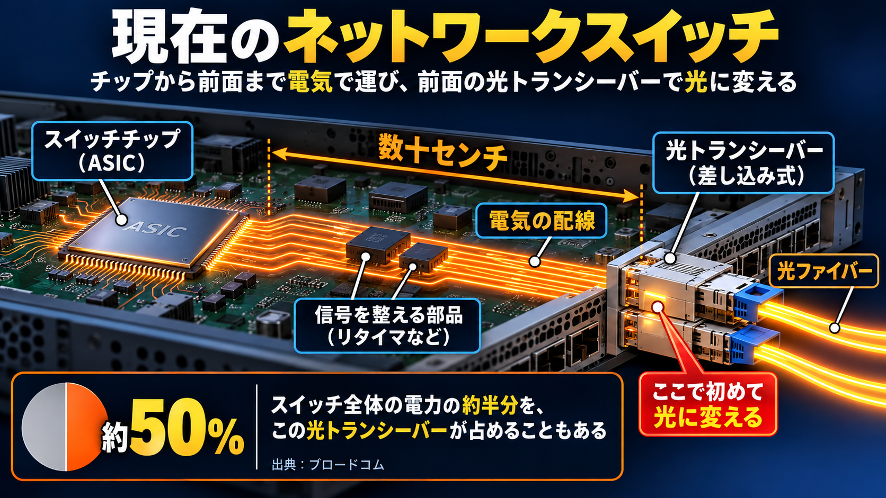

# スライド構成プラン｜光電融合（ユーザー作成画像28枚＋通常スライド287枚＝315枚）

入力：`docs_光電融合/scenario_本文のみ.md`（21,833字・読み上げ約62分）
画像：`docs_光電融合/部材画像/`（1〜28の完成版PNG）＋ `ClaudeCode_光電融合_画像挿入指示書.md`
出力：`スライド/光電融合/光電融合.html` → `.pdf` → `PNG/slide_001.png …`（1920×1080）
作成日：2026-10-05

> **このプランが正本。**先に書いた `ILLUST_PLAN.md`（手書きSVGでイラストを作る計画）は**破棄**する。部材のイラストはユーザーが28枚を完成済みのため、SVGは作らない。

---

## 0. 先に確認した事実（機械チェック済み）

| 項目 | 結果 |
|---|---|
| 画像の枚数 | **28枚すべて実在。欠番なし・番号の重複なし** |
| 画像のサイズ | 1672×941（7番と24番だけ1671×941）。**比率1.777＝16:9** |
| 1280×720への収まり | `object-fit: contain` で**左右0.7pxの余白だけ。切らずに全面**に入る |
| 1920×1080書き出し | テスト済み（`_sample/PNG/slide_01.png`）。**文字は潰れない**（元1672px→1920pxの1.15倍） |
| 指示書の対応文 | 28枚ぶんすべて**台本に実在**。文言の取り違えなし |
| 台本の出現順 | **画像番号の昇順と一致**（19・20を §5-A の案で割り当てた場合） |
| 画像が担当する分量 | **2,708字＝全体の12.4%**。残り19,125字が通常スライド |

---

## 1. 守ること（指示書のルールをそのまま運用に落とす）

- **元画像を加工しない。**トリミング・比率変更・回転・パンズーム・色補正・文字やロゴの追加／削除・上書き保存は一切しない
- **元ファイル（`docs_光電融合/部材画像/`）には書き戻さない。**スライド用には別フォルダへ**連番コピー**（`img01.png`〜`img28.png`）を作る。コピーはバイト単位の複製で、加工ではない。元のファイル名は特殊文字や文字化けを含むため、HTMLからはコピー側の連番名で参照する
- **順番は 1→28 の昇順。**飛ばさない・入れ替えない・同じ番号を2回使わない・番号なしの旧版を使わない
- **画像が無い文章に画像を流用しない。**その区間は通常フォーマットのスライドにする
- **画像に合わせて台本を書き換えない。**食い違いは §5 に挙げて、判断を仰ぐ

---

## 2. 画像スライドの作り方（新しい型 `t-image`）

```css
.t-image{padding:0;background:#0d1626;display:flex;align-items:center;justify-content:center;}
.t-image::after{display:none;}          /* 上のグラデ帯を出さない */
.t-image img{width:100%;height:100%;object-fit:contain;display:block;}
```
```html
<section class="slide t-image"></section>
```

- **ヘッダー帯・フッター帯・上のグラデ線は出さない。**画像の上端に見出しが入っているので、帯をかぶせると隠れる
- `object-fit: contain` なので、どの画像も**切れない・伸びない**
- 画像スライドには文字を足さない（画像の中にすべて入っている）

**通常スライドは、いままでどおり** `keizai-slide` の型（`t-title` `t-section` `t-agenda` `t-text` `t-vs` `t-cards` `t-stats` `t-rank` `t-flow` `t-steps` `t-numline` `t-stack` `t-vbars` `t-prop` `t-fx` `t-metric` `t-closing`）だけで作る。ヘッダーの `sec` ラベル、フッター帯、1枚1ビート、数字は図、チャンネル名は書かない——ここは過去作と同じ。

---

## 3. 枚数（**実績 301枚**。生成済み）

| Section | パート | 本文 | 字数 | 画像 | 枚数 |
|---:|---|---|---:|---|---:|
| ― | `p01_intro` | ① 日本株がさらに上昇するかもしれません | 802 | ― | **12** |
| 1 | `p02_tema` | ② 一度冷めたテーマに、実物が出てきました | 2,278 | 01・02 | **32** |
| 2 | `p03_tsukurikata` | ③ 何が変わり、どう作られるのか | 2,018 | 03〜18 | **26** |
| 3 | `p04_3sha` | ④ 四季報で見る3社 | 3,418 | ― | **45** |
| 4 | `p05_junban` | ⑥ 作る順番で見る、日本の企業の居場所 | 3,380 | 19〜28 | **46** |
| 5 | `p06_eu_china` | ⑦ ヨーロッパと中国 | 878 | ― | **13** |
| 6 | `p07_okane` | ⑤ お金は、日本のデータセンターにもう来ています | 793 | ― | **11** |
| 7 | `p08_meibo` | ⑨ 合流点の2社と、材料の3社、検査の1社 | 4,572 | ― | **64** |
| 8 | `p09_mochikata` | ⑩ 光電融合の株の持ち方 | 2,587 | ― | **34** |
| 9 | `p10_imi` | ⑪ 「AIの次」の、本当の意味 | 1,107 | ― | **18** |
| | | **合計** | **21,833** | **28枚** | **301** |

読み上げ約62分 ÷ 301枚 ＝ **1枚あたり約12.4秒**（TOPIX改革 10.8秒、揺れる日本株 10.4秒、AI半導体2026 14.6秒）。過去作の幅の中。
見積りは315枚だったが、語りのビートを詰めすぎない形にまとめた結果300枚になった。**増やすなら**、⑨（1社あたり10〜11枚）と④（1社あたり13〜14枚）の数字スライドを分けるのがいちばん自然。

**セクション番号**：①は「はじめに」（番号なし）、②＝Section 1 … ⑪＝Section 9。扉は PART n / 9。


### 作ってから直した点（10/5）

1. **画像のパス。**HTMLは `スライド/光電融合/` に出るので、画像も同じ階層の `img/` に置く。`_parts/img/` だと参照が切れて真っ黒のまま書き出される
2. **企業紹介の9枚**（DNP・AGC・三菱電機・古河電工・住友電工・レゾナック・日産化学・デクセリアルズ・アドバンテスト）は `numviz t-metric` に変えて、**社名108px＋証券コード88px**で大きく出す
3. **`t-agenda` は3行まで。**6段階を1枚に入れたら、見出しがヘッダーに食い込み、6行目がCTAバーに隠れた（スキルの既知の落とし穴）。前半・後半の2枚に割った
4. **`t-steps` の `.v` は300px幅・50px。**「約1,000億円」が2行に折れたので44pxに下げた
5. **見出しがヘッダー帯（53px）に食い込む型。**`t-cards`(48px)・`t-vs`(50px)・`t-stats`(58px) は中身が上寄せで padding-top がそのまま開始位置になるため、見出しが帯に重なる。`deck.css` で 74〜76px に上げた（**56枚に効く**）。`t-text`・`t-flow`・`numviz`・`t-agenda`・`t-numline`・`t-steps` は縦中央寄せなので対象外
6. **`t-fx` は必ず `numviz t-fx` で使う。**`t-fx` 単独は padding-top も縦中央寄せも無く、見出しがヘッダーの下に完全に隠れる
7. **`t-fx` の `.c-v`(48px) と `.r-v`(58px) は `white-space:nowrap`。**文字数が多いと横にはみ出す。1枚の合計幅が約1,200pxを超えるなら、インラインで font-size を下げるか `<br>` で折る（slide_196・263がこれに該当）

**レイアウトの点検は、目視だけでなく機械で。**`t-fx` の横幅・`t-flow` のノード合計幅・`t-stats` の `val2` 幅・`t-agenda` の行数は、HTMLから文字幅を見積もって一覧にすると漏れない。

---

## 4. 画像28枚の割り付け（これが連番の順）

秒数は「0.17秒/字」で換算した、その画像を出しっぱなしにする時間。

| # | セクション | 対応文の始まり | 終わり | 字数 | 表示 |
|---:|---|---|---|---:|---:|
| 01 | ② | いまのネットワークスイッチは、 | この部品が占めることもあります。 | 128 | 22秒 |
| 02 | ② | だったら、光に変える場所を | 電気で運ぶ距離を短くします。 | 96 | 16秒 |
| 03 | ③ | スイッチのチップから前面の光トランシーバーまでは、 | この数十センチが、電力と熱の壁です。 | 132 | 22秒 |
| 04 | ③ | さきほどのCPOは、 | 最大で7割減らせると公表しています。 | 170 | 29秒 |
| 05 | ③ | ただし、差し込み式の光トランシーバーが、 | そうはいきません。 | 85 | 14秒 |
| 06 | ③ | だから、光を出す部品だけは外に置いて、 | 交換できるようにする設計もあります。 | 37 | 6秒 |
| 07 | ③ | では、そのCPOは、どう作られるのか。 | 自動車と同じです。 | 125 | 21秒 |
| 08 | ③ | 1つ目は、光を作る流れです。 | 良品だけを次に送ります。 | 264 | **45秒** |
| 09 | ③ | 3つ目は、土台と光の通り道を作る流れです。 | 日本の企業が狙っている作り方です。 | 213 | **36秒** |
| 10 | ③ | 3つの流れが集まったら、仕上げです。 | （同じ1文） | 18 | 3秒 |
| 11 | ③ | 光の向きをそろえるレンズを通して、 | つなぎ口でつなぎます。 | 47 | 8秒 |
| 12 | ③ | ここがいちばん難しいところです。 | ずれただけで漏れます。 | 42 | 7秒 |
| 13 | ③ | だから位置を合わせて、 | 熱と反りから守る。 | 29 | 5秒 |
| 14 | ③ | 完成したスイッチを作るのは、 | ところが、流れの中身は違います。 | 58 | 10秒 |
| 15 | ③ | 光を作る流れには、三菱電機と古河電工。 | 反りを止める材料にレゾナック。 | 76 | 13秒 |
| 16 | ③ | 合流点の光ファイバーの束とつなぎ口には、 | 検査の装置には、アドバンテストです。 | 89 | 15秒 |
| 17 | ③ | その白書に載っているNTTの計画では、 | チップとチップの間を光でつなぐ。 | 99 | 17秒 |
| 18 | ③ | 2032年度以降に、 | 2029年度ごろが目標です。 | 48 | 8秒 |
| 19 | ⑥-2 | しかも、CPOの検査は難しくなります。 | チップを切り出す前の段階から、 | 65 | 11秒 |
| 20 | ⑥-2 | 完成したパッケージまで、 | 何度も測ります。 | 20 | 3秒 |
| 21 | ⑥-3 | いまの樹脂の土台は、 | 電気より光のほうが深刻です。 | 288 | **49秒** |
| 22 | ⑥-4 | AGCは、この通り道を2種類持っています。 | オランダの研究機関との共同研究は、このためです。 | 168 | 29秒 |
| 23 | ⑥-4 | ここにも、材料の企業がいます。日産化学です。 | （同じ1文） | 22 | 4秒 |
| 24 | ⑥-4 | AGCやDNPが通り道そのものを作る側なら、 | 材料を納める側です。 | 47 | 8秒 |
| 25 | ⑥-4 | 光の材料は、透明なだけでは足りません。 | この3つを同時に満たす必要があります。 | 55 | 9秒 |
| 26 | ⑥-5 | 組み上げたら、光をチップの外へ出します。 | 次の世代のスイッチまで見据えた部材です。 | 125 | 21秒 |
| 27 | ⑥-5 | 束にした光ファイバーは、つなぎ口でつなぎます。 | たくさんの口を並べられます。 | 78 | 13秒 |
| 28 | ⑥-7 | ただ、ここまで歩いた工程を思い出してください。 | 接着と反り止め。 | 84 | 14秒 |

### 画像が無い区間（＝通常スライド。流用しない）

①全部／②の冒頭と「夏の高値を超えていない理由」「2026年に起きたこと」／③の末尾（「いま製品化が始まったCPOは…まず3社を見ます」）／④全部／⑥-1（古河電工・外部光源・約2,400億円）／⑥-2の入り（アドバンテスト、検品のたとえ、丸ごと無駄になる話）／⑥-5の新光電気工業／⑥-6（接着材と熱と反り）全部／⑦全部／⑤全部／⑨全部／⑩全部／⑪全部。

---

## 5. 決まったこと（10/5 ユーザー回答）

### 使う画像ファイル（重要）

ユーザーが **6・15・22・28 の4枚を作り直した**ため、`部材画像/` にはこの4番だけ**同じ番号のファイルが2つ**ある（初版と修正版）。

| # | 使うファイル | 直った内容 |
|---:|---|---|
| 06 | `6 修正版 外部レーザー光源とCPO光エンジン解説.png` | 光エンジン＝「電気を光に変える部品のまとまり」に修正／下段から「変調器」を削除 |
| 15 | `15 修正版日本企業の光技術サプライチェーン.png` | AGC「光蓄波路」の誤字を修正／デクセリアルズ＝「光の通り道の材料・受光部品」／レゾナックから「CMP・封止材など」を削除 |
| 22 | `22 修正版 光導波路を作る企業比較.png` | DNP＝「光導波路を同じガラスの土台の上にまとめる研究」に修正（製造ではない） |
| 28 | `28 修正版  日本企業が支える光技術サプライチェーン.png` | 9番目を「完成品スイッチ（ブロードコム・NVIDIA）」に修正／下段も「この先が完成品（スイッチ）」 |

**ルール：ファイル名に「修正版」が入っているものを使う。**無い番号は唯一のファイルを使う。
`img/img01〜img28.png` にこの基準でコピー済み（どれを採ったかは `img/SOURCE.txt`）。**画像はHTMLと同じ階層に置く**（`_parts/` の中に置くと、出力HTMLから参照が切れて真っ黒になる）。初版4枚は `部材画像/` にそのまま残してある（消していない）。

> 整理するなら、初版4枚を `部材画像/_旧版/` に移すと番号の重複が消える。**勝手には動かさないので、必要なら指示してください。**

### 直さないと決めたもの（ユーザー「他は直さなくてよい」）

| 箇所 | 状態 | 運用 |
|---|---|---|
| 画像1〜5の「スイッチチップ（ASIC）」 | そのまま | **通常スライドと読み上げは従来どおり「スイッチのチップ」**。ASICは画面にだけ出る |
| 画像10・11「光電融合パッケージ」／画像21「樹脂基板・ガラス基板」／画像25「微細加工」 | そのまま | 通常スライド側は台本の言葉（土台・細かく加工できる）で通す |

### A・C の割り付け（提案どおりで進める）

- **A：**画像19＝「しかも、CPOの検査は難しくなります。…チップを切り出す前の段階から、」／画像20＝「完成したパッケージまで、何度も測ります。」／間の「丸ごと無駄になる」の段落は**画像なしの通常スライド**。これ以外だと昇順が崩れるため
- **C：**22＝AGCの2種類〜オランダの研究／23＝「ここにも、材料の企業がいます。日産化学です。」／24＝「AGCやDNPが通り道そのものを作る側なら、…材料を納める側です。」

### D：部材の説明画像は長く出してよい（ユーザー回答）

画像21（約49秒）・08（約45秒）・09（約36秒）・04・22（各29秒）は、**1枚のまま出しっぱなし**にする。分割しない。

---

## 5-b. 収録前に決める（残り2点）

1. **画像17と台本の食い違い。**台本「2025年度以降に、装置と装置の間を光でつなぐ」／画像17「ボードとボードの間を光でつなぐ（1台の装置の中で）」。画像は直さない方針なので、**HANDOFF §9-7 の裏取り（経産省白書のNTTロードマップ3段階の原文）で決める。**原文が「ボード間」なら台本の1文を画像に合わせる。「装置間」なら画像17だけ作り直す
2. **画像24の「AGC DNP：材料を加工して光導波路を製造」。**画像22はDNPを「研究」に直したので、24だけ「製造」のまま残っている。**24も直すか、そのままでよいか。**（直さない場合、22と24で表記が揃わない）

---

## 6. ファイル構成と作る順番

```
スライド/光電融合/
  PLAN.md                 … このファイル（正本）
  ILLUST_PLAN.md          … 破棄（SVGは作らない）
  img/img01.png … img28.png   … 部材画像/ からの連番コピー（加工しない）
  _parts/
    build.py              … p*.html を結合して本体HTMLを書き出す
    deck.css              … t-image の3行だけ
    p01_intro.html … p10_imi.html
  convert.py
  光電融合.html / .pdf / PNG/slide_001.png …
```

1. §5のA〜Dの回答をもらう
2. `部材画像/` → `_parts/img/` に `img01〜img28.png` でコピー（元は触らない）
3. セクションごとに `p01`〜`p10` を作る。**1応答で1セクション**、作るたびにPNGで確認
4. `build.py` で結合 → `convert.py` で PDF と PNG（315枚）
5. §7の検収を回す

---

## 7. 検収チェックリスト

**画像まわり（指示書 §5 と同じ）**
- [ ] 画像は28枚すべて使われている
- [ ] 登場順が1→28の完全な昇順
- [ ] 飛ばし・重複・旧版の混入がない
- [ ] 元PNG（`部材画像/`）のタイムスタンプとサイズが変わっていない
- [ ] 画像スライドに帯・文字・ロゴを重ねていない
- [ ] クロップ・比率変更・色補正をしていない
- [ ] 対応文の開始でスライドが切り替わり、終わりまで同じ画像が続く
- [ ] 画像が無い区間に画像を流用していない

**デッキまわり（いつもの型）**
- [ ] 通常スライドは `keizai-slide` の型だけで作っている
- [ ] チャンネル名を書いていない（`brand` は空）
- [ ] 数字が出て比較する箇所は図になっている
- [ ] 1スライド＝1ビート、はみ出し・フッター帯との重なりがない
- [ ] 「会社」ではなく「企業」（会社四季報だけ例外）
- [ ] 証券コードは9社それぞれ最初のスライドに1回
- [ ] 株価の図は全社「1月5日→10月2日」で統一
- [ ] 方向を示す矢印や「買い」の文言を入れていない
- [ ] 出さない語（ASIC・Tbps・PIC・EIC・RDL・シリコンフォトニクス・ウエハー／Meta・SENKO・Corning・Marvell・パナソニック・TDK）が通常スライドに無い

> **注意：**画像1・2・3・4・5の中には「ASIC」の文字が入っています。**画像は完成品なので触りません。**通常スライド側では従来どおりASICを使わず「スイッチのチップ」で通します（読み上げも台本どおりASICとは言いません）。
