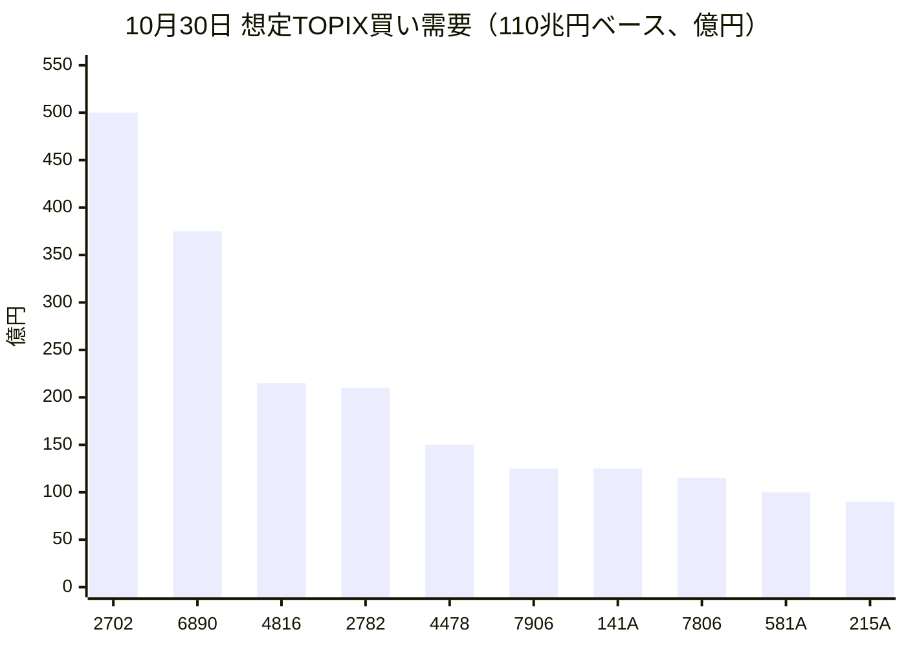
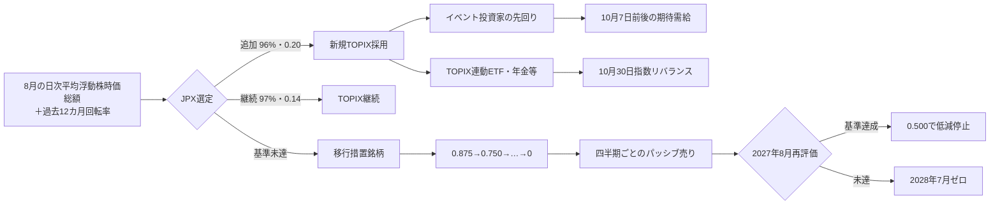
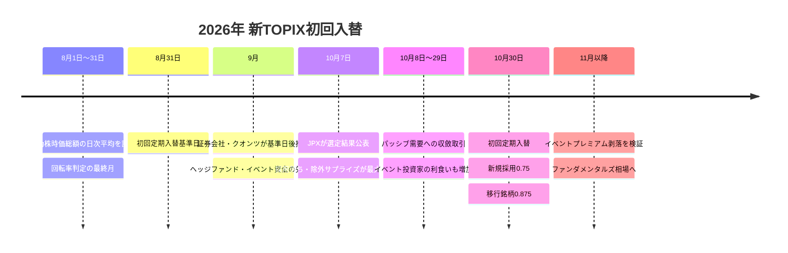

# TOPIX改革「2026年・新TOPIX移行」機関投資家向け分析レポート

## エグゼクティブサマリ

2026年9月24日現在、TOPIX改革は「制度を予想する局面」から、**8月の判定データがほぼ固定され、10月7日のJPX正式公表を待つ局面**へ移った。JPXの新ルールでは、プライム・スタンダード・グロースを横断し、年間売買代金回転率と浮動株時価総額で選別する。追加は回転率0.20以上・累積96％以内、継続は0.14以上・97％以内である。8月31日終値だけではなく、浮動株時価総額は8月中の日次平均、回転率は日次売買代金の中央値を使う。citeturn28view0turn28view3

前回メモの大和証券6月試算「新規約30、除外約740、約930銘柄」は、その後の株価・8月データを受け、9月初めには**新規約35、除外約680、約990銘柄**へ修正された。一方、ニッセイ基礎研究所の6月末試算は958銘柄であり、現時点の合理的レンジは**約960～990、中心値980前後**とみるのが妥当である。fileciteturn0file0 citeturn14search5turn13search11

投資上の最大のポイントは「採用されるか」より、**想定パッシブ需要÷通常売買代金（ADV）**である。JPXが公表するTOPIX連動資産は2024年3月末時点でETF・年金信託等を合わせ約110兆円で、民間では足元を約165兆円とみる推計もある。したがって流動性の薄いスタンダード銘柄では、採用需要が通常売買の10日分を超える可能性がある。一方、すでにヘッジファンドなどの先回り買いが進んでおり、10月7日・30日は「材料出尽くし」のリスクも高い。citeturn1view0turn14search0turn14search11

**現時点で「正式にほぼ確定」した銘柄はゼロ**である。JPX公表は10月7日だからだ。ただし8月判定後の大和証券予想から、日本マクドナルドHD、フェローテック、セリア、東映アニメーション、ヨネックス、GO、トライアルHD、freee、パワーエックス、MTG、タイミー、アストロスケールHD、QDレーザ、Synspective、ティアフォーは有力候補と判断できる。除外では、メドレー、ブロードリーフ、筑波銀行、新日本建設、いちよし証券が9月時点の大和予想で特に有力である。以下ではこの「確率」と「需給インパクト」を分けて評価する。citeturn13search0turn14search11

## 制度変更の時系列とJPX算出要領

TOPIX改革は単なる2026年10月の一回限りの銘柄入替ではなく、2021年から続く「市場区分と指数を切り離す」改革の最終局面である。JPX自身も、TOPIXを市場代表性と投資可能性を備えたベンチマークと位置付け、2022～2025年を第1段階、2026年以降を第2段階としている。citeturn1view0turn1view1

| 時期 | 制度・市場イベント | 機関投資家から見た意味 |
|---|---|---|
| 2021年4月 | TOPIX見直し方針を正式決定 | 「東証1部＝TOPIX」の自動連動を解消する方向が確定。citeturn4search12 |
| 2022年4月 | 東証がプライム・スタンダード・グロースへ市場再編 | 市場区分変更だけでは旧TOPIX銘柄を直ちに排除せず、指数改革を別工程で実施。citeturn4search3 |
| 2022年10月 | 第1段階のウエイト低減開始 | 流通株式時価総額100億円未満などの対象企業について四半期ごとに低減。10月7日に対象銘柄公表。citeturn4search4 |
| 2023年10月 | 第1段階再評価 | 基準改善企業には低減停止措置。企業側に株価・流動性・浮動株改善インセンティブが発生。citeturn4search6 |
| 2024年6月 | 第2段階改革案を意見募集 | プライム限定ではなく全市場区分から流動性で選ぶ案を提示。citeturn1view1 |
| 2024年9月27日 | 第2段階を正式決定 | スタンダード・グロース企業にもTOPIXへの道が開く。citeturn5view1 |
| 2025年1月末 | 第1段階完了 | 約2,200銘柄から約1,700銘柄へ。大和総研によればウエイト低減銘柄はTOPIXを大幅にアンダーパフォーム。citeturn26search9 |
| 2025～2026年 | 親子上場・資本コスト・英文開示等の改革継続 | 指数改革とガバナンス改革が同時進行。citeturn25view0turn23search5 |
| 2026年3月 | 採用候補への先回り取引が顕在化 | Bloombergによればヘッジファンド中心に候補約30銘柄を先回り、国内機関投資家も参加。citeturn14search0 |
| 2026年6月 | 大和証券：約930銘柄を予想 | 新規約30、除外約740。前回メモ作成時の主要前提。citeturn14search5 |
| 2026年8月 | 初回選定の判定月 | 浮動株時価総額は8月の日次平均。回転率は過去12カ月を測定。citeturn28view3 |
| 2026年8月31日 | 定期入替基準日 | 通常の株価変動で初回選定データを変える期間は終了。特殊指定等は別途考慮余地。citeturn28view0 |
| 2026年9月 | 大和：約990、ニッセイ：約958 | 「930」から960～990近辺へ予想が収斂。citeturn13search11turn14search9 |
| 2026年10月7日 | JPX正式公表予定 | 10月第5営業日。採用・継続・移行措置が公式に確定。citeturn28view0 |
| 2026年10月30日 | 初回定期入替 | 新規採用は調整係数0.75、非継続銘柄は移行係数0.875へ。citeturn28view1 |

JPX算出要領の中で、実務上最重要なのは以下である。

> 「定期入替は年に1回、10月最終営業日」

基準日は8月最終営業日、結果は「10月第5営業日」に公表される。2026年なら10月7日が第5営業日、10月30日が最終営業日に当たる。citeturn28view0

選定基準は非常に明快である。

| | 新規追加 | TOPIX継続 |
|---|---:|---:|
| 年間売買代金回転率 | **0.20以上** | **0.14以上** |
| 浮動株時価総額 | **累積96％以内** | **累積97％以内** |

JPX原典の表現では「年間売買代金回転率 0.2以上／0.14以上」「上位96％以内／97％以内」であり、新規採用の方が厳しい。これは指数の不必要な入替を抑制する典型的な**バッファルール**と理解できる。citeturn28view0turn28view1

初回で継続できなかった銘柄も、10月30日にゼロになるわけではない。

| 修正日 | 移行係数 |
|---|---:|
| 2026年10月30日 | 0.875 |
| 2027年1月末 | 0.750 |
| 2027年4月末 | 0.625 |
| 2027年7月末 | 0.500 |
| 2027年10月末 | 0.375 |
| 2028年1月末 | 0.250 |
| 2028年4月末 | 0.125 |
| 2028年7月末 | 0 |

さらに2027年8月末を基準日に再評価し、継続基準を満たせば**0.500で低減が停止する**。ここは重要で、「TOPIXに100％復活」するわけではない。JPXは明確に「0.500を継続適用」と規定している。citeturn28view1

逆に2026年10月の新規採用銘柄は、通常の浮動株比率に**調整係数0.75**を掛けてスタートする。したがって「将来のフルウエイト相当の需要」が10月30日に一度に発生するわけではない。citeturn28view0turn28view1

また2026年11月以降は、プライム・スタンダード・グロースの新規上場企業について、直前の定期入替で累積95％以内となる最低浮動株時価総額を上回れば、翌月末に非定期追加できる仕組みも導入される。つまり2026年改革は単なる既存銘柄の整理ではなく、**大型・高流動性IPOを迅速にTOPIXへ取り込む構造改革**でもある。citeturn28view3

今回の9月1日版メモでは最終銘柄数を900～1,000程度と整理していたが、その後の8月確定データを踏まえると、現在は「930中心」より**960～990、特に980台**をベースケースとした方が適切である。fileciteturn0file0 citeturn13search11turn14search9

## 親子上場・上場ゴールと流動性改革

TOPIX改革と親子上場改革は別制度だが、**経済的にはかなり強く結び付いている**。

東証は2025年2月、親子・持分法関係にある上場企業について、グループ経営、経営資源の適切な配分、少数株主保護を巡り、企業側の対応と国内外投資家の期待にギャップがあるとして「親子上場等に関する投資者の目線」を公表した。citeturn25view0

TOPIX側では親子上場企業を機械的に排除するルールはない。しかし指数の重み・採否は**浮動株時価総額**によって決まる。親会社、創業家、政策保有株主などの安定保有が大きければ市場で投資可能な株式が少なくなり、同じ企業価値でも浮動株時価総額は小さくなる。したがって、これは制度を組み合わせた場合の推論だが、親会社持分が極めて高い上場子会社はTOPIX採用・ウエイト面で相対的に不利になりやすい。citeturn25view0turn28view0

企業にとって取り得る対応は、親会社による完全子会社化だけではない。親会社・大株主による持分売却、政策保有株の解消、株式売出しによる浮動株拡大などでも浮動株時価総額は改善する。ただし売出し直後には供給増で株価が弱含むこともあるため、**短期株価にはマイナス、中長期の指数適格性にはプラス**という二面性がある。

このため新TOPIXは、親子上場問題に対し「禁止する」のではなく、

**親会社の大量保有 → 浮動株が少ない → 指数ウエイト・採用確率が低くなる → 機関投資家アクセスが悪化する**

という市場メカニズムを通じて圧力をかける制度と捉える方が正確である。これはJPXの指数ルールと親子上場に関する投資家目線を組み合わせた分析である。citeturn25view0turn28view0

「上場ゴール」問題にも同様の効果がある。グロース市場では現在、上場10年経過後の時価総額基準は40億円だが、**2030年3月1日以降は上場5年経過後100億円以上**へ引き上げられる。東証自身がグロース市場の高成長企業市場としての機能強化を進めている。citeturn25view1

新TOPIXでは市場区分そのものが採用条件ではないため、成長企業は「プライムへ市場変更しないと主要指数に入れない」という従来型のインセンティブから解放される。GO、タイミー、freee、Synspective、アストロスケールなどが実際に採用候補に挙がっているのは象徴的である。**グロースのままでも、大型化し、株式を十分市場に流通させ、恒常的に取引されれば日本を代表するベンチマークに入れる**。citeturn14search11turn13search2

逆にIPO後に成長が止まり、浮動株が少なく、取引も減った企業は、グロース市場の上場維持基準強化とTOPIXの流動性基準の双方から圧力を受ける。この意味で、今回の改革は「上場すること自体が目的」という上場ゴール問題への市場規律を強める。citeturn25view1

流動性の測り方も重要である。年間売買代金回転率は、単純な年間売買代金÷時価総額ではない。JPXは各月について、

**日次の東証立会売買代金の中央値 × 営業日数 ÷ 月末浮動株時価総額**

を月次回転率とし、それを直近12カ月合計する。citeturn28view3

中央値を使う意味は大きい。一日の巨大ブロック取引や材料発表で売買代金が突然膨らんでも、日常的に取引されていなければ指数適格性を大幅に引き上げにくい。**「一日だけ出来高を作る」より「毎日安定して取引される」ことが重要**なのである。これは機関投資家が実際にポジションを構築・解消できるかというinvestabilityをかなり素直に反映する設計である。citeturn28view3

上場1年未満の銘柄については、上場後に得られた月次回転率を月数で割って12倍する年率換算ルールがある。そのためGO、パワーエックス、ティアフォーなど新しい銘柄でも、十分な売買があれば初回採用の対象になれる。citeturn28view3

浮動株時価総額も8月31日の一点観測ではない。JPX原典は**「定期入替基準日が属する月の日次平均の浮動株時価総額」**を使う。したがって今回なら8月各営業日の指数用株式数×浮動株比率×採用価格の平均が重要であり、8月31日の終値だけを操作してボーダーを越えることはできない。citeturn28view3

これは8月中に大型株が大きく上昇すると、累積96％・97％の分母と上位銘柄の比率が膨らみ、下位企業が締め出されやすくなることも意味する。ニッセイ基礎研究所は、大型株の相対上昇が新TOPIXの銘柄数を当初予想より少なくする要因と分析し、6月末で継続924、新規34、除外713、計958と試算している。citeturn13search11

## 機関投資家需給と海外マネーのシナリオ

JPXによれば、TOPIXにはETF・投信・年金信託など**約110兆円**が連動している。これは2024年3月末時点の公式値であり、現在の株価上昇を反映した最新額ではない。民間では2026年時点を約165兆円とする推計もあるため、本レポートでは**110兆円を保守的な基準ケース、165兆円を上方感応度ケース**として扱う。citeturn1view0turn14search11

新規採用銘柄についての簡易需要モデルは、

\[
\text{TOPIX買い需要}_i
\approx
\text{TOPIX連動AUM}
\times
\frac{0.75 \times \text{浮動株時価総額}_i}
{\text{TOPIX全体の投資可能時価総額}}
\]

である。

0.75はJPXの初回追加時の調整係数である。実際にはファンドごとの完全複製・サンプリング、先物利用、事前売買などがあるため、110兆円が10月30日引けにそのまま現物注文として出るわけではない。したがって以下の金額は**指数理論需要の目安**であり、約±30～40％の誤差を想定すべきである。0.75という係数自体はJPX公式ルールである。citeturn28view0turn28view1

さらに実務的なのが、

\[
\text{需給日数}
=
\frac{\text{想定パッシブ需要}}{\text{通常1日平均売買代金}}
\]

である。

100億円の買い需要でもADVが100億円なら1日分だが、ADVが5億円なら20日分である。後者の方が価格弾力性ははるかに大きい。前回メモで示した「買い需要÷売買代金」という考え方は、現在でも最重要指標である。fileciteturn0file0

本レポートの110兆円ベースのモデルでは、15銘柄だけでも数千億円規模の指数需要が生じ得る。民間推計165兆円を使用する場合、下表・グラフの需要金額を概ね**1.5倍**するのが感応度の目安となる。citeturn1view0turn14search11

**想定TOPIX買い需要・上位候補のモデル中央値**

これは証券会社の公式フロー予測ではなく、公開時価総額・浮動株比率の概算、JPXの0.75係数、110兆円AUMを使った**本レポート独自の感応度モデル**である。特に正確な浮動株比率はJPXの指数用値と一般サイトの「流通株」概念が一致しないため、売買執行判断にはJPX/J-Quants等で再計算すべきである。JPXは公式の月間相場表で個別銘柄の売買高・売買代金を掲載している。citeturn19view0

海外投資家については、TOPIX連動110兆円のうち「海外資金が何兆円」とJPXは開示していない。この点は**34.7％という外国人保有比率と混同してはいけない**。2025年度の株式分布状況調査では外国法人等の日本株保有比率は34.7％と過去最高となったが、これは日本株全体のストックであり、TOPIXパッシブAUMの地域別シェアではない。citeturn24search2turn24search1

ただ、海外投資家が今回のTOPIX改革を積極的に取引する理由は明確である。

まず、指数の投資可能性が高まる。低流動性の多数の小型株を減らし、取引可能な大型・中型株に集中させれば、グローバル運用会社から見てトラッキング・ポートフォリオを構築しやすい。これはJPXが改革理由として掲げる「市場代表性」と「投資可能性」の強化そのものである。citeturn1view0

次に、資本効率・ガバナンス改革と方向性が一致する。親子上場、政策保有株、少数株主保護、資本コストを意識した経営などへの東証の働きかけと、浮動株・流動性を要求するTOPIX改革は、海外機関投資家から見ると一つの改革パッケージとして評価しやすい。citeturn25view0

情報面の障壁も低下している。プライム市場では2025年4月から決算短信・適時開示の原則同時英文開示が進み、2025年末時点でIR説明会資料の英文開示率は87.1％、株主総会招集通知等は94.9％に達した。これは海外アクティブ資金にとって日本株の調査コストを下げる。citeturn23search5

また外国法人等の保有比率が34.7％と過去最高になっていることから、指数変更で新たにベンチマーク入りする銘柄は、これまで海外投資家の調査対象外だったスタンダード・グロース企業にも国際的なスクリーニング資金が入る契機になり得る。citeturn24search2turn24search9

ただし、この35％前後をTOPIXパッシブ需要にそのまま掛けるのは誤りである。あえてストレステストとして「指数・イベント需要の35％が海外投資家由来」と仮定した場合、本レポートの新規採用合計需要0.4～0.7兆円に対して、**海外由来の潜在フローは0.14～0.25兆円程度**となる。この35％は公表値ではなく、外国人保有比率を使ったシナリオ仮定である。citeturn24search2

短期の株価シナリオは三つに分けて考えるべきだ。

**強気シナリオ**では、採用確度が高く、需要がADVの10～20日分、かつ9月までの織り込みが小さい銘柄に海外イベントドリブン＋国内パッシブの買いが集中する。この場合、10月7日前後から30日にかけて二桁％の追加上昇も理論上十分あり得る。ただしこれはシナリオであり株価予測ではない。

**ベースシナリオ**では、採用候補はすでに3～8月に先回りされている。Bloombergも3月段階でヘッジファンド中心の先回りを報じており、この場合10月7日の正式採用で上昇した後、30日の実需要を前にイベント投資家が売却する「buy the rumor, sell the fact」が起こりやすい。citeturn14search0

**弱気シナリオ**では、世界的リスクオフ、円高、決算悪化、採用落ちなどがTOPIX需給を上回る。TOPIX採用は企業の利益・キャッシュフロー自体を増やさないため、指数イベントだけでバリュエーションが恒久的に上がると考えるべきではない。長期のリレーティングにはEPS、ROE、資本配分、成長率の改善が必要である。野村證券も2026～28年のTOPIX上昇シナリオの中心をEPS拡大・株式数減少等に置いている。citeturn13search4

需給の構造は以下のようになる。

制度部分はJPX算出要領に基づく。citeturn28view0turn28view1turn28view3

## 採用・除外候補のスクリーニング

ここではユーザーの「各15社」を、**新規採用候補15社＋除外候補15社＝合計30社**と解釈する。10業態それぞれ15社、すなわち300社を意味するとは解釈しない。理由は、公開されている最新の主要証券予想でも新規候補自体が約35社だからである。citeturn13search0turn14search9

また重要な前提として、**9月24日時点で「ほぼ確定」というのは統計的な表現であり、公式確定ではない。** JPXの公式確定日は10月7日である。citeturn28view0

採用候補15社は、8月基準日通過後の大和証券の9月予想で名前が挙がった企業を中心にする。大和は約35社の新規採用を予想しており、スタンダードでは日本マクドナルド、フェローテック、セリア、東映アニメーション、ヨネックスなど、グロースではGO、トライアル、freee、パワーエックス、MTG、タイミー、アストロスケール、QDレーザ、Synspective、ティアフォーなどを候補とした。citeturn14search11turn13search2

**表中の需要・ADVはすべて概算レンジ。** 「8月位置」は実際のJPX内部ランキングではなく、証券会社の基準日後予想と公開時価総額から「余裕／線内／境界」を推定したもの。「推奨」は10月イベントだけを対象とする戦術判断で、企業の12カ月目標株価ではない。GOやその他IPO後1年未満銘柄については回転率が年率換算される。citeturn28view3

| 業態 | コード | 社名 | 採用確度 | 理由・8月位置・織込み | 10/30想定TOPIX買い | 通常ADV概算 | 需給日数 | アクション |
|---|---:|---|---|---|---:|---:|---:|---|
| 外食・食品 | 2702 | 日本マクドナルドHD | **高** | FFMC大、回転率十分、96％線内余裕と推定。候補として長期間周知され織込み高 | **450～550億円** | 40～45億円 | 10～13日 | **様子見** |
| 半導体・電機 | 6890 | フェローテックHD | **高** | FFMC・回転率とも余裕。6月・9月双方で有力。先回り高 | **330～420億円** | 80～100億円 | 3～5日 | **様子見** |
| 小売 | 2782 | セリア | **高** | FFMC大、回転率十分、96％線内余裕。株価先回り大 | **180～240億円** | 12～16億円 | 12～18日 | **様子見** |
| コンテンツ | 4816 | 東映アニメーション | **高** | 大型、流動性改善、96％線内推定。ADV比需要が大きい | **180～250億円** | 10～15億円 | 13～22日 | **買い** |
| スポーツ用品 | 7906 | ヨネックス | **高** | FFMC十分、回転率良好。8月後半株価調整で織込み相対的に低い | **100～150億円** | 6～10億円 | 10～20日 | **買い** |
| モビリティソフト | 581A | GO | **高** | 大型IPO、回転率極めて高い。上場期間短いため年率換算。8月線内推定 | **80～120億円** | 100～140億円 | 1日未満 | **様子見** |
| 小売・流通 | 141A | トライアルHD | **高** | FFMC大、売買活発。6月から一貫候補。需要/ADVも大きい | **100～150億円** | 15～25億円 | 5～9日 | **買い** |
| SaaS | 4478 | freee | **高** | FFMC・回転率とも基準クリア推定。グロース大型株 | **120～180億円** | 25～40億円 | 3～7日 | **買い** |
| 蓄電池・電力 | 485A | パワーエックス | **高～中** | 回転率非常に高い一方、IPO後でFFMC推定誤差大。96％線内推定 | **60～100億円** | 20～40億円 | 2～4日 | **様子見** |
| 美容・消費財 | 7806 | MTG | **高** | 時価総額・回転率が十分。8月まで株価上昇し織込み高 | **90～140億円** | 15～30億円 | 4～7日 | **様子見** |
| 人材サービス | 215A | タイミー | **高** | グロース大型・高回転率。イベント認知度高い | **70～110億円** | 30～50億円 | 1.5～3日 | **様子見** |
| 宇宙 | 186A | アストロスケールHD | **高** | 高回転率、6月から継続候補。8月の先回り上昇が大きい | **60～100億円** | 20～40億円 | 2～4日 | **様子見** |
| 半導体・光学 | 6613 | QDレーザ | **中** | 回転率は十分だがFFMCが他候補より小さく96％線への余裕小 | **50～80億円** | 10～20億円 | 3～6日 | **様子見** |
| 宇宙・衛星 | 290A | Synspective | **高～中** | 売買活発、6月から継続候補。8月に株価上昇し織込み高 | **60～100億円** | 20～40億円 | 2～4日 | **様子見** |
| 自動運転ソフト | 593A | ティアフォー | **中** | 新規上場で年率換算、回転率高。FFMCの96％位置は相対的に境界寄り | **50～90億円** | 20～35億円 | 2～4日 | **様子見** |

個別市場データの参考として、日本マクドナルドは直近平均出来高約53万株、フェローテックは約109万株とされ、フェローテックの9月株価9,000円前後なら100億円近いADVになる。GOも直近平均出来高が数百万株規模で、マクドナルドやセリアより指数買いの「日数インパクト」は小さくなる。citeturn20search3turn20search0turn21search0turn21search10

セリアは8月後半に20～40万株程度、東映アニメーションも概ね数十万株程度の取引が多く、絶対的な新規買い金額以上に流動性との比率が重要である。citeturn21search1turn20search1

**私がこの15社で最も需給妙味を感じるのは、絶対買い需要が最大の日本マクドナルドではなく、東映アニメーション、ヨネックス、トライアルである。** 理由は、マクドナルドは候補認知があまりに高く、3月以前から先回り対象だった一方、これらは需要/ADVが大きい割に価格調整または相対的な織込み余地が残る可能性があるからである。これはイベント需給に限定した判断である。候補群への先回りは3月時点ですでに観測されている。citeturn14search0

除外側についてはさらに注意が必要である。9月2日の大和予想で明示された「浮動株時価総額の大きい除外候補」は、**メドレー、ブロードリーフ、筑波銀行、新日本建設、いちよし証券**である。この5社は基準日通過後の予想であるため、現状で最も「ほぼ確定」に近いグループとみる。citeturn13search0

6月時点ではRYODEN、三洋化成工業、ジェイ・エス・ビー、レイズネクスト、淺沼組が除外候補として挙がっていた。これらは基準日前予想なので9月の5社より確度を一段下げる。citeturn14search5

残り5社は「ほぼ確定」とは呼ばず、7月時点で浮動株時価総額約617～695億円に位置していた**ボーダー観察銘柄**を採用した。青山商事、リケンNPR、三ツ星ベルト、三愛オブリ、MIXIであり、8月の株価次第では残留している可能性が十分ある。citeturn27view0

| 業態 | コード | 社名 | 除外確度 | 理由・8月位置・織込み | 10/30初回売り概算 | 通常ADV概算 | アクション |
|---|---:|---|---|---|---:|---:|---|
| 医療・DX | 4480 | メドレー | **高** | 8月基準日後の大和除外候補。97％線外推計 | ▲10～15億円 | 15～25億円 | **様子見** |
| ソフトウェア | 3673 | ブロードリーフ | **高** | 基準日後の大和候補。FFMCが継続線に不足推計 | ▲8～12億円 | 3～6億円 | **売り** |
| 銀行 | 8338 | 筑波銀行 | **高** | 基準日後の大和候補。小型金融でFFMC制約 | ▲7～10億円 | 3～6億円 | **売り** |
| 建設 | 1879 | 新日本建設 | **高** | 基準日後の大和候補。FFMC97％線外推計 | ▲8～12億円 | 3～6億円 | **様子見** |
| 証券 | 8624 | いちよし証券 | **高** | 基準日後の大和候補。境界付近だが除外予想 | ▲6～9億円 | 2～4億円 | **売り** |
| 商社・電機 | 8084 | RYODEN | **中** | 6月大和除外候補。8月結果未確認 | ▲7～11億円 | 2～4億円 | **売り** |
| 化学 | 4471 | 三洋化成工業 | **中** | 6月大和候補。事業規模に対し浮動株が課題 | ▲8～12億円 | 2～5億円 | **様子見** |
| 不動産・学生住宅 | 3480 | ジェイ・エス・ビー | **中** | 6月大和候補。ADVが薄く指数売りの価格影響大 | ▲4～8億円 | 1～3億円 | **買い※** |
| プラント・建設 | 6379 | レイズネクスト | **中** | 6月大和候補。FFMC97％線リスク | ▲7～11億円 | 2～4億円 | **様子見** |
| 建設 | 1852 | 淺沼組 | **中** | 6月大和候補。FFMC・流動性ともボーダー | ▲6～10億円 | 2～5億円 | **様子見** |
| 小売 | 8219 | 青山商事 | **低～中** | 7/3時点FFMC約617億円、典型的ボーダー | ▲約9億円 | 5～10億円 | **様子見** |
| 自動車部品・機械 | 6209 | リケンNPR | **低～中** | FFMC約618億円で当落線 | ▲約9億円 | 2～5億円 | **様子見** |
| 機械部品 | 5192 | 三ツ星ベルト | **低** | FFMC約683億円、当落線上だが余裕やや大 | ▲約10億円 | 3～6億円 | **様子見** |
| エネルギー商社 | 8097 | 三愛オブリ | **低～中** | FFMC約656億円、7月時点ボーダー | ▲約10億円 | 3～6億円 | **様子見** |
| ネット・サービス | 2121 | MIXI | **低～中** | FFMC約627億円、浮動株比率35％が指数上の弱点 | ▲約10億円 | 8～15億円 | **様子見** |

後半5社の浮動株時価総額は7月3日時点の公開推計であり、8月平均では変化している。したがって「高」グループと同列に扱ってはいけない。citeturn27view0

除外側の「10月30日売り」が意外に小さく見えるのは、係数が1.0から0.875へ下がるだけだからである。初回は現在の指数保有量の**12.5％分**しか減らない。しかし再評価に失敗すれば四半期ごとに同程度の売却が繰り返され、2028年7月にゼロとなる。したがって除外銘柄の問題は「10月30日の一発売り」より**約2年間のオーバーハング**である。citeturn28view1

これは第1段階でも実証的に重要だった。大和総研によれば、2022～25年に段階的ウエイト低減の対象となった銘柄群は、低減の進行とともにTOPIXを大幅にアンダーパフォームした。citeturn26search9

したがって「良い企業なのにTOPIX除外で売られた株」を狙う際も、**正式発表直後に即買いする戦略は薦めにくい**。

特に候補として面白いのは、ジェイ・エス・ビー、新日本建設、三洋化成工業、メドレーなどである。ここで「良い」は指数適格性ではなく、事業価値・財務・成長性を別途評価できる可能性があるという意味であり、除外候補であること自体は企業価値の否定ではない。

実務上は、

**10月7日正式除外確認 → 初期の失望売りを観察 → 10月30日の初回指数売り → 決算・還元策を再評価 → 指数需給を除いた妥当価値との乖離が十分なら分割買い**

の順が合理的である。

例えば、想定指数売りが通常ADVの3～5日分あるにもかかわらず、業績予想・FCF・配当方針に変化がなく株価だけ15～20％下がった場合、イベントドリブンのロング候補になる。一方、除外＋業績下方修正＋大株主売却が同時に起きるケースは「安くなった」という理由だけで買うべきではない。

## 公表から入替までのイベント戦略

9月24日現在、最も重要なのは「基準日はもう過ぎている」という点である。通常の判定データは固定され、投資家は10月7日の答え合わせに向けてポジションを作る局面に入った。citeturn28view0turn28view3

制度日程はJPX算出要領による。citeturn28view0turn28view1

**個別株買い派**については、9月24日から10月6日は「候補を全部買う」時期ではない。候補への先回りは3月から始まっており、8月にはアストロスケールやSynspectiveなどが大幅上昇した週もあった。したがって「採用確度 × 需給日数 × 織込み度」でスコアリングする必要がある。citeturn14search0turn14search10

私ならイベント専用ポートフォリオでは、**需給日数5日未満で織込みが高い株は原則追わず、10日超かつ株価が8月高値から調整しているものを優先**する。したがってマクドナルドは採用確率は高くても新規エントリーの期待値は必ずしも最高ではなく、ヨネックス、東映アニメーション、トライアルなどの方が需給対ADVの歪みを取りやすいと考える。

10月7日は「採用」という事実より**市場予想との差**を見る。高確率銘柄の採用はニュース価値が小さい。高確率銘柄が落ちること、あるいはボーダー銘柄が入ることの方が価格インパクトが大きい。

10月8～29日は、買い需要÷残存日数を日次で監視する。例えば予想需要200億円、ADV10億円なら20日分だが、10月7日までに株価が20％上昇してADVも30億円へ膨らめば、実質的な需給インパクトは大幅に低下する。

10月30日はパッシブフローそのものより、**イベント投資家の出口**が重要になる。採用銘柄を何カ月も前から買っていたファンドは、指数ファンドが強制的に買う10月30日の引けを流動性供給の場として利用できる。そのため「最大の買い需要が出る日＝最大上昇日」とは限らない。3月からすでに先回り取引が観測されていることが、そのリスクを高めている。citeturn14search0

リスク管理では、イベントバケットを長期ポートフォリオと切り離すべきである。一銘柄の採用落ちでポートフォリオ全体を毀損しないサイズにし、特にグロース銘柄ではTOPIXイベントと決算・ロックアップ・公募売出しなどの別需給を分離して考える必要がある。

**インデックス・ETF買い派**は、基本的にTOPIX改革を理由に売買回転を上げる必要はない。TOPIX ETF・TOPIX連動投信は指数変更をファンド側が処理するため、投資家自身が35銘柄を買い、680銘柄を売る必要はない。JPXでは2026年9月にも新しいTOPIX連動ETFが上場しており、商品選択肢は拡大している。citeturn15search6

インデックス投資家にとって重要なのは「改革前か改革後か」より、信託報酬、売買スプレッド、追跡誤差、税口座である。10月30日前後にはファンド側で大規模リバランスが発生するため、一時的にトラッキング差が通常より動く可能性はあるが、長期投資家がその1日をタイミング売買するメリットは小さい。

むしろ積み立て派であれば、一括でイベントを当てにいくより、9月・10月・11月に分割してTOPIX ETF・投信を購入する方が、「10月7日サプライズ」「10月30日材料出尽くし」「世界市場のリスクオフ」を同時に回避しやすい。

税制面では、通常の課税口座では上場株式の配当等には20.315％の税率が適用される。売買益も通常は上場株式等の申告分離課税体系で扱われるため、イベント売買では税引後リターンを見る必要がある。citeturn26search6

NISAでは、つみたて投資枠120万円＋成長投資枠240万円で年間最大360万円、非課税保有限度額は1,800万円、そのうち成長投資枠は1,200万円である。売却した簿価分の総枠は翌年以降再利用できる。したがって、数週間のTOPIXイベントトレードでNISAの成長投資枠を大量消費するより、長期保有の確信がある銘柄・ETFに使う方が制度との整合性は高い。citeturn23search10

手数料については「売買手数料ゼロ」だけを見ない方がよい。特に流動性の低いスタンダード・グロース株では、**ビッド・アスクスプレッドと自分の注文によるマーケットインパクト**の方が証券会社の明示手数料より大きくなる場合がある。その意味でも成行で採用発表直後を追うより、指値・分割執行の方が合理的である。

## 初心者向けQ&Aと具体アクションプラン

**Q：10月7日にTOPIX採用が発表された株をすぐ買えばよいのか。**

基本的には違う。採用候補への先回りは3月から始まっている。正式発表時点では「期待」が何カ月も株価に入っている銘柄がある。重要なのは採用そのものではなく、**採用確率に対して株価がどれだけ織り込んでいるか**である。citeturn14search0

**Q：TOPIXから除外されると上場廃止になるのか。**

ならない。TOPIXという指数から外れるだけで、東証上場そのものとは別である。しかも今回の非継続銘柄は10月30日に即除外されず、0.875から四半期ごとに段階的にウエイトを落とし、再評価に失敗した場合に2028年7月にゼロになる。citeturn28view1

**Q：8月31日の株価を見れば採用・除外が分かるのか。**

不十分である。浮動株時価総額は8月の日次平均、年間売買代金回転率は過去12カ月の各月について「日次立会売買代金の中央値」を使う。そのため8月31日終値だけでは再現できない。citeturn28view3

**Q：除外銘柄は全部売るべきか。**

インデックス運用ならルールに従うが、アクティブ運用ならそうとは限らない。第1段階では除外・低減銘柄がアンダーパフォームしたため、短中期のオーバーハングを軽視すべきではない。一方、企業価値は変わらず指数売りだけで価格が大幅下落した場合、長期投資家には逆張り機会になる。citeturn26search9

**Q：「良い企業なのにTOPIXから外れる株」で最も重要なことは何か。**

「安くなったか」ではなく、**指数売りを除いた適正価値との差**を見ることである。除外後も営業利益・FCF・ROIC・財務・配当成長が維持され、かつ指数売りがADV数日分以上ある銘柄を優先する。逆に業績も悪化している株は、TOPIX売りが株価下落の「原因」ではなく単なる追加要因にすぎない。

**Q：2027年に基準を回復したら元のTOPIXウエイトに戻るのか。**

戻らない。初回非継続銘柄が2027年8月の再評価で継続基準を満たした場合、低減が**0.500で止まる**だけである。これは今回の改革で誤解されやすいポイントである。citeturn28view1

**Q：TOPIX ETFを持っている人は何をすればよいか。**

長期投資なら基本は保有継続でよい。指数運用会社が自動的に構成を変更するからである。今後のTOPIXは全市場区分から投資可能性の高い企業を選ぶ指数へ変わるため、従来より「市場区分の名簿」に近い性格が弱まり、「投資可能な日本株ポートフォリオ」に近づく。citeturn1view0turn28view0

**実務アクションを日付順に圧縮すると、次のようになる。**

| 時期 | 個別株派 | TOPIX ETF・投信派 |
|---|---|---|
| **9月24日～10月6日** | 高確率候補を追いかけず、需要/ADVと織込み度を計測。ヨネックス・東映アニメ・トライアル等の押し目を優先 | 通常積立を継続。イベント狙いの一括買いは不要 |
| **10月7日** | JPX結果と市場予想との差を取引。「予想外の採用」が最重要 | 基本何もしない |
| **10月8～29日** | 想定パッシブ需要÷残存ADVを毎日更新。急騰銘柄は一部利食い | 分割積立なら通常通り |
| **10月30日** | パッシブ買いをイベント投資家の出口と考える。成行追随を避ける | ファンドにリバランスを任せる |
| **11月～年末** | 採用プレミアムが剥落しても業績が良い銘柄を再評価。除外良品の逆張り探索開始 | 改革後の構成を気にせず長期保有 |
| **2027年1～8月** | 除外候補の四半期売りと企業の浮動株・還元対策を監視 | 原則継続 |
| **2027年8～10月** | 非継続銘柄の「敗者復活」候補を再スクリーニング | 原則継続 |

私の現時点の優先順位を端的に示すと、**新規採用イベントでは「採用確度」より「需要/ADV」を重視し、東映アニメーション・ヨネックス・トライアルを上位観察。マクドナルド・フェローテックは採用確度は高いが先回りを警戒。GO・タイミーなど高流動性グロースは採用しても需給日数が短いためイベント単独では追わない。除外側ではメドレー、ジェイ・エス・ビー、新日本建設、三洋化成などを“売られ過ぎ後の再評価候補”として監視する**、という戦略になる。

なお、これは「今買えば上がる銘柄ランキング」ではない。10月7日に公式採否が判明すれば、採用確率という不確実性が消えるため、最適ポートフォリオは大きく変わる。現時点では、候補株に最大ポジションを置くより、**10月7日のサプライズに資金を残しておくこと自体がオプション価値**を持つ。

今回の改革をより長期に見ると、最大の意味は35銘柄の新規採用ではない。低流動性・固定株主比率が高い企業に対して、**「浮動株を増やす、親子・政策保有関係を見直す、株主還元とIRを強化する、企業価値を上げる」ことが主要インデックスへのアクセス条件になる**ことである。親子上場問題、上場ゴール問題、資本コスト改革、英文開示、グロース市場改革がTOPIX改革と同じ方向を向き始めている。citeturn25view0turn25view1turn23search5

その意味で、短期的には「約0.5兆円前後の入替需給イベント」でも、中長期には**日本企業の資本構成と株主構成を変える市場制度改革**として見る方が重要である。第1段階で低減銘柄に明確な相対劣後が起きた以上、経営陣にとってTOPIX残留は単なる名誉ではなく資本市場アクセスの問題になった。citeturn26search9

**主要一次・準一次情報URL**

| 情報 | URL |
|---|---|
| JPX「TOPIX等の見直し」 | https://www.jpx.co.jp/markets/indices/revisions-indices/ |
| JPX「TOPIXの見直し（第2段階）」 | https://www.jpx.co.jp/markets/indices/revisions-indices/02.html |
| JPX「東証指数算出要領 TOPIX編」 | https://www.jpx.co.jp/markets/indices/line-up/files/cal2_30_topix.pdf |
| JPX「親子上場等に関する投資者の目線」 | https://www.jpx.co.jp/news/1020/20250204-01.html |
| JPX「グロース市場 上場維持基準」 | https://www.jpx.co.jp/equities/listing/continue/outline/03.html |
| JPX「株式分布状況調査」 | https://www.jpx.co.jp/markets/statistics-equities/examination/01.html |
| JPX「月間相場表」 | https://www.jpx.co.jp/markets/statistics-equities/price/ |
| 大和証券予想を報じた6月記事 | https://news.livedoor.com/article/detail/31577303/ |
| 大和証券の9月基準日後予想（MINKABU） | https://minkabu.jp/news/4609825 |
| Bloomberg「TOPIX改革の先回り」 | https://www.bloomberg.com/jp/news/articles/2026-03-04/TAPNU0T96OSG00 |
| 金融庁 NISA | https://www.fsa.go.jp/policy/nisa2/know/ |
| 国税庁 上場株式等の配当課税 | https://www.keisan.nta.go.jp/r7yokuaru_sp/cat2/cat21/cat215/scid1548.html |

これらのうち、**制度・基準・日程についてはJPX原典を最優先し、証券会社・シンクタンクの数字は採用・除外を予測するための推計値としてのみ扱う**のが、10月7日までは最も安全な読み方である。citeturn28view0turn28view1turn28view3