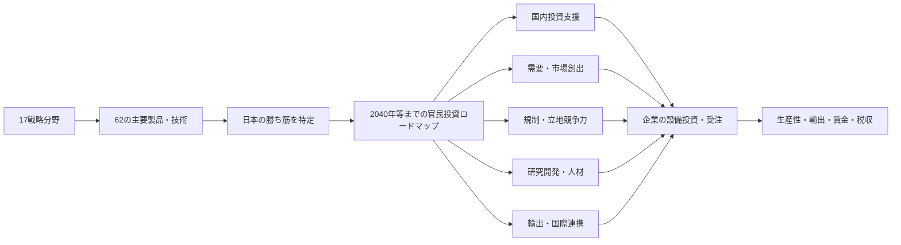

# 日本成長戦略「エネルギー・ゲーム／コンテンツ・防衛」投資家向け徹底分析

## エグゼクティブサマリー

2026年の日本成長戦略を機関投資家の目線で読むと、最大の変化は、政府が単に「GX、コンテンツ、防衛を育成する」と理念を掲げる段階から、**17戦略分野・62の主要製品／技術まで落とし込み、2040年度までを中心に官民で累計370兆円超の投資を引き出すロードマップを示したこと**にある。高市政権は2026年7月21日に日本成長戦略と「骨太方針2026」を取りまとめ、骨太方針自体を「責任ある積極財政元年」と位置付けている。citeturn0search20turn0search8turn0search11turn29search1

指定PDF「日本成長戦略」は以下である。  
https://www.cas.go.jp/jp/seisaku/nipponseichosenryaku/pdf/jgs2026.pdf  
政府資料では、17戦略分野ごとに「日本の勝ち筋」を定め、国内投資支援、需要・市場創出、立地競争力、国際連携、人材、研究開発まで含めた政策パッケージと官民投資ロードマップを構築する考え方が明示されている。citeturn9search1turn5view0

今回取り上げる3分野は、性格がかなり異なる。

| 分野 | 政策上の本質 | 官民投資ロードマップで特に大きい項目 | 投資家から見た核心 |
|---|---|---:|---|
| エネルギー／GX | 電力供給力・脱炭素・経済安全保障を同時に解くインフラ投資 | 次世代太陽電池4.1兆円、水素等6.2兆円、洋上風力5.1兆円、次世代革新炉5.0兆円など | **需要減少産業から、AI・DC・半導体による需要増加産業へのレジーム転換** |
| ゲーム／コンテンツ | 日本が既に世界的競争力を持つIPを輸出産業へ転換 | ゲーム24.5兆円、アニメ3.3兆円、漫画1.6兆円、音楽3.0兆円、実写1.3兆円＝機械的合計33.7兆円 | **設備産業ではなく高ROIC型の無形資産輸出産業** |
| 防衛 | 安全保障と産業政策を一体化 | 小型無人機0.4兆円、デュアルユース4.3兆円、艦艇は2026年度約0.34兆円 | **予算の長期可視性が劇的に改善した受注産業** |

投資額は単純比較できない。例えばコンテンツは2033年度、防衛・GXの多くは2040年度を終期とし、艦艇は単年度予算である。また、GXのグリーンスチール等は「マテリアル」と重複し得る。したがって「コンテンツ33.7兆円、エネルギー24.6兆円、防衛約4.7兆円だから、政府がコンテンツに防衛の7倍を支出する」という理解は誤りである。**これは政府支出額ではなく、民間投資を含む官民投資の目線であり、集計期間・定義も異なる。** citeturn5view0turn8view0

投資判断として最も重要なのは、3テーマを同じ「国策株」と一括りにしないことだ。

**エネルギーは「需要増 × 供給制約 × 更新投資」、ゲーム／IPは「海外売上 × 高粗利ライセンス × デジタル流通」、防衛は「国家予算 × バックログ × 生産能力拡張」が利益ドライバーである。**

2015年末から2025年末までの統一した10暦年で見ると、今回選んだゲーム／IP10社の単純等金額・年次リバランス型バスケットは約**5.39倍、年率約18.3%**となり、同期間の日経平均約**2.64倍、年率約10.2%**を大幅に上回った。もっとも、全銘柄が勝ったわけではなく、カプコン約8.5倍、任天堂約6.75倍、コナミ約6.18倍に対し、スクウェア・エニックスは約0.78倍だった。つまり「日本コンテンツなら何でも買い」ではなく、**IPを長期間反復収益化できる企業と、ヒット依存企業との格差**が極めて大きい。株価データは配当を含まない価格リターンであり、CompaniesMarketCapの年次データと日経指数データから再構成した。citeturn23view3turn32search0turn30search0turn31search1turn31search2turn33search0turn33search1turn33search3turn34search0turn32search1turn27search3

**図表出典:** CompaniesMarketCap各社年次株価リターン、日経平均はNikkei Indexes/Macrotrends。2015年末=100、配当除外。2026年は一部銘柄で株式分割によるデータ系列の非連続があるため、厳密な横比較は2025年末までとした。日経平均そのものは2026年8月14日に68,713.80円で引けている。citeturn28search3turn28search7

## 日本成長戦略はなぜこれまでよりインパクトが大きいのか

### 岸田・石破路線から「産業別キャッシュフローの可視化」へ

岸田政権の「新しい資本主義」は、賃上げ、人への投資、スタートアップ、GX・DX、資産所得倍増など幅広い構造改革を提示した。石破政権も2025年には「賃上げと投資が牽引する成長型経済」を中心に据えていた。スタートアップ育成5か年計画など、個別分野で数量目標を置いた政策も既に存在していた。citeturn13search0turn13search1turn13search7turn13search17

したがって、2026年戦略を「過去には成長戦略がなく、今回初めて産業政策を始めた」と語るのは不正確である。

違うのは**粒度と財政コミットメントの見せ方**だ。

2026年戦略は、

というように、**マクロ政策→産業→製品→投資額→需要創出まで一段ずつ落とし込んでいる**。政府は主要企業へのヒアリングを通じて官民投資額を積み上げ、その後もPDCAで精査するとしている。citeturn5view0turn5view1

投資家にとって重要なのはここだ。

従来の「GXを推進」「コンテンツを海外展開」という政策は企業のDCFに落とし込みにくかった。一方、今回のロードマップが予算・補助制度・調達計画に接続すれば、

**将来売上 → 受注残 → 設備投資 → 利益率 → フリーキャッシュフロー**

までモデル化できる。防衛株が典型である。

さらに、骨太方針2026は成長戦略を経済財政運営の中心に据え、「責任ある積極財政」と危機管理投資・成長投資を組み合わせる姿勢を打ち出した点で、財政規律を最優先して歳出を横断的に抑える従来型の議論とは相当にトーンが違う。経済財政諮問会議の民間議員からも「これまでにない画期的な内容」との評価が示されたが、これはあくまで会議メンバーの評価であり、政策効果が既に証明されたという意味ではない。citeturn0search26turn29search3

### では、なぜ日本はこれまで成長しなかったのか

「人口減少だけ」が答えではない。

内閣府は、バブル崩壊後のデフレと国内需要の停滞を背景に企業がコスト削減姿勢を強め、設備・人材への投資を抑制したことが潜在成長率低下につながったと整理している。また長期的には、企業収益が改善しても設備投資への還流が弱く、海外投資や現預金・財務改善に回る比率が高まった。citeturn13search9turn13search2

日本銀行の分析でも、1990年代以降の生産性上昇率の鈍化、実質賃金の弱さ、労働分配や交易条件、長期の低インフレ・デフレ環境と弱い設備投資需要が相互に作用してきたことが指摘されている。citeturn13search16turn13search6

機関投資家の言葉に置き換えると、日本の問題は、

> **「企業が儲からなかった」だけではなく、「企業が将来需要を確信できず、国内に再投資する期待収益率が低かった」**

ことだ。

今回の政策は、この失敗に対して政府自身が**アンカー需要**を作ろうとしている。

防衛なら政府調達、電力なら原子力・GX・系統整備・AI向け電源需要、コンテンツなら海外展開支援・知財保護・流通・人材育成である。

ただし最大のリスクもここにある。

**370兆円という「官民投資意向」を、実際の民間設備投資、売上、利益へ変換できなければ、過去の成長戦略と同じく目標数字だけが残る。**

したがって株式市場では、政策発表より、

1. 補助金・税制の具体化  
2. 企業の設備投資計画引き上げ  
3. 受注残・海外売上の増加  
4. ROICがWACCを上回っているか  

を見るべきである。政府自身も官民投資額について今後精査・更新する前提を置いている。citeturn5view0

## エネルギーは「脱炭素株」ではなく「電力不足回避株」へ

### なぜこれほど投資額が大きいのか

エネルギー戦略は、環境政策だけで理解すると本質を外す。

最大の変化は、日本の電力需要が長く「人口減少・省エネで縮小する」と考えられてきたのに対し、**データセンター、生成AI、半導体工場、電化、GXによって増加方向へ転換する可能性が高くなったこと**である。

OCCTOの2026年1月の10年間の需要想定では、2025～2035年度に最大需要電力が平均年率約**+0.4%**、需要電力量が約**+0.5%**増える想定となった。人口減少・省エネ要因を、経済成長やデータセンター・半導体工場の新増設が上回る。citeturn11search5

0.5%という数字だけを見ると小さい。

しかし電力産業では意味がまったく違う。

従来は、

**需要減 → 老朽火力を廃止しても余力が残る**

という世界だった。

今後は、

**需要増 + 火力廃止 + 再エネ変動性 + 原発再稼働の不確実性 = 新規供給力と系統投資が必要**

になる。

OCCTOは中長期的に、データセンター・半導体工場による需要増加の一方で、発電所の廃止が新設を上回ることによる需給逼迫リスクを指摘しており、2027年度以降には一部地域・時間帯で供給信頼度目標を満たさないケースも示している。2040年度に需要が約**1.1兆kWh**へ増えるシナリオでは、老朽火力を全て更新しても供給力不足が起こり得るとの検討もある。citeturn11search1turn11search9

第7次エネルギー基本計画は2040年度の電源構成として、おおむね**再エネ40～50%、原子力約20%、火力30～40%**を示している。これは再エネだけを増やす政策ではなく、原子力も最大限活用し、火力も調整力・安定供給上必要な分を維持するポートフォリオ戦略である。citeturn11search2turn11search15

### 官民投資ロードマップ

政府資料の代表額は以下である。citeturn5view0turn8view0

| 技術 | 官民投資額の目線 | 投資家が見るべき上場企業への波及 |
|---|---:|---|
| 次世代太陽電池・ペロブスカイト等 | 4.1兆円 | 素材、製造装置、電力、建材 |
| 水素等 | 6.2兆円 | INPEX、ENEOS、出光、重工、商社 |
| 次世代地熱 | 1.0兆円 | 電力、掘削、タービン |
| 洋上風力 | 5.1兆円 | 電力、送電、海洋土木、ケーブル |
| 次世代革新炉 | 5.0兆円 | 三菱重工、日立、電力会社 |
| GX化学 | 3.2兆円 | 石油・化学・水素関連 |
| フュージョン | 3.1兆円 | 別戦略分野。重工、特殊素材、超電導等 |

エネルギー／GXとして重複を避けて機械的に合計すると約**24.6兆円**となるが、これは政府が正式に「エネルギー予算24.6兆円」と定義した数字ではない。フュージョンは17分野上別項目である。citeturn5view0

### 日本の勝ち筋

日本の優位性は「再エネ発電事業者」そのものよりも、**電力システムを構成する高付加価値機器と既存インフラ**にある。

三菱重工には大型ガスタービン、原子力プラント、蒸気タービン、水素燃焼技術がある。日立は原子力・送配電／デジタル制御、富士電機はパワー半導体、発電設備、電力変換に強い。既存電力会社は送電網・顧客基盤・原発など膨大な既存資産を抱えており、電力需要が構造的に増加するなら「衰退公益株」から「設備投資型インフラ株」へ評価軸が変わり得る。

一方、日本は大型風車そのものでは欧米・中国勢に大きく後れた。したがって洋上風力では「完成風車の世界シェアを奪う」というより、浮体、海洋施工、電力ケーブル、変電、保守、電力取引など**周辺サプライチェーンで取りに行く方が現実的**である。政府も第7次エネルギー基本計画で電源確保だけでなく、サプライチェーン・エネルギー安全保障を重視している。citeturn11search2turn11search12

### エネルギー株の10年

**図表出典:** CompaniesMarketCap年次株価リターンから2015年末=100に再構成。日経平均はNikkei Indexes/Macrotrends。配当を含まない。citeturn23view0turn23view1turn23view2turn24search0turn25search0turn24search1turn25search1turn27search5turn27search2turn27search3

過去10年は同じ「エネルギー株」でも結果が完全に分かれた。

**INPEX**は2020年の原油価格急落で大幅安になった後、2021年以降、油・LNG高、地政学リスク、株主還元改善によって大きく反発した。2015年末→2025年末は約2.5倍。

**ENEOS／出光興産**も、製油所合理化、マージン、資源価格、株主還元により、後半5年間が強かった。

対照的に**東京電力**は、原発再稼働の不透明性、廃炉・賠償負担、電力調達コスト等による特殊事情から10年で日経平均を大きくアンダーパフォームした。

最も興味深いのが**日立と富士電機**である。単なる資源・公益株ではなく、デジタル、送配電、電力制御、パワーエレクトロニクスを持つ「電化設備企業」として評価され、2015年末→2025年末で日立は約**6.3倍**、富士電機約**4.4倍**となった。citeturn27search2turn25search1

### 厳選エネルギー10銘柄

主要財務指標の具体的な指定は**未指定**であるため、比較可能性を優先して「売上規模レンジ」「10年株価倍率」「株価CAGR」を統一指標とした。PER・PBR・ROEは評価基準日の指定が未指定であり、株価・株式分割との整合を保つため本表では**未指定**とする。株価倍率は原則2015年末→2025年末、配当除外。売上規模は直近通期を概数レンジ化している。

| 銘柄 | 事業概要／売上規模 | 10年株価チャート・指標 | 成長ドライバー | 主な投資リスク |
|---|---|---|---|---|
| **東京電力HD 9501** | 首都圏電力、送配電、福島廃炉。5兆円超級 | **0.66倍 / CAGR -4.1%** `█▅▄█▄▁▁▃▆▂▄` | 柏崎刈羽再稼働、首都圏DC需要、電力卸価格正常化 | 廃炉・賠償、原発規制、政策介入 |
| **中部電力 9502** | 中部電力、JERA持分。1～5兆円級 | **1.46倍 / +3.8%** `▂▃▂▄▄▂▁▁▄▂█` | 浜岡、JERA、DC・製造業需要 | 原発停止継続、LNG価格、JERA感応度 |
| **関西電力 9503** | 関西電力、原発比率相対的に高い。1～5兆円級 | **10年系列：未指定** | 原発稼働率、データセンター、首都圏小売 | 原発停止、規制、金利 |
| **J-POWER 9513** | 水力・石炭・送電、大間原発。1兆円級 | **0.73倍 / -3.0%** `█▄▅▅▅▁▁▂▃▃▅` | 電源不足、原発、CCS、送電増強 | 石炭脱炭素コスト、大間遅延 |
| **INPEX 1605** | 石油・天然ガス／LNG。1～5兆円級 | **2.52倍 / +9.7%** `▃▃▄▂▃▁▂▃▅▅█` | LNG、油価、水素・CCS、株主還元 | 原油・ガス価格、豪州・中東地政学 |
| **ENEOS HD 5020** | 国内最大級精製・販売、資源、素材。5兆円超級 | **2.10倍 / +7.7%** `▁▂▅▃▂▁▂▁▂▅█` | 製油所合理化、水素、電力、還元 | 原油・マージン、脱炭素座礁資産 |
| **出光興産 5019** | 精製、燃料、素材、電力。5兆円超級 | **2.82倍 / +10.9%** `▁▄▇▅▄▃▄▃▅▆█` | 次世代燃料、SAF、水素、化学再編 | 原油、石化市況、GX投資負担 |
| **富士電機 6504** | パワエレ、電力設備、半導体。1兆円級 | **4.40倍 / +16.0%** `▁▂▃▂▂▃▅▃▄▅█` | DC電源、パワー半導体、送配電 | 半導体循環、設備投資負担 |
| **東京ガス 9531** | 都市ガス、LNG、電力。1～5兆円級 | **2.17倍 / +8.1%** `▂▂▂▃▂▂▁▂▃▄█` | LNG取引、発電、首都圏需要 | ガス需要減、LNG価格 |
| **日立製作所 6501** | 電力・送配電・原子力・デジタル。5兆円超級 | **6.34倍 / +20.3%** `▁▁▂▁▂▂▃▂▃▆█` | 電力網、AI/DC、Lumada、原子力 | 高バリュエーション、大型案件 |

東京電力・関西電力の公式サイトでも電力需給・原子力・IR情報が継続的に開示されている。citeturn38search3turn38search9

## ゲーム・コンテンツは日本で最も「輸出産業化」しやすい無形資産

### なぜゲームの投資額が突出して大きいのか

政府の官民投資ロードマップでは、ゲームが**24.5兆円**と、コンテンツの中で圧倒的に大きい。アニメ3.3兆円、音楽3.0兆円、漫画1.6兆円、実写1.3兆円を含めると、機械的合計約33.7兆円である。citeturn5view0turn8view0

これはゲームが単なる娯楽ではなく、

**ソフトウェア + IP + ハードウェア + ネットワーク + ライブサービス + キャラクター商品 + 映画／アニメ**

を束ねる産業になったためである。

政府資料では、コンテンツ産業について2033年に海外売上**20兆円**を目指す基幹産業と位置付けている。ゲームは既に日本発コンテンツ海外売上の3割強、約**2.1兆円**を占め、2033年にゲーム単体で海外売上**12兆円**を目標とする方向が示されている。citeturn9search1turn9search4

2.1兆円から12兆円まで10年前後で伸ばすなら、単純計算で必要な年平均成長率は**約19%**になる。

これは「政府予測」ではない。

**政策目標を実現するために必要なインプライドCAGR**である。

コンテンツ全体について仮に足元約5.8兆円から20兆円を10年で目指すとすると、必要CAGRは約**13%**となる。つまり政策目標自体が相当に野心的であり、達成には既存作品の販売増だけでは足りない。

### 日本の勝ち筋は「作品数」よりIPのLTV

日本企業の最大の優位性は、IPの寿命が異常に長いことである。

マリオ、ゼルダ、ポケモン、Hello Kitty、ガンダム、ドラゴンボール、モンスターハンター、バイオハザード、ストリートファイター、ゴジラなどは、新作発売時だけでなく、

**ゲーム → 映像 → 玩具 → ライセンス → テーマパーク → モバイル → コラボ → 再発売**

を循環できる。

カプコンはResident Evil、Monster Hunterなど複数シリーズで長期販売を積み上げ、旧作カタログのデジタル販売を利益源化している。公式資料ベースでも2026年時点でResident Evilシリーズは2億本超、Monster Hunterも1億本超の世界累計販売規模に達している。citeturn30search1turn30search4

サンリオも本質的には「物販会社」というより、キャラクターライセンスを地域横断で展開するIP会社である。事業はキャラクターライセンス、商品、テーマパーク等にまたがる。citeturn31search21

したがって、ゲーム・IP株を見るときの最重要KPIは単年度のゲーム販売本数だけではない。

**IP当たりLTV、海外比率、デジタル比率、旧作比率、ライセンス売上、営業利益率、ユーザー獲得コスト**である。

### 日経平均を本当に上回ったのか

結論は、**代表的な成功企業を束ねれば明確に上回った**。

2015年末→2025年末：

| 銘柄／指数 | 株価倍率 | 年率換算 | 10年チャート |
|---|---:|---:|---|
| カプコン | **8.50倍** | **+23.9%** | `▁▁▁▂▂▅▄▅▅▇█` |
| 任天堂 | **6.75倍** | **+21.0%** | `▁▂▃▂▄▆▅▄▆▇█` |
| コナミG | **6.18倍** | **+20.0%** | `▁▂▃▂▂▃▃▂▃▅█` |
| ソニーG | **5.34倍** | **+18.2%** | `▁▁▂▃▄▆█▄▆▆█` |
| サンリオ | **4.47倍** | **+16.2%** | `▂▁▁▁▁▁▂▃▃█▇` |
| バンダイナムコ | **4.40倍** | **+16.0%** | `▁▂▂▄▅█▇▆▅▇█` |
| コーエーテクモ | 3.28倍 | +12.6% | `▁▁▂▂▃█▇▆▄▄▅` |
| KADOKAWA | 3.25倍 | +12.5% | `▂▂▁▁▂▅█▆▇▇▇` |
| セガサミー | 1.68倍 | +5.3% | `▁▅▂▄▄▄▅▅▄█▄` |
| スクウェア・エニックス | 0.78倍 | -2.5% | `▂▂▆▂▆█▇▆▄▄▁` |
| **10社等金額バスケット** | **5.39倍** | **+18.3%** | — |
| **日経平均** | **2.64倍** | **+10.2%** | — |

出典は各社CompaniesMarketCap年次価格リターンおよび日経平均年次リターン。配当を含まないため、厳密なトータルリターン比較ではない。citeturn23view3turn32search0turn30search0turn31search1turn31search2turn33search0turn33search1turn33search3turn34search0turn32search1turn27search3

この結果からの機関投資家としての結論は、

> **「コンテンツ産業が強い」のではなく、「世界展開できるIPを保有し、そのIPの限界利益を高く保てる企業が強い」**

である。

スクウェア・エニックスやセガサミーの相対的低リターンは、ヒットタイトルの不確実性、開発中止・評価損、パチスロ等ゲーム以外の景気感応度など、コンテンツ株が決して一方向の成長セクターではないことを示す。citeturn33search0turn33search1

### 厳選ゲーム・IP10銘柄

| 銘柄 | 事業／売上規模 | 10年指標 | 成長ドライバー | 主な投資リスク |
|---|---|---|---|---|
| **任天堂 7974** | ハード＋ソフト＋IP。1～5兆円級 | **6.75倍 / +21.0%** | Switch 2世代、デジタル、映画・テーマパーク、IP | ハードサイクル、次世代機需要、為替 |
| **サンリオ 8136** | キャラクターライセンス・物販・テーマパーク。0.1～1兆円級 | **4.47倍 / +16.2%** | Hello Kitty等の海外ライセンス、若年層、デジタル | 高評価、流行変化、ライセンシー管理 |
| **ソニーG 6758** | PlayStation、音楽、映画、アニメ、センサー。5兆円超級 | **5.34倍 / +18.2%** | PS、Crunchyroll、音楽出版、IP横展開 | AAA開発費、ハード利益率、半導体循環 |
| **バンダイナムコHD 7832** | ガンダム等IP、玩具、ゲーム、アニメ | **4.40倍 / +16.0%** | IP軸戦略、カード、海外ファン、映像 | タイトル失敗、玩具在庫、IP集中 |
| **カプコン 9697** | 家庭用ゲーム中心 | **8.50倍 / +23.9%** | Monster Hunter、RE、旧作デジタル、PC | 大作延期、ヒット依存、高PER化 |
| **コナミG 9766** | ゲーム、遊技機、スポーツ | **6.18倍 / +20.0%** | eFootball、遊戯王、サイレントヒル等 | タイトル集中、モバイル競争 |
| **スクウェア・エニックス 9684** | FF、DQ等 | **0.78倍 / -2.5%** | IP再構築、マルチプラットフォーム | AAA開発費、減損、ヒット依存 |
| **セガサミーHD 6460** | ソニック等ゲーム＋遊技機 | **1.68倍 / +5.3%** | Sonic、海外スタジオ、IP映画化 | 遊技機循環、M&A、タイトル失敗 |
| **KADOKAWA 9468** | 出版、アニメ、ゲーム、動画 | **3.25倍 / +12.5%** | 小説→漫画→アニメ→ゲームのIP垂直展開 | サイバー、制作費、人材、ガバナンス |
| **コーエーテクモHD 3635** | ゲーム開発、IP、運用 | **3.28倍 / +12.6%** | 長寿IP、共同開発、海外 | タイトル変動、有価証券運用感応度 |

株価データ出典。citeturn23view3turn32search1turn32search0turn30search0turn31search1turn31search2turn33search0turn33search1turn33search3turn34search0

## 防衛は「予算産業」から「輸出・技術産業」へ

### なぜ今、防衛への投資が大きくなるのか

日本の防衛産業を分析する際、最大の誤りは「戦争が起こるから防衛株が上がる」という単純化である。

企業利益を本当に動かすのは、

**安全保障環境悪化 → 防衛予算増 → 契約額増 → 受注残増 → 生産能力増強 → 売上認識**

という数年単位のプロセスである。

防衛省の2026年度資料では、防衛力整備計画対象経費は歳出ベース約**8.8093兆円**、契約ベース約**8.2607兆円**。SHIELDを含む無人アセット、スタンド・オフ防衛、統合防空ミサイル防衛、領域横断能力、弾薬、施設強靱化などが重点項目となっている。防衛生産・技術基盤について防衛省自身が「防衛力そのもの」と位置付けている。citeturn12search0

2016年度の防衛関係費が約5.05兆円規模だったことを基準にすると、2026年度の8.81兆円までの名目CAGRは概算**5.7%**となる。

しかも現在の方向性は単なる装備購入増ではない。

政府は2026年中に国家安全保障戦略等「三文書」を前倒し改定する方向を示し、防衛装備移転制度の見直し、GCAPの日英伊協力、同志国向け装備・サービス輸出、民生先端技術の取り込みを進めている。citeturn12search2turn12search16

米国DIUと防衛装備庁の協力も、民生技術を防衛用途へ取り込むデュアルユース政策の象徴である。citeturn12search1

2026年日本成長戦略も、無人アセットの重要性とデュアルユース技術の重要性上昇を明記する。官民投資ロードマップでは、小型UAV約0.4兆円、デュアルユース約4.3兆円が示されている。citeturn26search0turn5view0

### 日本の勝ち筋

米国と同じ戦闘機・ミサイルを大量輸出してLockheed Martin型を目指すのは現実的ではない。

日本には別の強みがある。

**艦艇・潜水艦、航空機構造、航空エンジン、レーダー、誘導・通信、精密加工、特殊鋼、パワーエレクトロニクス、ロボティクス、無人機、宇宙・サイバー**である。

つまり防衛産業単独というより、

> **「重工業 + エレクトロニクス + IT + 民生デュアルユース」の束**

で競争する。

三菱重工は艦艇、ミサイル、航空・宇宙だけでなく、原子力・ガスタービンまで持つ。川崎重工は潜水艦、航空機、航空エンジンに加え、水素・ロボット。IHIは航空エンジンと宇宙。三菱電機・NECはレーダー・通信・宇宙・サイバー。

ここが後述する**エネルギー株と防衛株の重なり**につながる。

### 株価が変わった転換点

**図表出典:** CompaniesMarketCap年次価格リターンから2015年末=100に再構成。2026年は川崎重工・IHI等の株式分割による非連続がデータベースに残るため除外。citeturn23view4turn37view1turn37view2turn37view3

三菱重工は2015年末→2025年末で約**6.68倍**。

ただし上昇の大半は直近4年である。

同社の年間価格リターンは2022年約+69%、2023年+55%、2024年+144%、2025年+73%という極端な再評価になった。citeturn23view4

これは防衛だけではない。原子力再稼働、ガスタービン需要、データセンター電力需要、航空需要も同時に改善したからである。

NECも2015年末→2025年末で約**5.84倍**、三菱電機約**3.46倍**となった。NECは防衛だけでなくIT・社会インフラの構造改革、三菱電機はFA・電力・防衛宇宙が混在するため、防衛テーマだけで株価を説明するべきではない。citeturn37view1turn37view2turn36search14

川崎重工は防衛関連売上について、2023年度約2,400億円から2031年3月期までに5,000～7,000億円規模を目指す考えを示しており、2026年にはガスタービン、水素、航空エンジン、ロボット等の設備投資資金需要も拡大している。ただし増資・CB等による希薄化リスクが株価の新たな変動要因となる。citeturn36news37turn36news36

### 厳選防衛10銘柄

防衛売上比率が低い企業も含むため、表は「防衛ピュアプレー」ではなく**日本の防衛・デュアルユース・サプライチェーン投資対象**として選定した。

| 銘柄 | 防衛・デュアルユース事業／売上規模 | 10年株価 | 成長ドライバー | 主なリスク |
|---|---|---|---|---|
| **三菱重工 7011** | ミサイル、艦艇、航空宇宙、原子力、ガスタービン。約5兆円級 | **6.68倍 / +20.9%** `▁▂▁▁▁▁▁▁▂▅█` | 防衛予算、GCAP、艦艇、原子力、GT | 高評価、生産能力、人材、大型案件 |
| **川崎重工 7012** | 潜水艦、航空機、エンジン、ミサイル、水素 | **約2.94倍* / +11.4%** `▂▂▂▁▁▁▁▂▂▅█` | 防衛売上倍増、水素、航空エンジン、ロボット | 増資希薄化、開発費、案件遅延 |
| **IHI 7013** | 航空エンジン、宇宙、防衛推進系 | **分割調整系列：未指定** | 航空エンジン、防衛、宇宙 | 品質問題、エンジン補償、分割調整 |
| **三菱電機 6503** | レーダー、防空、宇宙、電力設備 | **3.46倍 / +13.2%** `▁▂▃▁▂▃▂▁▃▄█` | 防衛電子、宇宙、電力網 | 景気循環、FA、中国需要 |
| **NEC 6701** | 防衛通信、指揮統制、衛星、サイバー | **5.84倍 / +19.3%** `▁▁▁▁▂▂▂▁▃▄█` | C4ISR、サイバー、宇宙、政府DX | IT競争、人件費、案件採算 |
| **富士通 6702** | 防衛・政府IT、サイバー | 株価10年統一系列：**未指定** | 防衛DX、行政クラウド、AI | 防衛比率小、IT人件費 |
| **SUBARU 7270** | 航空宇宙、ヘリ・航空機部品 | **未指定** | 防衛航空、米国自動車CF | 自動車事業感応度が圧倒的 |
| **新明和工業 7224** | 救難飛行艇US-2、航空機部品 | **未指定** | 航空防衛、輸出可能性 | 小規模案件、予算依存 |
| **東京計器 7721** | 航法・レーダー・防衛電子 | **未指定** | ミサイル・艦艇・防衛電子 | 小型株、受注集中、流動性 |
| **日本製鋼所 5631** | 特殊素材・産業機械、原子力・防衛関連供給網 | **未指定** | 防衛素材、原子力、半導体製造装置 | 産業循環、事業ミックス |

\*川崎重工は2025年末までのデータ。IHI・川崎重工等は2025～2026年の株式分割が二次データの年次リターンに十分調整されていない箇所が確認されたため、誤った「暴落」を表示しないよう2026年系列を除外した。例えば二次データ上のIHI 2025年-68%、川崎重工2026年-71%は、株価チャートとしてそのまま解釈すべきではない。citeturn37view0turn37view3

## エネルギーと防衛はなぜ同時に上がりやすくなったのか

### 相関は存在するが「常に正」ではない

2016～2025年の年次価格リターンを使い、エネルギー各サブセクターを等金額化し、三菱重工・川崎重工・三菱電機・NECの防衛バスケットとのPearson相関を試算すると以下となった。

**図表出典:** CompaniesMarketCap各社年次価格リターン、筆者計算。日次ではなく年次10観測のため、統計的な因果推定ではなくレジーム比較用の参考値。

| エネルギー側 | 防衛バスケットとの年次相関 |
|---|---:|
| 上流・精製：INPEX、ENEOS、出光 | **約0.27** |
| 公益・ガス：東電、中部、J-POWER、東京ガス | **約0.38** |
| 電力設備：富士電機、日立 | **約0.42** |
| エネルギー9社全体 | **約0.49** |

この相関を「防衛予算が増えれば電力株も上がる」と解釈するのは危険である。

相関を生む経済メカニズムは少なくとも4つある。

### 地政学ショック

ロシア・ウクライナ、中東、東アジアの軍事的緊張は、防衛費を押し上げると同時に石油・LNG供給リスクを上げる。

この時、

**INPEX：プラス  
防衛重工：プラス  
燃料輸入型電力会社：むしろマイナス**

になり得る。

したがって同じ「エネルギー」でもINPEXと東京電力では地政学リスクの感応度が逆である。日本のエネルギー基本計画が資源外交・調達先多角化を重視するのもこのためだ。citeturn11search12

### 国家安全保障の概念拡大

2026年版防衛白書が扱う安全保障はミサイルや艦艇だけではない。サイバー、宇宙、技術、経済、重要インフラ、そしてエネルギーを含む「総合的国力」である。citeturn38search2

つまり電力網、LNG、原子力、衛星通信、半導体は**民間インフラであると同時に安全保障インフラ**になった。

### 共通サプライチェーン

三菱重工は最も分かりやすい。

防衛向けの航空宇宙・艦艇と、原子力・ガスタービンを同じ企業が持つ。

IHIも航空エンジンとエネルギー機器、川崎重工も潜水艦と水素・ガスタービン、三菱電機も防衛電子と電力インフラを持つ。

このため「防衛ETF」と「エネルギー設備ETF」を日本で作れば、実質的に同じ重工・電機会社が上位に入りやすい。

### 供給能力不足

防衛も電力も、問題は需要不足ではなく**供給能力不足**に変わりつつある。

防衛は生産設備、人材、弾薬能力。  
電力は発電容量、送電容量、変圧器、タービン、原子力人材。

同じ機械、特殊鋼、電子部品、熟練技術者、建設能力を奪い合うため、政府支出が増えても実物供給が追い付かなければ、売上より先に人件費・資材費・CAPEXが上がる。

これは2026～2030年代の国策株で最も重要なリスクである。

## 海外同業との比較と日本企業の投資優位性

### エネルギー

米国ではConstellation Energyのような原子力発電事業者、NextEra Energyのような再エネ・公益、GE Vernovaのようなガスタービン・送配電設備企業がテーマの中心になる。欧州ではSiemens Energyなどが直接比較対象となる。

日本の場合は事業がさらに混在している。

| 日本 | 海外の近似企業 | 日本側の優位点 | 日本側の弱点 |
|---|---|---|---|
| 三菱重工 | GE Vernova / Siemens Energy | 高効率ガスタービン＋原子力＋水素 | コングロマリットで評価が複雑 |
| 日立 | Siemens / Schneider系 | デジタル＋電力網＋原子力 | 純粋電力設備企業ではない |
| 電力各社 | Constellation / NextEra | 原発・送電網・顧客基盤 | 規制、燃料輸入、地域独占構造 |
| INPEX | Exxon / Chevron / Shellの上流部門 | LNG、アジア立地、国策性 | 規模、地域集中 |
| 富士電機 | ABB / Schneider系 | パワエレ・半導体 | 世界販売規模 |

日本企業の大きなチャンスは、米国AI投資の恩恵を**日本国内のデータセンター電力需要と、海外向け発電機器の二重で取れること**だ。

一方、米国の発電・データセンター設備株は既にAI需要を大きく織り込んでいる。日本企業も同様に「国策だから割安」という前提は置けない。

### ゲーム・IP

海外比較では日本の特徴がさらに明瞭である。

Microsoft、Disney、Netflix、Electronic Arts、Take-Two、Tencentなどは巨大な資本力・配信網を持つ。

日本企業は規模では負けるが、**IPの制作費当たり寿命が長い**。

任天堂の強みはハードからソフト、映画、テーマパークまで自社IPを制御できる点。ソニーはPlayStation、アニメ、音楽、映画を横断できる点。サンリオはゲーム開発費をほとんど負担せずに世界のライセンシーから収益を受け取れるため、IPビジネスとしては異なる収益構造になる。

これは機関投資家にとって非常に重要で、

**ゲーム開発会社はヒットリスクを負う。  
IPライセンサーはヒットの二次利用で利益を取る。  
プラットフォーマーは流通手数料を取る。**

同じコンテンツ株でもリスクプレミアムが異なる。

2026年戦略の「既存IPのマネタイズ高度化」は、この点を政策的にも重視している。citeturn9search4

### 防衛

米国のLockheed Martin、RTX、Northrop Grumman、General Dynamics、欧州のBAE Systems、Rheinmetall、Leonardoは、防衛専業または防衛比率が非常に高い。

日本の三菱重工・川崎重工・IHI・三菱電機は民生事業の比率が高い。

これはこれまで弱点だった。

防衛費が小さいと固定費を吸収できず、輸出制約があるため生産数量も少なく、米欧大手ほど高い規模の経済を得にくかった。

しかし、逆に2020年代後半は、

**国内防衛拡大 + 装備輸出 + 同盟国共同開発 + 民生デュアルユース**

を同時に取れる可能性がある。

GCAPは日本・英国・イタリアの共同開発であり、日本企業が単なるライセンス生産から国際共同開発へ踏み出す象徴である。政府は2026年の三文書見直しとともに装備移転・同志国連携をさらに進める方針を示している。citeturn12search16

川崎重工も2026年、AirbusとのEurodrone関連協力の可能性を含む海外連携を進めており、防衛と民生の境界は確実に薄れている。citeturn36news36

ただし米欧企業との最大の違いは**利益率**である。

日本の防衛企業は過去、国内少量生産、原価上昇、契約制度等から防衛事業が必ずしも高収益ではなかった。

ゆえに投資家が見るべきなのは「防衛売上高」ではなく、

> **防衛売上増 → 工場稼働率改善 → 量産効果 → 利益率改善**

まで起きるかどうかである。

## 機関投資家としての結論とYouTube台本の主軸

今回の日本成長戦略を株式投資のストーリーにすると、最も重要なのは「政府が370兆円をばら撒く」という話ではない。

むしろ次の構造変化である。

**第一に、日本政府が「需要を作る政府」へ変わろうとしている。**

日本経済の30年の問題は、企業が国内の将来需要に自信を持てず、設備・人材投資を抑えてきたことだった。2026年戦略は、17分野・62技術で政府が需要、規制、輸出、研究開発を一体化し、民間投資の期待収益率を引き上げようとしている。citeturn13search9turn5view0

**第二に、エネルギーは「ESGテーマ」から「AI時代のボトルネック」へ変わった。**

OCCTOがデータセンター・半導体による電力需要増を公式想定に織り込み、2040年に1.1兆kWh級となるシナリオまで議論する以上、電源、原子力、ガスタービン、系統、変圧器、パワー半導体の価値は上がる。citeturn11search5turn11search9

株式としての本命は「電気料金が上がる電力会社」だけではない。

**日立、富士電機、三菱重工のように電力設備を売る企業の方が、電源種別を問わず投資増から利益を取れる可能性がある。**

**第三に、コンテンツは日本が既に勝っている数少ない輸出成長産業である。**

2033年海外売上20兆円という目標は野心的だが、ゲームが既に最大級の海外収益源であり、ゲームの海外売上目標12兆円を達成するには約19%の年率成長が必要になる。citeturn9search1turn9search4

過去10年の株価も、その勝ち筋をある程度実証している。

今回の10社ゲーム／IPバスケットは年率約18.3%、日経平均約10.2%。特にカプコン、任天堂、コナミ、ソニー、サンリオが圧倒的だった。

ただし、これは「コンテンツ株は日経平均に勝つ」という未来保証ではない。

**成功企業に共通するのは、IPを複数作品・複数地域・複数媒体で繰り返し売れること**である。

**第四に、防衛株は既に「政策期待」だけでなく「受注・設備能力」を見るフェーズへ入った。**

三菱重工は2015年末から2025年末で約6.7倍。防衛費は10年間で約5兆円から約8.8兆円へ増加した。これ以上の再評価には「さらに予算が増える」というニュースだけでは足りない。

今後は、

**受注残 → 生産能力 → 売上 → 利益率**

が重要になる。citeturn12search0turn23view4

特に三菱重工の強さは、防衛株であると同時に**エネルギー株でもあること**にある。

データセンターが増える  
→ 電力が必要  
→ ガスタービン・原子力が必要  
→ 三菱重工。

地政学リスクが上がる  
→ 防衛予算が増える  
→ ミサイル・艦艇・航空宇宙が必要  
→ 三菱重工。

この「AI電力需要」と「地政学」の二つの大型テーマが一社に交差することが、2022～2025年の大幅な株価再評価を説明する重要な要素である。citeturn23view4turn12search0turn11search5

一方、現在最も危険なのも同じ銘柄群だ。

政策が正しくても、

**株価が既に全部織り込んでいるなら投資リターンは低い。**

国策テーマでは、政策の正否と株価の割安・割高を切り分けなければならない。

機関投資家として3分野の相対魅力度を整理すると、以下のようになる。

| 視点 | エネルギー | ゲーム／IP | 防衛 |
|---|---|---|---|
| 政策の確度 | **高い** | 中～高 | **非常に高い** |
| 需要の可視性 | **高い** | ヒット依存あり | **非常に高い** |
| 海外成長余地 | 中～高 | **非常に高い** | 高まりつつある |
| 利益率上昇余地 | 設備会社で高い | **IP会社で非常に高い** | 量産化次第で高い |
| 地政学の恩恵 | 資源・原子力にプラス | 間接的 | **直接的** |
| 政策変更リスク | 高い | 比較的低い | 中程度 |
| 資本集約度 | **非常に高い** | **低い～中** | 高い |
| ヒットリスク | 低い | **高い** | 低い |
| 2026時点の株価織込み | 銘柄差大 | 銘柄差非常に大 | **主要株ではかなり進行** |
| 長期の日本の勝ち筋 | 電源＋設備＋原子力 | **IP複利化** | 艦艇＋航空＋電子＋デュアルユース |

したがってYouTube台本の中心メッセージとして最も投資家に伝わりやすいのは、

> **「2026年の日本成長戦略は、単なる補助金リストではない。日本が長年不足していた“将来需要の見える化”を、17分野・62技術・370兆円超の官民投資ロードマップで行おうとしている。その中で、エネルギーはAI時代のインフラ、防衛は地政学時代の国家需要、ゲーム・IPは日本が世界で既に勝っている高利益率輸出産業だ」**

という構成である。citeturn0search20turn5view0turn29search7

そして個別株については、

**エネルギー：日立・富士電機・INPEX・原発稼働電力会社**  
**ゲーム／IP：任天堂・カプコン・サンリオ・ソニー・バンダイナムコ**  
**防衛：三菱重工を軸に、川崎重工・IHI・三菱電機・NEC**

を中心に、「政策テーマとの近さ」ではなく、**政策が1円の利益、1円のFCFにどれだけ転換されるか**で順位付けするのが妥当である。

なお、本レポートの株価チャートは原則として**2015年末=100、2025年末までの10暦年、配当除外**で統一した。2026年8月14日までを含めた「今日まで」のデータについては、日経平均は68,713.80円、日経平均連動ETFでは8月13日時点YTDトータルリターン約36.8%が確認できる一方、一部日本企業では2025～2026年の株式分割を無料二次データが未調整で表示するケースがあったため、誤った比較を避けて2026年値を除外した。該当箇所は「未指定」または「分割調整必要」と明記した。citeturn28search3turn28search1turn37view0turn37view3

投資判断上は、日本成長戦略の**政策方向そのものはかなり強い**。しかし株式リターンを決めるのは政策の大きさではなく、最終的には「業績上方修正幅 ÷ 既に株価へ織り込まれた期待値」である。2026年以降、最も重要なチェックポイントは、各社の**受注残、CAPEX、海外売上、営業利益率、ROIC、フリーキャッシュフロー**が政府ロードマップと同じ方向に実際に動き始めるかどうかである。