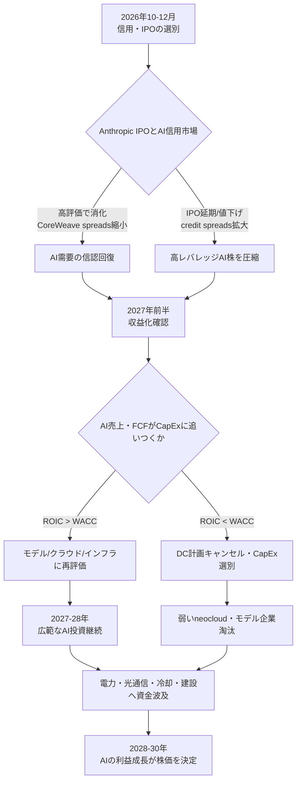

# AIバブルはなぜ簡単には崩壊しないのか

## Anthropic・CoreWeave・中国AI・電力需要・日本株を読み解く完全解説版

**分析の基準日：2026年10月19日／元資料：「AI投資は回収できるか――Anthropic IPO、CoreWeaveショック、中国AI、電力制約から読む『AIバブル後半戦』」**

> **この文書の読み方**　この「やさしい本文」は、元レポートの数値、企業名、業績、推計、投資シナリオと反対材料をなるべく削らず、順番を組み替えて説明したものです。後半には**元レポート全文（省略なし）**を収録し、原文の細かな条件や出典参照記号まで確認できるようにしています。「報道された数字」「会社の公式発表」「研究の結果」「元レポート筆者の独自予測」は異なります。この区別に注意してください。特に2026年10月時点の数字・出来事は、元レポートの記述に基づき、今回あらためて一次情報を照合したものではありません。投資判断の際は最新版の会社資料・規制当局への提出書類を確認する必要があります。

---

<!-- INTEGRATION-START:guide -->
## 【2026年10月20日追補】今回の統合版の読み方

このファイルは2026年10月19日版の**既存本文・原文全文を一切削除・変更せず保全**し、以下の検証済みテーマに関する詳細追補を差し込んだ完全版です。**既存の「日本株10社」比較も保存し、それとは別に四季報分析済みの8社を詳説**しています。証券会社の目標株価は新しい追加分析から除外しました。原文にある既存の想定値は検証記録として残しています。

### 増補した内容への案内

| 追加位置 | 追加した情報 |
|---|---|
| 第6章の末尾 | 発電→送電→変圧→UPS→蓄電所施工→冷却→制御→光通信の産業構造。IEA、Wood Mackenzie、Berkeley Lab、Uptimeの研究と日立・三菱重工の新提携 |
| 第7章の末尾 | **四季報詳細分析8社**：三菱重工、日立、明電舎、指月電機、JESCO、ダイキン、日本電技、santec。企業ごとの通期実績・予想・1Q・最新IR・CF・競争と海外評価 |
| 第8章の末尾 | 8社の比較表、海外機関投資家の保有変化、研究者が示す市場と個別企業の違い、競合・協業の網羅表、利益回収と反証条件 |
| 第10章の末尾 | 資金がAI利用→設備受注→企業利益→現金へ動く仕組み、2026～2028年の監視ポイント、追加用語集、出典リンク一覧 |
| 既存の付録 | **元レポート全文を一文字も省略せず保全** |

分析基準日：**2026年10月20日**。株価・PER等は原則2026年10月19日時点の比較用データ。企業IR、四季報予想、海外市場研究は同時点の実績・見通しではないため定義・公表日を明記する。完全版は金融商品の売買推奨ではなく、研究と企業会計を分けた検証レポートです。
<!-- INTEGRATION-END:guide -->
<!-- UPDATE-NSCALE-START:guide -->

### 【2026年10月20日ニュース追補】CoreWeaveの信用不安はAI全体の需要消失なのか

本版では、**「AI計算能力への注文はCoreWeave一社だけに集中していない」**という新しい検証結果を第5章に組み込んだ。Anthropicは2026年4月にCoreWeaveと複数年契約を締結し、8月にはNscaleと最大**446億ドル**のサービス契約を締結した。10月19日には、Nscaleとの**約450億ドルの追加契約を交渉中**と報じられた。さらにFluidstackと共同で米国のデータセンターへ最大**500億ドルを投じる計画**も報じられている。ただし、それぞれの契約形態・期間・進捗は異なり、単純合算して確定売上とみなさない。<https://investors.coreweave.com/news/news-details/2026/CoreWeave-Announces-Multi-Year-Agreement-With-Anthropic/>、<https://www.sec.gov/Archives/edgar/data/2110365/000119312526395475/ck0002110365-20260918.htm>、<https://www.reuters.com/technology/nscale-anthropic-talks-45-billion-cloud-computing-deal-bloomberg-news-reports-2026-10-19/>、<https://www.reuters.com/technology/anthropic-invest-50-billion-build-data-centers-us-2025-11-12/>。

**視聴者への説明の軸：『一社の社債が売られた＝AI需要が消えた』ではない。『需要は複数の供給会社に及ぶが、そのすべてが黒字化・借金返済に成功するわけではない』。**

<!-- UPDATE-NSCALE-END:guide -->

# 第1章　まず結論――「AIは成長する」と「AI関連株は全部上がる」は別の話

このレポートの出発点は、「AIバブルがはじけてAI投資が終わる」と考える必要はない一方、**AIへの投資なら何でも儲かる時代は終わり始めている**というものです。

2026年秋、AI向けGPU（画像処理から発展した、AI計算に使う半導体）を大量に保有して貸し出すCoreWeaveの株式や社債が売られました。これを見て「AI需要がなくなった」と考える人がいました。しかし、実際に問題視されたのは、AIを使う顧客の存在だけではありません。データセンターを建設するために借りた**巨額のお金を、将来の利用料で返せるか**という点でした。

例えるなら、急成長する観光地にホテルを建てる話です。観光客が増えるのは事実でも、金利の高い借金で高級ホテルを大量に造れば、満室に近い稼働率と高い宿泊料金が続かないと採算が合わないかもしれません。観光産業が成長していても、借金の多いホテル運営会社は破綻し得ます。**AI産業の成長と、個々の企業の財務健全性は分けて考える**必要があります。

<!-- UPDATE-NSCALE-START:ch1 -->

> **2026年10月20日・安心材料の追補：** AIクラウドの話題がCoreWeave一社の株価や社債に集中すると、視聴者は「AI設備全体が余り始めたのでは」と不安になりやすい。しかしAnthropicは**CoreWeaveだけでなく、Nscaleなど複数の企業から計算能力を調達・確保しようとしている**。Nscaleの新しい約450億ドルの案件はまだ協議中だが、既存の最大446億ドル契約はIPO申請資料に明記されている。**一社の信用不安と、市場全体の利用需要は別物**だという点を第5章で詳しく検証する。一方で、巨額契約が最終利用者の利益や現金回収を保証するわけでもない。これは安心材料と残存リスクを両方示す追補である。

<!-- UPDATE-NSCALE-END:ch1 -->

元レポートでは、AI投資の今後を次の3通りに分けています。これは統計から自動的に算出された確率ではなく、**筆者が2026年10月19日時点で置いた主観的な分析シナリオ**です。

| シナリオ | 主観確率 | 起こること |
|---|---:|---|
| 選別相場（基本） | **55%** | AIへの投資総額は高水準が続くが、借金の多い企業・採算の悪い案件と、利益を生む企業の株価が分かれる |
| 強気相場 | **25%** | AI売上と利益が想定以上に伸び、AnthropicのIPOなどが成功し、AI関連株全般が再上昇する |
| 弱気相場 | **20%** | 金利・信用不安から設備投資縮小が連鎖し、AIの高成長を織り込んだ銘柄が大幅に調整する |

なぜ投資総額が簡単に縮まないと考えるのでしょうか。元資料は、Goldman Sachsによる**2026～2031年のAI関連設備投資約7.6兆ドル**という基本ケース、Morgan Stanleyによる**2026年約8,000億ドル・2027年約1.1兆ドル**という推計、そしてBlackRockによる「AIは電力・資本・素材・企業の財務余力を大量に必要とする段階に入った」という見方を紹介しています。これらはいずれも**予測・分析であり、実際に支出が完了した金額ではありません**。

では、お金を使うだけで利益は生まれるのでしょうか。もちろん違います。ここで重要になるのが、**投資額に見合う利益と現金がどれだけ増えるか**という考え方です。

例えば100億円のAIシステムを導入し、人件費・外注費などが年12億円減り、AIによる新サービスから年8億円の営業利益が増えたとします。税金、維持費、再投資なども考慮する必要がありますが、投資が利益を生む仕組みは理解できます。一方、同じ100億円を使って年間5億円分の価値しか生まなければ、資金調達コスト次第では損をします。

元資料の中心的な言葉は**ROIC（投下資本利益率）**と**WACC（加重平均資本コスト）**です。ROICは事業に投じたお金でどれだけ税引後の営業利益を生んだか、WACCは借入や株主から集めたお金に対して求められる最低限の利回りです。**ROICがWACCを上回る案件は、原則として企業価値を生みやすい**のです。元レポートにはキャッシュフローを使った簡略式がありますが、厳密なROICの定義ではありません。また、営業キャッシュフローに既に含まれているコスト削減や新規売上を再度足すと二重計上になり得ます。正式な企業価値評価では、税引後営業利益・投下資本・フリーキャッシュフローを整合的に使います。

**CapEx（設備投資）**とは、設備やシステムを造り、長期間使用するための支出。**FCF（フリーキャッシュフロー）**とは、営業で稼いだ現金から必要な設備投資などを差し引き、企業が自由に使える現金の目安です。2024～2025年ごろには「AIのために何兆円投資するか」が成長期待を押し上げました。これからは「その投資によって何円のFCFが生まれたか」が問われる、というのが元レポートの見立てです。

## AIは本当に仕事を効率化しているのか

元レポートは、AI活用には**実際に測定された効果がある**と示す一方、無条件には肯定していません。

- 学術誌QJEに掲載されたBrynjolfsson・Li・Raymondらの研究では、**顧客対応担当者5,172人**を対象に、生成AI支援で平均**約15%**の生産性向上、経験の浅い人で**約30%**の改善が観察されたと紹介されています。
- 2026年のBIS（国際決済銀行）の研究では、米欧の**1万2,000社超**を分析し、AI導入企業で短期に**約4%**の労働生産性改善が見られたとされます。ただしソフトウェア、データ、人材教育への投資と組み合わせることが重要です。
- 反対材料として、METRの熟練オープンソース開発者を対象とするランダム化実験では、**2025年当時のAIツールを使うことで作業が平均19%遅くなった**と報告されています。AIが全業種・全作業で直ちに効率化を生むわけではありません。

つまり「AIは役に立たない」とも「AIを入れるだけで利益が出る」とも言えません。**どんな仕事に、どの価格のAIを入れ、従業員の仕事の進め方をどう変えたか**で収益性が変わります。元レポートはMorgan Stanleyの分析として、AI導入企業で利益予想の上方修正が相対的に強く、2024～2025年には一部企業群のEBIT（利払い・税引き前利益）率の改善がMSCI Worldの比較対象より大きかったとも紹介しています。

---

# 第2章　Anthropicは「未来の研究所」から巨大な法人向けビジネスへ移っている

Anthropic（アンソロピック）はClaudeというAIモデルを開発する企業です。一般の人が質問するチャットAIにとどまらず、企業が自社サービスにAIを組み込むための**API**、プログラム作成を支援する**Claude Code**、法人向け契約、クラウド経由の販売などで収益を得ます。

なぜ法人向けの利用が重要なのでしょうか。個人の月額契約は利用停止が比較的簡単ですが、企業がソフト開発、顧客対応、社内分析に組み込んだAIは、業務の一部として継続利用される可能性があります。もちろん乗り換えは起こり得ますが、うまく定着すれば利用量・契約数・売上が拡大します。

## 企業価値と売上の拡大

元レポートが紹介する主な数字を、時系列と意味に分けて見ます。

| 時点 | 元レポート記載の内容 | 意味と注意点 |
|---|---|---|
| 2026年2月、Series G | **300億ドル調達、資金調達後評価額3,800億ドル** | Series Gは上場前に行う大型資金調達のラウンド名。評価額は株式市場での株価とは違う |
| 2026年5月、Series H | Reuters報道として**650億ドル調達、評価額約9,650億ドル** | 報道ベースの数字。公式発表との区別が必要 |
| 2026年5月ごろ | **年間換算売上高約470億ドル**との報道 | その時点の売上速度を1年間続けた場合の額であり、確定した年間売上ではない |
| 2026年8月 | **年間換算売上高650億ドル超**とのReuters報道 | 企業利用の勢いを示す一方、毎年続く保証はない |
| 2026年Q1・Q2・Q3 | **四半期売上47億→116億→168億ドル**との報道 | 絶対額は増加。Q2→Q3の成長率は約45%で、Q1→Q2の2倍超より鈍化 |
| 2026年Q3 | **調整後ベースで黒字化**と報道 | 調整後利益は、すべての費用を含めた正式な会計上の最終利益とは限らない |
| 2025年通期 | 売上**約46億ドル**、営業損失**80億ドル超**と報道 | 高成長の前には非常に大きな赤字・開発負担が存在した |

**年間換算売上高（ランレート）**は、とても誤解しやすい言葉です。例えば直近1カ月の売上が10億ドルなら、そのペースを12カ月続けた場合の120億ドルを年間換算売上高と表現することがあります。これは「過去12カ月で120億ドル稼いだ」という意味ではありません。成長企業ほど両者の差が大きくなります。

Anthropicの発表として元レポートは、2026年入り後に**Claude Codeの法人契約が約4倍**となり、その収入の**過半数が企業顧客**から来ていること、Google・Broadcomとの計算基盤拡大発表時点で**年間換算売上高300億ドル超**、**年間100万ドル以上を支払う法人顧客1,000社超**となり、その大口顧客数が**2カ月未満で倍増**したことを挙げています。発表時点が異なる数字を同じ日付の実績として並べないことが大切です。

ここでの投資上のポイントは「AIを試しに使っている人が増えた」だけではなく、**法人が大きなお金を支払い、業務にAIを組み込み始めている**ことです。ただし、それだけで投資の全額が回収できると証明されたわけではありません。

## 売上の5つの入り口と、顧客集中の問題

Anthropicの主な販売経路は、①個人向けClaude、②企業契約、③開発業務向けClaude Code、④APIの従量課金、⑤AWSやGoogle Cloudなどのクラウド経由販売、の5層です。APIの従量課金は、AIに処理させた入力・出力の量などに応じて料金が変わる仕組みです。

元レポートが引用するReutersの非公開目論見書に関する分析では、**2025年のAmazon・Googleのクラウドマーケットプレイス経由売上は約21.6億ドル、全売上の約47%**を占め、関連販売手数料は**約3.51億ドル**と推計されています。また、名前が公表されていない**2社の顧客がそれぞれ売上の約12%**を占めたと報じられました。

これが意味するのは、Claudeが売れていても、**売上を運んでくれる販売先や、大口顧客への依存が高い**ということです。クラウド事業者との条件交渉や、大口顧客の発注変化が利益率に大きく影響する可能性があります。

## 巨額の「将来使う計算能力」の契約

ここがAnthropicを理解するうえで最も難しく、最も重要な部分です。AI会社には半導体を直接所有せず、クラウド会社から計算能力を借りる方法があります。しかし、借りるために**何年にもわたって大きな支払いを約束する**と、実質的に重い固定費を抱えることになります。

元レポートによれば、Reutersが目論見書をもとに報じた長期のクラウド・計算・インフラ関連契約は**約5,180億ドル**。その内訳として、**Google向け少なくとも1,111億ドル、Amazon向け約1,100億ドル、Microsoft向け約314億ドル**などが紹介されています。別の記述では、**2025年末の取消不能なホスティング・計算契約約546億ドル**、**2026年初めの長期契約総額4,170億ドル超**、専用計算能力**約3.5GW相当**という数字も出てきます。

これらは**時点や契約範囲が異なる数字**です。単純に全部を足して「負債総額」として扱ってはいけません。また、将来支払い契約は、会計上の借入金と必ずしも同じではありません。ただし、売上が計画より伸びなければ、将来の現金支出が経営を圧迫するという意味で重要です。

例えるなら、急拡大する飲食チェーンが、10年間分の店舗賃料と厨房使用料を先に契約するようなものです。客が増える間は成長を支える契約ですが、客足が鈍れば、使わない厨房にも支払い義務が残り得ます。

この構造から元レポートは、Anthropicが**「ソフトウェア企業並みの成長期待」と「インフラ企業並みの長期固定費」**を同時に持ち始めていると評価しています。これが同社の株価を考えるうえでの中心です。

<!-- UPDATE-NSCALE-START:ch2 -->

### 【10月20日追補】「長期の計算能力を確保する先」は1社ではない

Anthropicの計算能力調達は、**AWS・Googleなどの大型クラウド、CoreWeaveなどのAI専用クラウド、Nscaleなどの新興インフラ事業者**を含む複数の経路にまたがる。CoreWeaveは2026年4月10日にAnthropicとの複数年契約を公表した。他方、Nscaleは2026年8月に最大446億ドルのAnthropic向け契約を締結し、10月19日には追加約450億ドルの交渉が報じられた。

これは、Anthropicが将来の計算能力を確保する際に、**特定の1社に全依存するのではなく、複数の供給ルートを使う構造**を示す。ただし、これを「AI業界の最終顧客が十分に分散している」と言い換えてはいけない。複数の設備会社が同じAnthropicから巨額の発注を受けるほど、**設備の売り手は分かれていても、最終的な支払い能力は共通の大口顧客に依存**し得る。

この区別は、後述するCoreWeaveの信用不安とNscaleのIPO資料を読むうえで欠かせない。出典：[CoreWeave公式・2026/4/10](https://investors.coreweave.com/news/news-details/2026/CoreWeave-Announces-Multi-Year-Agreement-With-Anthropic/)、[Nscale Form S-1](https://www.sec.gov/Archives/edgar/data/2110365/000119312526395475/ck0002110365-20260918.htm)、[Reuters・2026/10/19](https://www.reuters.com/technology/nscale-anthropic-talks-45-billion-cloud-computing-deal-bloomberg-news-reports-2026-10-19/)。

<!-- UPDATE-NSCALE-END:ch2 -->

## AIの利用価格が安くなっても、儲かるのか

AIの利用料金を左右する単位の1つが**トークン**です。日本語なら一文字が必ず一トークンというわけではなく、文章をAIが処理しやすい単位に分割したものです。AIの処理量が増えるほど多くのトークンが扱われます。

問題は、中国AIや小型モデルとの競争で**1トークンの販売価格が下がる**ことです。例えば単価が半分になっても、利用量が3倍になれば、単純な売上は元の1.5倍です。一方、計算コストが高止まりしたら利益は増えないかもしれません。計算効率が改善し、同じ電力やGPUでより多くの処理をこなせるかが鍵になります。

元レポートは「トークン価格の低下を、利用量増加と計算効率改善で上回れるか」を収益化条件として表現しています。ただし厳密には、**売上＝単価×利用量、利益＝売上－計算費用－その他の費用**として別々に確認すべきです。

## 技術と社会への影響には光と影がある

Claude Codeのようなツールが普及すると、ソフトウェア開発の時間短縮、企業の情報整理、自動化、顧客対応の改善が期待できます。前章のQJE・BISの生産性研究は、**生成AIという技術一般**が一定の仕事で役に立つ可能性を支えます。ただし、それらの研究の数値をそのままAnthropic単独の効果として扱ってはいけません。

反対に、元レポートはAnthropic自身の脅威レポートが取り上げる**サイバー攻撃、詐欺、世論操作、監視、生物学的悪用、兵器関連利用、他社モデルの知識を不正に取り出す行為（蒸留）**にも触れています。さらにReutersが伝えたIPO関連書類には、先端モデルの制御や停止の難しさに関するリスクも記載されたとされています。

つまりAnthropicの評価は、**需要・技術は非常に強い／収益化は改善中／将来の計算費用は極めて大きい／顧客集中とAI安全性のリスクもある**、という複合的なものです。

---
# 第3章　AnthropicのIPO――11月上場は決まったのか、株式市場はどう動くのか

**IPO（新規株式公開）**とは、それまで未上場だった会社の株式を証券取引所で売買できるようにすることです。IPOをすれば企業は資金を集めやすくなりますが、上場した瞬間に必要な資金がすべて確保されるとは限りません。売り出した株が既存株主の保有分なら、売却代金は会社ではなく売り手に渡ることにも注意が必要です。

## 2026年10月19日時点の確定事項と未確定事項

元レポートによればAnthropicは**2026年6月1日、SEC（米証券取引委員会）へIPO用の登録書類案を非公開で提出した**と発表しました。これは上場準備が進んでいる材料ですが、**上場日、株数、公開価格、調達額、証券コード（ticker）が決定したことを意味しません**。

報道の時間軸を並べると、9月4日のReutersは早ければ10月中旬の投資家向け販売活動開始や中間選挙前の上場を視野に入れるとの情報を報じました。一方9月28日は中間選挙後へずれ込む可能性、10月14日は11月の中間選挙後に上場する可能性が高いとの報道に変化し、APは10月18日時点で11月IPOが見込まれると伝えた、と元レポートは記述しています。これらは会社の正式日程ではなく、**時点の異なる報道情報**です。

そこで元レポートは、あくまで筆者独自の予想として次の確率を置いています。

| 上場時期 | 筆者の主観確率 | 想定される状況 |
|---|---:|---|
| **2026年11月** | **45%** | 中間選挙後の11月中旬～下旬に価格を決めて上場 |
| 2026年12月 | 30% | 信用不安や相場の変動を見極めて数週間延期 |
| 2027年以降 | 25% | 評価額の折り合い、安全性、ガバナンス、開示、市況などを理由に延期 |

この45%を「11月上場の会社発表」や「統計的に算出された確率」と受け取るのは誤りです。

想定スケジュールは、**10月19日時点：非公開審査／10月後半：公開目論見書や価格帯が提示される可能性／11月初旬：米中間選挙／11月中下旬：投資家説明・値決め・上場候補／12月：延期時の代替候補／2027年：より大きな延期ケース**。10月後半以降の各段階は正式発表ではなく、シナリオ上の日程です。

## 会社はいくらの価値で上場するのか

**時価総額**は「1株の値段×発行済み株式数」で表した会社全体の市場評価です。元レポートでは2026年5月の未上場評価額**9,650億ドル**、一時意識された**2兆ドル前後**、10月に一部投資家が議論したとされる**約1.5兆ドル**を紹介しています。しかし、**IPOの正式な評価額は未公表**です。

未確定の公開株式比率を仮に置いた感応度分析は次の通りです。

| ケース | 仮の評価額 | 仮の新規発行・売出し株比率 | 理論上の売出し・募集総額 |
|---|---:|---:|---:|
| 悲観 | **0.8～1.0兆ドル** | **5%** | **400～500億ドル** |
| 中立 | **1.2～1.5兆ドル** | **7.5%** | **900～1,125億ドル** |
| 楽観 | **1.8～2.0兆ドル** | **10%** | **1,800～2,000億ドル** |

これは**会社が実際に発行予定の株数・調達金額を示した表ではありません**。しかも会社が新規発行する株式と既存株主が売却する株式の混在比率は不明です。**グリーンシュー**と呼ばれる追加売出しの仕組みや、既存株主が上場直後に株を売れない**ロックアップ期間**も未公表です。元レポートで触れる**180日**はロックアップの一般的な分析仮定であり、Anthropicの正式条件ではありません。

このような超大型IPOでは、投資家が購入資金を捻出するために、既に持っているほかの株式を売る可能性があります。**AI関連株が短期的に売られても、それが直ちにAI需要の減少を意味するわけではありません**。単に売買資金の移動である可能性があります。

一方、大規模な公開株式が高い価格で無事に売れれば「投資家はAIモデル企業の将来利益を高く評価している」と受け止められ、クラウド、計算設備、電力、光通信など幅広い関連銘柄の不安が和らぐ可能性もあります。ただし反応は、事前にどれだけ期待が株価に織り込まれているかで変わります。

## 上場後に本当に見るべき指標

元レポートでは、Anthropicはモデル・APIが中核の会社なのに、長期の計算契約によって巨額固定費を抱える構造だと指摘しています。株価上昇の材料は売上成長率だけではありません。将来の粗利益（売上からサービス提供の直接原価を引いた利益）が、今後支払う計算契約に比べて十分大きいかを確認することが重要です。

**「将来の計算契約支払額 ÷ 将来の粗利益」**は、契約負担の大きさを考えるための補助指標です。ただし支払期間の異なる合計額と年間粗利益をそのまま比べると誤解します。同じ年数にそろえる、契約の取消条件を確認する、成長率を複数パターンで想定することが必要です。

元レポートは、Anthropicが公益目的の基金へ**株式5%を拠出する計画**を持ち、株主承認が条件になるとの報道、創業者が自己保有株の**80%**を公益目的に寄付する方針との報道も挙げています。これは社会的理念としての側面だけでなく、既存株主の**希薄化（持分割合や1株当たりの取り分が変化すること）**、株主との関係、統治体制にも関わります。創業者の正確な持分比率も未公表とされています。

日本への波及では、元レポートが紹介する**2026年10月13日のReutersによる、NTTデータがAnthropicの日本初データセンターを大阪で整備する方向で最終協議している**という報道が重要です。これが事業化すれば、日本企業が米国AI企業の投資から受注や使用料を得る道が開けます。ただし「最終協議」と「建設・契約が確定」は違います。発注、着工、契約金額は今後の確認事項です。

---

# 第4章　DeepSeekなど中国AIが安くなっても、なぜAIインフラ需要がすぐには消えないのか

低価格で高性能な中国AIが普及すると、米国の高価なAIモデルは厳しくなります。これは元レポートも認めています。企業が同程度の品質を安く入手できれば、AIの利用単価には下落圧力がかかり、AnthropicやOpenAIの利益率が縮む可能性があります。

しかし、**AIの利用単価が下がることと、AIに使われる計算量の合計が減ることは同じではありません**。

例えば、AIで契約書をチェックする費用が10分の1になったら、以前は費用が高くて導入できなかった中小企業も利用できるようになります。動画制作、経理、医療研究、金融分析、ロボット、自動で複数の処理を進める**AIエージェント**にも広がります。「安くなるほど利用者が増え、全体の消費量はむしろ増える」という現象を、経済学では**ジェボンズのパラドックス**という考え方と関連付けて説明することがあります。ただし必ず成立する法則ではありません。

数字で見ると、1回のAI処理の計算量が半分になっても、処理回数が3倍になれば、全体の計算量は元の**1.5倍**です。反対に、処理回数が1.3倍にしかならなければ、合計計算量は元の**0.65倍**になります。つまり「効率化の速度」と「利用量の増加速度」の競争です。推論（学習済みAIが利用者の質問や指示に答える計算）の消費総量を見る必要があります。

## 世界のAI市場は一枚岩ではない

元レポートは、**米国・中国・日本・欧州のAI市場が完全に同じ製品に統一されるとは限らない**と指摘します。技術の善し悪しや価格だけでなく、政府の輸出規制、データ管理、安全保障、契約上の責任が調達判断に影響するためです。

元資料によると、米国の半導体輸出規制などの影響で、Nvidiaの中国データセンター向けAIチップ市場シェアは**2026年前半に34%**まで低下し、Huaweiなどの中国企業が拡大したとされます。ここから読み取れるのは、中国側で計算基盤の国産化が進めば、米国の製品と別の設備投資が発生し得るということです。

またReuters報道として、中国側が先端AIモデルの海外アクセスや、AIモデル・半導体技術の輸出に追加的な制限を検討していることが紹介されています。**中国が自国でAI技術を育成すると同時に、欧米も独自のAI供給網を維持しようとするなら、技術が分断されることで設備投資が重複する**可能性があります。

中国国内にはサイバーセキュリティ法、データセキュリティ法、個人情報保護法、生成AIに関する暫定措置などの制度があります。日米欧の大企業が中国モデルを使う場合は、個人情報や企業秘密をどこに保存するか、モデルの知的財産は誰のものか、監査や継続サポートに対応できるか、といった項目も判断材料になります。**中国製AIが一律に使用禁止という意味ではなく、用途や会社の規則によって調達条件が異なる**ということです。

## AIモデル企業とAI設備企業は同じ運命ではない

ここで利益の行き先が変わる可能性があります。安価なモデル同士が競争すると、モデル開発会社の価格決定力は弱まります。一方、利用回数が増えれば、計算するクラウド、通信ケーブル、ネットワーク装置、電力、冷却などが必要になります。

元レポートは価値が**AIモデル → 推論の利用量 → クラウド → 通信網 → 電力・冷却**へと移る可能性を論じています。これは「モデル企業は必ず負け、設備企業は必ず勝つ」という意味ではありません。設備の供給が増えすぎればGPUのレンタル料金も低下します。電力契約が高すぎるデータセンターも利益を失い得ます。

弱気条件は明確です。**AI処理の効率改善が利用量の増加を長期的に上回り、AIの価格競争で収益が圧迫され、大手クラウド企業が設備投資を一斉に削減する**なら、データセンターや半導体の設備も余り始めます。このシナリオを「絶対に起こらない」とするべきではありません。

ただし元レポートは、Anthropicの法人売上拡大、光通信需要、接続待ちの電力需要、そして**Schneider Electricが2026年Q3にデータセンター需要の拡大を受け通期見通しを再度引き上げた**という報道などから、現時点でAIインフラ需要の全面崩壊が基本シナリオではないと判断しています。

---

# 第5章　CoreWeaveショックの本質は「AIが不要」ではなく「借金を返せるか」

## CoreWeaveはどのような会社か

CoreWeave（コアウィーブ）は大量のGPUを用意し、企業にAI計算能力を貸し出すクラウド会社です。データセンターを建設・運営し、AIモデル会社や大手テック会社から利用料を受け取ります。**ネオクラウド**という言葉は、AWSなど従来の巨大クラウド企業とは異なり、特にGPU・AI計算の提供に強みを持つ新興のクラウド事業者を指す際に使われます。

元レポートによれば、CoreWeaveは**約500億ドルの債務**を抱えながら、**2026年の設備投資計画を350億～390億ドル**へ引き上げました。同年の市場予想は**売上約130億ドル、損失約21億ドル**とされています。つまり急成長を狙う一方、建設資金の大部分を稼ぎ切る前に大量の資金が必要になる構造です。

## 借入金利が上がると、なぜ株まで売られるのか

設備を造るために借金をすると、利息と元本返済が必要です。例えば100億円を借りて年間金利が6%なら、利息だけで年6億円です。借り換え時に10%を求められると、年10億円になり、利益を4億円押し下げます。実際の債務は固定金利、変動金利、担保の有無、返済期限で影響が違いますが、仕組みは同じです。

元レポートは、信用不安の際にCoreWeaveの**CDSが約1,000bp**まで上昇したとのReuters報道を取り上げています。**CDS（クレジット・デフォルト・スワップ）**は、企業が債務不履行になるリスクに備える金融契約です。保険料に似た価格が上がるほど、市場が信用リスクを強く警戒している目安になります。**1bp（ベーシスポイント）は0.01%ポイント**、1,000bpは10%ポイント相当です。ただしCDSの表示方法や契約条件があるため、単純に「倒産確率10%」という意味ではありません。

企業が新しく社債や融資を受ける際の金利が上がると、将来残る利益が減ります。また投資家は、高リスク企業の将来利益をより低く評価するため、**借金の金利上昇→利益減少→株価下落→資金調達がさらに難しくなる**という悪循環が起こり得ます。

## Nvidiaの支援があれば絶対に安全なのか

元レポートは、NvidiaがCoreWeaveの未販売の計算能力を**2032年4月まで一定条件で支える「バックストップ」**に言及しています。バックストップとは、計画どおり売れない分に対して一定の支援や引き受けを行う仕組みです。

ただし、**支援があることと、すべての利益や負債が保証されることは別**です。契約対象、価格、支援額、利用条件、期限を見なければなりません。データセンターが予定どおり完成するか、電力接続が間に合うか、GPUの利用率を維持できるか、競争によってレンタル単価が下がらないかも重要です。

例えば100台のGPUを持っていても、半分しか借り手がいなければ、売上は弱くなります。さらに同じ計算が低価格の半導体で実行できるようになると、1台当たりの料金も下がります。**利用率と単価が同時に悪化する**ことが最も危険です。

元レポートは、Morgan Stanleyが仮想的な**1GW規模のAIデータセンター**を使った分析で、前提条件により**ROICが約20%から70%超**まで大きく変化し得ることを紹介します。これはCoreWeave自体の実績利回りではなく、**価格・稼働率などの仮定に非常に敏感だという説明用のモデル**です。

## IMFが警戒する「循環するお金」

CoreWeave一社だけの問題ではありません。元レポートが引用するIMFの**2026年10月「国際金融安定性報告書」**では、2023年以降のAI関連大型案件**14件**について、**株式資金約3,000億ドル、債務約6,500億ドル、将来のサービス・半導体購入約束約1.4兆ドル**が絡む複雑な資金循環を問題視したとされています。債務のうち**約3,200億ドル**には投資家などの何らかの支援があり、一部は通常の貸借対照表には直接載りにくい構造になっていると説明されています。

仕組みを単純化すると次のようになります。

1. 半導体会社やクラウド会社がAI会社へ出資・融資する。
2. 資金を得たAI会社が、その出資者と関係する半導体やクラウドサービスを大量に購入する。
3. 売り手には大きな受注・売上が計上される。
4. しかし最終顧客から十分な収入が生まれなければ、借り手の返済能力も、販売側の受注見通しも同時に悪化する。

このように**本来、信用が安全なはずの相手の信用状態まで同じ方向に悪化する**ことを、金融の文脈で**wrong-way risk（逆方向リスク）**と呼びます。購入と融資が循環すると、売上の数字だけでは最終需要がどの程度強いのか分かりにくくなるのです。

AI投資が昔の通信・インターネットバブルに似ている部分は、インフラを大量に造り、先行費用が膨らむ点です。一方、異なる部分として元レポートは、現在はすでに**数百億ドル規模のAI企業売上**があり、研究でも**測定可能な生産性改善**が確認されていることを挙げています。「需要がすべて架空だった」とまとめるのは正確ではありません。

<!-- UPDATE-NSCALE-START:ch5 -->

## 【2026年10月20日追加検証】CoreWeaveだけに注文が集中しているわけではない――Nscaleの新契約交渉が示した「需要の広がり」

### まず視聴者に伝えたい結論

**CoreWeaveの株価や社債が急落したことだけを理由に、「AIの計算能力には買い手がいなくなった」「AIデータセンターが全部余る」と考える必要はない。** 理由は、AIの主要顧客がCoreWeave以外にも巨額の調達計画・契約を持っているからだ。

その具体例が、英AIクラウド企業**Nscale（エヌスケール）**と米**Anthropic（アンソロピック）**の取引である。Nscaleは2026年8月にAnthropicとの最大**446億ドル**のサービス契約を締結している。そして10月19日、両社が新たに**約450億ドル**の追加契約を協議しているとBloomberg、Reuters、Financial Timesが報じた。ただし、**追加分はまだ交渉中で、契約成立・建設完了・現金回収を意味しない**。

これは「巨額のAI計算能力を必要とする顧客がほかの供給会社にも現れている」という証拠にはなる。しかし「どのAIクラウド企業も安全で、AIバブルが絶対に崩壊しない」という証拠にはならない。今回のニュースを**需要の裏付け**と**金融・工事リスクの未解消**に分けて解説する。

### A. 新ニュースの概要――確認済み契約と、交渉中の契約を混ぜない

| 項目 | 内容 | 現時点の確度 |
|---|---|---|
| 既存契約 | AnthropicとNscale、**最大約446億ドル**のインフラ利用契約 | **締結済み**（SEC提出書類に記載） |
| 今回の新報道 | Monarchキャンパスの2棟目を対象とする**約450億ドル**の追加契約 | **交渉中**（未締結） |
| 新施設の計画 | 米ウェストバージニア州、約**460MW**の計算能力を提供する構想 | **報道された計画** |
| 使用予定チップ | NVIDIAの次世代**Vera Rubin** | **報道された計画** |
| 3棟目の扱い | Anthropicが優先権を持つとの報道 | **優先権であり受注確定ではない** |
| 額面上の合計 | 446億＋450億＝**約896億ドル** | **仮に追加契約が成立した場合の合計** |

**注意：** 896億ドルは「今日入金された現金」ではなく、将来の利用・納入条件に左右される複数年の契約価値の合計を仮に示したもの。460MWは新施設の計画規模であり、すでに460MWが通電・稼働していることを意味しない。契約総額から単純に年間売上や利益率を算出することはできない。

**出典：** [Bloomberg日本語・2026/10/19](https://www.bloomberg.com/jp/news/articles/2026-10-19/TN65Y9T9NJLT00)、[Reuters・2026/10/19](https://www.reuters.com/technology/nscale-anthropic-talks-45-billion-cloud-computing-deal-bloomberg-news-reports-2026-10-19/)、[Financial Times・2026/10/19](https://www.ft.com/content/26a604d8-1a9d-4801-bd73-6ac588b63bdc)、[NscaleのSEC登録届出書（Form S-1）・2026/9/18](https://www.sec.gov/Archives/edgar/data/2110365/000119312526395475/ck0002110365-20260918.htm)。

### B. 本当の安心材料は「AnthropicがCoreWeave以外にも発注している」こと

ここで誤解しやすいのは、**CoreWeaveとAnthropicの関係**だ。AnthropicはCoreWeaveと無関係なわけではない。実際に**CoreWeave自身が2026年4月10日にAnthropicとの複数年契約を公式発表**している。その後、Nscaleとの巨額契約や追加交渉も明らかになった。

さらにAnthropicは2025年11月に、**Fluidstackとの共同による米国データセンターへの最大500億ドルの投資計画**を発表している。これはNscaleの契約と同一の形式・支払条件ではないため、単純に足し合わせて「確定契約総額」としてはいけない。

| 調達・供給の関係 | 事実として確認できる内容 | 読み方 |
|---|---|---|
| **Anthropic × CoreWeave** | 2026年4月、Claudeの開発・展開を支える**複数年契約**を発表 | **CoreWeaveもAnthropicの供給先の一つ** |
| **Anthropic × Nscale** | 2026年8月、**最大446億ドル**の契約を締結 | **別の供給事業者への大型発注が確認できる** |
| **Anthropic × Nscale追加案件** | 2026年10月、**約450億ドル**の追加契約交渉が報道 | **追加需要を示唆するが未確定** |
| **Anthropic × Fluidstack** | 2025年11月、米国内のデータセンターへ**最大500億ドルの投資計画**を発表 | **複数のインフラ事業者を使う方向性** |
| **CoreWeave × その他顧客** | 2026年1QにMetaとの大型契約など、複数の法人・AI顧客を公表 | **CoreWeave自体も単一顧客専用ではない** |

**出典：** [CoreWeave・Anthropic契約](https://investors.coreweave.com/news/news-details/2026/CoreWeave-Announces-Multi-Year-Agreement-With-Anthropic/)、[CoreWeave・2026年1Q](https://investors.coreweave.com/news/news-details/2026/CoreWeave-Reports-Strong-First-Quarter-2026-Results/)、[NscaleのSEC登録届出書](https://www.sec.gov/Archives/edgar/data/2110365/000119312526395475/ck0002110365-20260918.htm)、[Reuters・Fluidstack共同投資計画](https://www.reuters.com/technology/anthropic-invest-50-billion-build-data-centers-us-2025-11-12/)。

この表から導ける安心材料は、**需要が特定のAIクラウド企業の1件の資金調達話に依存しているわけではない**ことだ。Anthropicのようなモデル企業は、計算能力を得るために複数の供給ルートを確保しようとしている。1社の株式や社債が売られたからといって、各社にまたがる長期の計算需要をそのまま「ゼロ」とは評価できない。

ただし、注意点がある。**複数の供給会社へ発注が分かれることと、最終顧客・信用リスクが十分に分散していることは別**だ。複数のAIクラウド企業が同じAnthropicに依存していれば、Anthropic側の売上成長が鈍ったとき、発注先に同時に影響する可能性がある。**供給先の分散は、最終需要家の分散と同義ではない。**

### C. なぜ需要の広がりは重要なのか――市場全体と一企業の財務を分ける

AIクラウドは、銀行から資金を借りてホテルを建てる事業に似ている。あるホテル会社の金利が急上昇しても、旅行者がいなくなった証拠にはならない。旅行客がほかのホテルを予約しているなら、観光需要自体は存在する。**ただし、高い金利を払えないホテル会社は、需要があっても経営難になる。**

AIでも同じだ。Anthropicが別の供給会社Nscaleに巨額の計算能力を求めているなら、「GPUを借りたい顧客はもういない」という極端な悲観論には反する。一方、CoreWeaveの借入金利が高く、設備の完成と稼働まで資金を回し続けなければならない問題は残る。

確認できる実態として、**CoreWeaveは2026年6月末時点で約1,040億ドルの将来売上バックログ**を公表した。それでも社債市場では金融リスクが強く意識されている。この事実も、信用不安と需要の存在が両立することを示している。なおバックログは将来売上の契約見込みであり、現時点の現金・利益と同じではない。

**一社の財務不安 → AI産業全体が無価値、という結論には飛躍がある。** より正確なのは、「実需は存在するが、それを誰が採算よく供給できるかを市場が選別している」という解釈である。

出典：[CoreWeave 2026年2Q決算](https://investors.coreweave.com/news/news-details/2026/CoreWeave-Reports-Strong-Second-Quarter-2026-Results/default.aspx)、[Reuters・CoreWeave信用不安](https://www.reuters.com/legal/transactional/why-coreweave-is-crosshairs-ai-scare-2026-10-16/)。

### D. 「契約が増えたから安全」とも言えない――Nscale自身の資金調達リスク

安心材料を正確に伝えるためには、反対側の事実も同時に示す必要がある。NscaleのIPO目論見書には、**既存のAnthropic向けサービス契約を履行するためのGPU・データセンター資金について、2026年9月18日の提出時点で拘束力のある必要融資確約が得られていない**と記載されている。事業者が契約を得ても、建設資金・GPU調達・電力供給・許認可がそろわなければサービスは始まらない。

また、Anthropic自身もクラウドに支払う長期費用を負うため、企業向けAI売上が今後も増え、計算費用を上回る利益を生む必要がある。事業者を複数に分けることで設備供給が安定しても、支払能力の問題が消えるわけではない。

| 論点 | 今回のニュースで確認できること | まだ分からないこと |
|---|---|---|
| 顧客の需要 | 既存446億ドル契約＋追加交渉 | 追加分が成立し、何年・どの条件で使われるか |
| 供給事業者 | CoreWeave以外のNscaleにも大型案件 | 各社が想定利益率で提供できるか |
| 融資 | NscaleはIPO等の調達を進めている | 必要なプロジェクト融資をすべて確保できるか |
| 物理的設備 | 460MW新施設の計画 | 通電・建設・納入・稼働開始の時期 |
| 最終的な利益 | 将来契約額は大きい | 利息・減価償却・設備更新後に現金が残るか |

「契約額が大きい＝無条件に黒字」「設備投資に借金がある＝必ず破綻」の両方が極端な見方である。**大事なのは、契約→資金確保→着工→稼働→利用料回収→借入返済という6段階のどこまで進んだか**だ。

出典：[Nscale・SEC Form S-1（2026/9/18）](https://www.sec.gov/Archives/edgar/data/2110365/000119312526395475/ck0002110365-20260918.htm)、[Financial Times・2026/10/19](https://www.ft.com/content/26a604d8-1a9d-4801-bd73-6ac588b63bdc)。

### E. 視聴者の不安を和らげるための説明例（動画本文に転用可能）

> いまCoreWeaveの株や社債が大きく売られていることで、「AIバブルはもう終わるんじゃないか」と不安になっている人もいると思います。
>
> ただ、ここで見落としてほしくないニュースがあります。AI開発企業のAnthropicは、CoreWeaveだけに計算能力を発注しているわけではないんです。
>
> 2026年4月にはCoreWeaveと複数年契約を発表していますが、8月には別のAIクラウド企業Nscaleとも最大446億ドルの契約を結びました。そして10月19日、さらに約450億ドルの追加契約を協議していることが報じられたんですね。
>
> もちろん、この追加契約はまだ決まったわけではありません。でも、重要なのは、**CoreWeave一社の資金繰りが悪化したからといって、AIを動かしたい顧客の需要まで消えたわけではない**ということです。
>
> 一方で、契約を受けた会社が高い金利の借金を返せるか、電力を確保してデータセンターを完成できるかは、また別の問題です。
>
> だから私は、AI市場全体が一斉に終わるというよりも、**需要を取り込んで利益を残せる会社と、投資負担に耐えられない会社が分かれる選別相場**として考える方が、いまの事実に合っていると思います。

この例文は視聴者の不安を煽らないための**説明用原稿**であり、投資収益や株価回復を保証するものではない。

### F. 今後のニュースで確認したい5つのポイント

1. **契約の確定**：NscaleとAnthropicの約450億ドルの追加契約が正式に発表されるか。契約期間・解約条項・支払条件はどうか。
2. **資金調達の確定**：NscaleがMonarchの建設とGPU購入に必要な融資を確保できるか。CoreWeaveの新規資金調達・借換条件は改善するか。
3. **実際の施設進捗**：電力・許認可・変圧器・冷却・GPUの納入予定が守られ、設備が稼働するか。
4. **Anthropicの利用と利益**：法人向けAIの売上・利用量が成長し、将来のクラウド使用料金を支える粗利益・現金創出力が改善するか。
5. **AIクラウドの採算**：CoreWeaveやNscaleなどが契約額を売上に変えた後、利息・運用費・減価償却を差し引いて利益と現金を残せるか。

**このニュースから導く結論：CoreWeaveだけに注文が集中しているわけではないという意味で安心材料。ただしAIクラウド業界の金融不安を解消したニュースではない。**

<!-- UPDATE-NSCALE-END:ch5 -->

## 淘汰が業界全体にはプラスになる理由

例えばAI用データセンターが100件計画され、そのうち採算の悪い10件が中止になっても、残る90件が事業として成立するなら、AI市場が消えたことにはなりません。電力設備、建設作業員、変圧器、光ケーブルなどの限られた資源を、より利益の出る案件へ振り向けられます。

元レポートでは、Dan Ivesが**計画中AI案件の最大約10%が実現しない可能性**に言及したと紹介しています。この数字は将来の確定したキャンセル率ではありません。**「計画されたものが全部完成する」という過度に楽観的な想定を修正する必要がある**、という注意喚起です。

今後のCoreWeave型企業の分析では、売上の伸びだけでなく、次の項目を継続的に見る必要があります。

- **Interest coverage（利払い余力）**：営業利益などが利息を何倍支払えるか。小さいほど金利上昇に弱い。
- **Net debt/EBITDA（純有利子負債÷利払い・税金・減価償却前利益）**：借入負担が事業の稼ぐ力に対してどの程度大きいか。ただしEBITDAは設備更新の現金支出を反映しません。
- **Take-or-pay契約の比率**：顧客が使わなくても一定額を支払う長期契約がどれほどあるか。
- **利用率・1MW当たり売上**：設備や電力がどれほど収益に転換されたか。
- **GPUの減価償却期間**：高価なGPUを何年間使えると想定しているか。寿命を長く見積もると会計上の費用は小さく見える場合がある。
- **顧客集中とFCF**：少数顧客への依存、および実際に残る現金。

---
# 第6章　次の最大の制約は「GPUが足りない」から「電気が足りない」へ

AI産業では、長く高性能半導体の確保が話題になってきました。しかし、GPUを確保しても動かす電力がなければ計算はできません。さらに発電所からデータセンターまで電気を届けるには、送電線、変電所、変圧器、電力を配る設備、建設許可、冷却設備などが必要です。**「世界全体で電気が足りるか」と「今すぐその地域のデータセンターに電気を届けられるか」は別問題**です。

<!-- UPDATE-NSCALE-START:ch6 -->

## 【10月20日補足】Nscaleの新施設が示す「需要があっても電力がなければ売上にならない」問題

NscaleとAnthropicが協議しているMonarchの2棟目は、**約460MW**の計算能力を提供する構想と報じられている。こうした施設はGPUを用意するだけでは完成しない。大量の電気を発電・受電し、変圧・配電・UPS・冷却・施工・通信設備をそろえる必要がある。今回の計画は電力インフラの重要性を改めて示す一例だが、**460MW分の設備が実際に稼働したことを示すニュースではない**。また、Monarchへ今回取り上げる日本企業8社が直接納入・受注したという事実は確認していない。

日本の8社の役割は既存の第7章・第8章で詳述したとおり、三菱重工＝発電、日立＝送配電、明電舎＝変圧・遮断、指月電機＝UPS部品・電力品質、JESCO＝電気設備施工、ダイキン＝冷却、日本電技＝空調制御、santec＝光通信検査である。**「施設の建設計画が発表された」→「日本企業の受注確定」と飛躍せず、発注契約と売上・利益を別々に見る。**

情報源：[Reuters・2026/10/19](https://www.reuters.com/technology/nscale-anthropic-talks-45-billion-cloud-computing-deal-bloomberg-news-reports-2026-10-19/)。

<!-- UPDATE-NSCALE-END:ch6 -->

## TWh、GW、MWの違いを知る

- **W（ワット）**：ある瞬間に使用する電力の大きさ。電気機器の消費電力などに使います。
- **MW（メガワット）**：100万W。大規模施設が必要とする電力の規模を表す際に使われます。
- **GW（ギガワット）**：10億W＝1,000MW。大量のデータセンターや発電設備の能力を示す際に使われます。
- **Wh（ワット時）**：一定の時間に消費した電気の量。**TWh（テラワット時）**は1兆Whで、年間の消費電力量に使われます。

例えば**1GWの設備が365日24時間、常に最大出力で電気を使った**なら、年間消費電力量は**8.76TWh**です。ただし実際には稼働率、送配電損失、予備電源、冷却などの要素があります。**GWの設備能力とTWhの年間需要をそのまま同じ数字として比較しない**ことが大切です。

## 世界のデータセンター電力需要

元レポートは、IEA（国際エネルギー機関）とIEEJ（日本エネルギー経済研究所）による数字を紹介しています。

| 指標 | 元レポートが紹介する数値 | 読み方 |
|---|---:|---|
| 世界のデータセンター電力使用量・2024年 | **約415TWh** | IEA推計。世界の電力消費の**約1.5%** |
| 近年のデータセンター需要増加率 | **年率約12%** | IEAによる過去5年間の増加ペース。今後の確定成長率ではない |
| 2025年 | **約497TWh** | IEEJの分析における基準年の値 |
| 2035年・基準ケース | **約1,080TWh** | IEEJの予測。2025年の**2倍超** |
| 2035年・高効率技術ケース | **約865TWh** | 冷却・情報通信・AI計算の効率が改善した場合の一例 |
| 先進国の最終電力需要に占めるDCの割合 | **2023年2.9%→2035年7.2%** | 先進国ではデータセンターの重みが特に大きくなるという推計 |

基準ケースの1,080TWhと効率改善ケースの865TWhの差は**215TWh**。計算すれば約20%の削減です。重要なのは、**効率が改善しても、2025年の497TWhと比べれば電力需要が大幅に大きい**という点です。

ただし、IEAの2024年415TWhとIEEJの2025年497TWhは調査主体も予測体系も違います。1年での増加率を求めるために無批判に直結するのは適切ではありません。原資料の方法や対象範囲を確認して比較します。

## 世界中で電力不足という意味ではない

電力問題は特に**米国の一部の地域**で深刻だと元レポートは説明しています。Goldman Sachs Alternativesのインフラ分析では、**2028年までに米国で潜在的に約45GWの電力不足**が生じる可能性があるとしています。また、米国東部を中心とする電力市場**PJM**では、ReutersがFERC（米連邦エネルギー規制委員会）関連資料をもとに、2030年にデータセンター電力需要が**約29GW、約3倍**となり、**約6.8GWの供給不足**が問題になっていると伝えたとされています。

**45GW**は米国広域に関する分析上の潜在不足、**6.8GW**はPJM地域の特定時点の不足見通しです。地域・年・方法が異なるため、足したり同列に比較したりはできません。

元レポートには、IEEJの2025年497TWhと2035年1,080TWhをもとに**一定の年平均成長率で2030年を補間した独自チャート**と、Goldmanの2028年45GWを外部の基準点として他年の不足幅を仮定した**独自シナリオ図**がありました。どちらも年次の公式予測そのものではありません。読み替えると「需要が速く増え、電力を供給する工事が遅れれば、数年間の需給ギャップが生まれる」という説明です。

元レポートはさらに、Microsoftが英国Nscaleのデータセンター計画から撤退した理由の一つとして、**送電網への接続が2030年代まで得られない可能性**が報じられたと紹介しています。これは資金があっても、地域の電力網へ接続できなければ計画を進められない例です。

## 発電量が多ければ勝てるわけではない

データセンター事業では、安い発電コストだけでなく、**その場所へ必要な時期に安定して電力を届けられるか**が重要です。発電所を建てるにも、系統接続を増やすにも時間がかかります。AIの半導体は数カ月単位で増産できる局面があっても、大規模な送配電網や変電設備はそれに追いつきません。

このため、元レポートが注目する価値は単なる半導体の性能から、**電力1MWを確保できる場所、長期電力契約を結べる能力、電力を無駄にしない通信・冷却**へ広がるのです。PPA（Power Purchase Agreement）は発電会社などと大口需要家の長期電力購入契約です。安定価格での調達に役立つ一方、長期の購入義務や電源・規制上のリスクも抱えます。

---

<!-- INTEGRATION-START:ch6 -->
---

# 第6章・追加調査　AI電力不足の「供給経路」と海外の研究を照合する

> **追加調査の基準日：2026年10月20日。** この追加部分は、既存第6章を消去・要約したものではない。既存レポートの論拠に、企業決算・新提携・海外研究を加えて検証した。出典は本追加部分末尾の資料一覧を参照。数字は、企業の確定実績、会社計画、四季報予想、研究機関の予測、筆者による試算のいずれかを明記する。

## 6-A　電力不足は「電気を発電する量」だけの問題ではない

AIデータセンターの運営者が最終的に買いたいのは「電力設備」そのものではなく、**予定した日に必要なMWを安定供給し、計算資源を連続稼働できる能力**である。途中のどこかが欠けてもAIサーバーは動かない。

```text
燃料・再エネ・原子力など
  ↓ ① 発電・オンサイト電源：三菱重工業（7011）
発電所／現地電源
  ↓ ② 高圧送電・HVDC／送電網制御：日立製作所（6501）
送電網・変電所
  ↓ ③ 変圧・開閉・保護：明電舎（6508）
データセンター受電設備
  ↓ ④ UPS・電力変換／電力品質：指月電機（6994）は部品と関連機器
データセンターのGPU・ネットワーク・電源系統
  ├─ ⑤ 系統用蓄電所・電気設備工事：JESCO HD（1434）※主に周辺の系統設備
  ├─ ⑥ 空冷・液冷・冷凍機：ダイキン工業（6367）
  ├─ ⑦ 空調計装・設備自動制御：日本電技（1723）
  └─ ⑧ 高速光通信の測定・検査：santec HD（6777）
```

⑤の蓄電所はデータセンターの内部UPSと同じではない。⑧は電力設備ではなく、光通信の品質向上・省電力化を支える隣接分野である。日立と三菱重工は複数工程にまたがるが、比較を分かりやすくするため主役割に分類した。

## 6-B　国際研究機関は何を予測し、何を予測していないか

| 機関・資料 | 実際に示した論点 | 8社に関する分析上の意味 | 言っていないこと |
|---|---|---|---|
| IEA『Energy and AI』（2025） | 世界のデータセンター電力消費は2024年約415TWh、2030年基本ケース約945TWh。供給源は天然ガス、再エネ、原子力等の組み合わせ | 発電、電力網、蓄電、冷却に複数年の投資需要 | 日本の特定株式が上がるとは予測していない |
| Wood Mackenzie（2026年4月） | ガスタービン市場は受注の蓄積と生産能力の制約により価格・納期が逼迫。2027年末の世界市場価格を約600ドル/kWと予測 | 三菱重工の受注残・価格決定力の分析に有用 | 三菱重工の契約単価が同比率で上がるとはいえない |
| Berkeley Lab（2026年、大口需要家の系統接続研究） | 電力網の計画、接続審査、需要予測、建設・費用分担が大口需要家の制約 | 日立・明電舎の送配電設備とJESCOの工程遅延リスクに関連 | 電力設備メーカーに利益を保証しない |
| Uptime Institute（2026年の調査・分析） | 高密度AIラックで液冷の必要性が上がる一方、一般データセンターへの一斉普及は限定的。電力使用効率の改善も容易ではない | ダイキンの液冷・既存空調、日本電技の改修・計装に関連 | すべてのデータセンターが液冷に移るとは述べていない |
| NVIDIAの800V直流給電構想 | 高密度AIラックに対応する次世代給電アーキテクチャを提案 | 指月電機・明電舎・日立等には新技術採用機会と既存仕様変更リスクが併存 | 8社の製品の採用確定を意味しない |
| OFC 2026の光通信技術動向 | CPO、1.6Tbps級通信、高密度光接続、量産測定への関心拡大 | santecの光測定・接続検査事業と整合する | santecの世界シェアやCPOの採用時期を保証しない |

IEA推計の世界2030年約945TWhは、**世界の総電力消費の3%弱**である。「地球全体の発電量が枯渇する」という説明は不適切だ。一方、地域・時間・接続先の制約は深刻になり得る。発電余力があっても変圧器の長納期や系統接続審査により、必要な場所へ電気を届けられない場合がある。需要予測が過大なら設備投資計画は延期・中止され得るため、「不足＝全銘柄の増益」を短絡させない。

### PUEで理解する「冷却は発電と同じくらい重要」の正確な意味

**PUE＝施設全体の消費電力÷IT機器の消費電力**。IT機器100MW、PUE1.4なら施設全体140MW。PUE1.2なら120MWで、差は20MW（施設全体の14.3%）。これはダイキンや日本電技が20MW削減したという実績ではなく、**技術改善が使える計算容量を増やし得る仕組みの例**である。冷却装置は設置後も電力消費、保守、交換費を生み、顧客は導入費と継続費用を比較して採用を決める。

### 受注を評価するときの4段階

1. **市場推計・案件構想**：受注ではない。例：業界の想定需要、基本合意、協業覚書。
2. **正式な受注・契約残**：将来売上の根拠。ただし検収前、原価変動・遅延が残る。
3. **売上・営業利益**：案件が遂行され、会社の損益に反映された段階。
4. **営業キャッシュフロー・資本回収**：売上債権を回収し、必要な設備投資・運転資金・保守負担を差し引いて現金が残った段階。

今回の8社を強気に評価できるかどうかは、最終的に4まで確認できるかで決まる。

## 6-C　日立・三菱重工の2026年10月のニュースが示す方向

| 公表日 | 主体 | 確認された動き | 段階 | 投資上の意味 |
|---|---|---|---|---|
| 2026/10/15 | 三菱重工×Ingeteam | AIデータセンター向けの配電・電力変換・制御等の販売・開発についてMOU | 協業覚書 | GTCC単体から「発電＋配電＋制御＋冷却」へ提案範囲を拡張する可能性 |
| 2026/10/16 | 日立エナジー×アンサルド・エネルジア | 発電から送配電網へつなぐ一体システムの共同開発へ | 覚書 | 日立側の変圧器・系統制御とアンサルド側のガスタービン等を接続 |
| 2026/10/16 | 日立エナジー | カナダで変圧器用絶縁材の供給体制強化に投資すると発表 | 投資計画 | 変圧器完成品だけでなく供給制約になり得る部材まで確保 |
| 2026/10/19 | 日立×Brookfield×Hartree×東京ガス | 日本国内の電源併設型データセンターを共同検討 | 覚書 | 送電網接続を待つだけでなく、近接電源とDCを同時に設計する選択肢 |
| 2026/10/19 | 三菱重工 | 10MW級ターボ冷凍機の米国向け認証に関する発表 | 製品・認証 | 米国の大型冷却設備市場への販売機会。10MWは消費電力ではなく冷却能力 |

**共通点**は、顧客が個別の変圧器・発電機・冷凍機を買うだけでなく、利用開始までの工期・安定性・効率を含めて一括で解決したいこと。**相違点**は、日立は送配電・系統・デジタル制御、三菱重工は発電・大型冷却・統合エネルギーに強いことである。特定案件で両社が直接取引するとの証拠はない。今後、統合提案によってハードウェア以外の設計・保守・制御サービス利益がどれほど増えるかを検証する。

**参照**：IEA https://www.iea.org/reports/energy-and-ai/executive-summary ／ Wood Mackenzie https://www.woodmac.com/press-releases/gas-turbine-prices-soar-195-as-market-faces-supply-demand-crisis/ ／ 三菱重工 https://www.mhi.com/jp/news/26101502.html ／ 日立 https://www.hitachi.com/ja-jp/press/articles/2026/10/1019/ 。その他のIRは後掲の企業別資料一覧を参照。
<!-- INTEGRATION-END:ch6 -->
# 第7章　日本企業がAI成長の利益を受け取る5つの入り口

AIを動かすのは米国企業だけではありません。日本には、AI計算を支える**通信・冷却・電力設備・建設・工事**の分野で仕事を得る企業があります。元レポートは、米国のモデル企業同士の勝負に直接依存せず、業界全体の設備投資から利益を得る企業を、金鉱で金を掘る人に道具を売る**「つるはし企業」**に例えています。

ただし「AIに欠かせない製品を作っている」からといって、必ず株価が上昇するわけではありません。顧客が実際に発注するか、利益率を確保できるか、設備増強のための支出を回収できるか、株価に既に期待が織り込まれていないか、という4点を考える必要があります。

## 1　光ファイバーと光通信：GPU同士を高速・低消費電力で結ぶ

AIの計算では、GPUがそれぞれ独立して働くのではなく、大量のデータを行き来させます。GPUが入ったラック同士、建物同士、離れたデータセンター同士をつなぐ通信量が増えるほど、**高速で損失の少ない光通信**が重要になります。

元レポートによれば、**古河電工**は2026年、AIデータセンター需要拡大を受け次世代光コネクタの供給体制を強化し、**Rollable Ribbon Cable（丸めたり収めたりしやすい高密度光ファイバーケーブル）**や**MTフェルール（複数の光ファイバーを正確な位置にそろえて接続する部品）**を拡大しています。**住友電工**もAIデータセンター向け光デバイス・光接続製品の需要増を説明しているとされます。**フジクラ**も高密度の光ファイバーや関連ケーブル製品で需要の増加を収益機会にしています。

## 2　NTTとIOWN：通信に必要な電力そのものを減らす

**NTT**はIOWNという構想のなかで、**APN（All-Photonics Network：オールフォトニクス・ネットワーク）**と呼ぶ、光技術を広く活用した大容量・低消費電力通信を進めています。分かりやすくいえば、離れた計算設備の間で大量のデータを運ぶとき、電気信号だけに頼る場合の消費電力や通信遅延などの問題を減らそうとする技術です。

元レポートは、2026年に発表された**2Tbit/s無線伝送**や**800Gクラス光ネットワーク監視技術**にも言及しています。無線伝送技術と光ネットワークは技術的に同一ではありませんが、いずれも高速通信・次世代ネットワークに関わるNTTの技術開発として紹介されています。AIデータセンターが分散化するほど、**計算する場所同士を結ぶネットワーク**の価値が増す可能性があります。

また、前章で触れた**NTTデータとAnthropicの大阪データセンター協議**が成約すれば、日本市場への直接的な設備投資経路として注目されます。ただし、この報道を将来売上に確定計上してはいけません。

## 3　ダイキンと液冷：AI半導体の熱を逃がす

半導体は大量の電気を使うと熱くなります。従来の空調だけでは高密度のラックを冷やしきれない場合、冷却液を用いる**液冷**の利用が増えます。

元レポートによると、**ダイキン工業**は2025年、AI・HPC（高性能計算）データセンター向けの**負圧式液冷**を手がける**Chilldyne**を買収しました。負圧式は、液体を流す回路の圧力を工夫し、漏水時のリスクを抑えることを狙う方式です。ダイキンは空冷、液冷、ハイブリッド冷却、ラック単位の冷却を組み合わせる方向に事業を広げています。

**AIモデルの提供会社が誰であれ、半導体が高密度に稼働すれば冷却が必要**です。ただし液冷の競争にはVertiv、Schneider Electricなどもおり、事業買収後の統合がうまくいくかが収益化の鍵です。

## 4　変圧器・電気工事：電力を実際にデータセンターまで届ける

データセンターを建てたあと、発電所から届く電気をそのままサーバーに流せるわけではありません。必要な電圧に変える**変圧器**、安全に電気を切り替える**開閉装置**、停電時にも動かすための**UPS（無停電電源装置）**、受配電設備、送電線、配線工事が必要です。

**明電舎**は変圧器・受変電設備など、**関電工**は大規模電気設備工事や送配電工事で事業機会があります。ただし、部品不足や工事人員不足で納期が延びる場合、受注が増えても利益率が悪化することがあります。「受注額」と「最終的な利益」を分けて見ます。

## 5　大林組など建設会社：データセンターを建てる

元レポートは**大林組**のデータセンター設計・施工ノウハウに着目しています。AIデータセンターは床があればよい建物ではありません。大型電源設備、熱を逃がす配管や設備、耐震性、高密度ラック、短工期への対応が求められます。つまり**建物1平方メートル当たり**だけでなく、**供給できる電力1MW当たりの施工難易度・価値**が重要になっていく可能性があります。

施工会社はデータセンターを自社保有して運営する場合とは異なり、基本的には**工事代金・施工利益を受け取る**構造です。そのためGPUの長期レンタル単価が直接下がっても、既に契約した工事の収益には影響が限定的な場合があります。一方、工事計画そのものが中止されれば受注は減り、資材費・人件費上昇でも採算が変わります。

## 供給側が強い理由と、油断できない理由

AIモデルが増えれば、ネットワーク、冷却、電気、建物が必要になります。ここは技術の世代交代後も需要が残る可能性があります。しかし、**AIデータセンターが増えるからといって電力会社や建設会社の利益率が必ず上がるわけではありません**。公共料金規制、建設資材、人員、金利、長期投資の回収期間など、別の制約もあります。こうした違いを踏まえて、次章で日本企業10社を比較します。

---
<!-- INTEGRATION-START:ch7 -->
---

# 第7章・新設詳細編　電力の役割で読む「四季報8社」の完全分析

> **対象は、会話内で四季報画像を使って詳細調査した8社に限定する。** 会社の会計年度は原則2027年3月期（JESCOのみ2027年8月期）。全社利益とAI関連の利益は区別する。「四季報予想」は会社の約束ではなく編集部の見通し。各社の過去株価・PERは原則2026年10月19日時点の調査値であり、現在価格ではない。株価目標・証券会社の目標株価は一切示さない。

## 役割①　発電・自家発電――三菱重工業（7011）

### 1. 企業の役割とAI需要の入り口

三菱重工は大型ガスタービン複合火力（GTCC）、原子力関連設備、発電サービス、さらに大型冷凍機や電力インフラ統合技術を持つ。AIデータセンターが求めるのは電力の量だけでなく、連続運転と設置までの時間の短縮である。米国ではガスタービンの新設・保守需要が増え、電源をデータセンターに近接配置する選択肢も検討される。ただし**三菱重工のGTCC受注のすべてがAIデータセンター向けではない**。一般電源、電力網更新、原子力、防衛需要も全社利益を左右する。

### 2. 四季報と決算を並べて読む

| 期間 | 売上収益 | 事業利益に相当する指標 | 親会社帰属純利益 | 種類 |
|---|---:|---:|---:|---|
| 2026年3月期 | 4兆9,742億円 | 4,322億円 | 3,321億円 | 実績・四季報掲載値を丸めたもの |
| 2027年3月期 | 5兆4,000億円 | 5,400億円 | 3,800億円 | 会社予想・四季報予想 |
| 2028年3月期 | 5兆7,000億円 | 5,700億円 | 4,010億円 | 四季報予想 |
| 2027年3月期1Q | 1兆1,942億円 | 1,596億円 | — | 2026年8月4日決算、1Q実績 |

同1Qの新規受注は2兆224億円（前年同期比約25.7%増）、全社受注残は約14.1兆円。エナジーの事業利益1,013億円は前年同期564億円から増え、増益額は449億円。ただし、この1,013億円には長期案件の売価確定益約150億円や事業売却益約100億円など、合計約250億円の特殊要因があった。機械的に控除すると763億円だが、これは正式な調整後利益ではない。**高収益化は事実でも、1Qの見かけの利益率18.9%を年間標準値にしてはいけない。**

### 3. 先行指標：発電設備の受注残

GTCCの1Q受注額約9,300億円は前年同期約6,025億円から54%増。大型ガスタービンの契約残は2026年6月末で**80台・約35GW**。主な納入が2028～2030年に予定され、新規案件では2030～2031年の納入枠も意識される。これは契約が数年後の売上・利益へ転換する長期製造ビジネスであることを示す。設備製造や熟練工のボトルネック、長期契約中の原価変動、将来の出荷・検収の時期が極めて重要。

### 4. 2026年10月の新戦略と競争

10月15日のIngeteam（スペイン）との覚書は、発電・電力変換・制御・冷却を組み合わせたAIデータセンター向けの提案力を高める狙い。10月19日の10MW級ターボ冷凍機に関する米国向け認証は、冷却事業の市場拡大につながり得る。ただしMOUは受注ではなく、冷凍機の10MWは「冷却能力」であって「消費電力」ではない。

**直接競合**：世界の大型ガスタービンでGE Vernova、Siemens Energy。**隣接・一部競合**：日立の統合電源事業、冷却ではダイキン。**補完の可能性**：日立の変圧器・送配電設備と三菱重工の発電設備を一つの案件に組み合わせられるが、実際の共同受注を示す情報とは区別する。

### 5. 海外の評価と反証

海外証券会社には強気の投資判断が複数あるが、公開情報で確認できる判断の理由には**防衛費拡大・防衛輸出**も含まれる。AIガスタービンだけを評価したものではない。Wood Mackenzieは2026年4月、世界のガスタービン市場で受注の蓄積が供給能力を圧迫し、納期と価格が上昇していると分析。同時に新規注文が2026年前後にピークを迎える可能性も示している。供給制約の強さは価格決定力を生み得るが、設備メーカーの増産によって永続するとは限らない。

### 6. 財務・株価評価・注意点

2026年6月末の現金・現金同等物約1兆6,840億円、有利子負債約5,198億円、ネットキャッシュ約1兆1,642億円、自己資本比率約38.9%。同1Qの営業CF約2,845億円、投資CF約1,069億円、会社定義のFCF約3,915億円。ただし現金増加には顧客からの**前受金**と投資時期の変動が含まれる。前受金はすべて自由に使える余剰資金ではない。2026年10月19日の調査株価3,781円、会社予想PER約33.4倍は、長期の成長期待が大きい水準。利益成長が強くてもPER縮小なら株価は下がり得る。

**次に確認すること**：GTCCの新規受注・契約残、特殊利益控除後のエナジー利益率、増産の稼働状況、2028〜2031年納入分の採算、前受金以外の現金創出、防衛事業の増益寄与を分けて検証する。

**主要資料**： [三菱重工2026年度1Q決算](https://www.mhi.com/jp/finance/library/result)／[Ingeteam提携（2026/10/15）](https://www.mhi.com/jp/news/26101502.html)／[Wood Mackenzie 2026年4月](https://www.woodmac.com/press-releases/gas-turbine-prices-soar-195-as-market-faces-supply-demand-crisis/)。

---

## 役割②　送配電・変圧器・電力網統合――日立製作所（6501）

### 1. 日立は「送電設備＋ソフトウェア」の両方を持つ

日立エナジーは変圧器、高電圧直流送電（HVDC）、電力系統の保護・制御、系統接続を担う。発電設備が増えても送電網、変電所、系統接続がなければデータセンターへ電気を運べない。日立はさらに**HMAX Data Center**などのデジタル運用管理で、電力・IT・冷却を横断した監視と最適化を狙う。このソフト・サービスの利益率はハード単体より高くなり得るが、HMAX全社売上をデータセンター専用売上として足してはいけない。

### 2. 四季報と最新決算

| 期間 | 売上収益 | 利益指標 | 純利益 | 注記 |
|---|---:|---:|---:|---|
| 2026年3月期実績 | 約10兆5,868億円 | 営業利益約1兆1,320億円 | 約8,024億円 | 四季報掲載 |
| 2027年3月期会社予想 | 11兆7,000億円 | **Adj. EBITA**1兆5,200億円 | 9,000億円 | 2026年7月時点の会社見通し |
| 2027年3月期四季報予想 | 12兆円 | **営業利益**約1兆3,250億円 | 9,400億円 | 利益指標が会社欄と異なる |
| 2028年3月期四季報予想 | 12兆5,000億円 | 営業利益約1兆3,750億円 | 9,700億円 | 四季報独自予想 |
| 2027年3月期1Q実績 | 2兆7,095億円 | Adj. EBITA3,235億円 | — | 2026年7月29日発表 |

**Adj. EBITAと営業利益は異なる定義**であり、1兆5,200億円と1兆3,250億円の差額は上振れ幅ではない。1Qのエナジー部門Adj. EBITAは約1,290億円で前年同期比約505億円増、全社増益額約860億円の約59%に相当した。日立エナジー単独の1Q売上は約54億ドル、Adj. EBITA約8億ドル、利益率約14.8%。ここでもセグメント間の定義差・ドル/円換算差に注意する。

### 3. 10.3兆円の受注残が意味すること

2026年6月末の日立エナジー受注残は**約10.3兆円**、3月末比約12%増。欧州の大型HVDCプロジェクトなどが背景にある。契約残は将来の売上見通しを支えるが、AI向けだけではなく、風力、系統接続、老朽化対応などを含む。Q&Aでは契約残案件の平均粗利益率改善も示された。ただし、複雑な大型プロジェクトほど部材調達・工期・契約変更で採算が変わり得る。

### 4. 最新IRでつながった「発電から運用まで」

- **2026/9/3 HMAX Data Center**：北米で提供を始め、電力・冷却・IT設備の統合監視、障害分析、運用改善を目指す。全機能の自動最適化が既に完成したとまではいえない。
- **2026/9/16 米国の変圧器能力増強**：5億2,800万ドル規模の工場投資を公表。生産能力の増強が受注の売上化を支えるが、稼働開始まで時間を要する。
- **2026/10/16 アンサルド・エネルジアとのMOU**：ガスタービン・発電機と日立側の変圧器・送配電網・デジタル制御を接続する構想。受注契約と誤認しない。
- **2026/10/16 カナダの変圧器用絶縁材投資**：部品供給の内製化・地域分散を強化。完成品の需給だけでなく材料の供給網が制約になっている証拠となる。
- **2026/10/19 東京ガス・Brookfield・Hartreeとの協業**：国内で電源を併設したデータセンターの開発を検討。電力供給と設置場所の一体化が新しい販売形態になる可能性。
- **次世代800V DC**：電源から高密度AIラックへの変換・制御を次世代技術として検討。既存方式からの移行速度と投資回収を区別する。

### 5. 財務・海外評価・競争

2026年6月末の現金・現金同等物約1兆5,044億円、有利子負債約1兆569億円、概算ネットキャッシュ4,475億円。2027年3月期設備投資計画約6,700億円、コアFCF計画約9,000億円。増産と株主還元を同時に行う財務余力があるが、顧客前受金を全額余剰現金として扱わない。

海外証券会社には強気評価が複数あり、一方で中立評価も存在する。**目標株価は本レポートには掲載しない。** 海外の電力系統・系統接続研究は、日立エナジーの製品群が解決する課題と一致する。ただし研究機関が日立株を推奨したわけではない。送電・変圧器ではSiemens EnergyやGE Vernova、一部製品は明電舎などと競合する。三菱重工とは統合システム提案で競合し得る一方、発電と送配電という異なる設備を補完する可能性がある。

2026年10月19日調査株価5,773円、会社予想PER約28.7倍、PBR約3.93倍。2028年3月期四季報EPS217.4円を使えば約26.6倍で、利益成長の継続を一定程度織り込む。2027年の四季報予想と2028年予想のEPS増加率は約3.2%なので、受注残の増加が**実際にどれだけEPS上振れとFCFを生むか**が株価判断の鍵になる。

**次に確認すること**：日立エナジー受注残10.3兆円からの増減、案件の売上転換・利益率、HMAX単独の利益寄与、2029年頃に稼働する増産設備の回収、四季報EPSからの上振れ。

**主要資料**：[日立2027年3月期1Q資料](https://www.hitachi.com/ja-jp/press/articles/2026/07/0729/)／[IR決算資料一覧](https://www.hitachi.com/ja-jp/ir/library/fr/)／[国内データセンター協業（2026/10/19）](https://www.hitachi.com/ja-jp/press/articles/2026/10/1019/)。

---

## 役割③　変圧器・受変電・遮断器――明電舎（6508）

### 1. 日立との違い：「電気を変換・保護する装置」への感応度

明電舎は変圧器・受変電設備・真空遮断器などの電力機器が主力。日立は系統全体を統合する大規模な海外企業グループ、明電舎は設備ごとの製品・技術に比較的高い利益感応度を持つ。データセンター増設、系統増強、老朽化した受変電設備の交換、環境負荷の大きい絶縁ガスを減らす機器更新が複数の成長経路になる。

### 2. 四季報の成長予想と1Qの進捗

| 決算期 | 売上高 | 営業利益 | 純利益 | 備考 |
|---|---:|---:|---:|---|
| 2026年3月期実績 | 約3,262億円 | 約271億円 | 約236億円 | 四季報掲載 |
| 2027年3月期予想 | 3,850億円 | 350億円 | 265億円 | 四季報予想 |
| 2028年3月期予想 | 4,000億円 | 365億円 | 280億円 | 四季報予想 |
| 2027年3月期1Q実績 | 約734億円 | 約46.6億円 | 約50.6億円 | 2026年7月31日発表 |

2026年3月期営業利益率は約8.3%。四季報の2027年3月期予想は約9.1%。電力設備の案件構成と納期によって四半期の利益が偏るため、1Q実績だけから通期を単純年率換算しない。

### 3. IRから見える投資回収の論点

変圧器の増産計画では国内設備に約160億円を投じ、生産能力を1.5倍規模へ引き上げる構想が重要。真空遮断器は北米需要の取り込みを狙い、英国BRUSHとの関係も設備供給・市場開拓の評価対象。変圧器・遮断器は受注獲得後も金属材料、絶縁材、技術者、検査能力、据付工期が供給制約となる。能力増強によって納期を短縮できるか、増産後も利益率を維持できるかを追う。

### 4. 海外運用会社の保有変化

2026年8月14日を報告義務発生日とする変更報告では、**米Capital Research and Management Companyの明電舎株式保有割合が5.52%から6.62%へ増加**、株数は約301万株になった。これは海外大手運用会社による実際の保有拡大として重視できる。ただし、**AI変圧器需要を理由に買ったと同運用会社が明言した公開資料は確認できない**。保有の事実と売買理由の推測は分離する。

### 5. 競争・財務・株価の読み方

競合は日立エナジー、三菱電機、ダイヘン、海外重電メーカー等で、重複する製品・電圧領域は同一ではない。指月電機とは電力品質に接点があっても、主力製品が異なる。比較では**大型総合メーカーのシステム統合力**と**専門メーカーの製品利益率・投資回収速度**を分ける。

2026年10月19日の過去調査ベースで予想PER約20.9倍、PBR約2.94倍、前期ROE約15.1%。四季報の2027年3月期EPS584.2円などと、実際の会社予想EPSの前提差も確認する。PERが相対的に低くても、変圧器増産に必要な設備投資と製造能力の立ち上がりが遅れれば、FCFは利益より弱くなり得る。

**次に確認すること**：電力インフラ新規受注、変圧器増産の設備稼働、北米真空遮断器の受注・利益率、投資CF、Capital Researchの追加変更報告。研究機関の「変圧器不足」は個別株の推奨と同一ではない。

**主要資料**：[明電舎IR](https://www.meidensha.co.jp/ir/)／[2026/7/31の1Q短信（JPX）](https://www2.jpx.co.jp/disc/65080/081220260730503916_tse-qcedjpsm-65080-20260731365080-ixbrl.htm)／[Capital Research保有増（大量保有集計）](https://maonline.jp/db/shareholding_reports/S100YXO4)。

---

## 役割④　UPS内部部品・電力品質改善――指月電機製作所（6994）

### 1. ニッチな部品がAI電源設備の中で果たす役割

指月電機はフィルムコンデンサ、電力機器システム、瞬低（短時間の電圧低下）補償などを手掛ける。AIデータセンターのUPS（無停電電源装置）は、停電・電圧変動時に重要機器の電力を維持するための仕組みで、コンデンサは回路のエネルギー平滑化、電圧変動・ノイズ抑制等に使われる。**2027年3月期1Qでデータセンター向けUPS用コンデンサの販売好調が会社資料に明記**されたことが投資仮説の土台となる。ただしUPSメーカーそのものではなく、部品・関連装置の供給者である。

### 2. 四季報と直近決算

| 決算期 | 売上高 | 営業利益 | 純利益 | 種類 |
|---|---:|---:|---:|---|
| 2026年3月期実績 | 約280.0億円 | 25.3億円 | 19.9億円 | 四季報掲載 |
| 2027年3月期会社・四季報予想 | 312.0億円 | 30.0億円 | 22.0億円 | 2026年8月上方修正後 |
| 2028年3月期四季報予想 | 330.0億円 | 34.0億円 | 25.0億円 | 四季報予想 |
| 2027年3月期1Q実績 | 73.64億円 | 6.28億円 | 約4.24億円 | 2026年8月5日決算 |

同1Q売上は前年同期比約21%、営業利益は約108%増。受注高約83.21億円、受注残約124.91億円。コンデンサ・モジュール事業売上49.07億円・セグメント利益2.56億円、電力機器システム売上24.57億円・セグメント利益7.64億円。電力機器システムのセグメント利益率は**配賦前で約31.1%**、コンデンサ・モジュールは約5.2%。売上の中心と利益の中心が異なることは、AI向けコンデンサだけを見て企業全体を語れない理由になる。

### 3. 技術の将来性と落とし穴

NVIDIAが進める800V直流配電構想は、高密度ラックの電流量、ケーブル、変換ロスを減らす狙いがある。指月電機のコンデンサ技術に新しい設計採用機会が生まれる可能性はあるが、**NVIDIAの800Vシステムへ同社製品が正式採用された証拠は未確認**。給電方式の変更は既存UPS構成を変えてしまうリスクもある。採用実績と将来の部品単価・数量を分けて分析する。

### 4. 競合・協業・財務

三菱電機は取引・資本関係のある企業だが、2026年6月に持分を減らし、議決権保有割合は約22.88%から19.99%となった。村田製作所との合弁では自動車向けコンデンサ等の事業もあり、AI関連以外の変動リスクを負う。合弁会社や一部連結会社で債務超過の記載があり、EV需要・設備投資の損益を監視する。2026年6月末自己資本比率約62.1%、概算ネットキャッシュ約9.4億円。2026年3月期営業CF約51.7億円、投資CF約マイナス17.5億円、簡易FCF約34.2億円。ただし売掛金の回収で一時的にCFが大きくなる場合がある。

海外大手機関の**確証ある個別強気判断は今回確認できない**。証券会社名義の株式が存在しても、自己勘定の長期投資とは限らない。2026年10月19日の調査株価1,239円、会社予想PER約14.2倍、PBR約1.12倍、前期ROE約8.2%。PBRが低い背景にはROEの低さもある。ROE改善が持続するかを重視し、PBRの数字だけで割安と決めない。

**次に確認すること**：UPS向けの売上増とコンデンサ事業利益率、電力機器システムの採算、EV関連持分法損益、三菱電機との取引・株式需給、800V方式への正式採用情報。

**主要資料**：[指月電機決算資料](https://www.shizuki.co.jp/financial/past/)／[製品・電力機器情報](https://www.shizuki.co.jp/)／[NVIDIA 800V DC](https://www.nvidia.com/en-eu/data-center/technologies/800-vdc-architecture/)。


---

## 役割⑤　系統用蓄電所・電気設備の施工――JESCOホールディングス（1434）

### 1. 「蓄電池をつくる企業」ではなく、電気工事を完成させる企業

JESCOの主力は国内EPC（設計・調達・施工）、アセアンEPCおよび不動産。ダイヘンや蓄電所事業者の設備・計画を、実際の電気工事として完成させる役割がある。**系統用蓄電所**は電力系統の需給調整や再エネ安定化などに利用され、データセンター内で停電時に瞬時に電力を維持するUPSとは異なる。「AIの電力不足に関連する」と「AIデータセンターから直接受注している」を分ける。

### 2. 四季報と2026年10月14日発表の最新本決算を比較

| 決算期・基準 | 売上高 | 営業利益 | 純利益 | 注記 |
|---|---:|---:|---:|---|
| 2025年8月期実績 | 190.67億円 | 17.21億円 | 10.76億円 | 四季報掲載 |
| 2026年8月期の旧四季報予想 | 210.0億円 | 20.0億円 | 12.0億円 | 決算発表前の予想 |
| **2026年8月期実績** | **180.63億円** | **19.27億円** | **12.09億円** | **10月14日発表済みの確定決算** |
| 2027年8月期会社予想 | 212.0億円 | 23.0億円 | 13.5億円 | 10月14日時点 |
| 2028年8月期中計目標 | 250億円 | 25億円 | — | 長期計画上の目標 |

四季報の売上予想に対して実績は29.37億円未達、一方営業利益の未達は0.73億円にとどまる。2026年8月期は前年比**減収・営業増益**。ただし2026年6～8月の直近3か月は利益率が低下したため、年間増益だけを強調してはならない。決算期が8月なので、3月決算の他の7社と同じ「2027年3月期1Q」の時系列に並べない。

### 3. 受注の確度を裏付ける具体例

- **武雄蓄電所**：ダイヘンと協力して系統用蓄電所設備に関わった実績。規模は出力約2MW、容量約8MWh。ダイヘンが蓄電池・電力変換設備、JESCO側が設計・調達・施工などを担当したと公表。
- **四街道・佐倉蓄電所**：日本リーテック等が関係する蓄電所の電気設備工事を受注。契約・工期と最終利益が一致するとは限らない。
- **2026年3月末時点の系統用蓄電所**：施工実績7件・計54MWh、受注済み5件、引き合い6件という会社開示。ただし引き合いは契約済みではなく、施工実績のMWhから売上を推定することもできない。

### 4. 一番の論点は「不動産利益」と「営業CF」

2025年8月期は国内EPCに加え不動産の利益貢献が大きかった。国内EPCの売上約128.20億円・セグメント利益約11.79億円、不動産は売上約48.59億円・セグメント利益約8.11億円。セグメント利益は連結営業利益と定義・調整が異なり、全体へ単純に加算できない。AI電力関連の工事が伸びたかどうかを判断するため、**不動産の売却益を別計算**する。

2026年8月期の営業CFは**約マイナス1.81億円**、投資CF約マイナス5.27億円、単純合算で約マイナス7.08億円。会計上の営業利益19.27億円とは乖離がある。不動産在庫、売掛債権、工事支出、前受金の時期が原因候補だが、原因を一つに断定しない。自己資本比率は約44.6%、現金同等物約28.86億円。目先の安いPERだけを投資判断の根拠にしない。

### 5. 海外評価・競合・補完

海外主要証券会社の公開レーティングや海外大型アクティブファンドによる個別投資理由は十分に確認できていない。系統接続・大口需要家の電力設備施工が重要であることはBerkeley Labなどの研究と整合するが、研究者がJESCOを推奨したわけではない。**補完・案件関係**：ダイヘン、日本リーテック等。**競合**：同様の電気工事・EPCを担う専門会社。ただし実際の同一案件における受注競争の証拠がない組み合わせは競合可能性にとどめる。

2026年10月19日調査株価1,550円、2027年8月期会社予想PER約8倍、PBR約1.28倍、予想配当利回り約3.9%。低PERは魅力に見えるが、収益の質・工事タイミング・不動産事業・CF変動を反映している可能性がある。

**次に確認すること**：国内EPCだけの受注・利益率、蓄電所の受注残、引き合いの成約率、営業CFマイナスの解消、不動産販売分を控除した利益の持続性。

**主要資料**：[JESCO IRニュース（2026/10/14本決算）](https://www.jesco.co.jp/ja/news/ir.html)／[決算資料](https://www.jesco.co.jp/ja/ir/library/result.html)／[IRカレンダー](https://www.jesco.co.jp/ja/ir/calendar.html)。

---

## 役割⑥　大型冷却設備・直接液冷――ダイキン工業（6367）

### 1. 電力不足を「電力の節約」で解く

GPUが密集するラックは膨大な熱を発生させる。ダイキンは建物全体の大型空調・チラーに加え、DDC Solutionsの高密度冷却キャビネット、Chilldyneの負圧式液冷技術を獲得した。2026年6月にはNTTデータとAIによる冷却最適化の共同検証も発表。既存の空冷・冷凍機と次世代液冷の両方で需要を取り込む狙いがある。液冷で熱をGPUから逃がしても、その熱を外部へ放出するための冷却設備が必要になる場合がある。

### 2. 四季報・本業決算の重要なズレ

| 決算期 | 売上高 | 営業利益 | 純利益 | 注記 |
|---|---:|---:|---:|---|
| 2026年3月期実績 | 約5兆150億円 | 約4,150億円 | 約2,752億円 | 四季報掲載 |
| 2027年3月期会社予想 | 5兆1,500億円 | 4,360億円 | 2,780億円 | 会社計画 |
| 2028年3月期四季報予想 | 5兆3,000億円 | 4,960億円 | 3,180億円 | 四季報予想 |
| 2027年3月期1Q実績 | 1兆4,268億円 | 1,306億円 | 801億円 | 2026年8月4日決算 |

1Qは売上前年同期比**約17.5%増**、営業利益約**7.6%増**、純利益約**1.7%減**。売上急増ほど営業利益が伸びない。前年1Qに対する利益率は約10.0%から9.2%へ低下。米国関税還付金約105億円が利益を支えた一方、関税・材料・開発費などの負担がある。**AI冷却市場の成長と、ダイキン全社の営業利益成長を同一視してはいけない**。

### 3. 実需は確認できるが単独利益は未開示

北米アプライド（大型業務用空調）事業の1Q売上は前年同期比約29%増で、データセンター向け設備が寄与。だが採算は開発・関税・材料費などに圧迫された。さらに化学事業では半導体装置向けPFA樹脂、高速通信ケーブル向けFEP樹脂が好調で、1Q化学セグメント営業利益は前年同期比約76%増の約115億円。つまりダイキンには**冷却装置と高速通信材料という二つのAI関連経路**がある。ただし、いずれもAI関連売上・利益が独立開示されていない。

### 4. 戦略：買収・実証・中期計画

- DDC Solutionsを2025年に買収し、ラック単位の高密度冷却能力を取り込む。
- Chilldyneを2025年に買収し、負圧式の直接液冷を加える。買収によるのれん・統合費用と量産後の利益率を追う。
- NTTデータとの2026年6月発表の共同検証は、AIによる冷却の予測制御。2027年度の商用化を目指す計画で、**実証段階＝商用売上ではない**。
- FUSION30は北米アプライドのソリューション売上比率拡大と採算改善を目指す。サービス売上比率が増えてもコスト増で利益率が下がるなら投資回収は遅れる。

### 5. 財務・海外評価と反証

2026年3月期の営業CF約4,658億円、投資CF約マイナス3,222億円、簡易FCF約1,436億円。2026年6月末自己資本比率約50.2%、現金・預金約9,255億円、有利子負債約1兆2,066億円（社債・借入・CP、リース除外の概算）。大型自社株買いの影響で自己資本比率や借入金が変わっているため、**EPS改善と本業の利益改善は分離**する。

海外証券会社は買い派と中立派に分かれる。具体的な目標株価は省略する。Uptime Instituteの分析は**高密度AI設備では液冷の重要性が高まる一方、一般データセンターが一斉に液冷へ移行するわけではない**と示す。ダイキンの大型空調と液冷の併存戦略とは整合するが、投資回収を保証しない。

**競合**：Vertiv、Schneider Electric、Johnson Controls、Trane Technologies、三菱重工の大型冷凍機など。**一部補完領域**：日本電技の計装工事、日立の設備統合制御。ただし具体的な取引・共同案件が未確認なら実際の協業と書かない。

2026年10月19日調査株価21,440円、会社予想EPS949.32円ベースのPER約22.6倍、PBR約2.0倍、前期ROE約9.1%。四季報の2028年予想EPS1,143円は増益を期待するが、北米住宅用空調や中国市場など**非AI事業の回復**が実現条件となる。

**次に確認すること**：北米アプライドの利益率、DDC・Chilldyneの商用受注、NTTデータの実証結果、化学の材料需要、買収のれん・CF、一般空調市場の回復。

**主要資料**：[ダイキン決算資料](https://www.daikin.co.jp/investor/library/results_materials)／[2026/8/4決算公表](https://www.daikin.co.jp/press/2026/20260804)／[2026/6/29 NTTデータとの共同検証](https://www.daikin.co.jp/press/2026/20260629)。

---

## 役割⑦　空調自動制御・既存施設の省エネ改修――日本電技（1723）

### 1. ダイキンとは利益を得る段階が違う

ダイキンが冷却装置そのものを設計・製造するのに対し、日本電技は空調計装、自動制御、中央監視、既設設備の改修・施工を得意とする。高密度AIラック向け冷却の普及は、空調設備の熱負荷変動・監視・バルブ制御・ポンプ制御などを複雑にする。**既存データセンターを止めずに省エネ改修する需要**もあり、新設案件が遅れても別の需要を持ち得る。

### 2. 四季報と決算

| 決算期 | 売上高 | 営業利益 | 純利益 | 種類 |
|---|---:|---:|---:|---|
| 2026年3月期実績 | 463.71億円 | 118.21億円 | 84.4億円 | 四季報掲載 |
| 2027年3月期会社・四季報予想 | 515.0億円 | 125.0億円 | 87.0億円 | 予想 |
| 2028年3月期四季報予想 | 530.0億円 | 130.0億円 | 90.0億円 | 四季報予想 |
| 2027年3月期1Q実績 | 86.96億円 | 17.56億円 | 約12.98億円 | 2026年7月24日発表 |

2026年3月期の営業利益率は約25.5%、ROE約19.6%。1Qは売上前年同期比約3.2%増、営業利益約39.4%増、営業利益率約20.2%。好採算工事の選別と原価管理が寄与。1Qの受注高**159.71億円（前年同期比30.8%増）**、繰越工事高**407.51億円（前年同期比37.5%増）**。この受注残には翌期以降に完工する案件もあり、当期売上に全部計上されるわけではない。

### 3. 事業と取引の実態

空調計装関連が1Q売上の大部分を占め、データセンター向けの既設工事増加を会社資料が明記。2026年3月期の有価証券報告書では**アズビルからの仕入比率約65.5%**が示される。これは長年の取引関係という強みであると同時に、調達と取引条件の集中リスクでもある。大手空調施工会社（高砂熱学、テクノ菱和、ダイダン等）との計装工事の取引関係も確認されるが、それら全件がデータセンター案件ではない。2026年6月には監視制御システム関連事業の譲受を発表、保守や更新の継続収益への展開を図る。

### 4. 海外資金・需給・財務

Fidelity Management & Research Company LLCと共同保有者の日本電技株の報告保有割合は、**2026年4月30日基準で9.45%から8.46%へ減少**。大手運用機関が保有していることは確認できるが、直近確認分では売却方向であり、**同社がAIデータセンターを理由に投資したとの公開コメントは未確認**。外部研究が示す「冷却設備の効率化・既存施設改善」という方向とは事業が整合する。

2026年6月末自己資本比率約84.4%、2026年3月期営業CF約110.45億円、投資CF約マイナス58.20億円、簡易FCF約52.25億円。投資CFには土地等への支出があり、毎年同額の投資を前提としない。2026年9～10月に大規模な**既存株の売出し**が実施され、需給に影響した可能性がある。新株発行を伴う一般増資と異なりEPS希薄化とは区別する。

2026年10月19日の調査株価2,100円（株式分割調整後）、会社予想PER約15.4倍。営業利益率が高い一方で四季報は2027～2028年の増益率を年約4～6%と見積もる。成長率に対してどのPERが妥当か、受注残の利益転換による上振れを見極める必要がある。

**次に確認すること**：受注残から今期売上への転換、既設工事の採算、技術者・協力会社の施工能力、売出し後の需給、Fidelityのその後の変更報告。

**主要資料**：[日本電技決算短信](https://www.nihondengi.co.jp/ir/data/result.html)／[適時開示一覧](https://finance.yahoo.co.jp/quote/1723.T/disclosure)／[Fidelity保有減少（EDINETに基づく報道）](https://s.kabutan.jp/news/n202606220516/)。

---

## 役割⑧　光通信の測定・検査――santec Holdings（6777）

### 1. 光通信の「つるはし」だが電力設備そのものではない

大量のGPUを高速で結ぶには高密度光ケーブル、光トランシーバ、光集積回路等が必要になる。santecは**光の強さ、損失、反射、波長特性、コネクタの状態を測定する検査装置**を開発・販売する。ケーブルメーカーと同一の製品を作るわけではなく、製造・接続・検査工程の重要な一部を担う。ただしsantecの測定器がフジクラ・古河電工・住友電工の全製品に採用されていると意味するものではない。

### 2. 四季報と最新決算

| 決算期 | 売上高 | 営業利益 | 純利益 | 備考 |
|---|---:|---:|---:|---|
| 2026年3月期実績 | 315.07億円 | 103.25億円 | 76.67億円 | 四季報掲載 |
| 2027年3月期会社予想 | 370.0億円 | 120.0億円 | 88.0億円 | 2026年8月時点 |
| 2027年3月期四季報予想 | 386.0億円 | 130.0億円 | 94.0億円 | 四季報は会社より強気 |
| 2028年3月期四季報予想 | 420.0億円 | 140.0億円 | 100.0億円 | 四季報予想 |
| 2027年3月期1Q実績 | 93.55億円 | 31.04億円 | 27.09億円 | 2026年8月7日決算 |

1Q売上は前年同期比約51.2%増、営業利益約49.4%増。**光測定器関連の売上73.81億円・前年同期比65.0%増、セグメント利益28.18億円・利益率38.2%**。一方光部品関連は売上13.88億円、利益2.23億円で、設備増強に伴う減価償却等が採算を圧迫。光測定器関連には医療用・産業用もあるので、73.81億円のすべてがAI向けではない。純利益の伸びには投資有価証券売却益等が含まれ、営業利益と分けて評価する。

### 3. CPO・光検査のIR

CPO（Co-Packaged Optics）はチップの近くに光通信を組み込み、高速・低消費電力を目指す技術。光ファイバーの高精度位置合わせ、接続損失・反射、量産検査が重要となる。2026年1月に**SENKO・Aerotechと共同でPICAlign（位置合わせ・検査）**を発表。2026年3月には波長掃引測定器SPA-200を公表、9月にはSTP-100・MPM-315などの測定製品を発表。8月には韓国HM SOLUTIONSの買収完了を発表し、コネクタ端面検査を強化した。新製品・買収の事実と、それぞれが生む追加利益額の見積もりは分ける。

### 4. 海外運用機関と競争

米SEC提出資料に基づく過去確認では、**Oberweis International Opportunities Fundが2026年6月30日時点でsantecを34,900株保有し、評価額約570万ドル**。これは海外アクティブファンドの保有実績として意味があるが、具体的なAI・CPO評価理由の公開コメントは未確認。VanguardやBlackRock等の受動的保有はAI技術を評価した証拠にしない。

**協業を確認**：SENKO、Aerotech。**製品市場の競合**：VIAVI、Keysight、EXFO等。SENKOは別の検査方式でアドバンテスト・VIAVIとも協業しており、santecがCPO量産検査を独占するとはいえない。CPOや1.6Tbps通信の技術研究は同社の市場に追い風でも、測定器の買い替えサイクルや量産設備の採用率は不確実。

### 5. 財務・株価の評価

2026年6月末の自己資本比率約73%、現金・預金約151.31億円、借入金約26.56億円。2026年3月期営業CF約80.95億円、投資CF約マイナス39.44億円、単純合算FCF約41.51億円。会社全体の営業利益率は30%超、前期ROEは約31.1%と高いが、**高収益企業でも投資価格が高すぎれば株主リターンは低下する**。

2026年10月19日の調査株価20,550円、会社予想PER約27.5倍、PBR約8.38倍。過去の年初来高値から40%超の調整を経験しても、高ROE・高成長を相当織り込む水準。1Q粗利益率は前年同期比で低下しているため、競争激化と原価構造を継続検証する。海外売上が大きく為替感応度も高い。

**次に確認すること**：光測定器事業の売上成長とセグメント利益率、HM SOLUTIONSの統合、CPO関連の量産受注、測定器更新サイクル、海外投資家保有・為替感応度。

**主要資料**：[santec 2027年3月期1Q開示一覧](https://finance.yahoo.co.jp/quote/6777.T/disclosure)／[santec IRカレンダー](https://www.santec.com/jp/ir/ircalendar/index.html)／[同社公式](https://www.santec.com/)／[OFC](https://www.ofcconference.org/)。
<!-- INTEGRATION-END:ch7 -->
# 第8章　日本株10社を同じ条件で比べる――何で稼ぎ、何が危険か

元レポートは、GPUやHBMそのものを主力テーマとする企業ではなく、AIに必要な**電力・光通信・冷却・建設・ネットワーク**を手がける10社を選んでいます。住友電工には半導体関連事業もありますが、この分析では光通信と電力ケーブルを重視しています。

比較の際に大切なのは、**会社の財務健全性を表す原文のA・B+などは信用格付会社の公式格付ではなく、元レポート独自の定性的評価**であることです。また「AI案件の回収年数」も各社が投資家に約束した数値ではありません。元資料が、供給設備型の事業でおおむね**WACC 7～9%**、通信・電力事業などで**5～7%**を仮定し、AI関連の追加案件が想定稼働率に達した場合に計算した**簡易的な案件別回収シナリオ**です。会社全体のPERやDCF（将来の現金を現在価値に割り引く企業評価）と混同しないでください。

## 10社の事業・収益経路・リスク・投資回収シナリオ

以下の詳細比較表は**元レポートの数字と各社の説明を維持**しています。出典参照コードは元レポートが付したものです。

| 企業 | 事業概要 | AI関連の収益化経路 | 電力・インフラ依存度 | 財務健全性の評価 | 主なリスク | AI増分案件の回収シナリオ |
|---|---|---|---|---|---|---|
| **NTT（9432）** | 通信、データセンター、法人IT、IOWN | DC、APN、低電力光通信、AI間ネットワーク。Anthropic日本DCとの関連も強い。citeturn17search6turn22news36 | **非常に高い** | **A−**：安定通信CFが支えるが投資額大 | IOWN普及速度、DC CapEx、金利 | **5～8年**。DC/ネットワークは長期だが継続収入化しやすい |
| **日立製作所（6501）** | 電力網、IT、産業システム | HMAX Data CenterでIT workload、冷却、energyを統合制御。citeturn15search24 | **高い** | **A**：事業分散が大きい | 大型案件execution、valuation | **3～5年**。ハード販売＋保守/ソフト継続収益 |
| **フジクラ（5803）** | 光ファイバー、光ケーブル | AI DC向け高密度fiber、SWR/WTC等。DC需要が利益成長を牽引。citeturn19search7turn19search0 | **中～高** | **A−**：利益成長強いがAI/DC集中度上昇 | 高valuation、顧客CapEx減速 | **2～4年**。増産設備の稼働率を維持できれば10社中最短級 |
| **古河電気工業（5801）** | 光ファイバー、ケーブル、コネクタ | Rollable Ribbon Cable、MT ferruleなどAI DC高密度接続。citeturn19search8turn19search35 | **中～高** | **B+**：成長投資局面 | 大型増産、価格競争、原材料 | **3～5年**。北米AI DC需要が計画通りならFCF転換 |
| **住友電気工業（5802）** | 電力ケーブル、光通信、自動車 | DC内外の光デバイス・光ケーブル＋送配電。2028年に情報通信部門の大幅拡大を目標。citeturn20view1turn19search2 | **高い** | **A**：事業分散が強み | 自動車等非AI事業、中国・原料 | **3～5年**。光＋電力の二重exposureが最大の利点 |
| **ダイキン工業（6367）** | 空調・冷却 | AIラック向けliquid/hybrid cooling。Chilldyne等買収で液冷へ展開。citeturn19search3turn19search17 | **高い** | **A−**：グローバル事業基盤 | M&A統合、競合Vertiv/Schneider等 | **4～6年**。液冷比率上昇とservice revenueが鍵 |
| **明電舎（6508）** | 変圧器、受変電、電力設備 | DC受電設備、変圧器、電力品質設備 | **非常に高い** | **A−**：需要環境良好、案件型 | 部材、人手、納期、受注採算 | **3～5年**。変圧器不足が価格決定力を維持すれば短縮。citeturn22search23 |
| **大林組（1802）** | 総合建設 | データセンター設計・施工、耐震、電力・冷却設備統合 | **非常に高い** | **A**：受注型でDC保有リスクを負いにくい | 建設インフレ、人手不足 | **2～4年**。DCそのものを保有せず施工利益を取るため回収が比較的速い。citeturn22search1 |
| **関電工（1942）** | 電気設備、送配電工事 | DC受変電、電気設備、送電capacity増強 | **非常に高い** | **A**：asset-heavy DC運営よりリスク低 | 技能者不足、工期、資材高 | **2～4年**。設備投資より受注・人員capacityが制約。citeturn22search2 |
| **中部電力（9502）** | 発電・送配電・小売 | DC大口需要、grid connection、長期電力販売 | **最大** | **B+**：utilityの安定性と巨額資本需要が併存 | 規制、燃料、金利、発電投資 | **8～12年**。PPA・grid投資型の長期回収。日本の電力需要上振れが重要 |

## 10社は、何が違うのか

**第1群：リスクを分散しつつAIインフラで稼ぐ候補**

元レポートは**NTT、日立製作所、住友電気工業、ダイキン工業、大林組、関電工**を、AI関連の直接需要に加え、事業の分散性や受注型の特徴があるグループと評価します。

- **NTT（9432）**：通信とデータセンター、法人向けIT、IOWN/APNが収益経路。元レポートの回収想定は**5～8年**。安定的な通信事業の現金創出力が強みですが、長期設備投資と技術普及の遅れに注意。
- **日立製作所（6501）**：電力網とIT・産業向けシステムを併せ持ち、元資料では**HMAX Data Center**によるIT負荷・冷却・エネルギーの統合制御を挙げます。想定回収**3～5年**。大型案件の遂行と株価評価がリスク。
- **住友電気工業（5802）**：電力ケーブルと光通信の両方を持つことが特徴。自動車分野など非AI事業の景気や原料コストも利益を左右します。想定回収**3～5年**。元資料は**2028年に情報通信部門の大幅な拡大を目標**と記述。
- **ダイキン工業（6367）**：空冷だけでなく液冷・ハイブリッド設備とサービスの拡大が期待点。Chilldyne買収後の事業統合と競争が鍵。想定回収**4～6年**。
- **大林組（1802）**：データセンターを保有せず施工する案件では、半導体の利用料より工事利益が中心。建設インフレ・人手不足に注意。想定回収**2～4年**。
- **関電工（1942）**：変電・配線・大規模電気工事の受注が収益源。案件自体の増加に加え、技能者を十分確保できるかが重要。想定回収**2～4年**。

**第2群：需要が増えると利益が大きく伸び得るが、株価変動も大きい候補**

元資料は**フジクラ（5803）**と**古河電気工業（5801）**を、高成長が期待される一方で、期待が既に株価に織り込まれているときの危険性が大きいグループとしています。フジクラの想定回収は**2～4年**、古河電工は**3～5年**です。増産後の稼働率、北米のデータセンター投資継続、原料・価格競争、売上が本当に現金に変わるかを確認します。

**電力・受変電の長期・安定型候補**

**明電舎（6508）**は変圧器・受変電設備の需要に注目し、元資料の回収想定は**3～5年**。**中部電力（9502）**は大口電力需要、送配電網、電力の長期販売が中心で、回収想定は**8～12年**です。明電舎には納期・資材・受注採算、電力会社には燃料費、規制、長期金利、発電・送配電設備への巨額投資という別のリスクがあります。

ここで「電力会社だからディフェンシブ」「建設会社だから安全」という単純化は避けます。電力需要が増えるだけでは、料金規制などの事情から利益が同じ割合で増えるとは限りません。また、光ファイバーの受注が増えても、株価がすでに数年先までの利益成長を織り込んでいれば、**業績好調でも株が下がる**ことがあります。

投資を検討するときは、各社のAI関連売上の比率、全社の営業利益率とFCF、受注残、設備増強、負債、株価指標（PER・PBRなど）を比較しなければなりません。元レポートの10社は**購入推奨や割安ランキングではなく、事業構造から選んだ調査候補**です。

---

<!-- INTEGRATION-START:ch8 -->
---

# 第8章・追加横断分析　8社の投資価値、海外評価、競合・協業、利益回収を同じ尺度で比べる

> 上の既存「日本株10社比較表」は削除していない。以下は**四季報深掘り済み8社だけ**の追加分析。既存10社に登場するNTT、フジクラ、住友電工、古河電工、大林組などは、既存本文を保存する以外には個別四季報分析を追加しない。

## 8-A　四季報・企業業績を横並びにした比較

### 1. 会社の通期業績・資本効率

| 主な役割 | 企業 | 対象通期 | 会社売上予想 | 会社営業利益／主要利益予想 | 直近四季報で補足すべき点 |
|---|---|---|---:|---:|---|
| 発電 | 三菱重工（7011） | 2027/3 | 5兆4,000億円 | 事業利益5,400億円 | 2028/3事業利益相当5,700億円、長期契約の利益化 |
| 送配電統合 | 日立（6501） | 2027/3 | 11兆7,000億円 | Adj. EBITA1兆5,200億円 | 四季報は売上12兆円・営業利益約1兆3,250億円。**指標の定義が違う** |
| 変圧器・遮断器 | 明電舎（6508） | 2027/3 | — | — | 四季報予想売上3,850億円・営業利益350億円。会社予想との一致は正式資料で都度照合 |
| UPS部品 | 指月電機（6994） | 2027/3 | 312億円 | 営業利益30億円 | 2028/3四季報営業利益34億円 |
| 施工・蓄電所 | JESCO（1434） | 2027/8 | 212億円 | 営業利益23億円 | **2026/8本決算は旧四季報予想を下回る**。8月決算で比較 |
| 冷却 | ダイキン（6367） | 2027/3 | 5兆1,500億円 | 営業利益4,360億円 | 2028/3四季報営業利益4,960億円 |
| 計装・省エネ | 日本電技（1723） | 2027/3 | 515億円 | 営業利益125億円 | 2028/3四季報営業利益130億円 |
| 光測定 | santec（6777） | 2027/3 | 370億円 | 営業利益120億円 | 四季報は2027/3営業利益130億円と上振れを想定 |

**注記**：明電舎の会社予想欄は最新の公式公表値を本表で再検算しきれていないため、四季報欄と誤って同一扱いしないよう空欄にした。重要なのは、存在しない「統一営業利益」の列をでっち上げないこと。日立のAdj. EBITA、三菱重工の事業利益、他の日本基準の営業利益は同一会計指標ではない。

### 2. 株価評価は「過去の固定基準日」の参考値に限る

| 企業 | 2026年10月19日時点の予想PER概算 | 前期ROE目安 | 読み方 |
|---|---:|---:|---|
| 三菱重工 | 33.4倍 | 12.2% | エナジー・防衛の長期利益増を強く織り込む |
| 日立 | 28.7倍 | 12.9% | 送配電の受注残とソフトウェア成長を期待 |
| 明電舎 | 20.9倍 | 15.1% | 変圧器・遮断器の増産と採算改善が鍵 |
| 指月電機 | 14.2倍 | 8.2% | 低倍率だけでは割安確定にならない |
| JESCO | 8.0倍 | 約15% | 不動産利益・CFにより低PERの解釈に注意 |
| ダイキン | 22.6倍 | 約9.1% | 冷却の成長と一般空調の利益回復が必要 |
| 日本電技 | 15.4倍 | 19.6% | 利益率高いが、四季報の成長率鈍化を織り込む可能性 |
| santec | 27.5倍 | 31.1% | 高ROEだが成長鈍化に株価が敏感 |

株価は現在価格ではない。株式分割を経た日本電技などは調整後数値を使う。企業間でPERだけを比べても、財務の安全性、利益の一時性、配当・成長性、会計基準、取引市場、時価総額は異なる。**本書は証券会社の「目標株価」を掲載しない。**

## 8-B　「どれだけAIの実需が確定しているか」を5段階で分ける

| 企業 | 現在の裏付け | AI需要の帰属の限界 | 分析上の確からしさ |
|---|---|---|---|
| 三菱重工 | GTCC契約残、エナジー売上・利益増。10月の協業MOU | GTCCは一般電源・防衛以外の需要も含む | **発電設備の実需は高い／AI単独利益は非開示** |
| 日立 | 日立エナジー10.3兆円の受注残、増益、HMAX展開 | 大型HVDC・系統更新が多く、AI単独受注は不明 | **送配電の実需は高い／AI単独利益は非開示** |
| 明電舎 | 変圧器・遮断器の設備投資・生産計画、電力機器受注 | 更新需要・一般インフラとAI分を分離しにくい | **電力設備需要の裏付けあり／AI純度は不明** |
| 指月電機 | 会社がUPS向けデータセンター需要の好調を明記 | AI向けUPSの売上額・利益額は非開示 | **直接需要の言及あり／利益貢献は非開示** |
| JESCO | 蓄電所の完工・受注・引き合いを公表 | 系統用蓄電所はAI専用設備ではない | **施工実績は高確度／AI直接性は限定的** |
| ダイキン | 北米アプライドのDC向け売上増、液冷買収 | 北米住宅空調や化学等の影響大、DC利益は非開示 | **売上寄与は確認／利益回収は検証中** |
| 日本電技 | 会社がDC向け既設計装工事増を説明、受注残増 | DC工事の金額・利益を個別公表しない | **直接需要の言及あり／利益貢献は非開示** |
| santec | 光測定器の増収増益、AI光通信需要を会社が説明 | 光測定器に医療・産業用途も含む | **関連事業の利益成長は明確／AI純度は非開示** |

**「実需」とは異なる3つの言葉**：MOU（協議・協業段階）、引き合い（検討段階）、受注残（原則契約済みで未売上）を混同しない。特にAI需要の波及を議論するとき、すでに成約した金額を最も重視する。

## 8-C　海外機関投資家・研究者の評価を個別株推奨と混同しない

### 投資判断の証拠レベル

| 証拠の種類 | 意味 | 注意 |
|---|---|---|
| 海外証券会社の銘柄別投資判断 | その時点の株式見通し。買い・中立などの**方向性のみ**使う | 理由の全文が公開されていなければ推測しない。**目標株価は掲載しない** |
| 運用機関の大量保有・変更報告 | 特定時点での保有割合と増減を確認できる | 投資理由、翌日の持分、純粋な買い判断は確定できない |
| SEC提出のファンド保有明細 | 特定時点のファンドによる保有を確認できる | 単独ファンドの保有は市場全体のコンセンサスではない |
| IEA・Wood Mackenzie等の研究 | 電力・技術市場の規模、供給制約、コストを示す | 日本の個別銘柄を推奨した資料ではない |
| メーカー同士の共同開発 | 技術・顧客接点が存在 | 量産採用・受注・利益確定とは異なる |

### 海外投資家の**具体的な保有・評価**

| 銘柄 | 保有・評価の確認内容 | 2026年10月時点の読み方 | 未確認事項 |
|---|---|---|---|
| **明電舎** | 米Capital Researchの保有割合：2026/6/30約5.52% → 8/14約6.62%、8/21報告 | 明確な海外運用会社の保有拡大 | 変圧器・AI需要を具体的に投資理由としたか |
| **日本電技** | Fidelity Management & Researchと共同保有者：9.45% → **8.46%**（4/30義務発生日、6/22報告） | 海外運用会社が大株主だが、確認された方向は**減少** | 以降の保有変化、売却理由 |
| **santec** | 米Oberweis International Opportunities Fundの2026/6/30保有明細：**34,900株、約570万米ドル**（過去調査） | 海外アクティブファンドからの投資対象として認識 | CPO技術を買い理由と明記したか |
| **三菱重工** | 複数の海外証券会社で強気投資判断が確認された | 受注残の魅力に加え**防衛・輸出**の評価も混在 | AIガスタービンだけを理由とする判断割合 |
| **日立** | 海外証券会社に強気判断が複数、中立判断も存在 | 系統設備とHMAXの成長期待が評価対象 | 各レポート全文におけるAI電力寄与の定量評価 |
| **ダイキン** | 海外証券会社で買いと中立が併存し、判断引下げの例もある | DC冷却需要の強さと全社の採算回復で評価が分かれる | AI冷却の独立利益・個別レポート全文 |
| **指月電機** | 主要海外運用会社の個別強気判断を直接示す公開資料は不十分 | 海外ファンド名義の保有データをそのまま買い推奨にしない | 実質保有者、個別投資理由 |
| **JESCO** | 海外運用機関の明確な個別調査・強気保有根拠は限定的 | 自社の受注・CFが優先評価材料 | 海外ファンドの具体的な保有・理由 |

**確認用公開資料**：Capital Researchの明電舎保有[集計データ](https://maonline.jp/db/shareholding_reports/S100YXO4)／Fidelityの日本電技[EDINETに基づく報道](https://s.kabutan.jp/news/n202606220516/)／santecのOberweis保有明細は米SECの該当提出書類を直接確認して最新化する必要がある（2026/6/30時点の過去調査値）。**海外の保有が強気を保証せず、研究者の市場評価は投資判断とは別**である。

### 国際研究との一致度：銘柄別の読み替え

| 企業 | 研究・市場分析とのつながり | 避けたい過大評価 |
|---|---|---|
| 三菱重工 | Wood Mackenzieが指摘するガスタービンの供給ひっ迫 | 世界価格の値上がり率を同社の売上単価へそのまま適用 |
| 日立 | Berkeley Lab/IEAが扱う系統接続、送電・変圧の供給制約 | 全10.3兆円受注残をAI関連とみなす |
| 明電舎 | 送配電・変圧器不足と、低環境負荷の開閉機器への移行 | 増産すれば即高採算化すると決めつける |
| 指月電機 | 800V DC等の次世代電源技術 | NVIDIA採用確定と書く |
| JESCO | 系統接続・工事工程の長期化、蓄電所導入 | 電力網全体の建設規模が直接JESCOに落ちると推定 |
| ダイキン | Uptime Instituteの高密度液冷・空冷併存見通し | 全DCが液冷へ移行する、冷却売上増＝連結増益とする |
| 日本電技 | 施設の冷却効率改善、既設工事の重要性 | PUE改善の仮定を実際の同社の削減実績とする |
| santec | OFC 2026のCPO・高速光通信・検査工程 | 新技術の普及＝特定測定器の大量採用・独占とする |

## 8-D　競合と取引関係：同じ市場でも「敵」と「顧客」が混在する

| 8社の主体 | 比較先 | 関係分類 | 事業上の論点 | 確認状況 |
|---|---|---|---|---|
| 三菱重工 | GE Vernova、Siemens Energy | 世界のガスタービン市場で競合 | 出荷枠、価格、保守網、ガス火力以外の電源対応 | 競合製品あり |
| 三菱重工 | Ingeteam | 技術・販売協業 | 発電・電力変換・制御の統合 | 2026/10 MOUを確認 |
| 三菱重工 | ダイキン | 大型冷却設備で競合領域 | ターボ冷凍機、DC冷却、保守 | 技術・市場に重なり |
| 日立 | アンサルド・エネルジア | 技術・販売協業 | 発電設備と送配電の統合 | 2026/10 MOUを確認 |
| 日立 | 三菱重工 | 統合エネルギー提案で競合・補完 | 日立は系統・変圧、三菱重工は発電・冷却 | 特定共同受注は未確認 |
| 日立 | 明電舎 | 変圧・受変電等の競合領域 | 製品別の電圧・容量・地域・サービス範囲 | 全製品が一対一の競合ではない |
| 明電舎 | 海外重電、三菱電機、ダイヘン | 機器別の競合領域 | 変圧器、遮断器、効率・低環境負荷 | 製品仕様別の比較が必要 |
| 指月電機 | 三菱電機 | 資本・取引関係 | UPS部品・電力変換装置 | 関係確認、持分減少あり |
| 指月電機 | 村田製作所 | 合弁・技術関係 | 車載コンデンサ等、AI以外の業績影響 | 合弁関係確認 |
| JESCO | ダイヘン | 施工・設備の補完 | 系統蓄電池と設計調達施工 | 武雄蓄電所で実績 |
| JESCO | 日本リーテック | 施工案件で関係 | 蓄電所の電気設備工事 | 四街道・佐倉の案件確認 |
| ダイキン | Vertiv、Schneider Electric | 液冷・熱管理で競合 | 高密度ラック、CDU、保守・統合設計 | 競合製品あり |
| ダイキン | 日本電技 | メーカーと計装施工の補完可能性 | チラー・冷却設備と施工・監視 | 個別提携は未確認 |
| 日本電技 | アズビル | 継続的な仕入・特約店関係 | 制御機器の調達と工事利益の分担 | 有報から確認 |
| 日本電技 | 高砂熱学など | 計装工事の取引関係 | 大型空調施工と下請・専門工事 | 個別関係あり、DC限定ではない |
| santec | SENKO、Aerotech | 共同開発 | CPOの位置合わせ・光計測 | 2026年公表 |
| santec | VIAVI、Keysight、EXFO | 光計測分野で競合 | 測定速度、精度、装置価格、量産対応 | 競合市場あり |
| santec | フジクラ等 | 光関連サプライチェーン上の補完可能性 | 光部品製造と検査・計測 | すべてが直接顧客とは未確認 |

**競合の存在を示すことと、販売価格でどちらが優れているか、世界シェアがどれくらいかを示すことは異なる。** 競争優位性を「独占」と表現するのは、採用実績とシェアが確認できるときだけに限定する。

## 8-E　実需が強い順ではなく「資金回収の確度」を考える

8社は以下の点で構造的に違う。これは実際の企業格付・買い推奨ではなく、決算を読むための観点である。

| ビジネス型 | 対象の中心 | 現金が増えるまで | 財務上の注意 |
|---|---|---|---|
| 長期製造・大型設備 | 三菱重工、日立、明電舎 | 受注→製造→設置・検収、数年かかる例もある | 前受金、設備投資、原価変動、納期 |
| 高付加価値機器・部品 | 指月電機、santec | 量産採用→納入・検収→代金回収 | 顧客集中、技術転換、製品構成、在庫 |
| 工事・EPC | JESCO、日本電技 | 受注→施工→出来高・完工に応じた入金 | 技術者数、工期、運転資金、与信、不動産区分 |
| 設備＋買収＋保守 | ダイキン | 製品販売＋保守、買収事業は統合後に回収 | のれん、開発費、一般空調の不調、資金調達 |

ROIC（投下資本利益率）がWACC（資本コスト）を上回ることが企業価値創出の条件。短期の営業利益上昇だけでなく、**増産に使った資金と将来のCFのバランス**が必要。部品メーカーの高粗利、施工会社の高利益率、総合電機の受注残は、数字の性格が異なるため単一の順位にはしない。

### 企業ごとの反証条件（投資仮説が崩れるサイン）

| 企業 | 強気シナリオに必要 | 警戒すべきサイン |
|---|---|---|
| 三菱重工 | 35GW等の契約残が高採算で出荷・保守へ転換 | 受注鈍化、増産遅延、特殊利益を除く利益率低下 |
| 日立 | 10.3兆円の受注残が売上・高収益・FCFに転換 | 工期遅れ、設備投資先行、HMAXの成長鈍化 |
| 明電舎 | 変圧器・遮断器の増産が受注・利益に結びつく | 部材不足、稼働率不足、投資CF悪化 |
| 指月電機 | UPS向けコンデンサと高採算電力機器が伸びる | EV合弁損失、単価下落、次世代電源から脱落 |
| JESCO | 国内EPCの利益と現金回収が改善 | 工期遅延、不動産に偏る利益、営業CF赤字持続 |
| ダイキン | DC冷却・化学需要の増加が全社利益率を押し上げる | 一般空調低迷、液冷価格競争、買収費用が先行 |
| 日本電技 | 受注残が高採算で完工、既設工事の拡大 | 施工人員不足、粗利益率低下、受注減速 |
| santec | 光測定器の高利益率維持とCPO等の量産検査採用 | 設備投資減速、光部品の減益、測定器価格競争 |

### 2026年末～2028年に見る順序

1. **2026年10～11月の次回決算**：日立・明電舎・ダイキン・三菱重工・JESCO・santecなどの公表資料で当期の受注・採算を確認。予定日と確定開示日を区別する。
2. **2027年**：UPS・空調計装・光測定器の新規採用、液冷の商用化、半導体・データセンター建設の進捗。全社利益に占める実際の寄与を再検証。
3. **2028年以降**：大型GTCCの納入、日立エナジーの増産効果、変圧器工場の稼働と回収。前受金の取り崩し後も現金が残るかを確認。
4. **景気・信用市場のストレス時**：データセンター建設融資、債務の借換条件、契約破棄、電力接続の延期が新規受注へ与える影響を分離する。

**投資上の結論**：AI需要に強気であることと、各株価に強気であることは違う。会社全体の利益の持続性、資金回収、バリュエーション、外部研究の前提をそれぞれ独立に確認する。
<!-- INTEGRATION-END:ch8 -->
# 第9章　2026年末から2030年まで――株式市場はどう変わるのか

元レポートが最も重視するのは、**AI投資のお金を支払う企業**と**AI投資のお金を受け取る企業**を区別することです。同じAI関連でも、借金をして設備を持つ企業と、設備を作って納品する企業はリスク構造が違います。

## どの種類の企業を、何で評価するか

| 企業の種類 | 注目する数字 | なぜ重要か | 危険信号 |
|---|---|---|---|
| AIモデル会社（Anthropicなど） | 売上成長、計算費用÷売上、粗利益率、法人契約の継続率 | 利用量を収益・利益にできているか | 価格下落が利用量の増加を上回る、将来計算契約が急増 |
| クラウド・ネオクラウド | GPU利用率、売上÷MW、ROIC、純負債÷EBITDA、利払い余力 | 設備の稼働と借金返済の両立 | 稼働率下落、借換金利急騰、長期契約の集中 |
| 光通信・電力設備・建設・冷却の供給会社 | **受注残、受注÷売上、営業利益率、FCF転換** | 受注を利益と現金にできるか | 大口注文取消、過大な増産投資、主要顧客への集中 |
| 電力会社 | 接続契約、PPA期間、設備利用率、送配電投資のROE | 長期設備投資を料金や契約で回収できるか | 接続遅延、規制、発電能力不足、金利高 |

**Book-to-bill（ブック・トゥ・ビル）**は、一定期間の受注額を同期間の売上額で割る指標です。1を上回れば、一般に受注が売上を上回る状態です。**Backlog（受注残）**はまだ売上計上されていない受注の残高ですが、すべてが必ず予定どおり利益になるわけではありません。**FCF conversion**は利益や営業キャッシュフローのうち、最終的にどれほどFCFとして残るかを見る考え方です。

**ROE（自己資本利益率）**は株主の出した資本に対して利益をどれだけ生んだかの指標ですが、電力会社では規制上の投資回収ルール・許容利回りとの関係も重要です。**売上成長率だけを見る時代から、現金を生む効率を見る時代へ**、というのが共通点です。

## 2026年10～12月：最初は株より信用市場

短期的には、AIモデルの性能が改善したかよりも、**CoreWeaveの社債・CDS・借換条件、AnthropicのIPOの価格、ハイパースケーラーの設備投資計画**が焦点になります。

ハイパースケーラーとは、Microsoft、Amazon、Googleなど大規模クラウドを運営する企業を指します。彼らが巨額設備投資の見通しを引き下げると、半導体だけでなくデータセンター建設、通信、冷却設備まで受注見通しが変わり得ます。

借金が多く、黒字化やFCF創出が何年も先の企業は、資金調達が難しくなると株価が大きく下落しやすいです。企業価値を将来利益から逆算するとき、金利・リスクを高く見積もるほど現在価値が下がるためです。このとき、市場全体でAI関連株が一斉に売られることもあります。

<!-- UPDATE-NSCALE-START:ch9 -->

### 【10月20日更新】信用市場の不安とAI需要の強さは同時に起こり得る

Nscaleの約450億ドル追加契約の交渉報道は、**AIクラウドへの新たな需要がCoreWeave以外にも存在する**ことを示唆した。一方、CoreWeaveが約1,040億ドルのバックログを公表していても債券投資家は利払い・借換を警戒しており、Nscaleも将来契約の履行資金を確保する必要がある。2026年10～12月を見るうえでは、「新規契約の金額」と「債券市場の金利」のどちらか一方ではなく、**長期契約の稼働率・利益率・契約履行資金**を組み合わせて判断したい。

この追加材料は、元レポートの選別相場シナリオを補強するが、筆者が置いた55%・25%・20%という主観確率を統計的に再計算する根拠にはならない。元の確率は編集履歴として維持する。

<!-- UPDATE-NSCALE-END:ch9 -->

## 2027年前半：AI売上が利益率を引き上げるか

次に重要なのは、AIを使っている会社の**営業利益率が実際に改善したか**です。法人AIの利用額、顧客1社当たり売上（ARPU）、AIを使ったクラウドの売上、企業向けソフトウェアの利用拡大を決算で確認します。

ここでAI導入企業のコスト削減・売上拡大が明確になれば、AI投資の価値は「将来の夢」から「企業の利益」へ移ります。逆に、導入件数が増えても費用がそれ以上に増えているなら、強気論を修正する必要があります。

## 2027年後半～2028年：設備が完成する時期こそ危ない

多くのデータセンターが完成すると、供給できる計算能力が増えます。需要がそれ以上に伸びればよいのですが、需要が追いつかなければ、**GPUのレンタル単価・設備利用率の下落、借換費用、減価償却費**が同時に重くなります。ここでCoreWeave型企業の財務が再び問題になる可能性があります。元レポートはこれを**second-order shock（二次的なショック）**の懸念として説明しています。

要するに、設備を造っている段階は「受注・建設投資」という良いニュースが多くても、**完成後に利用料金を回収する段階こそ本当の採算試験**が始まる、ということです。

## 2028～2030年：AIを動かす物理的な制約が価値を持つ

長期的には、GPUの性能だけでなく、**限られた電力でどれだけ効率よく大量のAI処理ができるか**が重要になります。そのため光通信、APN、変圧器、送配電網、液冷、データセンター建設、電気工事の価値が高まる可能性があります。

これが元レポートのいう、AIが成熟するにつれて**利益がモデル会社以外の層にも分配される**という考え方です。ただし、将来需要の増加がすでに株価に織り込まれている場合、関連企業の株式リターンは限定され得ます。

## 米国株・日本株の3つのシナリオ

| シナリオ | 確率（筆者仮定） | 米国株 | 日本株 |
|---|---:|---|---|
| **選別相場（基本）** | **55%** | Nasdaqは値動きが大きい。高負債モデル・ネオクラウド企業は苦戦し、現金余力のある大手クラウドとインフラ企業が比較的優位 | AI半導体一辺倒から、光通信、送配電設備、冷却、建設へ物色が広がる |
| **強気** | **25%** | Anthropic IPOが高い評価で成功し、AI利用売上が加速、信用不安が低下して広範なAI株高 | 半導体とインフラの両方が上昇する可能性 |
| **弱気** | **20%** | AI設備投資の下方修正、IPO延期、信用事故が重なる。高リスクAI銘柄が**20～35%**調整するストレスケースを想定 | 半導体・光通信にも売り圧力。電力・建設は相対的に下落耐性を示す可能性 |

ここにある**20～35%**は過去データから確定的に予測した下落幅ではありません。シナリオ分析上の**仮定**です。また、確率55%・25%・20%も時間経過や新たな決算によって修正が必要です。

---

# 第10章　投資家が見るべきチェック項目と、本レポートの最終結論

AI産業全体が拡大していても、株式投資で利益を得られるかは「何を、いくらで買ったか」によって変わります。次の4つの問いを持つと、元レポートの複雑な情報を実際の投資判断につなげやすくなります。

**問い1：本物の需要があるか。** Anthropicの契約顧客数、法人売上、クラウドAI収入、データセンターへの発注を確認します。年間換算売上と実際の通期売上を取り違えないようにします。

**問い2：需要が利益と現金に変わるか。** GPU利用率、計算費用、粗利益率、営業利益、FCF、投資効率を確認します。稼働率の上昇だけでなく、売上単価や電力費用も重要です。

**問い3：財務が成長まで耐えられるか。** 借入金、社債満期、利息、将来の計算契約、信用スプレッド（安全性の高い債券と比べてどれだけ上乗せ金利が必要か）を見ます。元レポートはAnthropicの契約負担、CoreWeaveの負債とCDSを重点的に取り上げています。

**問い4：株価に期待が織り込まれすぎていないか。** インフラ受注が伸びる会社でも、期待株価が高すぎれば投資収益率は低くなり得ます。受注残と利益率、FCFの確認に加え、現在の株価評価が必要です。

投資する時期で見るものも変わります。**2026年10月～2027年初頭**は信用不安・IPO価格・大型設備投資計画、**2027～2028年**は実際の利益率とGPU稼働率、**2028～2030年**は電力接続・光通信・冷却・送配電網のボトルネックに重点を置く、というのが元レポートの時間軸です。

結論は、**AIに大量のお金が使われ続ける可能性は高いが、その資金のすべてが効率よく回収されるわけではない**ということです。Anthropicの売上・企業導入はAIの実需を示す材料です。しかし同社の長期計算契約、CoreWeaveの借金、電力不足は、成長を支えるための費用がどれだけ大きいかも示しています。

今後の重要な問いは「AIバブルか、そうでないか」の二択ではありません。**①最終顧客がいくら支払うか、②そのうち誰が利益を得るか、③必要な投資額と金利に見合うか、④株価にどこまで織り込まれているか**です。

元レポートが示す基本的な見立ては、AI設備投資が高水準を維持するなかで、**資本コストを上回れない企業や案件は淘汰され、モデル・クラウド・電力・光通信・冷却・建設のあいだで利益が再配分される**というものです。AIそのものへの期待と、特定のAI関連株への投資判断は、最後まで分けて考える必要があります。

<!-- UPDATE-NSCALE-START:ch10 -->

## 【2026年10月20日追加総括】一社の信用不安を業界全体の需要崩壊と取り違えない

CoreWeaveのようなAIクラウド企業の株式や社債が売られると、AI全体への不安が広がりやすい。しかし、Anthropicの計算能力調達はCoreWeave、Nscale、Fluidstackなど複数の供給経路にまたがり、Nscaleでは**最大446億ドルの既存契約**に加え、**約450億ドルの追加契約交渉**が報じられた。**供給事業者が複数存在することは、AIクラウド需要が一社の株価に依存していないという安心材料**になる。

ただし、複数のクラウド企業が同じ大口顧客の発注に依存すれば、最終需要家の信用が連動するリスクは残る。またNscaleの追加契約は未締結で、既存契約についても資金調達・設備建設・稼働・現金回収はこれから確認が必要である。**安心材料の本質は「需要が消えていないこと」であって、「すべての企業が生き残る保証」ではない。**

8社の四季報分析へ接続すると、AIクラウド企業の負債リスクが意識されていても、発電・送配電・変圧・UPS・冷却・省エネ・施工・光通信に必要な投資が直ちにゼロになるわけではない。ただし、個別案件の延期・融資未確保・調達中止は各社の受注・現金回収へ波及するため、企業別に検証する必要がある。

**視聴者へ伝える結論：『CoreWeaveの不安＝AIが不要になった』ではない。『AIへの注文は複数の企業に広がっている。ただし、儲かる会社と資金繰りに苦しむ会社は分かれる』という理解が最も事実に近い。**

<!-- UPDATE-NSCALE-END:ch10 -->

---
<!-- INTEGRATION-START:ch10 -->
---

# 第10章・追加総括　AIが増えても8社のリターンが同じにならない理由

## 10-A　資金の流れを最後まで追う

この8社を合わせて分析する目的は、米国のAIモデル・GPUクラウドに流れる投資資金が、**誰の売上、誰の営業利益、誰の手元現金になるか**を理解することにある。

1. **AIサービス企業の法人売上**が増え、API・エージェント・コード開発の利用量が拡大する。
2. モデル企業・クラウド企業が計算能力を調達し、データセンターの建設とGPU運用を拡大する。
3. 建設計画の実現には電力接続、発電、送配電、変圧器、受電・UPS、冷却、通信設備、施工が必要になる。
4. この設備投資は三菱重工、日立、明電舎、指月電機、JESCO、ダイキン、日本電技、santecなどの製品・工事市場に波及する。
5. しかし、発注する側が借金を返せない、工事を延期する、価格交渉を強める、投資を中止する場合、**需要成長と供給企業の利益成長は切り離される**。
6. 株価は利益の額だけでなく、将来成長の期待とPER・PBRなどの評価倍率によって変わる。**AI産業の成長、会社の増益、株価上昇の3つは別々に確かめる。**

この構図は既存の第1〜5章にあるAnthropicの高成長、CoreWeaveの資金調達リスク、中国AIによる単価下落と利用量増加の議論を、実際の日本企業の収益へつなぐものである。

## 10-B　強気・中立・弱気それぞれで観測すべき現象

| 事象 | 8社への潜在的な影響 | 観測対象 |
|---|---|---|
| AIの法人実需拡大、クラウド設備投資継続 | 新規受注・更新需要増、機器・施工メーカーへ波及 | 受注、新設案件、契約残、受注採算 |
| AIモデルの利用単価低下と処理量急増 | インフラ需要は伸び得るが、クラウド企業の採算が弱まる可能性 | 推論単価×利用量、GPU稼働率、電力容量 |
| 電力網接続が慢性的に遅延 | 日立・明電舎には系統増設需要、JESCOには工期遅延、DC計画には中止リスク | 接続期間、変圧器納期、実際の着工数 |
| 冷却・光通信技術の高度化 | ダイキン、日本電技、santec、指月電機に新製品市場 | 商用採用、歩留まり、利益率、特許・技術競争 |
| 金利上昇・信用市場悪化 | DC建設金融、長期案件、成長株のPERに逆風 | 社債スプレッド、借換、設備投資削減、FCF |
| 大型メーカーの増産が進み供給不足が解消 | 受注成長が鈍化し、価格決定力が縮小する可能性 | 設備稼働率、競合増産、値上げ・値引き動向 |

この表の「潜在的な影響」は、因果関係を考えるための分析である。企業別の将来株価を予測・保証するものではない。

## 10-C　研究者の視点と投資家の視点をつなぐ最終判断

**電力研究者が強調するもの**は、将来の消費電力量だけでなく、電源・送電・変電・需要家接続・立地・需給調整・効率化という物理的制約である。これは発電と送電の大型メーカーだけでなく、UPS部品、蓄電所施工、冷却・計装、光測定の企業にも需要経路があることを説明する。ただし、8社の独自シェア・AI向け利益額は多くが未開示で、研究成果から株式の投資価値を直接算出できない。

**海外機関投資家から確認できるもの**は、日立・三菱重工・ダイキンに対する証券会社の定性的な投資判断、明電舎に対するCapital Researchの買い増し、日本電技に対するFidelity系の保有・減少、santecに対する一部海外ファンドの保有など。海外大手運用機関の内部の投資理由や時点後の残高を知ることはできない。目標株価を使う代わりに、今後の受注・利益率・CF・運用機関の変更報告という**更新して検証可能な事実**を確認する。

**8社の投資上の位置付け（推奨順位ではない）**：

- **発電・送配電の長期受注が強い**：三菱重工、日立、明電舎。AI以外の需要が厚い反面、設備投資と長納期による案件リスクがある。
- **高付加価値な機器・部品と技術転換**：指月電機、santec。製品採用の成否、利益率の持続性、競争とバリュエーションが鍵。
- **工事・省エネの実務を担う**：JESCO、日本電技。案件を売上・現金へ変える施工能力と利益の質が鍵。
- **冷却の技術ポートフォリオを広げる**：ダイキン。液冷と従来空調・化学の両面で成長できるが、AI冷却の全社利益寄与をまだ分離しにくい。

## 10-D　新しく追加した用語

| 用語 | 読み方・意味 | このレポートとの関係 |
|---|---|---|
| GTCC | ガスタービン複合火力 | 三菱重工の発電設備・受注残 |
| HVDC | 高電圧直流送電 | 日立の大容量・長距離の送電技術 |
| 変圧器 | へんあつき、電圧を変える電力設備 | 日立・明電舎の受注、納期・供給制約 |
| UPS | 無停電電源装置 | サーバー用の電力品質維持。指月電機は内部部品等 |
| BESS | 蓄電池エネルギー貯蔵システム | 系統用蓄電池の設備・JESCOの施工 |
| EPC | 設計・調達・施工 | JESCOなどの工事受注・施工利益 |
| PUE | 施設全体の電力÷IT機器の電力 | 冷却・電力効率の指標。小さいほど効率的 |
| DLC | Direct Liquid Cooling、直接液冷 | ダイキンの冷却技術と海外の普及研究 |
| CDU | Coolant Distribution Unit、冷却液供給装置 | 液冷の温度・流量・圧力を管理 |
| SCADA | 監視制御・データ収集システム | 電力設備の統合制御 |
| EMS | エネルギー管理システム | 電力の需給・蓄電・制御の最適化 |
| CPO | Co-Packaged Optics、光電技術の近接実装 | santecの光測定・接続検査 |
| 800V DC | 800ボルトの直流給電 | 次世代AIラックの配電構想。企業採用未確定 |
| 受注残 | 受注したが売上計上していない契約残額 | 将来売上の見通し。売上・利益・現金と異なる |
| Adj. EBITA | 償却等を調整した事業利益指標 | 日立の主要指標。日本基準の営業利益とは異なる |
| ROIC | 投下資本利益率 | 設備投資が資本コストを上回る利益を生むか |
| WACC | 加重平均資本コスト | 事業の必要収益率の目安 |
| FCF | フリーキャッシュフロー | 実際に投資と運転資金の後に残る現金 |
| DOE | 株主資本配当率 | 配当方針を利益や純資産と比較する指標 |

---

# 追加調査の出典・更新履歴（2026年10月20日版）

## A. 企業の決算・IR（一次資料を優先）

1. **三菱重工業**：[決算説明資料一覧](https://www.mhi.com/jp/finance/library/result)、[Ingeteamとの提携（2026/10/15）](https://www.mhi.com/jp/news/26101502.html)。四季報添付画像と2026年度1Q決算の事業利益・GTCC受注データを利用。
2. **日立製作所**：[2027年3月期1Q決算（2026/7/29）](https://www.hitachi.com/ja-jp/press/articles/2026/07/0729/)、[IR決算資料](https://www.hitachi.com/ja-jp/ir/library/fr/)、[アンサルドとの提携（2026/10/16）](https://www.hitachi.com/en/press/articles/2026/10/1016a/)、[東京ガス等と協業（2026/10/19）](https://www.hitachi.com/ja-jp/press/articles/2026/10/1019/)。
3. **明電舎**：[IR情報](https://www.meidensha.co.jp/ir/)、[2027年3月期1Q（JPX、2026/7/31）](https://www2.jpx.co.jp/disc/65080/081220260730503916_tse-qcedjpsm-65080-20260731365080-ixbrl.htm)。
4. **指月電機**：[決算短信・説明資料一覧](https://www.shizuki.co.jp/financial/past/)。2026/8/5の1Q短信と添付四季報を利用。
5. **JESCO HD**：[IRニュース](https://www.jesco.co.jp/ja/news/ir.html)、[決算資料](https://www.jesco.co.jp/ja/ir/library/result.html)。2026/10/14の本決算を、以前の四季報予想より優先。
6. **ダイキン**：[決算説明資料・質疑応答一覧](https://www.daikin.co.jp/investor/library/results_materials)、[2026/8/4の1Q発表](https://www.daikin.co.jp/press/2026/20260804)、[NTTデータとの共同検証（2026/6/29）](https://www.daikin.co.jp/press/2026/20260629)。
7. **日本電技**：[決算短信](https://www.nihondengi.co.jp/ir/data/result.html)、[決算説明資料](https://www.nihondengi.co.jp/ir/data/presentation.html)、[適時開示一覧](https://finance.yahoo.co.jp/quote/1723.T/disclosure)。
8. **santec Holdings**：[適時開示一覧](https://finance.yahoo.co.jp/quote/6777.T/disclosure)、[公式IRカレンダー](https://www.santec.com/jp/ir/ircalendar/index.html)、[公式サイト](https://www.santec.com/)。

## B. 海外機関投資家・保有開示

9. [明電舎：Capital Researchの変更報告（EDINETに基づく集計）](https://maonline.jp/db/shareholding_reports/S100YXO4)。2026/8/14義務発生日、6.62%。
10. [日本電技：Fidelity系の変更報告（EDINETに基づく集計）](https://s.kabutan.jp/news/n202606220516/)。2026/4/30義務発生日、共同保有8.46%。
11. [Oberweis International Opportunities Fundの米SEC提出資料](https://www.sec.gov/Archives/edgar/data/803020/000121390026097472/ea0299194-01_ncsrs.htm)。過去調査でsantec保有明細を参照。該当銘柄の明細行・数量はファンド本体の2026/6/30運用報告書と改めて照合して更新するのが望ましい。

## C. 海外技術・電力研究

12. [IEA『Energy and AI』Executive Summary](https://www.iea.org/reports/energy-and-ai/executive-summary)：世界2030年のデータセンター消費電力量約945TWh、供給源構成。
13. [Wood Mackenzie：2026年4月ガスタービン需給分析](https://www.woodmac.com/press-releases/gas-turbine-prices-soar-195-as-market-faces-supply-demand-crisis/)：製造能力・受注・価格の見通し。
14. [Lawrence Berkeley National Laboratory『Speed to Power』（2026年6月）](https://eta.lbl.gov/publications/speed-power-solutions-accelerating)：大型負荷の電力網接続に関する40以上の対策。
15. [Uptime Institute：2026年グローバルデータセンター調査](https://uptimeinstitute.com/resources/research-and-reports/uptime-institute-global-data-center-survey-results-2026)：電力容量・設備運用上の制約。
16. [Uptime Institute：液冷の用途と普及の限界（2026/4/15）](https://journal.uptimeinstitute.com/liquid-cooling-will-not-outgrow-its-high-density-niche/)：高密度AI用途と一般ITの違い。
17. [NVIDIA：800V DC給電構想](https://www.nvidia.com/en-eu/data-center/technologies/800-vdc-architecture/)：高密度AIラックの電源技術。
18. [OFC：光通信国際会議](https://www.ofcconference.org/)：CPO・高速光通信・光測定技術。

## D. この追加調査の編集基準と限界

- **基準日**：2026年10月20日。株価・倍率は原則2026年10月19日時点の過去調査値、決算は会社の公表時点を明記。今後の決算や保有変更に追随したリアルタイム更新ではない。
- **資料区分**：「四季報の予想」「会社の公式見通し」「確定実績」「研究機関の予測」「本レポートの分析・仮説」を混同しない。情報が開示されていないところに数値を埋めない。
- **海外運用会社の保有**：大量保有・米国の運用報告はその時点の実績であり、現在の保有継続やAI事業への支持を保証しない。
- **目標株価**：今回の追加分析では証券会社の目標株価や架空の将来株価は使用していない。ただし原文保全の要請により、元レポートに元々ある文章は削除しない。
- **既存レポート**：添付ファイルの第1〜10章・用語集・原文全文は文章・順序・数値を変更せず保全する。新しい内容が既存文と異なる場合は、この追補の基準日を優先して判断するのではなく、両方の公表日・指標定義を照合する。
- **未確認事項**：一部の海外証券会社の個別レポート全文や運用機関内部の購入理由、AI向けの製品別売上・利益、特定共同案件の受注額は公開情報から確認できない。確認済みと推測を区別する。
<!-- INTEGRATION-END:ch10 -->
# 用語集――元レポートの難しい金融・技術用語

| 用語 | 読み方・簡単な意味 | 株式投資での見方 |
|---|---|---|
| AI推論 / inference | インファレンス。学習後のAIが質問に回答したり、作業を処理したりすること | 回数・処理量が増えれば計算需要増につながるが、1回当たりの計算量も変わる |
| GPU | ジーピーユー。AIの大量計算を担う半導体 | 購入価格、レンタル単価、使用期間が重要 |
| Token | トークン。AIが文章などを処理する単位 | 課金単価と利用量、原価の関係を見る |
| CapEx | キャペックス。設備投資 | 投資増だけでは利益増の証明にならない |
| OpEx | オペックス。人件費・賃借料など事業運営の費用 | 巨額の計算使用料は継続的な費用負担になり得る |
| FCF | フリーキャッシュフロー。営業で得た現金から設備投資などを引いた現金 | 借金返済や新投資に使える余裕を見る |
| ROIC | ロイック。投下資本利益率 | 資本コストより高いかが重要 |
| WACC | ワック。借入と株主資本を合わせた調達コスト | これを上回る投資収益を生む必要がある |
| EBITDA | イービットディーエー。税・金利・減価償却等の前の利益指標 | 設備更新費用を除くため、これだけで返済能力を判断しない |
| DCF | ディーシーエフ。将来のキャッシュフローを現在価値に割り引く評価法 | 金利や将来成長率で企業価値が大きく変わる |
| CDS | シーディーエス。企業などの債務不履行リスクに対する保護契約 | 価格上昇は信用不安の一つの兆候 |
| Credit spread | 信用スプレッド。安全性の高い債券に対する上乗せ金利 | 拡大すると企業の借換コストが上がりやすい |
| bp | ベーシスポイント。1bp＝0.01%ポイント | 100bp＝1%ポイント、1,000bp＝10%ポイント |
| Backlog | バックログ。受注残 | 将来の売上の手掛かりだが、取消・採算悪化の可能性がある |
| Book-to-bill | 受注額÷売上額 | 1超は受注が売上を上回る目安 |
| ARPU | 1契約・利用者当たりの平均売上 | 法人顧客の支出が増えているかを観察 |
| Hyperscaler | ハイパースケーラー。超大規模クラウド企業 | 大手企業のCapEx計画が半導体・DC受注に影響 |
| Neocloud | ネオクラウド。主にGPU・AI計算を提供する新興クラウド事業者 | 高成長でも借金や稼働率に注意 |
| Take-or-pay | 使用しなくても一定額を支払う契約 | 提供側の売上の見通しを強めるが、顧客側の負担が重くなる |
| Wrong-way risk | 逆方向リスク。相手が苦しくなると自分の信用リスクも高まる関係 | 投資・融資と売上が循環する構造に注意 |
| Off-balance-sheet | オフバランス。債務や権利が通常の貸借対照表に直結しない契約構造など | 会計上の負債額だけで将来支払義務を判断しない |
| GW / MW | 電力の大きさ。1GW＝1,000MW | 瞬間的な電力規模・設備能力の指標 |
| TWh | 電力量。年間電力消費などに使う | 発電能力（GW）と混同しない |
| Grid | グリッド。送配電網・電力系統 | 接続できなければDCを稼働できない |
| PPA | 長期電力購入契約 | 電力供給の確保と長期費用の両面を確認 |
| APN | 光技術を使う次世代ネットワーク | 帯域・通信電力の効率化に関係 |
| HPC | ハイパフォーマンス・コンピューティング。高性能計算 | AI以外の科学技術計算でも需要がある |
| UPS | 無停電電源装置 | DCの安定運転を支える設備 |
| ROE | 自己資本利益率 | 株主資本をどの程度効率よく使ったか |
| IPO | 株式の新規公開 | 公開価格・既存株主売却・新規資金調達を区別 |
| Valuation | バリュエーション。企業・株式の市場評価 | 成長率が高くても高値買いならリターンは小さくなり得る |
| Multiple | マルチプル。利益や売上の何倍で評価されるか | 金利上昇・成長鈍化で下がることがある |
| Primary / secondary | 新規発行株 / 既存株主の売出し株 | IPOの売却資金が会社に入るか既存株主に入るかの違い |
| Lock-up | ロックアップ。上場後の一定期間の売却制限 | 解除時期に追加の売り需要が発生し得る |

---

# 原文との対応・検証メモ

以下は、完全解説版が元レポートの論点をどう引き継いだかを示すものです。

| 元レポートの大見出し | 再構成後の主な対応章 |
|---|---|
| Executive Summary | 第1章・第10章 |
| Anthropicの実需・技術・収益モデルと社会的インパクト | 第2章 |
| Anthropicの十一月IPO確率と日米市場への影響 | 第3章 |
| 中国AIが台頭してもAI投資サイクルが直ちに崩れない理由 | 第4章 |
| CoreWeaveショックが示すAI金融構造の弱点と淘汰の必要性 | 第5章 |
| 電力制約と日本の「つるはし」企業の機会 | 第6・7章 |
| 選別相場のシナリオ、評価指標、トリガー | 第9・10章 |
| 日本の非AI半導体有望銘柄と投資家向けアクション | 第8・9・10章 |

**出典と図表についての注意：** 元レポートには、前段階の調査時に生成された `turn...search...` や `turn...news...` 形式の参照記号があります。この再構成では原文の参照記号を「原文記録」として残していますが、これらは一般のウェブURLではなく、このファイルから直接参照先を開ける保証はありません。必要な部分の出典は、IEA、IEEJ、IMF、Anthropic、SEC、Reuters、各社IRなどの一次資料や記事本文へ遡って確認してください。原文に含まれていたローカル画像の参照先も、当該ファイルだけでは表示できない場合があります。本文ではグラフが伝えようとした数字と、その補間・シナリオ上の注意点を文章と表で説明しました。

---

# 付録　元レポート全文（情報・数値・表・独自仮定を省略せず収録）

> 以下は、比較・照合用の**元レポート原文**です。本文の「やさしい解説」とは区別してください。原文の主観確率、事実と異なる可能性のある報道、分析上の近似式、参照記号も、後から点検できるよう原則そのまま収録しています。文中の `sandbox:/mnt/data/...` は元原稿で参照された旧画像パスであり、本ファイルに埋め込まれていることを意味しません。

<!-- 元レポートの省略なし全文がここから始まります -->

# AI投資は回収できるか――Anthropic IPO、CoreWeaveショック、中国AI、電力制約から読む「AIバブル後半戦」

## Executive Summary

**結論から言えば、「AIバブルは崩壊しない」という断定よりも、2026年秋から始まったのは“AI投資そのものの終焉”ではなく、“資本コストを無視したAI投資の終焉”と見るのが最も整合的です。** CoreWeaveの信用不安、Anthropicの巨額コンピュート契約、電力不足、金利上昇は同じ問題の別の表現です。すなわち、AIの**実需は依然急増している一方、需要があることと、すべてのAIプロジェクトが資本コストを上回るROICを出せることは全く別**です。CoreWeaveショックは「AI需要消滅」の証拠ではなく、レバレッジを使って需要を先取りした企業から始まる**資本配分の正常化**と解釈するのが妥当です。CoreWeaveは約500億ドルの債務を抱え、2026年設備投資計画を350億～390億ドルへ引き上げる一方、依然赤字と見込まれており、債券・株式双方が大きく売られました。citeturn0search11turn0search1turn0search49

本レポートのベースケースは、**「AI総投資はピークアウトせず、内部で大規模な選別が始まる」確率を約55%**と置きます。強気ケース25%は、AI収益化が設備投資の伸びを上回り、2027年に再び広範なAI株高へ移行するケース。弱気ケース20%は、信用スプレッド拡大、データセンター延期、Anthropic IPOの延期・ディスカウント、ハイパースケーラーの設備投資下方修正が連鎖するケースです。これは確定予測ではなく、2026年10月19日時点の情報から構築した投資シナリオです。Goldman Sachsは2026～2031年のAI関連設備投資をベースケースで約7.6兆ドルと推計し、Morgan Stanleyも2026年約8,000億ドル、2027年約1.1兆ドルのAI設備投資を想定しています。BlackRockもAIが電力・資本・素材・バランスシートを大量に吸収する局面に入ったとの見方を示しています。citeturn9search0turn9search9turn9search2

重要なのは、**AI投資の回収主体は必ずしもGPUを買った企業と一致しない**ことです。社会全体では、生産性向上によって投資回収が成立していても、価値の取り分が「AIモデル企業 → クラウド → 電力 → 光通信 → 冷却 → 建設」へ移動する可能性があります。QJE掲載のBrynjolfsson、Li、Raymondによる5,172人のカスタマーサポート担当者の研究では、生成AI支援により平均生産性が約15%向上し、経験の浅い労働者では約30%の改善が確認されています。2026年のBIS研究でも、米欧1万2,000社超を分析し、AI導入企業で短期的に約4%の労働生産性向上が確認され、特にソフトウェア、データ、人材投資との補完性が重要とされました。citeturn5search16turn12search18

一方で、**「AIを導入すれば必ず生産性が上がる」という前提も誤り**です。METRの熟練オープンソース開発者を対象とするランダム化実験では、2025年当時のAIツールを使った開発作業が平均19%遅くなりました。したがって、AIバブル論の正しい分解は「AIは役に立つか」ではなく、「どの業務・どの企業・どの価格ならROIC>WACCになるか」です。citeturn7search4

投資家として最も重視すべき式は単純です。

\[
\text{AI投資回収条件}
=
\frac{\text{AIによる増分営業CF}+\text{コスト削減}+\text{新規売上}}
{\text{AI関連投下資本}}
>
\text{WACC}
\]

2024～25年までは分母である**CapEx**が株価を決めていました。2026年末からは分子である**増分FCF**が問われます。Morgan Stanleyの分析でも、2023年末以降「AI導入企業」の利益予想上方修正が「AIにディスラプトされる企業」を大きく上回り、2024～25年にはAI導入企業群のEBITマージン改善がMSCI Worldを上回ったとされています。つまり、AI投資の収益化は既に一部企業では損益計算書に現れ始めています。citeturn10view2turn11view2

**最大の投資機会は、AIモデル企業そのものより、AIが勝っても負けても必要になる物理インフラへ徐々に移っています。** 電力、送配電、変圧器、光ファイバー、冷却、電気設備工事、データセンター建設がそれです。IEAによればデータセンターは2024年に約415TWh、世界電力消費の約1.5%を使用しており、近年の需要増加率は年率約12%。IEEJは2025年497TWhから2035年1,080TWhへ2倍超となる基準ケースを置いています。citeturn22search7turn20view0

**日本株については、「AI半導体からAIインフラへ」のローテーション余地が大きい**と考えます。特にNTT、日立、フジクラ、古河電工、住友電工、ダイキン、明電舎、大林組、関電工、電力会社は、AI計算量そのものよりも「電力密度」「光伝送量」「冷却需要」「建設量」の増加を収益源にできます。実際、NTTデータグループはAnthropicの日本初のデータセンターを大阪に建設する方向で最終協議に入ったと報じられており、日本のAIインフラ企業が直接的に海外AI需要を取り込む構図が現れ始めています。citeturn22news36

## Anthropicの実需・技術・収益モデルと社会的インパクト

Anthropicはもはや「将来収益を期待される研究所」ではなく、**極端に高い成長率を持つエンタープライズAI企業**へ移行しています。Anthropicは2026年2月のSeries Gで300億ドルを調達し、ポストマネー評価額は3,800億ドル。5月にはReutersが、Series Hで650億ドルを調達し、評価額が9,650億ドルに達したと報じました。同時期の年間換算売上高は約470億ドルと報じられています。さらにReutersによれば2026年8月には年間換算売上高が650億ドルを超えました。citeturn1search4turn1search3turn1search7

売上の加速は単なる個人向けサブスクリプションではありません。Anthropic自身によると、2026年入り後に**Claude Codeの法人契約は約4倍**となり、その収入の過半がエンタープライズ顧客から発生しています。また、Google/Broadcomとの計算基盤拡大発表時点で年間換算売上高は300億ドル超、年間100万ドル以上を支払う法人顧客は1,000社超へ増え、その社数は2カ月未満で倍増したとしています。これは「チャットボット利用」より、ソフトウェア開発・社内業務・API・エージェントへの組み込みが実需の中心になりつつあることを示します。citeturn1search4turn1search15

Reutersが報じた2026年第3四半期売上高は168億ドルで、Q2の116億ドル、Q1の47億ドルから拡大し、Q3には調整後ベースで黒字化したとされています。ただし、Q2の前四半期比2倍超に対しQ3の伸び率は約45%へ鈍化しており、「高成長は継続しているが、成長率の二階微分は悪化した」というのが機関投資家的には重要です。citeturn2search6turn3search7

収益モデルは大きく、**個人向けClaude、有料法人契約、Claude Code、API従量課金、AWS/Google Cloud経由販売**の五層です。中でもクラウド流通への依存は大きく、Reutersによるconfidential prospectus分析では、2025年にAmazon・Googleのクラウドマーケットプレイス経由売上が約21.6億ドル、全売上の約47%を占めたとされ、関連する販売手数料は約3.51億ドルと推計されています。二つの非開示顧客がそれぞれ2025年売上高の約12%を占めたとも報じられました。したがってAnthropicには強い実需がある一方、**販売チャネル・大口顧客集中リスク**があります。citeturn2search12

より重要なのは、収益の急成長と同時に**巨額の固定的コンピュート契約を背負っていること**です。Reutersがprospectusを基に報じた数字では、Anthropicは今後約5,180億ドルのクラウド・計算・インフラ関連契約を抱え、Google向け少なくとも1,111億ドル、Amazon向け約1,100億ドル、Microsoft向け約314億ドルなどの契約が含まれます。一部は利用量にかかわらず支払い義務が発生する契約だと報じられています。2025年末時点の取消不能なホスティング・計算能力契約は約546億ドル、2026年初めには長期契約総額が4,170億ドル超、約3.5GWの専用計算能力に相当するとされています。citeturn2search4turn2search12

これはAnthropicを分析するうえで最重要のポイントです。**Anthropicは「ソフトウェア企業の評価倍率」と「電力会社・データセンター会社並みの長期固定費」を同時に持ち始めています。** 2025年売上は約46億ドルまで増えたものの、営業損失は評価損等を除いても80億ドル超だったとReutersが報じています。したがって収益化の鍵は売上成長率そのものではなく、

> **トークン価格下落率 < inference量増加率 × 計算効率改善率**

を維持できるかです。citeturn1search2turn2search0

Anthropicの資本・契約状況を、公開確認可能な情報と報道されたconfidential prospectus情報に分けると次のようになります。

| 項目 | 2026年10月19日時点 | 投資家としての読み方 |
|---|---:|---|
| Series G | 300億ドル調達、3,800億ドルpost-money | 2026年2月時点の公式評価。citeturn1search4 |
| Series H | 650億ドル、評価額約9,650億ドルとReuters報道 | 半年弱で評価額2倍超。IPO価格形成の基準。citeturn1search3 |
| Amazon | 最大250億ドル規模の資本支援・関係強化が報道 | 株主持分の正確な比率は**未公表**。AWSへの依存と垂直統合が両面。citeturn1search3 |
| 長期compute契約 | 約5,180億ドル | 売上成長が鈍化すると「成長投資」が「固定負債」に変質。citeturn2search4 |
| 専用compute | 約3.5GW相当との報道 | もはや電力調達能力が競争力そのもの。citeturn2search12 |
| Public Benefit Fund | 株式5%を拠出する計画、株主承認条件付き | 希薄化・ガバナンス・公益目的を同時に評価する必要。citeturn1news38turn2news34 |
| 創業者持分 | 正確な比率は**未公表** | 創業者は自己保有株式の80%を公益目的に寄付する方針と報道。citeturn1news38 |
| IPO株数・価格・ticker | **未公表** | public S-1の正式条件待ち。citeturn0search0 |

社会的インパクトについては二面性があります。一方ではClaude Codeを代表に高度知的労働を代替・補完し、QJEやBISが示す生成AI一般の生産性効果を企業へ移植する可能性があります。他方、Anthropic自身のThreat Reportは、サイバー攻撃、詐欺、影響工作、監視、生物学的悪用、兵器関連利用、他社モデルへの蒸留などの悪用事例を報告しています。IPO prospectusには高度モデルの制御不能・shutdown回避等のリスクまで長大に記載されたとReutersが報じています。citeturn1search8turn3search23

したがってAnthropicに対する本レポートの評価は、**技術・需要＝非常に強い、収益化＝急速に改善、バランスシート外を含む将来固定費＝極めて大きい、ガバナンス＝通常のSaaSより複雑**です。AIの実需を証明する企業であると同時に、AI投資回収の成否を最も純粋に試す「巨大な実験」でもあります。citeturn2search6turn2search4turn1news42

## Anthropicの十一月IPO確率と日米市場への影響

Anthropicは2026年6月1日、**IPOに向けたdraft registration statementをSECへconfidentialに提出した**と正式発表しました。ただし発行株数、価格、調達額、ティッカー、正式な上場日程は設定されていないと明記しています。したがって、2026年10月19日時点で「11月上場が決定した」という表現は適切ではありません。citeturn0search0turn3search6

報道は一度前倒し方向へ振れた後、再び後ずれしています。Reutersは9月4日に、早ければ10月中旬からIPO marketingを開始し、米中間選挙前のデビューも視野に入ると報じましたが、9月28日にはprospectusを基に「中間選挙後へずれ込む可能性」を報道し、10月14日には**public-market debutは11月の米中間選挙後になる可能性が高い**と報じました。一方、APは10月18日時点で11月IPOが見込まれていると報道しています。citeturn3search11turn3search3turn3search15turn2news34

以上から、本レポートの主観確率は次のように置きます。

| シナリオ | 主観確率 | 想定 |
|---|---:|---|
| **2026年11月上場** | **45%** | 中間選挙後、11月中旬～下旬にpricing |
| 2026年12月上場 | 30% | CoreWeave信用不安・市場ボラティリティを見て数週間延期 |
| 2027年以降 | 25% | valuation gap、ガバナンス、安全性、開示・市場環境で延期 |

この45%は会社予想ではなく、**Reuters/APの相反する最新情報、public termsがなお未公表であること、CoreWeaveを起点としたAI信用スプレッド再評価を合わせた本レポート独自推計**です。citeturn3search15turn2news34turn0search12

候補スケジュールは次のようになります。

| 時期 | 中立シナリオ | 状態 |
|---|---|---|
| 2026年10月19日時点 | confidential SEC review | 確認済み。公開の最終条件は**未公表**。citeturn0search0 |
| 10月後半 | prospectus公開・価格レンジ提示の可能性 | **未公表** |
| 11月初旬 | 米中間選挙を通過 | Reutersは選挙後への後ずれを報道。citeturn3search15 |
| 11月中旬～下旬 | roadshow / pricing / listing候補 | 本レポートのベース想定、**未公表** |
| 12月 | 市場不安時のfallback | 本レポート想定 |
| 2027年 | valuation・規制・市況悪化時 | downside scenario |

IPO評価額についても確定情報はありません。2026年5月の9,650億ドル評価を起点に、その後一時2兆ドル前後が意識された一方、Reutersは10月に投資家の一部が約1.5兆ドル程度を議論していると報道しました。したがって**正式IPO valuationは未公表**です。citeturn1search3turn1search6

発行比率まで未公表なので、「上場規模」はシナリオ分析しかできません。

| 仮定 | 評価額 | 新規・売出し株比率の分析仮定 | 理論的オファー規模 |
|---|---:|---:|---:|
| 悲観 | 0.8～1.0兆ドル | 5% | 400～500億ドル |
| 中立 | 1.2～1.5兆ドル | 7.5% | 900～1,125億ドル |
| 楽観 | 1.8～2.0兆ドル | 10% | 1,800～2,000億ドル |

**この表の発行比率・調達額はAnthropicのガイダンスではありません。完全な感応度分析です。** 実際の株数、primary/secondary比率、greenshoe、ロックアップ期間はいずれも**未公表**です。ロックアップについて以下では180日を感応度分析上の仮定として使用しますが、実際の契約条件を意味しません。citeturn0search0

市場インパクトは二段階になると考えます。上場前は、巨大なIPOのために機関投資家が現金を作る必要が生じれば、米大型テック、AIインフラ、CoreWeave等から資金が抜け、**一時的な需給悪化**が起こり得ます。反対に、Anthropicが高い評価額で消化されれば「AIモデルには実際に数百億ドル規模の売上がある」と市場が確認でき、クラウド、データセンター、電力、光通信を含むAI設備投資チェーンに対するリスクプレミアムが低下する可能性があります。この部分は上記fundamentalsからの本レポートの推論です。citeturn2search6turn2search4

日本株への影響は、**半導体だけを見ると一時的な資金吸収がネガティブ、インフラを見るとfundamental confirmationがポジティブ**となる可能性があります。特にAnthropicが日本でNTTデータと大阪データセンターを検討しているとの報道は、Anthropicの上場・資金調達が日本の光通信、電力設備、建設、冷却需要へ直接波及する可能性を示します。citeturn22news36

類似案件としてCoreWeaveは「AI企業をpublic marketがどのように評価するか」という意味では参考になりますが、経済構造は大きく異なります。CoreWeaveは固定資産と債務を大量に抱えるGPUクラウドであり、Anthropicはモデル/APIを主力としながら長期compute契約を通じて事実上巨大な固定費を負います。**Anthropic IPOで市場が最も厳しく見るのは売上成長率ではなく、「将来compute commitment / 将来粗利益」の比率になる**と考えます。citeturn2search4turn0search11

## 中国AIが台頭してもAI投資サイクルが直ちに崩れない理由

「DeepSeek型の低コストモデルや中国AIが進歩すれば、高価な米国AIインフラは不要になる」という議論には、一部正しい部分と大きな飛躍があります。

正しい部分は、**モデル層の価格決定力は低下する**ことです。より少ない計算資源で同等性能を実現できれば、1トークン当たり推論価格は下がり、Anthropic、OpenAI等の粗利率には圧力がかかります。したがって、中国AIの台頭は「AIバブルに無関係」ではありません。むしろモデル企業のvaluationには明確なディスインフレ圧力です。

しかし、それがそのままデータセンター需要の崩壊を意味しません。**コンピュート単価低下と総コンピュート消費量低下は同義ではない**からです。価格低下によって、従来は採算に合わなかったコールセンター、コーディング、法務、金融分析、動画生成、ロボティクス、エージェントが利用可能になれば、単位コスト低下以上に利用量が増える可能性があります。Anthropic自身の売上とClaude Code法人利用が急増している事実は、モデル単価低下と需要拡大が同時に起こり得ることを示す現時点の市場データです。citeturn1search4turn1search15

第二に、**中国と西側のAI市場は完全に一つの市場ではありません。** 2026年10月時点でも、米国の輸出規制の影響からNvidiaの中国データセンターAIチップシェアは2026年前半に34%まで低下し、Huaweiなど中国企業のシェアが拡大しています。これは中国がAI投資を止めたことではなく、むしろ中国側に独立したAIインフラスタックが形成されていることを意味します。citeturn23search12turn23search22

さらに北京自身も先端AIを戦略資産と見なし、2026年には最先端AIモデルへの海外アクセスを制限する案を検討しているとReutersが報じています。中国当局はAIモデル・半導体技術の追加的輸出規制も検討していると報じられました。つまり、**中国AIが安価だから世界中の企業が同一モデルへ収斂するという前提自体が、地政学的に成立しにくい**のです。citeturn23search4turn23search16

中国国内でも生成AIはサイバーセキュリティ法、データセキュリティ法、個人情報保護法等の上に構築されたGenerative AI Interim Measuresの対象となり、訓練データ、個人情報、コンテンツ、安全性等に義務が課されています。したがって日米欧の大企業が中国モデルを採用する際も、単純なベンチマーク性能・価格だけではなく、データ所在地、IP、監査可能性、国家安全保障、ベンダー継続性を調達条件として評価する必要があります。citeturn23search3turn23search31

第三に、中国AIの台頭はむしろ**「AI需要が本物かどうか」を検証する競争圧力**になります。米国モデルが高価格でも採用され続けるなら、それは高い安全性、tool use、enterprise integration、モデル品質等への支払い意思が存在する証拠になります。一方、価格差だけで中国・open-weightモデルへ流れる用途では米国モデル企業の超過利潤が消えます。つまり、淘汰されるのは「AI」ではなく**AIモデル企業のrent**です。

投資家にとって最も重要なのは、これによって価値の所在が

**モデル → inference量 → クラウド → ネットワーク → 電力・冷却**

へ下流化する可能性が高まることです。Goldman、Morgan Stanley、BlackRockがAI設備投資の継続を予想するのは、モデル一社の価格決定力ではなく、計算需要全体の拡大を前提にしているからです。citeturn9search0turn9search9turn9search14

ただし「中国AIがあっても絶対にAIバブルは崩れない」とまでは言えません。**効率改善率が利用量増加率を恒常的に上回り、同時にモデル価格競争でAI企業の営業CFが減り、ハイパースケーラーが設備投資を削減すれば、AIインフラ投資は実際に過剰設備になります。** 現時点では、Anthropicの実需、Schneider Electricのデータセンター向け需要急増、光通信需要、電力接続需要を見る限り、このシナリオが中心とは言いにくい、というのが本レポートの判断です。Schneiderは2026年第3四半期にデータセンター関連需要が急増したことを背景に通期見通しを再度引き上げています。citeturn22news35

## CoreWeaveショックが示すAI金融構造の弱点と淘汰の必要性

「CoreWeaveショック」は正式な金融用語ではなく、2026年10月のCoreWeave株・債券・信用市場の急落を指す市場上の呼称と捉えるべきです。

本質は極めて単純です。

> **AI需要の問題というより、「将来AI需要を担保に現在どれだけ借金してよいか」という信用問題です。**

CoreWeaveは約500億ドルの債務を抱え、黒字化前にもかかわらず2026年CapExを350億～390億ドルへ引き上げました。市場予想では2026年売上約130億ドルに対し約21億ドルの損失が見込まれていました。そのため金利上昇やデータセンター完成遅延が起きると、将来収益の現在価値が低下するだけでなく、**借換コスト自体が上昇する二重の打撃**を受けます。citeturn0search11turn0search2

信用不安時にはCoreWeaveの債務保険コストが約1,000bpまで上昇したとReutersが報じました。Nvidiaが未販売capacityを2032年4月まで一定条件で支えるbackstopがあっても、株式・債券投資家が懸念しているのは「GPUに需要がない」ことではなく、**建設費・電力・金利を先に払った後、十分高い利用率と価格でcapacityを販売できるか**です。citeturn0search1

したがってCoreWeaveの収益モデルは、

\[
ROIC \approx
\frac{
\text{GPU利用率}
\times
\text{時間当たり単価}
-
\text{電力・運用・減価償却費}
}{
\text{GPU+DC+電力インフラ投資}
}
\]

で決まります。

Morgan Stanleyの1GW AIデータセンターを用いた仮想モデルでも、ROICはtoken pricingに極めて敏感で、前提次第で約20%から70%超まで大きく振れると分析されています。つまり、「GPUが100%稼働する」という仮定ならAI設備投資は驚異的に高いリターンを出せますが、**価格低下と利用率低下が同時に来ればROICは急速に崩れます**。citeturn10view0

より大きな問題はCoreWeave一社ではありません。IMFの2026年10月Global Financial Stability Reportは、2023年以降の大型AI関連14案件において、約3,000億ドルのequity、約6,500億ドルのdebt、さらに約1.4兆ドルの将来サービス・チップ購入コミットメントが絡む金融構造を問題視しています。そのうち約3,200億ドルの債務は投資家等から何らかの支援を受け、一部がoff-balance-sheet化されているとされています。IMFは「投資家がAI企業に資金を出し、そのAI企業が投資家側のクラウドやチップを購入する」循環的構造に伴うwrong-way riskを指摘しています。citeturn23search2turn23search6turn23news32

これは2000年前後の通信バブルと似た面があります。ただし決定的な違いは、現在のAI投資には既に**数百億ドル規模の実売上と測定可能な企業生産性向上**があることです。したがって「すべて架空需要」という説明はデータと一致しません。問題は、実需の成長率以上の速度で負債を積んだプレイヤーがいることです。AnthropicのQ3売上、QJE/BISの生産性研究、CoreWeaveの債務を同時に見る必要があります。citeturn2search6turn5search16turn12search18turn0search11

CoreWeave型ショックは、長期的にはAI産業にとって必ずしも悪いことではありません。**資本コストによる淘汰は、採算性の低いデータセンター計画を止め、電力・建設人員・変圧器・光ファイバーを高ROIC案件へ再配分します。** Reutersは市場関係者の見方として、現在の売りはAI需要の突然の消滅よりも、AI buildoutをどのようにfinancingしているかに対する再評価だと報じています。またDan Ivesは計画中AIプロジェクトの最大約10%が実現しない可能性に言及しています。citeturn0search21turn0search12

これは「10%キャンセル＝AIバブル崩壊」ではありません。むしろ、

**100件の案件を全部建てる段階 → 採算の良い90件だけ建てる段階**

への移行です。

機関投資家にとっては、この段階から売上成長率よりも**interest coverage、net debt/EBITDA、契約のtake-or-pay比率、電力接続日、GPU減価償却期間、顧客集中、FCF**が株価説明力を持つようになります。

## 電力制約と日本の「つるはし」企業の機会

AI投資を最終的に制約するものは、GPU供給より電力供給へ移りつつあります。IEAによればデータセンター電力消費は2024年約415TWhで世界電力需要の約1.5%、過去5年間の増加率は年率約12%でした。IEEJは2025年約497TWhから2035年1,080TWhへの増加を想定し、高効率冷却、ICT効率改善、アルゴリズム改善等によって2035年需要を約20%削減できる可能性も示しています。citeturn22search7turn20view0

したがって「AIが省電力化するから電力需要は増えない」という議論も単純化しすぎです。IEEJの分析では、効率改善を織り込んでもデータセンター需要自体は大規模に残ります。先進国ではデータセンターが最終電力需要に占める比率が2023年2.9%から2035年7.2%まで上昇するとの推計です。citeturn20view0


上図はIEEJの2025年497TWh、2035年1,080TWhという基準点を一定CAGRで機械的に補間した**本レポート独自チャート**です。したがって2030年値はIEEJが公表した年次forecastそのものではありません。方向性確認用に使うべきです。IEEJの元シナリオでは2035年に1,080TWh、高効率技術ケースでは約865TWhまで抑えられる可能性があります。citeturn20view0

米国ではさらに局地的制約が強いです。Goldman Sachs Alternativesのインフラ分析では、2028年までに米国で潜在的に約45GWの電力不足が発生し得ると推計され、2030年までに大規模な追加電力capacityが必要とされています。PJM地域ではFERC関連資料を報じたReutersによると、データセンター需要が2030年に29GWへ約3倍となり、約6.8GWの供給不足が問題になっています。citeturn10view1turn22news38


この第二図の2028年中立ケース約45GWのみがGoldman Sachsの外部アンカーで、それ以外の年次数値は、発電所・送電網・許認可の進捗差を示すための**本レポート独自シナリオ**です。公式forecastではありません。重要なのは点予測ではなく、電力供給がAI需要より数年遅れる場合、**電力1MWの経済価値がGPU1台の価値と同じくらい重要になる**という点です。citeturn10view1turn22news38

実際、Microsoftが英国Nscaleのデータセンター計画から撤退した背景として、送電網接続が2030年代まで得られない可能性が報じられています。これはデータセンターのボトルネックが資金ではなく**grid availability**になり得ることを象徴しています。citeturn0news37

ここで日本企業には大きな機会があります。

**光通信**では、AIクラスターが巨大化するとGPU間、ラック間、建屋間、データセンター間の帯域が急増します。古河電工は2026年にAIデータセンター需要拡大を受け次世代光コネクタの供給体制を強化し、通信ソリューション部門でもRollable Ribbon Cable、MTフェルール等を拡大しています。住友電工もAIデータセンター向け光デバイス・光接続製品需要の増加を明記しています。citeturn19search8turn19search35turn19search2

**NTT**はIOWNのAll-Photonics NetworkをAIデータセンター向け低消費電力・大容量ネットワークの中核へ位置付けています。2026年には2Tbit/s無線伝送や800Gクラス光ネットワーク監視技術を発表しており、AIクラスタが分散化するほど、計算機ではなく「計算機同士を省電力で結ぶ」価値が高まります。citeturn17search6turn17search12turn17search19

**冷却**ではダイキンが重要です。同社は2025年にAI/HPCデータセンター向けnegative-pressure liquid coolingを持つChilldyneを買収し、air、liquid、hybrid、rack-level coolingを一体化する方向へ事業領域を広げています。AIラックの電力密度上昇は、従来型空調から液冷への置換を加速させるため、GPU世代に依存しにくい「二次的AI需要」です。citeturn19search3turn19search17

**電力設備**では変圧器、開閉装置、UPS、送電線、電気工事が必要です。明電舎は高電圧変圧器等を手掛け、関電工は送配電・大規模電気設備工事を展開しています。これはAIがどのモデルを勝者にしても必要になる領域です。citeturn22search23turn22search2

**建設**では大林組が国内データセンターの設計・建設ノウハウを明示的に事業化しています。設備の高度化、耐震性、短工期、電力設備、冷却の複雑化により、「床面積」ではなく**MW当たり建設単価**が上昇しやすいことが建設会社の収益機会です。citeturn22search1

そして日本市場にとって最も重要な実証材料が、AnthropicとNTTデータです。2026年10月13日、ReutersはNTTデータがAnthropic初の日本データセンターを大阪で構築する方向で最終協議していると報じました。これは「日本のAI需要」だけでなく、**米国AI企業の設備投資を日本企業が海外需要として取り込む**経路が実際に形成され始めたことを示します。citeturn22news36

## 選別相場のシナリオ、評価指標、トリガー

2026年末以降のAI相場は、従来の「AIに関連しているか」ではなく、

**誰がAI投資のコストを負担し、誰がAI投資のキャッシュフローを受け取るか**

で株価が二分されると考えます。

最も重要な評価指標は以下の四群です。

| レイヤー | 最重要指標 | 警戒シグナル |
|---|---|---|
| AIモデル | 売上成長、compute cost / revenue、gross margin ex-compute、enterprise retention | token価格低下 > inference量増加、長期compute契約膨張 |
| Cloud / neocloud | GPU利用率、revenue/MW、ROIC、net debt/EBITDA、interest coverage | utilization低下、借換スプレッド急拡大 |
| インフラ供給者 | book-to-bill、backlog、営業利益率、FCF conversion | backlog cancel、顧客集中、能力増強過多 |
| 電力会社 | 接続契約、PPA期間、負荷率、送配電投資ROE | grid delay、規制、発電capacity不足 |

Anthropicで特に見るべきは**compute commitments / annualized gross profit**です。CoreWeaveでは**debt / contracted EBITDAとcapacity utilization**。日本の光通信・電力設備企業では**受注残と増産CapExからのFCF転換**が重要になります。citeturn2search4turn0search11turn20view1

時系列では、次のような展開を想定します。



**短期、2026年10～12月**はfundamentalより信用市場です。CoreWeave債券、private credit、Anthropic IPO、ハイパースケーラーのCapEx guidanceが重要で、AI株の相関が一時的に高まります。CoreWeave型企業の信用スプレッドがさらに上がれば、株式市場では最初に「将来利益が大きく、現在FCFが小さい」企業のmultiplesが縮小します。citeturn0search12turn23search2

**2027年前半**は「AI投資が売上に転換したか」が焦点です。AI導入企業のマージン改善、Claude/他モデルの法人ARPU、クラウドAI売上、ソフトウェア企業のseat expansionを見る局面です。企業生産性研究と実際の決算が一致すれば、AIのvaluationは「ストーリー」から「利益成長」へ移れます。citeturn5search16turn12search18turn11view2

**2027年後半～2028年**が最も危険です。現在大量に建設されているデータセンターが稼働し始め、供給量が増える一方、借換・減価償却・電力コストが本格化します。ここでGPU utilisationが十分でなければcapacity価格が低下し、CoreWeave型企業からsecond-order shockが発生します。逆に需要が供給を吸収すれば、現在の「バブル論」は急速に後退します。これは現在の債務・設備投資構造からの本レポートの推論です。citeturn0search11turn22search29

**2028～2030年**には電力が最大のボトルネックとなり、AI valuationより電力接続権・送電・変圧器・冷却・光通信の物理的capacityが重要になります。IEA/IEEJの電力需要予測と現在のgrid bottleneckは、この方向を支持します。citeturn22search7turn20view0turn22news38

本レポートの株式市場シナリオは以下です。

| シナリオ | 確率 | 米国株 | 日本株 |
|---|---:|---|---|
| **選別相場・ベース** | **55%** | Nasdaq全体は高ボラ、AIモデル/neocloud低迷、cash-rich hyperscalerとインフラ優位 | 半導体集中から光・電力設備・建設・冷却へrotation |
| 強気 | 25% | Anthropic IPO成功、AI売上加速、credit spread縮小で再度broad rally | 半導体＋つるはし双方上昇 |
| 弱気 | 20% | AI CapEx下方修正、IPO延期、信用事故で高beta AIに20～35%級の調整を分析上想定 | 半導体・光通信は調整、utility・建設等の相対耐性 |

20～35%という下落幅は過去データの予測値ではなく、**stress scenario上の仮定**です。

ここで特に重要なのは、「AI関連株全体のPERが高いか」ではなく、

\[
\frac{\text{増分AI営業利益}}
{\text{AI設備投資}}
\]

が企業ごとにどれだけ違うかです。**2027年の勝者はAI CapExが最大の企業ではなく、AI CapEx 1ドルから最も多くのFCFを生み出す企業**になります。

## 日本の非AI半導体有望銘柄と投資家向けアクション

以下はGPU、HBM、AIアクセラレータを主投資テーマとする企業を除き、**電力・光通信・冷却・建設・ネットワークという「つるはし」側を中心に選んだ10社**です。住友電工は光デバイス・化合物半導体事業も持つため完全な「半導体ゼロ」ではありませんが、本表での投資論はAIアクセラレータではなく光通信・電力ケーブルです。citeturn20view1

回収年数は会社guidanceではありません。**AI関連の増分案件だけを独立案件として、供給設備型企業のWACCを概ね7～9%、通信・utility型を5～7%、設備の稼働率が中立ケースを達成すると仮定した本レポートの簡易案件DCF/回収期間**です。実際の企業価値DCFとは分けて読む必要があります。

| 企業 | 事業概要 | AI関連の収益化経路 | 電力・インフラ依存度 | 財務健全性の評価 | 主なリスク | AI増分案件の回収シナリオ |
|---|---|---|---|---|---|---|
| **NTT（9432）** | 通信、データセンター、法人IT、IOWN | DC、APN、低電力光通信、AI間ネットワーク。Anthropic日本DCとの関連も強い。citeturn17search6turn22news36 | **非常に高い** | **A−**：安定通信CFが支えるが投資額大 | IOWN普及速度、DC CapEx、金利 | **5～8年**。DC/ネットワークは長期だが継続収入化しやすい |
| **日立製作所（6501）** | 電力網、IT、産業システム | HMAX Data CenterでIT workload、冷却、energyを統合制御。citeturn15search24 | **高い** | **A**：事業分散が大きい | 大型案件execution、valuation | **3～5年**。ハード販売＋保守/ソフト継続収益 |
| **フジクラ（5803）** | 光ファイバー、光ケーブル | AI DC向け高密度fiber、SWR/WTC等。DC需要が利益成長を牽引。citeturn19search7turn19search0 | **中～高** | **A−**：利益成長強いがAI/DC集中度上昇 | 高valuation、顧客CapEx減速 | **2～4年**。増産設備の稼働率を維持できれば10社中最短級 |
| **古河電気工業（5801）** | 光ファイバー、ケーブル、コネクタ | Rollable Ribbon Cable、MT ferruleなどAI DC高密度接続。citeturn19search8turn19search35 | **中～高** | **B+**：成長投資局面 | 大型増産、価格競争、原材料 | **3～5年**。北米AI DC需要が計画通りならFCF転換 |
| **住友電気工業（5802）** | 電力ケーブル、光通信、自動車 | DC内外の光デバイス・光ケーブル＋送配電。2028年に情報通信部門の大幅拡大を目標。citeturn20view1turn19search2 | **高い** | **A**：事業分散が強み | 自動車等非AI事業、中国・原料 | **3～5年**。光＋電力の二重exposureが最大の利点 |
| **ダイキン工業（6367）** | 空調・冷却 | AIラック向けliquid/hybrid cooling。Chilldyne等買収で液冷へ展開。citeturn19search3turn19search17 | **高い** | **A−**：グローバル事業基盤 | M&A統合、競合Vertiv/Schneider等 | **4～6年**。液冷比率上昇とservice revenueが鍵 |
| **明電舎（6508）** | 変圧器、受変電、電力設備 | DC受電設備、変圧器、電力品質設備 | **非常に高い** | **A−**：需要環境良好、案件型 | 部材、人手、納期、受注採算 | **3～5年**。変圧器不足が価格決定力を維持すれば短縮。citeturn22search23 |
| **大林組（1802）** | 総合建設 | データセンター設計・施工、耐震、電力・冷却設備統合 | **非常に高い** | **A**：受注型でDC保有リスクを負いにくい | 建設インフレ、人手不足 | **2～4年**。DCそのものを保有せず施工利益を取るため回収が比較的速い。citeturn22search1 |
| **関電工（1942）** | 電気設備、送配電工事 | DC受変電、電気設備、送電capacity増強 | **非常に高い** | **A**：asset-heavy DC運営よりリスク低 | 技能者不足、工期、資材高 | **2～4年**。設備投資より受注・人員capacityが制約。citeturn22search2 |
| **中部電力（9502）** | 発電・送配電・小売 | DC大口需要、grid connection、長期電力販売 | **最大** | **B+**：utilityの安定性と巨額資本需要が併存 | 規制、燃料、金利、発電投資 | **8～12年**。PPA・grid投資型の長期回収。日本の電力需要上振れが重要 |

相対順位を付けるなら、**リスク調整後の第一群はNTT、日立、住友電工、ダイキン、大林組・関電工**です。AIモデルの勝敗に依存せず、AI設備投資が継続する限り収入が生じやすく、かつGPU価格そのものへのexposureが小さいからです。NTTはAnthropicとの直接的な日本データセンター案件の可能性、日立は電力・IT・冷却の統合、住友電工は光と送電の二面性を持ちます。citeturn22news36turn15search24turn20view1

**高betaの第二群はフジクラ、古河電工**です。AI需要に対する利益弾性は高い反面、株価が既に高い成長期待を織り込むほど、「需要が増えたのに株価が下がる」現象が起こりやすくなります。これが選別相場の典型です。実需が強いことと期待リターンが高いことは同義ではありません。AIデータセンター向け光需要自体は引き続き強いとの報道・会社資料があります。citeturn19search0turn19search35

**ディフェンシブな第三群は電力・建設・電気工事**です。AIモデルのtoken価格が半減しても、既に着工されたデータセンターには受電設備、配線、冷却、建設が必要です。ただしutilityは収益回収期間が長く、金利・規制が大きいため、純粋なAI growth stockとは評価方法を分ける必要があります。PJMで既に電力供給不足が顕在化し、日本でもデータセンター集積が進むことはこのテーマを支持します。citeturn22news38turn22search28

**短期、2026年10月～2027年初頭**は、AI関連株を一律に買う局面ではありません。CoreWeave CDS・債券、Anthropic公開prospectus、IPO valuation、ハイパースケーラーCapEx、データセンター接続延期を監視し、**net debtが大きくFCFが遠いAI企業を避け、受注残が既に存在する光・電力設備・施工企業へ比重を移す**のが合理的です。Anthropicが11月に高評価で上場できればリスクオン、延期または大幅ディスカウントなら短期的にはAI high-beta全体への圧力になると見ます。citeturn3search15turn0search12

**中期、2027～2028年**は、「AIを作る企業」より「AIで利益率が上がる企業」を探す局面になります。AI導入企業のEBIT margin、Claude/APIの法人利用、cloud AI revenue、GPU utilizationが設備投資を正当化できるかを確認します。QJE、BIS、Morgan Stanleyのデータが企業決算でも再現されるなら、AI投資の回収可能性は大幅に高まります。citeturn5search16turn12search18turn11view2

**長期、2028～2030年**は、「計算能力」より**限られた電力をどれだけ多くの知能に変換できるか**が競争優位になります。この段階で日本企業の最大の機会はGPU製造そのものではなく、低損失光通信、APN、変圧器・送配電、液冷、データセンター建設、電気工事です。IEEJが示す電力需要の倍増方向、NTTのIOWN、古河・住友電工の光通信投資、ダイキンの液冷参入は同じ構造変化を指しています。citeturn20view0turn17search6turn19search8turn19search3

最終的な投資判断は、**「AIバブルが崩壊するか、しないか」という二択から離れるべきです。** より可能性が高いのは、

> **AI投資総額は高水準を維持する。  
> ただし資本コストを上回れないAI企業・データセンターは淘汰される。  
> その淘汰によって、利益はモデル企業から電力・光・冷却・建設を含む高ボトルネック企業へ再配分される。**

というシナリオです。

CoreWeaveショックはこの過程の**始まり**であって、現時点ではAI実需の**終わり**を示していません。Anthropicの急増する法人売上、生産性に関する学術的エビデンス、電力・光通信・冷却の受注増を合わせて考えると、AI設備投資には十分な回収経路があります。ただし回収される資本と毀損する資本は今後急速に分かれます。したがって2026年10月以降の最適な機関投資家戦略は、**「AIを売る会社」への一括ベットから、「AI投資1円当たりの増分FCFが最も高い会社」と「AI産業が物理的に避けて通れないボトルネック」へポートフォリオを移すこと**です。citeturn2search6turn5search16turn20view0turn23search2
