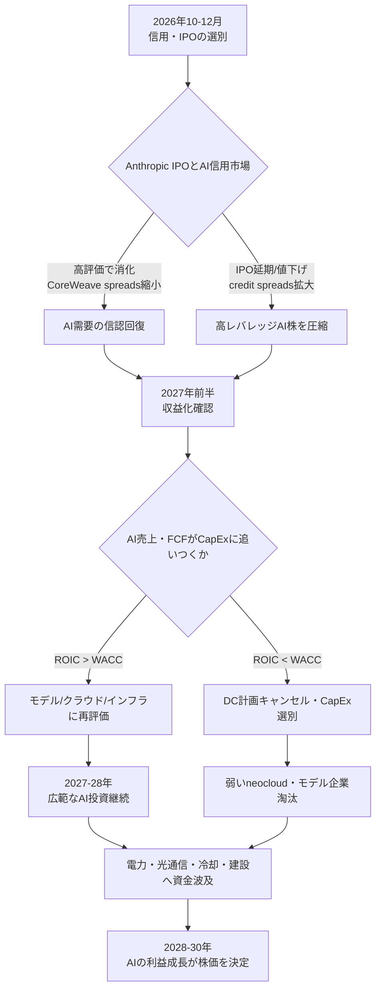

# AI投資は回収できるか――Anthropic IPO、CoreWeaveショック、中国AI、電力制約から読む「AIバブル後半戦」

## Executive Summary

**結論から言えば、「AIバブルは崩壊しない」という断定よりも、2026年秋から始まったのは“AI投資そのものの終焉”ではなく、“資本コストを無視したAI投資の終焉”と見るのが最も整合的です。** CoreWeaveの信用不安、Anthropicの巨額コンピュート契約、電力不足、金利上昇は同じ問題の別の表現です。すなわち、AIの**実需は依然急増している一方、需要があることと、すべてのAIプロジェクトが資本コストを上回るROICを出せることは全く別**です。CoreWeaveショックは「AI需要消滅」の証拠ではなく、レバレッジを使って需要を先取りした企業から始まる**資本配分の正常化**と解釈するのが妥当です。CoreWeaveは約500億ドルの債務を抱え、2026年設備投資計画を350億～390億ドルへ引き上げる一方、依然赤字と見込まれており、債券・株式双方が大きく売られました。citeturn0search11turn0search1turn0search49

本レポートのベースケースは、**「AI総投資はピークアウトせず、内部で大規模な選別が始まる」確率を約55%**と置きます。強気ケース25%は、AI収益化が設備投資の伸びを上回り、2027年に再び広範なAI株高へ移行するケース。弱気ケース20%は、信用スプレッド拡大、データセンター延期、Anthropic IPOの延期・ディスカウント、ハイパースケーラーの設備投資下方修正が連鎖するケースです。これは確定予測ではなく、2026年10月19日時点の情報から構築した投資シナリオです。Goldman Sachsは2026～2031年のAI関連設備投資をベースケースで約7.6兆ドルと推計し、Morgan Stanleyも2026年約8,000億ドル、2027年約1.1兆ドルのAI設備投資を想定しています。BlackRockもAIが電力・資本・素材・バランスシートを大量に吸収する局面に入ったとの見方を示しています。citeturn9search0turn9search9turn9search2

重要なのは、**AI投資の回収主体は必ずしもGPUを買った企業と一致しない**ことです。社会全体では、生産性向上によって投資回収が成立していても、価値の取り分が「AIモデル企業 → クラウド → 電力 → 光通信 → 冷却 → 建設」へ移動する可能性があります。QJE掲載のBrynjolfsson、Li、Raymondによる5,172人のカスタマーサポート担当者の研究では、生成AI支援により平均生産性が約15%向上し、経験の浅い労働者では約30%の改善が確認されています。2026年のBIS研究でも、米欧1万2,000社超を分析し、AI導入企業で短期的に約4%の労働生産性向上が確認され、特にソフトウェア、データ、人材投資との補完性が重要とされました。citeturn5search16turn12search18

一方で、**「AIを導入すれば必ず生産性が上がる」という前提も誤り**です。METRの熟練オープンソース開発者を対象とするランダム化実験では、2025年当時のAIツールを使った開発作業が平均19%遅くなりました。したがって、AIバブル論の正しい分解は「AIは役に立つか」ではなく、「どの業務・どの企業・どの価格ならROIC>WACCになるか」です。citeturn7search4

投資家として最も重視すべき式は単純です。

\[
\text{AI投資回収条件}
=
\frac{\text{AIによる増分営業CF}+\text{コスト削減}+\text{新規売上}}
{\text{AI関連投下資本}}
>
\text{WACC}
\]

2024～25年までは分母である**CapEx**が株価を決めていました。2026年末からは分子である**増分FCF**が問われます。Morgan Stanleyの分析でも、2023年末以降「AI導入企業」の利益予想上方修正が「AIにディスラプトされる企業」を大きく上回り、2024～25年にはAI導入企業群のEBITマージン改善がMSCI Worldを上回ったとされています。つまり、AI投資の収益化は既に一部企業では損益計算書に現れ始めています。citeturn10view2turn11view2

**最大の投資機会は、AIモデル企業そのものより、AIが勝っても負けても必要になる物理インフラへ徐々に移っています。** 電力、送配電、変圧器、光ファイバー、冷却、電気設備工事、データセンター建設がそれです。IEAによればデータセンターは2024年に約415TWh、世界電力消費の約1.5%を使用しており、近年の需要増加率は年率約12%。IEEJは2025年497TWhから2035年1,080TWhへ2倍超となる基準ケースを置いています。citeturn22search7turn20view0

**日本株については、「AI半導体からAIインフラへ」のローテーション余地が大きい**と考えます。特にNTT、日立、フジクラ、古河電工、住友電工、ダイキン、明電舎、大林組、関電工、電力会社は、AI計算量そのものよりも「電力密度」「光伝送量」「冷却需要」「建設量」の増加を収益源にできます。実際、NTTデータグループはAnthropicの日本初のデータセンターを大阪に建設する方向で最終協議に入ったと報じられており、日本のAIインフラ企業が直接的に海外AI需要を取り込む構図が現れ始めています。citeturn22news36

## Anthropicの実需・技術・収益モデルと社会的インパクト

Anthropicはもはや「将来収益を期待される研究所」ではなく、**極端に高い成長率を持つエンタープライズAI企業**へ移行しています。Anthropicは2026年2月のSeries Gで300億ドルを調達し、ポストマネー評価額は3,800億ドル。5月にはReutersが、Series Hで650億ドルを調達し、評価額が9,650億ドルに達したと報じました。同時期の年間換算売上高は約470億ドルと報じられています。さらにReutersによれば2026年8月には年間換算売上高が650億ドルを超えました。citeturn1search4turn1search3turn1search7

売上の加速は単なる個人向けサブスクリプションではありません。Anthropic自身によると、2026年入り後に**Claude Codeの法人契約は約4倍**となり、その収入の過半がエンタープライズ顧客から発生しています。また、Google/Broadcomとの計算基盤拡大発表時点で年間換算売上高は300億ドル超、年間100万ドル以上を支払う法人顧客は1,000社超へ増え、その社数は2カ月未満で倍増したとしています。これは「チャットボット利用」より、ソフトウェア開発・社内業務・API・エージェントへの組み込みが実需の中心になりつつあることを示します。citeturn1search4turn1search15

Reutersが報じた2026年第3四半期売上高は168億ドルで、Q2の116億ドル、Q1の47億ドルから拡大し、Q3には調整後ベースで黒字化したとされています。ただし、Q2の前四半期比2倍超に対しQ3の伸び率は約45%へ鈍化しており、「高成長は継続しているが、成長率の二階微分は悪化した」というのが機関投資家的には重要です。citeturn2search6turn3search7

収益モデルは大きく、**個人向けClaude、有料法人契約、Claude Code、API従量課金、AWS/Google Cloud経由販売**の五層です。中でもクラウド流通への依存は大きく、Reutersによるconfidential prospectus分析では、2025年にAmazon・Googleのクラウドマーケットプレイス経由売上が約21.6億ドル、全売上の約47%を占めたとされ、関連する販売手数料は約3.51億ドルと推計されています。二つの非開示顧客がそれぞれ2025年売上高の約12%を占めたとも報じられました。したがってAnthropicには強い実需がある一方、**販売チャネル・大口顧客集中リスク**があります。citeturn2search12

より重要なのは、収益の急成長と同時に**巨額の固定的コンピュート契約を背負っていること**です。Reutersがprospectusを基に報じた数字では、Anthropicは今後約5,180億ドルのクラウド・計算・インフラ関連契約を抱え、Google向け少なくとも1,111億ドル、Amazon向け約1,100億ドル、Microsoft向け約314億ドルなどの契約が含まれます。一部は利用量にかかわらず支払い義務が発生する契約だと報じられています。2025年末時点の取消不能なホスティング・計算能力契約は約546億ドル、2026年初めには長期契約総額が4,170億ドル超、約3.5GWの専用計算能力に相当するとされています。citeturn2search4turn2search12

これはAnthropicを分析するうえで最重要のポイントです。**Anthropicは「ソフトウェア企業の評価倍率」と「電力会社・データセンター会社並みの長期固定費」を同時に持ち始めています。** 2025年売上は約46億ドルまで増えたものの、営業損失は評価損等を除いても80億ドル超だったとReutersが報じています。したがって収益化の鍵は売上成長率そのものではなく、

> **トークン価格下落率 < inference量増加率 × 計算効率改善率**

を維持できるかです。citeturn1search2turn2search0

Anthropicの資本・契約状況を、公開確認可能な情報と報道されたconfidential prospectus情報に分けると次のようになります。

| 項目 | 2026年10月19日時点 | 投資家としての読み方 |
|---|---:|---|
| Series G | 300億ドル調達、3,800億ドルpost-money | 2026年2月時点の公式評価。citeturn1search4 |
| Series H | 650億ドル、評価額約9,650億ドルとReuters報道 | 半年弱で評価額2倍超。IPO価格形成の基準。citeturn1search3 |
| Amazon | 最大250億ドル規模の資本支援・関係強化が報道 | 株主持分の正確な比率は**未公表**。AWSへの依存と垂直統合が両面。citeturn1search3 |
| 長期compute契約 | 約5,180億ドル | 売上成長が鈍化すると「成長投資」が「固定負債」に変質。citeturn2search4 |
| 専用compute | 約3.5GW相当との報道 | もはや電力調達能力が競争力そのもの。citeturn2search12 |
| Public Benefit Fund | 株式5%を拠出する計画、株主承認条件付き | 希薄化・ガバナンス・公益目的を同時に評価する必要。citeturn1news38turn2news34 |
| 創業者持分 | 正確な比率は**未公表** | 創業者は自己保有株式の80%を公益目的に寄付する方針と報道。citeturn1news38 |
| IPO株数・価格・ticker | **未公表** | public S-1の正式条件待ち。citeturn0search0 |

社会的インパクトについては二面性があります。一方ではClaude Codeを代表に高度知的労働を代替・補完し、QJEやBISが示す生成AI一般の生産性効果を企業へ移植する可能性があります。他方、Anthropic自身のThreat Reportは、サイバー攻撃、詐欺、影響工作、監視、生物学的悪用、兵器関連利用、他社モデルへの蒸留などの悪用事例を報告しています。IPO prospectusには高度モデルの制御不能・shutdown回避等のリスクまで長大に記載されたとReutersが報じています。citeturn1search8turn3search23

したがってAnthropicに対する本レポートの評価は、**技術・需要＝非常に強い、収益化＝急速に改善、バランスシート外を含む将来固定費＝極めて大きい、ガバナンス＝通常のSaaSより複雑**です。AIの実需を証明する企業であると同時に、AI投資回収の成否を最も純粋に試す「巨大な実験」でもあります。citeturn2search6turn2search4turn1news42

## Anthropicの十一月IPO確率と日米市場への影響

Anthropicは2026年6月1日、**IPOに向けたdraft registration statementをSECへconfidentialに提出した**と正式発表しました。ただし発行株数、価格、調達額、ティッカー、正式な上場日程は設定されていないと明記しています。したがって、2026年10月19日時点で「11月上場が決定した」という表現は適切ではありません。citeturn0search0turn3search6

報道は一度前倒し方向へ振れた後、再び後ずれしています。Reutersは9月4日に、早ければ10月中旬からIPO marketingを開始し、米中間選挙前のデビューも視野に入ると報じましたが、9月28日にはprospectusを基に「中間選挙後へずれ込む可能性」を報道し、10月14日には**public-market debutは11月の米中間選挙後になる可能性が高い**と報じました。一方、APは10月18日時点で11月IPOが見込まれていると報道しています。citeturn3search11turn3search3turn3search15turn2news34

以上から、本レポートの主観確率は次のように置きます。

| シナリオ | 主観確率 | 想定 |
|---|---:|---|
| **2026年11月上場** | **45%** | 中間選挙後、11月中旬～下旬にpricing |
| 2026年12月上場 | 30% | CoreWeave信用不安・市場ボラティリティを見て数週間延期 |
| 2027年以降 | 25% | valuation gap、ガバナンス、安全性、開示・市場環境で延期 |

この45%は会社予想ではなく、**Reuters/APの相反する最新情報、public termsがなお未公表であること、CoreWeaveを起点としたAI信用スプレッド再評価を合わせた本レポート独自推計**です。citeturn3search15turn2news34turn0search12

候補スケジュールは次のようになります。

| 時期 | 中立シナリオ | 状態 |
|---|---|---|
| 2026年10月19日時点 | confidential SEC review | 確認済み。公開の最終条件は**未公表**。citeturn0search0 |
| 10月後半 | prospectus公開・価格レンジ提示の可能性 | **未公表** |
| 11月初旬 | 米中間選挙を通過 | Reutersは選挙後への後ずれを報道。citeturn3search15 |
| 11月中旬～下旬 | roadshow / pricing / listing候補 | 本レポートのベース想定、**未公表** |
| 12月 | 市場不安時のfallback | 本レポート想定 |
| 2027年 | valuation・規制・市況悪化時 | downside scenario |

IPO評価額についても確定情報はありません。2026年5月の9,650億ドル評価を起点に、その後一時2兆ドル前後が意識された一方、Reutersは10月に投資家の一部が約1.5兆ドル程度を議論していると報道しました。したがって**正式IPO valuationは未公表**です。citeturn1search3turn1search6

発行比率まで未公表なので、「上場規模」はシナリオ分析しかできません。

| 仮定 | 評価額 | 新規・売出し株比率の分析仮定 | 理論的オファー規模 |
|---|---:|---:|---:|
| 悲観 | 0.8～1.0兆ドル | 5% | 400～500億ドル |
| 中立 | 1.2～1.5兆ドル | 7.5% | 900～1,125億ドル |
| 楽観 | 1.8～2.0兆ドル | 10% | 1,800～2,000億ドル |

**この表の発行比率・調達額はAnthropicのガイダンスではありません。完全な感応度分析です。** 実際の株数、primary/secondary比率、greenshoe、ロックアップ期間はいずれも**未公表**です。ロックアップについて以下では180日を感応度分析上の仮定として使用しますが、実際の契約条件を意味しません。citeturn0search0

市場インパクトは二段階になると考えます。上場前は、巨大なIPOのために機関投資家が現金を作る必要が生じれば、米大型テック、AIインフラ、CoreWeave等から資金が抜け、**一時的な需給悪化**が起こり得ます。反対に、Anthropicが高い評価額で消化されれば「AIモデルには実際に数百億ドル規模の売上がある」と市場が確認でき、クラウド、データセンター、電力、光通信を含むAI設備投資チェーンに対するリスクプレミアムが低下する可能性があります。この部分は上記fundamentalsからの本レポートの推論です。citeturn2search6turn2search4

日本株への影響は、**半導体だけを見ると一時的な資金吸収がネガティブ、インフラを見るとfundamental confirmationがポジティブ**となる可能性があります。特にAnthropicが日本でNTTデータと大阪データセンターを検討しているとの報道は、Anthropicの上場・資金調達が日本の光通信、電力設備、建設、冷却需要へ直接波及する可能性を示します。citeturn22news36

類似案件としてCoreWeaveは「AI企業をpublic marketがどのように評価するか」という意味では参考になりますが、経済構造は大きく異なります。CoreWeaveは固定資産と債務を大量に抱えるGPUクラウドであり、Anthropicはモデル/APIを主力としながら長期compute契約を通じて事実上巨大な固定費を負います。**Anthropic IPOで市場が最も厳しく見るのは売上成長率ではなく、「将来compute commitment / 将来粗利益」の比率になる**と考えます。citeturn2search4turn0search11

## 中国AIが台頭してもAI投資サイクルが直ちに崩れない理由

「DeepSeek型の低コストモデルや中国AIが進歩すれば、高価な米国AIインフラは不要になる」という議論には、一部正しい部分と大きな飛躍があります。

正しい部分は、**モデル層の価格決定力は低下する**ことです。より少ない計算資源で同等性能を実現できれば、1トークン当たり推論価格は下がり、Anthropic、OpenAI等の粗利率には圧力がかかります。したがって、中国AIの台頭は「AIバブルに無関係」ではありません。むしろモデル企業のvaluationには明確なディスインフレ圧力です。

しかし、それがそのままデータセンター需要の崩壊を意味しません。**コンピュート単価低下と総コンピュート消費量低下は同義ではない**からです。価格低下によって、従来は採算に合わなかったコールセンター、コーディング、法務、金融分析、動画生成、ロボティクス、エージェントが利用可能になれば、単位コスト低下以上に利用量が増える可能性があります。Anthropic自身の売上とClaude Code法人利用が急増している事実は、モデル単価低下と需要拡大が同時に起こり得ることを示す現時点の市場データです。citeturn1search4turn1search15

第二に、**中国と西側のAI市場は完全に一つの市場ではありません。** 2026年10月時点でも、米国の輸出規制の影響からNvidiaの中国データセンターAIチップシェアは2026年前半に34%まで低下し、Huaweiなど中国企業のシェアが拡大しています。これは中国がAI投資を止めたことではなく、むしろ中国側に独立したAIインフラスタックが形成されていることを意味します。citeturn23search12turn23search22

さらに北京自身も先端AIを戦略資産と見なし、2026年には最先端AIモデルへの海外アクセスを制限する案を検討しているとReutersが報じています。中国当局はAIモデル・半導体技術の追加的輸出規制も検討していると報じられました。つまり、**中国AIが安価だから世界中の企業が同一モデルへ収斂するという前提自体が、地政学的に成立しにくい**のです。citeturn23search4turn23search16

中国国内でも生成AIはサイバーセキュリティ法、データセキュリティ法、個人情報保護法等の上に構築されたGenerative AI Interim Measuresの対象となり、訓練データ、個人情報、コンテンツ、安全性等に義務が課されています。したがって日米欧の大企業が中国モデルを採用する際も、単純なベンチマーク性能・価格だけではなく、データ所在地、IP、監査可能性、国家安全保障、ベンダー継続性を調達条件として評価する必要があります。citeturn23search3turn23search31

第三に、中国AIの台頭はむしろ**「AI需要が本物かどうか」を検証する競争圧力**になります。米国モデルが高価格でも採用され続けるなら、それは高い安全性、tool use、enterprise integration、モデル品質等への支払い意思が存在する証拠になります。一方、価格差だけで中国・open-weightモデルへ流れる用途では米国モデル企業の超過利潤が消えます。つまり、淘汰されるのは「AI」ではなく**AIモデル企業のrent**です。

投資家にとって最も重要なのは、これによって価値の所在が

**モデル → inference量 → クラウド → ネットワーク → 電力・冷却**

へ下流化する可能性が高まることです。Goldman、Morgan Stanley、BlackRockがAI設備投資の継続を予想するのは、モデル一社の価格決定力ではなく、計算需要全体の拡大を前提にしているからです。citeturn9search0turn9search9turn9search14

ただし「中国AIがあっても絶対にAIバブルは崩れない」とまでは言えません。**効率改善率が利用量増加率を恒常的に上回り、同時にモデル価格競争でAI企業の営業CFが減り、ハイパースケーラーが設備投資を削減すれば、AIインフラ投資は実際に過剰設備になります。** 現時点では、Anthropicの実需、Schneider Electricのデータセンター向け需要急増、光通信需要、電力接続需要を見る限り、このシナリオが中心とは言いにくい、というのが本レポートの判断です。Schneiderは2026年第3四半期にデータセンター関連需要が急増したことを背景に通期見通しを再度引き上げています。citeturn22news35

## CoreWeaveショックが示すAI金融構造の弱点と淘汰の必要性

「CoreWeaveショック」は正式な金融用語ではなく、2026年10月のCoreWeave株・債券・信用市場の急落を指す市場上の呼称と捉えるべきです。

本質は極めて単純です。

> **AI需要の問題というより、「将来AI需要を担保に現在どれだけ借金してよいか」という信用問題です。**

CoreWeaveは約500億ドルの債務を抱え、黒字化前にもかかわらず2026年CapExを350億～390億ドルへ引き上げました。市場予想では2026年売上約130億ドルに対し約21億ドルの損失が見込まれていました。そのため金利上昇やデータセンター完成遅延が起きると、将来収益の現在価値が低下するだけでなく、**借換コスト自体が上昇する二重の打撃**を受けます。citeturn0search11turn0search2

信用不安時にはCoreWeaveの債務保険コストが約1,000bpまで上昇したとReutersが報じました。Nvidiaが未販売capacityを2032年4月まで一定条件で支えるbackstopがあっても、株式・債券投資家が懸念しているのは「GPUに需要がない」ことではなく、**建設費・電力・金利を先に払った後、十分高い利用率と価格でcapacityを販売できるか**です。citeturn0search1

したがってCoreWeaveの収益モデルは、

\[
ROIC \approx
\frac{
\text{GPU利用率}
\times
\text{時間当たり単価}
-
\text{電力・運用・減価償却費}
}{
\text{GPU+DC+電力インフラ投資}
}
\]

で決まります。

Morgan Stanleyの1GW AIデータセンターを用いた仮想モデルでも、ROICはtoken pricingに極めて敏感で、前提次第で約20%から70%超まで大きく振れると分析されています。つまり、「GPUが100%稼働する」という仮定ならAI設備投資は驚異的に高いリターンを出せますが、**価格低下と利用率低下が同時に来ればROICは急速に崩れます**。citeturn10view0

より大きな問題はCoreWeave一社ではありません。IMFの2026年10月Global Financial Stability Reportは、2023年以降の大型AI関連14案件において、約3,000億ドルのequity、約6,500億ドルのdebt、さらに約1.4兆ドルの将来サービス・チップ購入コミットメントが絡む金融構造を問題視しています。そのうち約3,200億ドルの債務は投資家等から何らかの支援を受け、一部がoff-balance-sheet化されているとされています。IMFは「投資家がAI企業に資金を出し、そのAI企業が投資家側のクラウドやチップを購入する」循環的構造に伴うwrong-way riskを指摘しています。citeturn23search2turn23search6turn23news32

これは2000年前後の通信バブルと似た面があります。ただし決定的な違いは、現在のAI投資には既に**数百億ドル規模の実売上と測定可能な企業生産性向上**があることです。したがって「すべて架空需要」という説明はデータと一致しません。問題は、実需の成長率以上の速度で負債を積んだプレイヤーがいることです。AnthropicのQ3売上、QJE/BISの生産性研究、CoreWeaveの債務を同時に見る必要があります。citeturn2search6turn5search16turn12search18turn0search11

CoreWeave型ショックは、長期的にはAI産業にとって必ずしも悪いことではありません。**資本コストによる淘汰は、採算性の低いデータセンター計画を止め、電力・建設人員・変圧器・光ファイバーを高ROIC案件へ再配分します。** Reutersは市場関係者の見方として、現在の売りはAI需要の突然の消滅よりも、AI buildoutをどのようにfinancingしているかに対する再評価だと報じています。またDan Ivesは計画中AIプロジェクトの最大約10%が実現しない可能性に言及しています。citeturn0search21turn0search12

これは「10%キャンセル＝AIバブル崩壊」ではありません。むしろ、

**100件の案件を全部建てる段階 → 採算の良い90件だけ建てる段階**

への移行です。

機関投資家にとっては、この段階から売上成長率よりも**interest coverage、net debt/EBITDA、契約のtake-or-pay比率、電力接続日、GPU減価償却期間、顧客集中、FCF**が株価説明力を持つようになります。

## 電力制約と日本の「つるはし」企業の機会

AI投資を最終的に制約するものは、GPU供給より電力供給へ移りつつあります。IEAによればデータセンター電力消費は2024年約415TWhで世界電力需要の約1.5%、過去5年間の増加率は年率約12%でした。IEEJは2025年約497TWhから2035年1,080TWhへの増加を想定し、高効率冷却、ICT効率改善、アルゴリズム改善等によって2035年需要を約20%削減できる可能性も示しています。citeturn22search7turn20view0

したがって「AIが省電力化するから電力需要は増えない」という議論も単純化しすぎです。IEEJの分析では、効率改善を織り込んでもデータセンター需要自体は大規模に残ります。先進国ではデータセンターが最終電力需要に占める比率が2023年2.9%から2035年7.2%まで上昇するとの推計です。citeturn20view0

上図はIEEJの2025年497TWh、2035年1,080TWhという基準点を一定CAGRで機械的に補間した**本レポート独自チャート**です。したがって2030年値はIEEJが公表した年次forecastそのものではありません。方向性確認用に使うべきです。IEEJの元シナリオでは2035年に1,080TWh、高効率技術ケースでは約865TWhまで抑えられる可能性があります。citeturn20view0

米国ではさらに局地的制約が強いです。Goldman Sachs Alternativesのインフラ分析では、2028年までに米国で潜在的に約45GWの電力不足が発生し得ると推計され、2030年までに大規模な追加電力capacityが必要とされています。PJM地域ではFERC関連資料を報じたReutersによると、データセンター需要が2030年に29GWへ約3倍となり、約6.8GWの供給不足が問題になっています。citeturn10view1turn22news38

この第二図の2028年中立ケース約45GWのみがGoldman Sachsの外部アンカーで、それ以外の年次数値は、発電所・送電網・許認可の進捗差を示すための**本レポート独自シナリオ**です。公式forecastではありません。重要なのは点予測ではなく、電力供給がAI需要より数年遅れる場合、**電力1MWの経済価値がGPU1台の価値と同じくらい重要になる**という点です。citeturn10view1turn22news38

実際、Microsoftが英国Nscaleのデータセンター計画から撤退した背景として、送電網接続が2030年代まで得られない可能性が報じられています。これはデータセンターのボトルネックが資金ではなく**grid availability**になり得ることを象徴しています。citeturn0news37

ここで日本企業には大きな機会があります。

**光通信**では、AIクラスターが巨大化するとGPU間、ラック間、建屋間、データセンター間の帯域が急増します。古河電工は2026年にAIデータセンター需要拡大を受け次世代光コネクタの供給体制を強化し、通信ソリューション部門でもRollable Ribbon Cable、MTフェルール等を拡大しています。住友電工もAIデータセンター向け光デバイス・光接続製品需要の増加を明記しています。citeturn19search8turn19search35turn19search2

**NTT**はIOWNのAll-Photonics NetworkをAIデータセンター向け低消費電力・大容量ネットワークの中核へ位置付けています。2026年には2Tbit/s無線伝送や800Gクラス光ネットワーク監視技術を発表しており、AIクラスタが分散化するほど、計算機ではなく「計算機同士を省電力で結ぶ」価値が高まります。citeturn17search6turn17search12turn17search19

**冷却**ではダイキンが重要です。同社は2025年にAI/HPCデータセンター向けnegative-pressure liquid coolingを持つChilldyneを買収し、air、liquid、hybrid、rack-level coolingを一体化する方向へ事業領域を広げています。AIラックの電力密度上昇は、従来型空調から液冷への置換を加速させるため、GPU世代に依存しにくい「二次的AI需要」です。citeturn19search3turn19search17

**電力設備**では変圧器、開閉装置、UPS、送電線、電気工事が必要です。明電舎は高電圧変圧器等を手掛け、関電工は送配電・大規模電気設備工事を展開しています。これはAIがどのモデルを勝者にしても必要になる領域です。citeturn22search23turn22search2

**建設**では大林組が国内データセンターの設計・建設ノウハウを明示的に事業化しています。設備の高度化、耐震性、短工期、電力設備、冷却の複雑化により、「床面積」ではなく**MW当たり建設単価**が上昇しやすいことが建設会社の収益機会です。citeturn22search1

そして日本市場にとって最も重要な実証材料が、AnthropicとNTTデータです。2026年10月13日、ReutersはNTTデータがAnthropic初の日本データセンターを大阪で構築する方向で最終協議していると報じました。これは「日本のAI需要」だけでなく、**米国AI企業の設備投資を日本企業が海外需要として取り込む**経路が実際に形成され始めたことを示します。citeturn22news36

## 選別相場のシナリオ、評価指標、トリガー

2026年末以降のAI相場は、従来の「AIに関連しているか」ではなく、

**誰がAI投資のコストを負担し、誰がAI投資のキャッシュフローを受け取るか**

で株価が二分されると考えます。

最も重要な評価指標は以下の四群です。

| レイヤー | 最重要指標 | 警戒シグナル |
|---|---|---|
| AIモデル | 売上成長、compute cost / revenue、gross margin ex-compute、enterprise retention | token価格低下 > inference量増加、長期compute契約膨張 |
| Cloud / neocloud | GPU利用率、revenue/MW、ROIC、net debt/EBITDA、interest coverage | utilization低下、借換スプレッド急拡大 |
| インフラ供給者 | book-to-bill、backlog、営業利益率、FCF conversion | backlog cancel、顧客集中、能力増強過多 |
| 電力会社 | 接続契約、PPA期間、負荷率、送配電投資ROE | grid delay、規制、発電capacity不足 |

Anthropicで特に見るべきは**compute commitments / annualized gross profit**です。CoreWeaveでは**debt / contracted EBITDAとcapacity utilization**。日本の光通信・電力設備企業では**受注残と増産CapExからのFCF転換**が重要になります。citeturn2search4turn0search11turn20view1

時系列では、次のような展開を想定します。

**短期、2026年10～12月**はfundamentalより信用市場です。CoreWeave債券、private credit、Anthropic IPO、ハイパースケーラーのCapEx guidanceが重要で、AI株の相関が一時的に高まります。CoreWeave型企業の信用スプレッドがさらに上がれば、株式市場では最初に「将来利益が大きく、現在FCFが小さい」企業のmultiplesが縮小します。citeturn0search12turn23search2

**2027年前半**は「AI投資が売上に転換したか」が焦点です。AI導入企業のマージン改善、Claude/他モデルの法人ARPU、クラウドAI売上、ソフトウェア企業のseat expansionを見る局面です。企業生産性研究と実際の決算が一致すれば、AIのvaluationは「ストーリー」から「利益成長」へ移れます。citeturn5search16turn12search18turn11view2

**2027年後半～2028年**が最も危険です。現在大量に建設されているデータセンターが稼働し始め、供給量が増える一方、借換・減価償却・電力コストが本格化します。ここでGPU utilisationが十分でなければcapacity価格が低下し、CoreWeave型企業からsecond-order shockが発生します。逆に需要が供給を吸収すれば、現在の「バブル論」は急速に後退します。これは現在の債務・設備投資構造からの本レポートの推論です。citeturn0search11turn22search29

**2028～2030年**には電力が最大のボトルネックとなり、AI valuationより電力接続権・送電・変圧器・冷却・光通信の物理的capacityが重要になります。IEA/IEEJの電力需要予測と現在のgrid bottleneckは、この方向を支持します。citeturn22search7turn20view0turn22news38

本レポートの株式市場シナリオは以下です。

| シナリオ | 確率 | 米国株 | 日本株 |
|---|---:|---|---|
| **選別相場・ベース** | **55%** | Nasdaq全体は高ボラ、AIモデル/neocloud低迷、cash-rich hyperscalerとインフラ優位 | 半導体集中から光・電力設備・建設・冷却へrotation |
| 強気 | 25% | Anthropic IPO成功、AI売上加速、credit spread縮小で再度broad rally | 半導体＋つるはし双方上昇 |
| 弱気 | 20% | AI CapEx下方修正、IPO延期、信用事故で高beta AIに20～35%級の調整を分析上想定 | 半導体・光通信は調整、utility・建設等の相対耐性 |

20～35%という下落幅は過去データの予測値ではなく、**stress scenario上の仮定**です。

ここで特に重要なのは、「AI関連株全体のPERが高いか」ではなく、

\[
\frac{\text{増分AI営業利益}}
{\text{AI設備投資}}
\]

が企業ごとにどれだけ違うかです。**2027年の勝者はAI CapExが最大の企業ではなく、AI CapEx 1ドルから最も多くのFCFを生み出す企業**になります。

## 日本の非AI半導体有望銘柄と投資家向けアクション

以下はGPU、HBM、AIアクセラレータを主投資テーマとする企業を除き、**電力・光通信・冷却・建設・ネットワークという「つるはし」側を中心に選んだ10社**です。住友電工は光デバイス・化合物半導体事業も持つため完全な「半導体ゼロ」ではありませんが、本表での投資論はAIアクセラレータではなく光通信・電力ケーブルです。citeturn20view1

回収年数は会社guidanceではありません。**AI関連の増分案件だけを独立案件として、供給設備型企業のWACCを概ね7～9%、通信・utility型を5～7%、設備の稼働率が中立ケースを達成すると仮定した本レポートの簡易案件DCF/回収期間**です。実際の企業価値DCFとは分けて読む必要があります。

| 企業 | 事業概要 | AI関連の収益化経路 | 電力・インフラ依存度 | 財務健全性の評価 | 主なリスク | AI増分案件の回収シナリオ |
|---|---|---|---|---|---|---|
| **NTT（9432）** | 通信、データセンター、法人IT、IOWN | DC、APN、低電力光通信、AI間ネットワーク。Anthropic日本DCとの関連も強い。citeturn17search6turn22news36 | **非常に高い** | **A−**：安定通信CFが支えるが投資額大 | IOWN普及速度、DC CapEx、金利 | **5～8年**。DC/ネットワークは長期だが継続収入化しやすい |
| **日立製作所（6501）** | 電力網、IT、産業システム | HMAX Data CenterでIT workload、冷却、energyを統合制御。citeturn15search24 | **高い** | **A**：事業分散が大きい | 大型案件execution、valuation | **3～5年**。ハード販売＋保守/ソフト継続収益 |
| **フジクラ（5803）** | 光ファイバー、光ケーブル | AI DC向け高密度fiber、SWR/WTC等。DC需要が利益成長を牽引。citeturn19search7turn19search0 | **中～高** | **A−**：利益成長強いがAI/DC集中度上昇 | 高valuation、顧客CapEx減速 | **2～4年**。増産設備の稼働率を維持できれば10社中最短級 |
| **古河電気工業（5801）** | 光ファイバー、ケーブル、コネクタ | Rollable Ribbon Cable、MT ferruleなどAI DC高密度接続。citeturn19search8turn19search35 | **中～高** | **B+**：成長投資局面 | 大型増産、価格競争、原材料 | **3～5年**。北米AI DC需要が計画通りならFCF転換 |
| **住友電気工業（5802）** | 電力ケーブル、光通信、自動車 | DC内外の光デバイス・光ケーブル＋送配電。2028年に情報通信部門の大幅拡大を目標。citeturn20view1turn19search2 | **高い** | **A**：事業分散が強み | 自動車等非AI事業、中国・原料 | **3～5年**。光＋電力の二重exposureが最大の利点 |
| **ダイキン工業（6367）** | 空調・冷却 | AIラック向けliquid/hybrid cooling。Chilldyne等買収で液冷へ展開。citeturn19search3turn19search17 | **高い** | **A−**：グローバル事業基盤 | M&A統合、競合Vertiv/Schneider等 | **4～6年**。液冷比率上昇とservice revenueが鍵 |
| **明電舎（6508）** | 変圧器、受変電、電力設備 | DC受電設備、変圧器、電力品質設備 | **非常に高い** | **A−**：需要環境良好、案件型 | 部材、人手、納期、受注採算 | **3～5年**。変圧器不足が価格決定力を維持すれば短縮。citeturn22search23 |
| **大林組（1802）** | 総合建設 | データセンター設計・施工、耐震、電力・冷却設備統合 | **非常に高い** | **A**：受注型でDC保有リスクを負いにくい | 建設インフレ、人手不足 | **2～4年**。DCそのものを保有せず施工利益を取るため回収が比較的速い。citeturn22search1 |
| **関電工（1942）** | 電気設備、送配電工事 | DC受変電、電気設備、送電capacity増強 | **非常に高い** | **A**：asset-heavy DC運営よりリスク低 | 技能者不足、工期、資材高 | **2～4年**。設備投資より受注・人員capacityが制約。citeturn22search2 |
| **中部電力（9502）** | 発電・送配電・小売 | DC大口需要、grid connection、長期電力販売 | **最大** | **B+**：utilityの安定性と巨額資本需要が併存 | 規制、燃料、金利、発電投資 | **8～12年**。PPA・grid投資型の長期回収。日本の電力需要上振れが重要 |

相対順位を付けるなら、**リスク調整後の第一群はNTT、日立、住友電工、ダイキン、大林組・関電工**です。AIモデルの勝敗に依存せず、AI設備投資が継続する限り収入が生じやすく、かつGPU価格そのものへのexposureが小さいからです。NTTはAnthropicとの直接的な日本データセンター案件の可能性、日立は電力・IT・冷却の統合、住友電工は光と送電の二面性を持ちます。citeturn22news36turn15search24turn20view1

**高betaの第二群はフジクラ、古河電工**です。AI需要に対する利益弾性は高い反面、株価が既に高い成長期待を織り込むほど、「需要が増えたのに株価が下がる」現象が起こりやすくなります。これが選別相場の典型です。実需が強いことと期待リターンが高いことは同義ではありません。AIデータセンター向け光需要自体は引き続き強いとの報道・会社資料があります。citeturn19search0turn19search35

**ディフェンシブな第三群は電力・建設・電気工事**です。AIモデルのtoken価格が半減しても、既に着工されたデータセンターには受電設備、配線、冷却、建設が必要です。ただしutilityは収益回収期間が長く、金利・規制が大きいため、純粋なAI growth stockとは評価方法を分ける必要があります。PJMで既に電力供給不足が顕在化し、日本でもデータセンター集積が進むことはこのテーマを支持します。citeturn22news38turn22search28

**短期、2026年10月～2027年初頭**は、AI関連株を一律に買う局面ではありません。CoreWeave CDS・債券、Anthropic公開prospectus、IPO valuation、ハイパースケーラーCapEx、データセンター接続延期を監視し、**net debtが大きくFCFが遠いAI企業を避け、受注残が既に存在する光・電力設備・施工企業へ比重を移す**のが合理的です。Anthropicが11月に高評価で上場できればリスクオン、延期または大幅ディスカウントなら短期的にはAI high-beta全体への圧力になると見ます。citeturn3search15turn0search12

**中期、2027～2028年**は、「AIを作る企業」より「AIで利益率が上がる企業」を探す局面になります。AI導入企業のEBIT margin、Claude/APIの法人利用、cloud AI revenue、GPU utilizationが設備投資を正当化できるかを確認します。QJE、BIS、Morgan Stanleyのデータが企業決算でも再現されるなら、AI投資の回収可能性は大幅に高まります。citeturn5search16turn12search18turn11view2

**長期、2028～2030年**は、「計算能力」より**限られた電力をどれだけ多くの知能に変換できるか**が競争優位になります。この段階で日本企業の最大の機会はGPU製造そのものではなく、低損失光通信、APN、変圧器・送配電、液冷、データセンター建設、電気工事です。IEEJが示す電力需要の倍増方向、NTTのIOWN、古河・住友電工の光通信投資、ダイキンの液冷参入は同じ構造変化を指しています。citeturn20view0turn17search6turn19search8turn19search3

最終的な投資判断は、**「AIバブルが崩壊するか、しないか」という二択から離れるべきです。** より可能性が高いのは、

> **AI投資総額は高水準を維持する。  
> ただし資本コストを上回れないAI企業・データセンターは淘汰される。  
> その淘汰によって、利益はモデル企業から電力・光・冷却・建設を含む高ボトルネック企業へ再配分される。**

というシナリオです。

CoreWeaveショックはこの過程の**始まり**であって、現時点ではAI実需の**終わり**を示していません。Anthropicの急増する法人売上、生産性に関する学術的エビデンス、電力・光通信・冷却の受注増を合わせて考えると、AI設備投資には十分な回収経路があります。ただし回収される資本と毀損する資本は今後急速に分かれます。したがって2026年10月以降の最適な機関投資家戦略は、**「AIを売る会社」への一括ベットから、「AI投資1円当たりの増分FCFが最も高い会社」と「AI産業が物理的に避けて通れないボトルネック」へポートフォリオを移すこと**です。citeturn2search6turn5search16turn20view0turn23search2