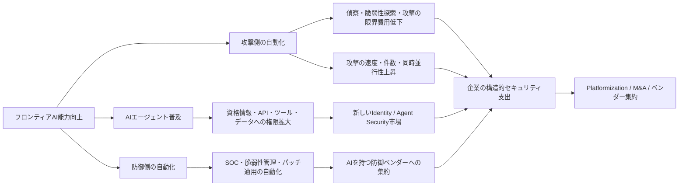

# AI時代におけるサイバーセキュリティの重要性：機関投資家視点の包括的分析

## Executive Summary

**結論から言えば、AI時代のサイバーセキュリティは「IT予算の一項目」から、AI投資・クラウド投資・国家安全保障・事業継続を成立させるための基幹インフラへと格上げされつつある。** これは単なるテーマ投資ではなく、機関投資家にとって、①長期的に削減しにくい支出、②AI普及量に連動して増える「AIへの保険料」、③国家安全保障・規制に支えられた政策支出、④ベンダー集約による勝者総取り性、という四つの構造要因を持つセクターとして評価すべきである。OpenAIはサイバー能力を「severe harm」に至り得るフロンティアリスクとして管理しており、AnthropicはLLMとツールを組み合わせた自律的攻撃が実ネットワークを侵害できることや、中国国家支援と評価した攻撃活動にAIが80～90%の作業を担った事例を公表している。 citeturn4search9turn4search23turn6search12turn6search7

AIはサイバー攻撃側の「労働生産性」を大幅に上げる。偵察、脆弱性探索、エクスプロイト生成、認証情報窃取、横展開、データ抽出、レポーティングまでをエージェントが連続実行できれば、熟練攻撃者一人が管理できる標的数は増える。Anthropicの実験では、LLMに専用サイバーツールキットを持たせると、テスト対象10ネットワーク中5つを完全侵害、4つを部分侵害した。一方、ツールなしではほぼ失敗しており、**AIモデルそのもの以上に「AI＋ツール＋権限」の組合せが重要なリスク変数**である。 citeturn6search12

同時にAIは防御側にも極めて強力である。OpenAIは2025年後半、同社モデルのCTF能力が数カ月で急速に高まったことを踏まえ、新モデルを原則「High」のサイバー能力に到達し得るものとして計画・評価する方針を示した。SoftBank GroupとOpenAIは2026年6月16日に日本向けの「Patching as a Service」を発表し、孫正義氏は **“Attempted cyberattacks powered by advanced AI will become widespread.”** と述べた。これは脆弱性発見から修正までの継続自動化が、新しいサイバーセキュリティ市場になり得ることを示唆する。 citeturn4search23turn8search1

株式市場にも既にこの再評価が表れている。本レポート作成時点の2026年10月5日米国終値ベースでは、Palo Alto Networks（PANW）は2025年末比約**+120.8%**、CrowdStrike（CRWD）は株式分割調整後で約**+132.7%**、Fortinet（FTNT）は約**+131.9%**。一方、Zscaler（ZS）は約**-10.3%**であり、サイバーセキュリティなら何でも上がる相場ではない。AI、プラットフォーム統合、ARR成長、販売執行力、M&Aの質を市場が峻別している。 citeturn0finance0turn0finance1turn0finance2turn0finance3turn15search0turn1search6turn1search7turn2search1

市場予測も構造成長を示す。IDCは世界のセキュリティ・ソリューション支出が年率12%超で伸び、2028年に**3,770億ドル**へ達すると予測する。Fortune Business Insightsは広義のサイバーセキュリティ市場を2026年**2,482.8億ドル**、2034年**6,993.9億ドル**、CAGR **13.8%**と推定する。さらに「AI in Cybersecurity」だけなら2026年**442.4億ドル**から2034年**2,131.7億ドル**、CAGR **21.71%**であり、AI関連部分が市場全体を上回って成長する構図である。定義差は大きいが、複数調査の方向性は共通している。 citeturn24search9turn25search5turn25search1

機関投資家の投資判断として特に重要なのは、**「攻撃件数が増えるからセキュリティ株が上がる」という単純なテーマではない**点である。長期的な勝者になりやすいのは、①エンドポイント・ネットワーク・クラウド・ID・データを横断するプラットフォーム、②大量のテレメトリをAI学習に利用できるデータ優位、③AIエージェント自身を守る新たな製品群、④政府・重要インフラで要求される信頼性と主権性、⑤高いARR/NRRとFCF、⑥買収をクロスセルにつなげられる統合能力、を持つ企業である、というのが本レポートの中心的な投資仮説である。これはOpenAI、Anthropic、IDCおよび公開されている証券会社見解を総合した推論である。 citeturn4search23turn6search20turn24search9turn26news37turn26news39

## AIフロンティアが変えるサイバーリスク

世界の主要AI企業自身が、サイバーセキュリティをフロンティアAIの中核リスクとして位置づけ始めている点は、投資家にとって重要である。AIベンダーが「モデルの悪用防止」に多額のセキュリティ投資を必要とする一方、一般企業は「AIを利用するために新たな防御層」を購入する必要が生じるからである。つまりAI投資の増加は、その一部をセキュリティ支出へ不可避的に転嫁する構造を持つ。 citeturn4search9turn24search9

| 組織・人物 | 日時 | 公的発言・研究・報告 | 脅威認識と対策 | 機関投資家への含意 | 出典 |
|---|---:|---|---|---|---|
| OpenAI | 2025/4/15 | Updated Preparedness Framework | Cybersecurityを「severe harm」につながり得るtracked categoryとして扱い、High/Critical能力に対して事前safeguardを要求。 | モデル能力上昇とともにアクセス制御、監視、red teaming、インフラ防御がモデル開発コストとして恒常化。 | citeturn4search9 <https://openai.com/index/updating-our-preparedness-framework/> |
| OpenAI | 2025/12/10 | Strengthening cyber resilience as AI capabilities advance | CTF性能の急速な改善を踏まえ、新モデルを「High」サイバー能力に到達し得る前提で評価。Highには、堅牢なシステムへのremote zero-day exploitation等が含まれる。アクセス制御、egress control、監視、拒否学習、red teaming等を実施。 | 攻撃・防御双方でAI能力が指数的に改善する可能性。セキュリティ予算はAI採用に対する付随費用になる。 | citeturn4search23 <https://openai.com/index/strengthening-cyber-resilience/> |
| OpenAI | 2026/5/28 | Frontier Governance Framework | cyber offense、CBRN、harmful manipulation、loss of control等をフロンティアAIガバナンス対象に設定。 | AIセキュリティが自主的安全対策から、将来的には規制・監査・ガバナンス市場へ広がる可能性。 | citeturn4search16 <https://openai.com/index/openai-frontier-governance-framework/> |
| Anthropic / Pattern Labs | 2025/7/15 | Claude 4 cyber evaluations | Claude 4 Opusで脆弱性発見や複雑なmulti-step attack chain能力が改善。Anthropicは「人間レベルのサイバー攻撃能力に近づく重要な時期」と評価。 | 攻撃者の限界費用低下が脆弱性管理、ASM、XDR、SOC自動化への需要を高める。 | citeturn6search6 <https://www.anthropic.com/research/claude-4-cyber> |
| Anthropic / CMU CyLab | 2025/6/13 | Incalmo / cyber toolkits | LLM＋サイバーツールキットは10ネットワーク中5を完全、4を部分侵害。ツールなしではほぼ失敗。 | 最大リスクはモデル単体ではなく、エージェントに与えられた「ツール・資格情報・実行権限」。PAM、identity security、agent governanceが新市場になる。 | citeturn6search12 <https://www.anthropic.com/research/cyber-toolkits> |
| Anthropic | 2025/8/9 | Cybersecurity competitions | Claudeは複数のCTFで高成績を達成。モデルコスト低下と能力向上が攻撃経済性を変えると指摘。 | 従来は人材不足で実行困難だった攻撃の自動化が可能になり、攻撃量そのものが増える可能性。 | citeturn6search16 <https://www.anthropic.com/research/cyber-competitions> |
| Anthropic | 2025/11/13 | AI-orchestrated cyber espionage | 2025年9月中旬に検知した、中国国家支援と高い確度で評価するキャンペーンで約30組織を標的化。AIが80～90%の作業を担い、人間は重要判断点に限定されたと報告。 | 「AI assisted」から「AI orchestrated」への移行。SOC側にも同水準の自律性が必要になる。 | citeturn6search7 <https://www.anthropic.com/news/disrupting-AI-espionage> |
| Anthropic / Verizon | 2026/6/3 | Attack Navigator | 2025/3～2026/3に悪意あるサイバー活動と関連する832アカウントを特定し、MITRE ATT&CKへマッピング。 | モデル提供者自身が新しいthreat-intelligence sensorとなる。AIベンダーと従来セキュリティ企業の境界が薄くなる。 | citeturn6search20 <https://www.anthropic.com/research/attack-navigator> |
| xAI | 2026/9/21 | Grok 4.7 Safety & Cybersecurity | refusal/jailbreak耐性を強化し、サイバー・生物分野で有用性を残しながら危険な要求を拒否するsafeguard stackを導入。 | Frontier-model vendor自身にsecurity stackが必要であり、安全性はAI市場の参入障壁にもなり得る。 | citeturn7search15 <https://x.ai/news/grok-4-7> |
| SoftBank Group・OpenAI / 孫正義、Sam Altman、宮川潤一 | 2026/6/16 | Patching as a Service | 孫氏は高度AIによるサイバー攻撃の普及を警告し、「最先端AIで守る」と表明。Altman氏もAIが防御側を加速できると説明。SoftBankは日本の重要インフラ防御への展開を視野。 | 「発見→解析→パッチ生成→適用」の自動化がAI-native securityの新カテゴリになる可能性。日本の国家安全保障テーマとも直結。 | citeturn8search1 <https://group.softbank/en/news/press/20260616> |

AIによる変化を因果関係で整理すると、次のようになる。これは上記OpenAI・Anthropic・IDCの研究・予測から本レポートが構成した投資家向けフレームワークである。 citeturn4search23turn6search12turn6search7turn24search9

ここから重要な投資上の逆説が生じる。**AIがセキュリティ業務を自動化するほど、セキュリティ企業の人員単価ベースのサービスは一部コモディティ化する一方、大量のデータ・モデル・ワークフローをプラットフォームに統合できる企業の価値は上がる可能性がある。** したがって、「AIはサイバー企業を代替するか」という問いより、「AIによってどのベンダーへの集約が進むか」という問いの方が機関投資家には重要である。RosenblattやMorgan Stanleyの公開報道上の見解も、AIによる攻撃面拡大とプラットフォーム型セキュリティ企業の優位を投資材料としている。 citeturn26news37turn26news39

## 上場株としての米国・日本サイバーセキュリティ

米国株では、時価総額と代表性を基準にPalo Alto Networks、CrowdStrike、Fortinetを大型主要銘柄として、Zero Trust/SSEの代表としてZscalerを加えた。2026年10月5日米国市場終値を基準とし、2025年12月31日の終値との**株価リターン**をYTDとして計算した。CrowdStrikeは2026年7月2日から4対1の株式分割後価格で取引されているため、2025年末値も分割調整済み価格を使用している。 citeturn3search6turn3search9

| 米国銘柄 | 2026/10/5頃株価 | 2025/12/31基準値 | YTD | 時価総額概算 | なぜ買われた／売られたか | 投資上の読み |
|---|---:|---:|---:|---:|---|---|
| **Palo Alto Networks（PANW）** | $406.76 | $184.20 | **+120.8%** | 約$326bn | Platformization、AIセキュリティ、CyberArkによるidentity、Chronosphereによるobservability拡張。FY26では買収統合費用が利益見通しを圧迫した一方、サイバー需要を背景に売上見通しは引き上げられた。Rosenblattもagentic AIによるattack surface拡大とplatform需要を評価。 citeturn0finance0turn15search0turn2news40turn15news36turn26news37 | 単一製品より「security operating system」に近づくほどwallet shareを取りやすい。ただし巨大M&Aの統合・希薄化リスクは大きい。 |
| **CrowdStrike（CRWD）** | $272.67 | $117.19（分割調整後） | **+132.7%** | 約$285bn | FY27 Q2でrecord net-new ARR $333m、前年比+51%。FY27 net-new ARR成長見通しのmidpointを34%へ引き上げ、Falcon Flex ending ARRは$2.29bn超、前年比+101%。AI、identity、cloud、SIEMへ拡張。 citeturn0finance1turn1search6turn3search9 | エンドポイントのデータ優位を横展開できる点が最大のmoat。ARR成長が高バリュエーションを支え続けるかが焦点。 |
| **Fortinet（FTNT）** | $184.13 | $79.41 | **+131.9%** | 約$136bn | 2025年末には$79.41まで低下していたが、2026/10/5には新たな52週高値$184.13。高頻度攻撃、AI詐欺、企業の防御強化によりセクター支出そのものが底堅く、セクター再評価の恩恵を受けたと推察される。 citeturn15news37turn3news39turn25news36turn24search9 | 本調査の公開ソースだけでは2026年上昇の個社別寄与分解はPANW/CRWDほど明確でないため、セクター・リレーティングと個社業績を分けて検証する必要。 |
| **Zscaler（ZS）** | $201.80 | $224.92 | **-10.3%** | 約$32bn | 売上自体はFY Q3で前年比約25%成長したが、弱いsales outlook、営業幹部離職への懸念で大幅下落。Symmetry、Red Canary、SPLX、SquareX、Avalor等を通じAI/security platformを拡大しているが、短期的にはexecution riskが勝った。 citeturn0finance3turn2search1turn2news39turn2news41 | 「Zero Trust＝自動的に勝者」ではないことを示す。販売力・guidance・統合実行力が株価に強く影響。 |

**計算式：** YTD = 2026/10/5頃価格 ÷ 2025/12/31終値 − 1。配当を含まないprice return。価格データはYahoo Financeおよび市場データを使用。PANW履歴：<https://finance.yahoo.com/quote/PANW/history/>、CRWD：<https://finance.yahoo.com/quote/CRWD/history/>、FTNT：<https://finance.yahoo.com/quote/FTNT/history/>、ZS：<https://finance.yahoo.com/quote/ZS/history/>。CrowdStrike FY27 Q2一次資料：<https://www.sec.gov/Archives/edgar/data/1535527/000153552726000029/crwd-20260826xex991.htm>。 citeturn15search0turn3search9

PANWとCRWDの差は、単純な製品カテゴリー以上に「プラットフォーム経済性」にある。PANWはfirewall/cloud/SOC/identity/observabilityをM&Aも使って束ね、CRWDはFalconエンドポイント由来の大量テレメトリをidentity、SIEM、cloud、AIへ展開する。Agentic AIが攻撃面を拡大するほど、顧客側は多数のpoint solutionを統合したいインセンティブを持つため、**AI時代はセキュリティ市場の成長と同時にベンダー集約を加速する可能性が高い**。これはRosenblatt、Wedbush、Morgan Stanleyの公開見解とも整合的である。 citeturn26news37turn26news38turn26news39

日本株では、①グローバル規模のTrend Micro、②安全保障・純国産技術へのエクスポージャーが大きいFFRIセキュリティ、③教育・官公庁・企業向けフィルタリングで強いデジタルアーツ、の三社を代表銘柄とした。日本株については、本調査時点でYahoo Financeの過去値レスポンスが一部銘柄について直近約20営業日分に限定され、2025年12月30日終値を同一データ系列で再検証できなかった。**機関投資家向け資料で推定値を精密値として示すことを避けるため、Trend Microだけ厳密なYTDを掲載し、FFRI・デジタルアーツは年初来高安値と10月5日値を併記する。** citeturn16search8turn16search15turn22search9

| 日本銘柄 | 2026/10/5頃 | YTD / 年初来状況 | 2026年の買い材料 | 技術・顧客基盤・政策上の優位性 | 主なリスク |
|---|---:|---|---|---|---|
| **Trend Micro（4704）** | ¥6,742 | 2025/12/30 ¥6,502 → **+3.7% YTD** | Vision Oneを中心とする次世代SOC/AI security、単体SaaSからplatformへの移行、credit方式、海外増収。 citeturn22search9turn21search13turn27view2 | 国内法人向けウイルス対策の大手でグローバル展開。Vision Oneでendpoint/cloud/network/email等の統合を狙える。海外売上分散も強み。 citeturn21search13turn27view2 | AI tokenを含むクラウド費用、人件費、為替、グローバル大手とのplatform競争。Yahoo掲載の決算分析でもAI関連クラウド費用増をリスクとしている。 citeturn27view2 |
| **FFRIセキュリティ（3692）** | ¥8,150 | 年初来高値¥10,430、安値¥4,395。現値は高値比約**-21.9%**、安値比約**+85.4%**。厳密YTDは算定留保。 | 国策・安全保障テーマ、官公庁・重要インフラ案件、「能動的サイバー防御」など政策期待。2025年度には最高益更新期待も株価材料となった。 citeturn21search11turn21search27turn26search13 | 「FFRI yarai」など純国産の研究開発型security。未知マルウェアのbehavior detectionに強み。官公庁・重要インフラでの実績は外国製品依存を減らしたい経済安全保障環境と相性が良い。 citeturn26search17 | 2026年4–6月期は売上+1.2%に対し営業利益-30.0%。小型成長株ゆえ政策期待・受注時期・人件費で業績と株価が大きく振れやすい。 citeturn26search1turn26search5 |
| **デジタルアーツ（2326）** | ¥5,210 | 年初来高値¥6,310、安値¥3,500。現値は高値比約**-17.4%**、安値比約**+48.9%**。厳密YTDは算定留保。 | 2026年4–6月期売上+19.4%、営業利益+30.2%。企業向けcloud、GIGAスクール構想第2期、省庁案件が牽引。 citeturn16search15turn21search1turn26search5 | i-FILTER等のWeb/email filteringで教育・公共セクターに強い。学校・官公庁の顧客基盤は更新需要・制度需要を取り込みやすい。 citeturn26search5turn26search17 | グローバルplatform vendorより海外スケールは小さい。国内公共案件の予算時期・GIGA更新サイクルへの依存度を監視する必要。 citeturn26search5 |

株価履歴・現値の主な確認先はFFRI <https://finance.yahoo.co.jp/quote/3692.T/history>、デジタルアーツ <https://finance.yahoo.co.jp/quote/2326.T/history>、Trend Micro <https://finance.yahoo.co.jp/quote/4704.T>。FFRIの技術・政策材料については <https://strainer.jp/notes/8600> および <https://shikiho.toyokeizai.net/news/0/910801>、FFRI/デジタルアーツの2026年業績比較については <https://www.zaikei.co.jp/article/20260915/870067.html> を参照。 citeturn26search17turn26search13turn26search5

日本株三社を機関投資家目線で分類すると、**Trend Microは「グローバル・プラットフォーム転換」型、FFRIは「国家安全保障・技術主権」型、デジタルアーツは「国内公共・教育の高参入障壁」型**である。FFRIは政策感応度が高い一方で業績の振れが大きく、Trend Microは海外競争とAIインフラ費用、デジタルアーツは国内公共セクターへの集中が主要論点となる。したがって、日本のサイバー株を一括りにするより、ポートフォリオ内で異なるリスクファクターとして扱う方が合理的である。 citeturn27view2turn26search1turn26search5

## 市場規模・機関投資家・証券会社の評価

サイバーセキュリティ市場の定量予測は調査会社により大きく異なる。最も重要なのは数値そのものより、**調査範囲の違いを認識した上で、ほぼすべてが二桁成長を想定していること**である。IDCは「security solutions spending」、Fortune Business InsightsやSkyQuestはより広い「cybersecurity market revenue」を対象としているため、絶対額を単純比較すべきではない。 citeturn24search9turn25search5turn25search17

| 調査機関 | 現状値 | 将来値 | CAGR / 成長率 | 定義上の注意 | 出典URL |
|---|---:|---:|---:|---|---|
| **IDC** | ページ上で起点値非開示 | **$377bn（2028）** | 年率**12%超** | 世界のsecurity solutionsへの支出予測。AI統合、複雑化するIT基盤、data governance/complianceを成長要因として明示。 citeturn24search9 | <https://www.idc.com/events/become-a-sponsor/it-security/> |
| **Fortune Business Insights** | **$248.28bn（2026）** | **$699.39bn（2034）** | **13.8%** | 広義の世界cybersecurity market。 citeturn25search5 | <https://www.fortunebusinessinsights.com/industry-reports/cyber-security-market-101165> |
| **SkyQuest** | **$217.38bn（2025）** | **$698.55bn（2033）** | **15.71%** | 広義市場。FBIとは推計範囲・方法が異なるため絶対額比較には注意。 citeturn25search17 | <https://www.skyquestt.com/report/cyber-security-market> |
| **Fortune Business Insights：AI in Cybersecurity** | **$44.24bn（2026）** | **$213.17bn（2034）** | **21.71%** | サイバー市場全体ではなくAI適用部分。全体市場を大幅に上回る成長率。 citeturn25search1 | <https://www.fortunebusinessinsights.com/artificial-intelligence-in-cybersecurity-market-113125> |

特に重要なのは、AIサイバーセキュリティ部分の約21.7%という予測成長率である。広義サイバー市場の13～16%程度を上回るため、仮に市場予測の絶対額が外れても、**既存security budgetの中でAI-enabled securityへmix shiftが起きる**可能性は高い。これは「AI対応機能を追加しただけの既存製品」と「AIによりSOCや脆弱性管理のワークフロー自体を再設計する製品」を区別する必要があることを意味する。 citeturn25search1turn24search9

海外機関投資家による公開資料については注意が必要である。今回のオープンWeb調査では、BlackRock等の巨大資産運用会社が無料公開する**「サイバーセキュリティ単独のsell-side型大型レポート」は限定的**で、詳細な個別銘柄分析はMorgan Stanley等のsell-side、IDC等の調査会社、Microsoft/Anthropic等のthreat-intelligence reportsの方が充実していた。公開確認できる大型運用機関の関連資料および、実務上機関投資家が併用すべき大型調査を整理すると以下の通りである。 citeturn24news44turn24search29turn6search20

| 発行体 | 資料 | 投資家としての要旨 | 本テーマへの使い方 |
|---|---|---|---|
| **BlackRock** | *Investment Directions 2026* 関連調査。2026/1/13のReuters報道ではEMEAの732顧客を調査。 | AIテーマは継続するが、巨大テック株だけでなく電力・インフラ等の「AIを成立させるenablers」へ投資家関心が分散。 citeturn24news44 | サイバーも同様に「AI利用量に付随して必要になるenabling infrastructure」と考えることができる。ただしBlackRock資料自体はサイバー単独レポートではない。 |
| **IDC** | 2026 IT Security / Security & Trust research | Security spending >12% growth、2028年$377bn。AI lifecycle security、Zero Trust、AI-driven SecOps、third-party risk、OT/IoT等を主要テーマ化。 citeturn24search9turn24search16 | TAM、予算優先順位、製品カテゴリー選別に有用。 |
| **Microsoft** | *Microsoft Digital Defense Report 2026* | 国家・犯罪組織の攻撃規模、高度化、AIが攻撃・防御双方に与える影響を体系化。 citeturn24search29 | 国家攻撃・企業セキュリティ予算の構造的下支えを検証するmacro threat input。 |
| **Anthropic / Verizon** | *Attack Navigator*, 2026/6/3 | 832のmalicious-cyber関連アカウントをMITRE ATT&CKにマッピング。 citeturn6search20 | AI悪用が理論上ではなく実運用フェーズに入ったかを測るleading indicator。 |

BlackRock関連報道URL：<https://www.reuters.com/business/investors-back-energy-providers-over-big-tech-2026-ai-bets-says-blackrock-2026-01-13/>。Microsoft Digital Defense Report：<https://www.microsoft.com/en-us/corporate-responsibility/topics/cybersecurity/reports/microsoft-digital-defense-report/>。Anthropic Attack Navigator：<https://www.anthropic.com/research/attack-navigator>。 citeturn24news44turn24search29turn6search20

大手証券・ブローカーの公開見解にも、AIを「既存セキュリティ企業への破壊要因」より「需要拡大要因」とみる傾向が見られる。ただし、sell-side report全文は有料・機関投資家向けの場合が多いため、下表の引用は**公開メディアが報じたレポート抜粋・アナリストコメント**に限定している。

| 証券会社・アナリスト | 2026年の公開見解 | ポジティブ要素 | 公開された短い引用・要旨 | 出典 |
|---|---|---|---|---|
| **Morgan Stanley** | 2026年夏 | PANW、CRWD等をsoftware sectorの有力候補として評価。AI破壊懸念でsoftware株全体のsentimentが行き過ぎたと判断。 | software sentimentは **“too negative”** との見方。AI security concernはPANW/CRWD等の需要をむしろ支えるというロジック。 citeturn26news39 | <https://www.investopedia.com/morgan-stanley-analysts-say-sentiment-has-gotten-too-negative-on-software-stocks-these-are-their-picks-msft-panw-now-crwd-snow-ddog-shop-12023958> |
| **Wedbush / Dan Ives** | 2026年6月頃 | Zscaler急落をセクター全体の構造悪化ではなく個社問題と判断。PANW、CRWDの目標株価を引き上げ。 | AIを **“major growth driver rather than a threat”** とみる趣旨。確立したベンダーのAI戦略を評価。 citeturn26news38 | <https://www.barrons.com/articles/palo-alto-stock-price-crowdstrike-cybersecurity-e128a40c> |
| **Rosenblatt / Catharine Trebnick** | 2026年6月頃 | CRWD、PANWの目標株価を引き上げ。 | **agentic AI**がattack surfaceを広げ、顧客のAI-enhanced securityとplatform consolidation需要を高めると評価。 citeturn26news37 | <https://www.investors.com/news/technology/rosenblatt-cybersecurity-stocks-crowdstrike-stock-palo-alto-stock/> |
| **Jefferies** | CyberArk買収発表時 | PANWによるCyberArk取得をAI security戦略・市場統合の方向性に合致すると評価。 | identityを含むplatform consolidationを戦略的に肯定。 citeturn15news38 | 公開記事の引用リンク参照。 |

証券会社の共通項は三つある。第一に、**AI agentの普及がattack surfaceを増やす**。第二に、顧客はpoint solutionの増加ではなくplatform consolidationを求める。第三に、既存大手は膨大なtelemetry、distribution、enterprise trustを持つため、AI-native新興企業が必ずしも既存企業を駆逐するとは限らない、という見方である。反対にZscalerの例が示すように、成長市場でもsales executionやguidanceが崩れれば株価は大幅にunderperformするため、「TAM拡大」と「個社株価上昇」を混同すべきではない。 citeturn26news37turn26news38turn2news39

## 日本企業の情報漏洩と実体経済への波及

サイバーセキュリティを機関投資家が重要視すべきもう一つの理由は、サイバー事故がIT部門内の損失ではなく、**顧客離反、操業停止、規制対応、ブランド毀損、サプライチェーン停止という実体経済リスクに変換される**ためである。直近の日本関連事例では、通信・製造・ITサービス・公共インフラまで攻撃対象が広がっている。以下は、2025年後半～2026年10月初旬までを中心とする主要公表例であり、「確定漏洩」と「漏洩可能性」「攻撃者側の主張」を区別している。 citeturn11search13turn11search12turn11search6turn11news45

| 企業・組織 | 発生日・検知日 | 手法・概要 | 漏洩内容・影響範囲 | ステータス | 出典 |
|---|---|---|---|---|---|
| **KDDI** | 2026/6/17頃に不正アクセス確認 | メールシステム内の第三者ソフトウェアの脆弱性を悪用したと報道。 | 約**1,223万件のメールアドレス**、約**761万件のパスワード情報**への不正アクセスを確認したと報道。当初は最大約1,422万件が影響し得るとされた。二次被害は記事時点で確認されず。 citeturn11search13 | 大規模な認証・メール情報インシデント | KDDI newsroom: <https://newsroom.kddi.com/>／正確な記事は引用リンク参照 |
| **象印マホービン・台湾子会社** | 2026/4/13検知、5/11までに調査進展、7/27公表 | 台湾子会社へのサイバー攻撃。 | 氏名、メールアドレス等の個人情報および一部機密情報が漏洩した可能性。クレジットカード情報は対象外と公表。 citeturn11search12 | 漏洩可能性 | 企業Newsroom: <https://www.zojirushi.co.jp/corp/news/> |
| **石川コンピュータ・センター** | 主な対象期間 2026/4/24～5/8、6/29公表 | Webシステムの脆弱性を起点とする不正アクセス。メール関連サーバーが影響。 | 対象となり得る送信メール**1,929件・添付2,551ファイル**、ログには外部メールアドレス**14,071件**。実際の持ち出しが確認されたという意味ではなく、「漏洩可能性」として公表。 citeturn11search6 | 漏洩可能性 | 企業公式発表（引用リンク参照） |
| **アサヒグループホールディングス** | 2025/9/29公表 | ransomware。Qilinが犯行を主張。 | 国内工場などの業務・生産に影響。攻撃者側は9,300超のファイル、約27GBのデータを取得したと主張したが、Reutersは当時独自確認できていないと明記。6工場は10/2までに生産再開。 citeturn11news45 | 攻撃確定／流出量は攻撃者主張 | Reuters引用リンク参照／Asahi newsroom: <https://www.asahigroup-holdings.com/en/newsroom/> |
| **デジタル庁 GSS** ※公共部門参考 | 2026/9/11公表 | Government Solution Serviceへの外部からの不正アクセス。 | GSSで取り扱っていた個人情報を含むファイルの一部が漏洩した可能性。対象は利用府省庁の職員・業務関係者で、一般国民の個人情報は含まれないと説明。 citeturn16search1 | 漏洩可能性 | <https://www.digital.go.jp/news/2026-0911-01> |
| **デジタル庁 国家資格等情報連携・活用システム** ※ヒューマンエラー例 | 2026/7/6発生確認、8/7公表 | ファイル作成・送付時の作業手順ミス。 | 各資格管理団体の職員**150名**の氏名、ユーザーID、所属等コードを誤送付。サイバー攻撃ではないが、「セキュリティ＝外部攻撃対策だけではない」例。 citeturn16search10 | 確定漏洩 | <https://www.digital.go.jp/news/6d720c40-a064-4e48-a698-c8123ba53299> |

これらから三つの投資上の含意が得られる。第一に、**telecom/email/identityは一度の侵害で影響人数が桁違いになる**ため、identity security、email security、MFA、credential monitoringへの予算は削減しにくい。第二に、アサヒの例のようにサイバー事故が工場生産に波及すると、OT/industrial cybersecurityはITコストではなく稼働率保険になる。第三に、石川コンピュータ・センターのようなサプライヤー側の事故は、第三者リスク管理が自社だけのセキュリティでは完結しないことを示す。IDCもthird-party/ecosystem riskとOT/IoT securityを2026年の主要優先項目に挙げている。 citeturn11news45turn11search6turn24search9

この構造は、サイバーセキュリティ企業にとって「攻撃件数増加」以上に重要である。経営者がセキュリティ投資のROIを「侵害を何件防いだか」で測りにくい場合でも、工場停止や数百万人規模のcredential exposureを経験すると、支出はCIO/CISO予算から取締役会レベルのbusiness continuity予算へ昇格する。Accentureが2026年、産業サイバーセキュリティのDragos等に大規模投資を行ったことも、OT securityがIT問題からboard-level business issueへ移行している動きと整合する。 citeturn25news38

## 地政学・国家安全保障としてのサイバーセキュリティ

サイバーセキュリティは、通常のソフトウェア投資と異なり、**国家間競争が需要を創出する「デジタル防衛支出」**でもある。ロシア、中国、北朝鮮の事例はそれぞれ異なる目的を示す。ロシアは軍事作戦と連動する破壊・通信妨害、中国は長期的な諜報・critical infrastructureへのpre-positioning、北朝鮮は外貨獲得を含む暗号資産窃取という特徴が顕著である。 citeturn13search9turn13search25turn14search2

| 国家・攻撃主体 | 日時 | 具体的攻撃 | 手法 | 被害・目的 | 出典 |
|---|---:|---|---|---|---|
| **ロシア** | 2022/2/24侵攻直前 | Viasat KA-SAT攻撃 | 衛星通信ネットワークへのサイバー攻撃 | ウクライナおよび複数EU加盟国で通信障害。EUはロシア連邦に帰属させ、攻撃が軍事侵攻を容易にしたと評価。 citeturn13search9 | EU Council: <https://www.consilium.europa.eu/en/press/press-releases/2022/05/10/russian-cyber-operations-against-ukraine-declaration-by-the-high-representative-on-behalf-of-the-european-union/> |
| **ロシア系攻撃者** | 2026/3報道 | Signal/WhatsApp等を利用する関係者への標的攻撃 | support担当等を装うphishing、credential/PIN窃取 | 政府関係者、軍関係者、ジャーナリスト等を標的化。オランダ政府関係者等で被害が報告された。 citeturn11news48 | Reuters引用リンク参照 |
| **北朝鮮 TraderTraitor** | 2024/3～5、12月帰属公表 | DMM Bitcoinから約4,502.9 BTC窃取 | 日本の暗号資産wallet関連企業従業員をsocial engineeringで侵害し、アクセスを足掛かりに取引フローを操作したとFBI・日米当局が分析。 | 当時約**$308m**相当を窃取。 citeturn14search2turn14search14turn14search26 | FBI: <https://www.fbi.gov/news/press-releases/fbi-dc3-and-npa-identification-of-north-korean-cyber-actors-tracked-as-tradertraitor-responsible-for-theft-of-308-million-from-bitcoindmmcom> / NPA: <https://www.npa.go.jp/bureau/cyber/koho/caution/caution20241224.html> |
| **北朝鮮 TraderTraitor** | 2025/2/21攻撃、2/26 FBI公表 | Bybit暗号資産取引所 | hot/cold-wallet transaction操作を含む暗号資産窃取・その後の高速laundering | FBIは北朝鮮が約**$1.5bn**を窃取したと帰属。 citeturn14search34turn14news36 | <https://www.ic3.gov/psa/2025/psa250226> |
| **中国系 MirrorFace** | 2019～2024、2025年に日本警察が注意喚起 | 日本の政府・研究・先端技術関係組織等に対する一連の攻撃 | spear phishing、VPN等の脆弱性利用 | 日本の国家安全保障・先端技術情報を狙い、200件超の攻撃との分析が報道された。外務・防衛、JAXA、民間、think tank等が標的群に含まれた。 citeturn14news37 | AP/NPA関連の引用リンク参照 |
| **中国国家支援 Volt Typhoon** | 少なくとも2023～2024に米当局が詳細公表 | 米国critical infrastructureへの長期潜伏 | living-off-the-land、EOL SOHO router/KV Botnet等を利用 | 米当局は、通常の諜報だけでなく将来の危機時に重要インフラを「disrupt or destroy」するためのpre-positioningと評価。 citeturn13search25 | <https://www.cisa.gov/news-events/cybersecurity-advisories/aa24-038a> |
| **中国国家支援とAnthropicが高確度評価した主体** | 2025/9中旬に検知 | Claude Codeを悪用した約30組織へのcampaign | jailbreaking、偵察、脆弱性探索、exploit、credential harvesting、data exfiltration等をAIで連続化 | tech、金融、化学、政府等が対象。AnthropicによればAIが80～90%の作業を実行し、一部侵害に成功。 citeturn6search7 | <https://www.anthropic.com/news/disrupting-AI-espionage> |

ロシアのViasat事例はサイバー作戦が実際の軍事侵攻とほぼ同時に使用されたこと、中国のVolt Typhoonは重要インフラを将来停止させるために平時から潜伏する可能性があること、北朝鮮のDMM/Bybit事例はサイバー攻撃が国家の外貨獲得手段として巨額の直接金銭価値を持つことを示す。したがって、サイバーセキュリティ予算を通常のsoftware seat growthだけでモデル化すると、**防衛予算・経済安全保障予算・critical infrastructure投資という第二の需要源**を過小評価する可能性がある。 citeturn13search9turn13search25turn14search2turn14search34

日本株ではこの点が特にFFRIセキュリティに重要である。官公庁・重要インフラ実績や純国産技術は、機能比較だけでは測れない「trusted domestic supplier」というオプション価値を持つ。一方、米国ではPANW、CRWD等の巨大platform vendorが政府・大企業双方から膨大なtelemetryを蓄積できること自体がAIモデルの改善につながり得る。サイバー分野では**顧客数→telemetry→AI精度→製品価値→顧客数**というデータ・フライホイールが、従来SaaS以上に競争優位になり得る、というのが本レポートの推論である。 citeturn26search17turn3search9turn24search9

Microsoftの2026 Digital Defense Reportも、現在の脅威を国家主体、サイバー犯罪、AI、identity、cloud等を横断して捉えている。したがって「地政学が悪化するほどサイバー株が一律上昇する」という短期トレードより、**平時から国家主体に耐えるsecurity architectureへ顧客の設計思想が変わること**の方が、長期投資家には本質的である。 citeturn24search29

出典URL：<https://www.microsoft.com/en-us/corporate-responsibility/topics/cybersecurity/reports/microsoft-digital-defense-report/>

## 投資判断フレームワークと結論

機関投資家の視点では、サイバーセキュリティをAIテーマの「周辺銘柄」と見るより、**AI adoptionに必ず付随するデジタル安全保障インフラ**と位置付ける方が適切である。IDCがAI/ML lifecycle security、Zero Trust、AI-driven SecOps、third-party risk、OT/IoT securityを同時に優先テーマとしていることは、企業が生成AIライセンスだけを購入して終わるのではなく、identity、data protection、監視、governance、incident responseまで連鎖的に投資する必要があることを示している。 citeturn24search9turn24search16

投資判断を整理すると、以下のマトリクスが有効である。

| 評価軸 | 強い企業の特徴 | 投資家が見るべきKPI・イベント | 主な該当例 |
|---|---|---|---|
| **AI攻撃面拡大への受益度** | endpoint、identity、cloud、network、email、AI agentを横断 | AI-related ARR、module adoption、SOC automation利用量 | PANW、CRWD、Trend Micro |
| **Platformization** | point solutionを束ね、顧客のvendor数を減らせる | ARR/customer、module数、大型deal、cross-sell | PANW、CRWD |
| **データ優位** | 大量のendpoint/network telemetryをリアルタイム収集 | sensor数、events/day、AI detection性能 | CRWD、PANW |
| **国家安全保障・主権性** | 官公庁、critical infrastructure、国内技術 | 政府受注、防衛・官公庁売上、認証 | FFRI |
| **公共・教育の参入障壁** | 学校・省庁等で長期間導入されるfiltering基盤 | 契約更新、GIGA関連受注、公共cloud案件 | デジタルアーツ |
| **AI-native remediation** | 発見だけでなく修正・patchまで自動化 | MTTR、patch automation、trusted access adoption | OpenAI/SoftBank型新市場 |
| **収益品質** | subscription/ARR、FCF、低churn、高gross margin | ARR growth、NRR、FCF margin | CRWD等 |
| **M&A統合力** | identity、cloud、data security等の買収を単一platformへ統合 | 買収後ARR、margin、stock-based compensation、cross-sell | PANW |
| **バリュエーション耐性** | 高成長が長期間持続し、期待を上回るguide | EV/Sales、FCF yield、Rule-of-40、guide revision | 全銘柄、とりわけ高成長米国株・FFRI |

最大の**ポジティブ・シナリオ**は、AI agentの企業導入が2027年以降も急拡大し、人間ユーザーだけでなく数百万・数千万のmachine identity/agent identityがAPI・database・cloud resourceにアクセスする世界である。その場合、identity/PAM、agent governance、runtime protection、data security、AI-SOC、automated vulnerability remediationという複数の新市場が同時に形成される。Anthropicのツールキット実験は「AI＋権限」が攻撃能力を飛躍させることを示しており、このシナリオではidentityとplatform securityが最も強い需要を得やすい。 citeturn6search12turn24search9

一方の**ベア・シナリオ**は、OpenAI、Anthropic、Microsoft、Google等の基盤AI企業が高度な脆弱性探索・SOC・セキュリティ機能を自社AI/platformへbundleし、従来security vendorsの一部機能をコモディティ化するケースである。OpenAI自身がAardvark等のAI vulnerability researchを進め、Anthropicもcyber capabilityを急速に高めていることから、このリスクは理論的ではない。したがって「AI機能を搭載している」というだけではmoatにならず、**独自telemetry、distribution、workflow ownership、government trust、規制認証、顧客switching cost**を持つかが重要になる。 citeturn4search23turn6search16

第二のリスクは**バリュエーションと期待値**である。2026年10月初旬までにPANW、CRWD、FTNTは2025年末比で概ね2倍以上に上昇しており、構造的成長の相当部分が株価に織り込まれている可能性がある。一方Zscalerは市場成長が続く環境でもguidanceやsales executionへの疑念でYTDマイナスとなった。したがって機関投資家にとって「サイバーセキュリティが重要か」という問いの答えがYesでも、「現在の株価が魅力的か」は別問題である。 citeturn0finance0turn0finance1turn0finance2turn0finance3turn2news39

第三のリスクは、**セキュリティ企業自身が攻撃・障害のsingle point of failureになること**である。プラットフォーム統合が進めば一社のsoftware agent、identity provider、security updateに障害が発生した際のsystemic impactも増大する。このため、winner-takes-more構造とsystemic-risk discountは同時に考慮する必要がある。これはセキュリティ企業の経済的moatが拡大する一方で、その企業のoperational resilienceに対する市場要求も高まることを意味する。

総合すると、AI時代のサイバーセキュリティは、**「AIによって消えるIT産業」ではなく、AIそのものの普及によって必要量が増える可能性が高い産業**である。OpenAIがフロンティアモデルをzero-day級能力を持ち得るものとして管理し、AnthropicがAI主体の実攻撃キャンペーンを確認し、SoftBankがAIによる自動patchingを日本の重要インフラ防御へ展開しようとしている状況は、攻撃と防御の双方で「AI対AI」の競争が始まったことを示す。 citeturn4search23turn6search7turn8search1

機関投資家にとって最も重要なのは、この構造変化を「security TAMの拡大」だけで終わらせないことである。**第一段階はサイバー支出の増加、第二段階はpoint solutionからplatformへの集約、第三段階はAI agent・identity・自動remediationという新市場の形成、第四段階はsecurity vendorそのものが国家安全保障インフラへ近づくこと**である。米国ではPANW・CRWDがこのplatformizationを最も強く体現し、日本ではFFRIが主権・国家安全保障、デジタルアーツが公共・教育、Trend Microがグローバルplatformという異なる角度から恩恵を受ける構図にある。 citeturn26news37turn3search9turn26search17turn26search5turn27view2

そして長期的な最大の投資命題は、**AI計算資源への投資額が増えるほど、それを安全に稼働させるためのsecurity spendも増えざるを得ない**という点にある。IDCが2028年に3,770億ドルのsecurity solutions spendingを見込み、AI-cybersecurityサブ市場の予測成長率が20%を超える一方、現実の国家主体が既にAIを攻撃プロセスへ組み込み始めていることを合わせると、サイバーセキュリティは半導体、データセンター、電力と並ぶ**「AI時代の不可欠な picks-and-shovels」**として評価する余地が大きい。ただし投資リターンを決めるのはテーマそのものではなく、プラットフォーム化、データ優位、AI能力、国家・企業からの信頼、収益品質、そして最終的には購入時バリュエーションである。 citeturn24search9turn25search1turn6search7