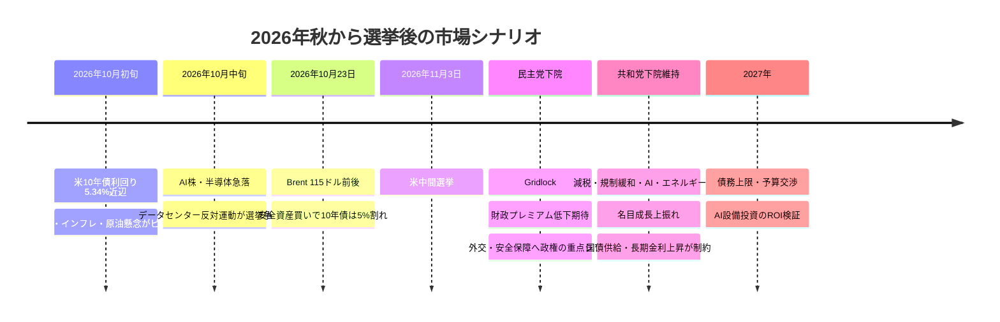

# 2026年米中間選挙と資産価格の楽観シナリオ分析――積極財政派・機関投資家のための米国株／日本株戦略レポート

## エグゼクティブサマリー

**結論から言えば、選挙後の「最も株式市場に優しい組み合わせ」は、指数全体では「民主党が下院を奪取・共和党が上院を維持するねじれ」、セクター選別では「共和党が下院を維持する統一政府」の方がアップサイドが大きい**、というのが本稿の基本判断である。ただし後者は、財政拡張→国債増発→長期金利・タームプレミアム上昇という「債券市場の拒否権」を受けやすく、S&P500全体には必ずしも後者の方が良いとは限らない。Amundi、J.P. Morgan Asset Management、BNYはいずれも、民主党下院・共和党上院の分割政府を有力視し、その場合は大型追加減税・大型歳出のハードルが上がり、国内政策より外交・安全保障に政権の重点が移る可能性を指摘している。citeturn1view0turn1view1turn2view3

10月中旬の予測市場も、Investecが紹介した価格形成では**民主党の下院獲得が約91%、共和党の上院維持が約64%**となっており、「民主下院＋共和上院」のねじれが市場の中心シナリオに近い。ただし予測市場は投票結果そのものではなく、残り期間で動く点には注意が必要である。citeturn1view4

投資家にとって最重要なのは、今回の中間選挙が単なる「民主党対共和党」ではなく、**財政赤字・AI設備投資・電力不足・原油高・5%近辺の長期金利という四つの制約条件の中で実施される**ことである。BNYは2027～28年にも米財政赤字がGDP比6%前後ないしそれ以上になり得るとし、義務的支出と利払いが連邦歳出の約4分の3を占める構造を指摘する。したがって共和党が下院を維持しても、2025年型の「減税＝無条件で株高」という反応は長続きしにくい。citeturn2view3

一方、**民主党が下院を取った場合の楽観シナリオ**は明快である。トランプ政権の既存減税・即時償却は概ね維持されながら、追加の大規模財政拡張が議会で抑制されることで国債供給プレミアムが低下する。長期金利が5%台から4%台へ定着すれば、高PER株、REIT、住宅、ヘルスケア、質の高い成長株に「バリュエーションの再膨張」が起きる。同時に、国内立法を阻まれた政権が外交・安全保障へ軸足を移せば、防衛株も必ずしも逆風にならない。Amundiは分割議会でヘルスケアのリバウンド、金融のイールドカーブ恩恵、既存の設備投資優遇による資本財・ソフトウェア支援を想定する。citeturn1view0

**共和党が下院を維持した場合の楽観シナリオ**は、実体経済・名目GDPにはより強い。減税・規制緩和・化石燃料・電源・AIデータセンター・防衛支出・設備投資優遇が続き、エネルギー、銀行、資本財、防衛、AIインフラに利益成長が集中する。BNYも共和党統一政府なら、初期反応として規制緩和、化石燃料、AI建設関連がリスク資産にプラスになり得る一方、国債供給と財政赤字が債券市場最大の問題になるとみている。citeturn2view3

ここで最大のテールリスクは**AIデータセンターに対する住民・地方政府の反発**である。Reutersによれば、来年のデータセンター・AIインフラ投資は1兆ドル超が見込まれる一方、電気料金、水使用、環境負荷への反発が強まり、登録民主党支持者の69%、共和党支持者の43%がデータセンター建設制限に賛成している。連邦議会が規制法案を可決してもトランプ大統領の拒否権があるため、**本当のリスクはワシントンより州・自治体、公益事業委員会、系統接続、固定資産税・優遇措置**である。citeturn2view0turn2view1

そのため、AI半導体暴落については「AI需要崩壊」と断定すべきではない。10月のSOX指数は8営業日で約2兆ドルの時価総額を失い、一週間で11%超下落したが、Morgan StanleyはAI投資総額を**2027年1.6兆ドル、2028年1.8兆ドル**と見込み、Goldman Sachsは急落後のCoreWeaveをBuyに引き上げ、BlackRockも米国株全体をNeutralに落としながらAI自体は引き続き選好している。つまり現在は「需要崩壊」よりも、**資本コスト上昇・過剰ポジショニング・債務調達・ROI検証への移行**とみる方が整合的である。citeturn7view0turn7view1turn25search3

長期金利は、10月1日前後に10年債利回りが**5.34%**まで上昇した後、10月22～23日のAI株急落に伴う安全資産需要で**4.97～4.99%近辺**まで約35～40bp低下した。この意味で「短期的ピークアウト」は成立している。しかしPIMCOのDan Ivascynはなお「ピークは先」とし、6%に達するリスクすら指摘している。BlackRockはTreasuryの投資妙味を改善評価しているため、現時点の適切な表現は、**「戦術的ピークの可能性は高まったが、構造的ピークアウトは未確認」**である。citeturn25search2turn25search3turn25news38turn25news39

原油については10月23日にBrentが一時**115ドル台**へ上昇した。米国が最も即効性を持って価格を下げられるのは①イラン・湾岸情勢の外交的緩和、②SPR・IEA備蓄放出、③ロシア等からの精製品供給拡大・制裁免除、であり、国内増産は重要だが時間がかかる。特にロシアとの関係は推測ではなく、**すでに直接的な証拠がある**。米政府はロシア産ディーゼルの米国輸入を認めるOFAC General License 135を出し、トランプ大統領はロシアからまず30万トン、その後さらに供給を受けると表明、10月22日には40,000トンを積んだタンカーがPrimorskからニューヨークへ向け出航した。citeturn25news37turn25search5turn5search2turn4news22

日本株では、**共和党下院維持なら「円安・高金利・高エネルギー・防衛・設備投資」の組み合わせから、メガバンク、商社、防衛重工、ハイブリッド自動車が最も素直なロング候補**になる。民主党下院なら米金利低下・円高方向の圧力が増え、自動車の為替恩恵は弱まる一方、原油低下も伴えば内需・不動産・運輸・電力のコスト改善が相対的に優位になる。Reutersによれば、現在の高エネルギー価格では日本の大手商社が記録的利益を見込む一方、地域電力は燃料調達コスト上昇に苦しんでいる。citeturn19news33

**11月決算の非AI半導体15銘柄では、業績モメンタムの強さを重視すると、三菱重工、IHI、川崎重工、MUFG、SMFG、みずほ、三井物産、伊藤忠が上位。自動車ではトヨタ・ホンダ・スズキ、保険では東京海上・MS&ADを選好する。SUBARUは実績というより回復期待枠で、15銘柄中の確度は低い。**

主要な選挙分析URL：  
Amundi: https://research-center.amundi.com/article/us-midterm-elections-fiscal-gridlock-horizon  
J.P. Morgan AM: https://am.jpmorgan.com/lu/en/asset-management/per/insights/market-insights/market-updates/on-the-minds-of-investors/us-midterm-elections-2026-divided-government/  
BNY: https://www.bny.com/investments/de/de/institutional/markte-und-analysen/insight/us-midterms-2026-key-policy-and-market-considerations.html  
Investec: https://www.investec.com/en_za/focus/economy/us-midterms-2026.html  

## 政治・マクロの前提と二つの楽観シナリオ

2026年の中間選挙は11月3日。現議会は下院が共和党220、民主党215、上院が共和党53、民主党45、民主党系無所属2という僅差構造である。Amundiは「民主党が下院を奪取、共和党が上院維持」を最も蓋然性の高い形とし、J.P. Morgan Asset Managementも少なくとも一院が民主党になる分割政府を有力視している。citeturn1view0turn1view1

重要なのは、**民主党下院＝トランプ政策の全面巻き戻しではない**ことだ。大統領行政権、規制当局、人事権の多くは共和党政権側に残るうえ、2025年に成立した税制・設備投資優遇のような既存法を民主党下院単独で廃止することもできない。Amundiは分割政府下でも既存の即時償却・bonus depreciationが設備・機械・ソフトウェア投資を支えるとみる。citeturn1view0

反対に共和党が下院を維持すれば、追加減税・歳出・規制緩和の自由度が高まる。しかしJ.P. Morgan AMが指摘するように、例えば5,000ドル規模の家計向け給付を全国的に行えば1.2～1.35兆ドル程度のコストになり得て、共和党内の財政保守派からも抵抗が生じる。つまり「共和党統一＝財政無制限」ではない。citeturn1view1

J.P. Morgan AMは債務上限が2027年半ばごろ再び問題化し、その後6～9カ月程度は財務省の特別措置で延命できる可能性を指摘している。選挙直後にはポジティブでも、2027年には再び財政・政府閉鎖リスクが市場テーマになりやすい。citeturn1view1

**シナリオの本質を数式的に表すと、**

> 株価 ≈ 企業利益成長 ＋ 財政・規制による利益上振れ − 実質金利・タームプレミアム上昇 − 地政学リスクプレミアム

となる。

共和党統一は左辺の「利益成長」を最大化しやすいが、同時に右辺の「長期金利」を上げる。民主党下院のねじれは利益成長の追加加速を抑える代わりに、割引率を下げる可能性がある。**したがって前者はバリュー／シクリカル／インフラ優位、後者はデュレーションの長い成長・REIT・住宅にも資金が戻りやすい。**

過去の中間選挙自体は株式に必ずしも悪材料ではない。Capital Groupによれば1950年以降、S&P500は中間選挙後12カ月で平均約15%上昇している。ただしこれは選挙効果の因果を示すものではなく、景気・金融政策サイクルが混在する歴史統計として扱うべきである。citeturn0search4

Capital Group URL:  
https://www.capitalgroup.com/individual-investors/hk/en/insights/articles/us-midterm-elections-may-be-closer-than-expected.html

## 米国株のシナリオ別セクター・銘柄戦略

以下は「選挙結果だけで機械的に売買する」リストではなく、**政策・規制・財政・金利・地政学・資金フローが同じ方向を向いた場合の相対パフォーマンス仮説**である。AmundiとBNYのセクター見通しをベースに、現在の金利・原油・AI投資環境を加えている。citeturn1view0turn2view3

| シナリオ | 上がりやすいセクター／例 | 投資ロジック | 売られやすい・相対劣後しやすい領域 |
|---|---|---|---|
| **民主党が下院奪取、共和党上院＝ねじれ** | **REIT・住宅**：PLD、AMT、DHI、LEN | 追加財政拡張が抑えられ、10年債が5%台から低下すればキャップレート・住宅ローン金利の圧迫が緩む。Amundiも高金利が不動産最大の逆風とするため、逆転時のβが大きい。citeturn1view0turn25news39 | 原油・長期金利上昇を前提に買われてきた「Trump reflation trade」。特に財政刺激期待だけで評価されたシクリカル。 |
| 同 | **ヘルスケア**：JNJ、LLY、XLV等 | 大型制度変更が通りにくくなり、政策テールリスク低下。Amundiもgridlock下でヘルスケア反発の可能性を指摘。citeturn1view0 | 政策依存性が極端に高い民間医療保険は民主党下院の調査・聴聞リスクもあるため、UNH等はヘルスケア全体より選別が必要。 |
| 同 | **防衛**：RTX、NOC、LMT、GD | 国内立法を阻まれるほど大統領が外交・安全保障に重点を移すというJPM/Amundiの見方。現在もRTX・Northropは記録的受注残を背景に2026年見通しを引き上げた。citeturn1view1turn21news31 | 財政削減が国防歳出まで及ぶ場合は逆風だが、現状は地政学需要が相殺しやすい。 |
| 同 | **質の高い大型成長株** | 金利低下がPERの割引率を改善。AIでもフリーCFが厚く自己資金で投資できる企業が、レバレッジ型AIプレイヤーより有利。 | **高レバレッジAIデータセンター**、設備完成前から大型借入を積む事業者。 |
| 同 | **一部金融**：JPM、BAC | 「長期金利暴騰」ではなく、短期金利低下＋長短差正常化ならNIM改善。Amundiもsteepeningを金融にプラスとする。citeturn1view0 | 急激な景気悪化を伴う金利低下なら信用コストが上昇するため、地域銀行は別。 |
| **共和党が下院維持** | **エネルギー**：XOM、CVX、SLB、HAL | 規制緩和・掘削・インフラ許認可、現在115ドル近い原油のキャッシュフロー恩恵。BNYも共和党勝利で化石燃料・電源インフラを主要受益領域とする。citeturn2view3turn25news37 | ENPHなど補助金感応度の高いクリーンエネルギー。FSLR/NEEは事業構造が異なるため一括りにしない。 |
| 同 | **AI半導体／電力インフラ**：NVDA、AVGO、AMD、VRT、ETN、GEV | トランプ政権は連邦レベルのデータセンター規制に反対しやすく、AI建設促進・電源増設が追い風。BNYは共和党統一をAI buildoutの初期的プラス要因とする。citeturn2view3turn2view0 | 州・自治体レベルの反発は残るため「共和党＝無条件でAI強気」ではない。 |
| 同 | **銀行・投資銀行**：JPM、GS、BAC | 規制緩和、M&A、資本市場活性化、名目GDP成長。 | 長期金利が6%方向へ暴騰するとクレジット・不動産・債券含み損を通じ逆効果。 |
| 同 | **防衛**：RTX、NOC、LMT | 国防・ミサイル・宇宙投資の継続。RTXの受注残は3400億ドル、Northropは1096億ドルまで拡大した。citeturn21news31 | なし。ただし高いバリュエーションと予算執行の遅れがリスク。 |
| 同 | **資本財・建機**：CAT、URI、ETN | bonus depreciation、国内製造、電源・工場・データセンター投資。Amundiは既存税制の設備投資支援が継続するとみる。citeturn1view0 | 金利感応度の高い住宅・商業不動産は、財政拡張で10年債が再び5.5%方向なら逆風。 |
| 同 | **小型内需株** | 名目成長・減税・国内投資が上振れし、指数集中から資金が循環すれば恩恵。 | 高PER・無利益成長株。金利上昇局面ではキャッシュフローの遠い銘柄ほどデュレーション損失が大きい。 |

特に共和党維持シナリオでは、**S&P500より「S&P500内のセクター拡散」の方が重要**になる可能性がある。財政刺激は企業利益を押し上げる一方、5%超の10年債は大型グロースのPERを圧迫するためである。逆に民主党下院では「利益予想の上方修正幅は小さくても、割引率低下で指数が上がる」展開が考えられる。これは積極財政派にとって重要なポイントで、**財政支出は実体経済にはポジティブでも、限界的には株式の割引率を上げてしまう局面に米国が入っている**。

BNYは共和党が両院を支配するケースについて、規制緩和・化石燃料・AI建設にはプラスだが、最も大きな市場圧力は財政・税制による国債供給だと明記している。これは現在の投資環境を最も端的に表す。citeturn2view3

## AIデータセンター反対運動とAI半導体暴落の検証

AI半導体を考える際、「半導体需要」だけを見てはいけない。現在のボトルネックは、**GPU供給 → 電力 → 系統接続 → ガスタービン／変圧器 → 水 → 土地・許認可 → ファイナンス**へ移っている。AmundiもAIデータセンターの主要制約として、州・地方のzoning、許認可、電力、水、環境規制を挙げている。citeturn1view0

Reutersの調査では、AI・データセンターインフラ支出は2027年に1兆ドルを超える可能性がある一方、民主党登録有権者の69%、共和党登録有権者の43%が建設制限を支持する。Morgan Stanleyなどが特に注視しているのはテキサス、オハイオ、ペンシルベニア、ジョージア、ネバダ、ウィスコンシン、ミシガンなどで、これらの州では公益事業規制委員会や州・地方政府が料金負担、接続費用、税優遇、許認可に大きな権限を持つ。citeturn2view0turn2view1

**AIデータセンター反対運動が半導体に伝播する経路は次の通り。**

| 経路 | 影響 | 感応度が高い銘柄群 |
|---|---|---|
| 許認可遅延 | データセンター稼働開始が後ずれし、GPU納入スケジュールを後方シフト | NVDA、AMD、AVGO |
| 系統接続負担 | 電力会社が接続費をDC事業者へ転嫁するとプロジェクトIRR低下 | CRWV、データセンター開発会社 |
| 電気料金政治化 | 家庭料金の上昇をAI企業に転嫁する制度が拡大 | META、MSFT、GOOGL、AMZNのcapex採算 |
| 水・環境規制 | 冷却方式変更・設備コスト上昇 | VRT等の冷却・電力設備はむしろ製品単価上昇の恩恵も |
| 優遇税制縮小 | 開発地選定が難しくなり、建設時期が長期化 | DLR、EQIX、CRWV |
| AI投資への政治的聴聞 | 大手テックの巨額capexと消費者電力負担が政治問題化 | META、GOOGL、MSFTなど |
| 債務調達コスト | DCプロジェクトのWACC上昇、レバレッジ型事業者の資金調達難 | CoreWeave等 |

ただし**AI反対運動＝NVDAの需要崩壊、とはまだ言えない**。トランプ政権が連邦規制に反対するため、民主党が下院を取っただけで全国的な建設停止法を成立させるハードルは高く、Reutersが取材したBNY WealthのKevin Sheaも「AIテーマそのものを崩すより、タイミングとコストを攪乱する」と評価している。citeturn2view0turn2view1

現在のAI株急落には、より金融的な理由がある。10月中旬までの8営業日で米半導体関連の時価総額は約2兆ドル減少し、SOX指数は一週間で11%以上下落した。にもかかわらずMorgan Stanleyは総AI投資を2027年1.6兆ドル、2028年1.8兆ドルと予測し、Goldman Sachsは約25%下落したCoreWeaveをBuyへ引き上げた。10月19日の反発局面ではNvidiaが約1.5%、AMDが3.6%、Broadcomが2.4%上昇した。citeturn7view0

BlackRock Investment Instituteは米国株をNeutralへ引き下げたが、**AIそのものについては「依然として選好」**との姿勢を維持している。10年債5%超とAI資金調達リスクを理由に「何でもAIなら買い」からは離れたが、テーマ終了とはしていない。citeturn25search3turn25search23

また、Super Microは10月20日に次四半期売上高を**185～195億ドル**と予想し、市場予想152.3億ドルを大幅に上回った。Microsoft、Google、Amazon、MetaのAIインフラ支出が2026年に合計7000億ドル超に達するとの見通しも報じられている。少なくともサーバー・アクセラレーターの実需が突然消えているわけではない。citeturn21news30

したがって機関投資家としての整理は、

**強気材料**
= ハイパースケーラーcapex、モデル計算需要、推論需要、ネットワーク高速化、HBM、電源不足解消投資。

**弱気材料**
= WACC上昇、負債依存、循環的なAI企業間資金取引、データセンター政治化、ROI・フリーCFへの市場の評価軸変更。

である。

私ならAIセクター内でも、**負債を使ってデータセンターを所有する企業より、GPU・ネットワーク・電源機器という“シャベル売り”の方を構造的には高く評価する**。ただし短期的にはデータセンター延期がGPU注文にも波及するため、NVDA/AMD/AVGOまで完全に防御的ではない。

主要URL：  
Reuters・データセンター反対運動  
https://www.reuters.com/legal/transactional/investors-see-risk-us-midterms-ai-trade-data-center-backlash-builds-2026-10-22/

Reuters・AI半導体急落後の強気評価  
https://www.reuters.com/world/asia-pacific/us-chip-stocks-rise-after-steepest-weekly-selloff-months-2026-10-19/

BlackRock Investment Institute  
https://www.blackrock.com/corporate/insights/blackrock-investment-institute/global-weekly-commentary

## 原油高・ロシアとの関係・米長期金利ピークアウトの検証

10月23日のBrentは一時115ドルを超え、Reutersでは115.16ドル、WTIは101ドル台まで上昇した。主要因は中東の供給途絶リスク、サウジ・紅海周辺の攻撃、UAE沖事故、リビア供給減などで、単純な世界需要の強さだけではない。citeturn25news37

EIAも最新STEOで2026年第4四半期のBrent平均を約105ドルと見込み、中東の供給制約と大幅な在庫取り崩しを前提としている。現在の115ドル台はEIAの平均想定よりさらに約10ドル高く、**かなり大きな地政学プレミアム**が乗っていると解釈できる。citeturn4search2turn4search7

EIA URL：  
https://www.eia.gov/outlooks/steo/report/global_oil.php

米国が取り得る政策を、即効性の順に整理すると次のようになる。

| 政策 | 原油／燃料価格への効き方 | 即効性 | 現在の証拠 |
|---|---|---:|---|
| **イラン・湾岸との外交的緊張緩和** | Brentの地政学プレミアムを直接削る。Hormuz・紅海の供給リスクが縮小 | 最も高い | 10月9日にトランプ氏がイランとの協議を「productive」とし、中間選挙前の攻撃を否定した際、原油には下押し圧力がかかった。citeturn25search13 |
| **SPR放出** | 現物市場に原油供給を追加し、prompt価格・精製マージンを抑制 | 高い | DOEは2026年3月、IEA協調400m bblの一環として米SPRから172m bblを約120日で供給すると発表。citeturn4search1 |
| **IEA諸国の協調備蓄放出** | 米国単独より規模を拡大 | 高い | 欧州も10月にディーゼル備蓄を放出する方針を取り、価格下落要因になった。citeturn25search25 |
| **ロシア産ディーゼル供給の制裁免除** | 原油より米ディーゼル・留出油価格に直接効く | 高い | OFAC GL135、米露ディーゼル合意。citeturn5search2turn25search5 |
| **国内原油・ガスの許認可促進** | 将来の供給期待・先物曲線に作用 | 中～低 | 新規掘削、生産能力、パイプラインにはタイムラグがあるためSPRほど即効性なし。 |
| **精製所稼働率・輸送規制緩和** | ガソリン・ディーゼルの精製品価格を抑える | 中 | 原油そのものより製品クラックに効く。 |
| **ガソリン税一時停止** | 消費者価格を下げるが、世界原油供給は増えない | 高いが一時的 | 10月9日にトランプ氏が連邦ガソリン税停止を検討していると発言。citeturn25search13 |

SPRについてはDOEによると、米SPRの設計上の最大放出能力は約**440万バレル/日**で、大統領判断から市場供給開始まで約13日である。したがって軍事衝突による一時的な供給途絶には非常に強力だが、数年にわたる構造不足を補う政策ではない。citeturn4search4

DOE URL：  
https://www.energy.gov/hgeo/opr/spr-quick-facts  
https://www.energy.gov/articles/united-states-release-172-million-barrels-oil-strategic-petroleum-reserve

**ロシアとの関係については、現在は「ある」と断定できる。**

10月9日、米財務省OFACはGeneral License 135を出し、一定のロシア産ディーゼルの米国への販売・輸送・荷卸し・輸入に関する取引を2027年4月7日まで認めた。citeturn5search2

OFAC URL：  
https://ofac.treasury.gov/recent-actions/20261009_33

さらにReutersによれば、トランプ大統領はロシアからまず30万トンのディーゼルを供給させ、その後供給量を増やすと発表した。10月22日には約4万トンを積んだタンカーがロシアのPrimorskを出航し、11月7日前後にニューヨーク到着予定となった。これは「米国が燃料価格抑制のためロシアとの関係を利用しているか」という問いに対する直接的な証拠である。citeturn4news22turn25search5

Reuters URL：  
https://www.reuters.com/business/energy/tanker-carrying-40000-t-russian-diesel-heads-new-york-after-putin-trump-deal-2026-10-23/

ただしこれは**Brent原油価格そのものを劇的に下げる規模ではない**。ディーゼル市場の逼迫と米消費者価格には有効でも、中東由来の115ドルBrentを80ドルへ戻すには、ロシアよりもHormuz・サウジ・イランのリスクプレミアム縮小の方がはるかに重要である。

**長期金利のピークアウト判定**は、次のようになる。

| 指標 | 観測 | 判定 |
|---|---|---|
| 米10年債 | 10月1日前後に約5.34% | 2002年以来の高水準。citeturn25search26 |
| 10月22～23日 | 約4.97～4.99%へ低下 | 高値から約35～40bp低下。AI株急落による安全資産需要が主因。citeturn25news38turn25news39 |
| BlackRock | Treasuriesをアップグレード、短期債を特に選好 | 金利上昇後のrisk/rewardは改善。ただし財政・タームプレミアムリスクは残る。citeturn25search23turn25search3 |
| PIMCO Ivascyn | 「ピークはまだ先」の可能性 | Fed追加引き締め、インフレ、財政供給を警戒。citeturn25search2 |
| PIMCO別コメント | 10年債6%リスク | 5.5%以上なら株・クレジットへの大きな圧力を警告。citeturn25search6 |
| 現在のBrent | 約115ドル | エネルギーインフレ再加速のため「金利ピーク確定」を妨げる。citeturn25news37 |

したがって私は、**5.34%を「cycle high」と断定する確率はまだ50%を明確に超えていない**とみる。現状は「risk-offによる局所的ピークアウト」であって、「インフレと財政懸念が終わったからピークアウト」ではない。

民主党下院なら、追加財政刺激が抑えられることでこの4.9%台が4%台半ばへ向かうシナリオが成立しやすい。共和党下院維持なら、減税・歳出・名目成長・国債発行増から再び5.3～5.5%、極端にはPIMCOが指摘する6%がテールになる。citeturn1view0turn25search2turn25search6

株式への作用は非線形である。

**10年債が5.34→4.7%へ低下**する場合、AI・ソフトウェア・REIT・住宅のようにキャッシュフローの遠い資産に最も大きなバリュエーション効果が出る。一方で銀行は、景気後退を伴わず短期金利の方が速く下がってyield curveがsteepenするならプラス。逆に「景気後退で全期間の金利が急落」なら信用コストが増えるため銀行には必ずしもプラスでない。

BlackRock URL：  
https://www.blackrock.com/corporate/insights/blackrock-investment-institute/global-weekly-commentary

PIMCOに関するReuters：  
https://www.reuters.com/markets/us/us-treasury-yields-yet-peak-fed-may-tighten-further-pimcos-ivascyn-says-2026-10-13/

FRED米10年債：  
https://fred.stlouisfed.org/series/DGS10

## 日本株への波及と選好セクター

日本株では米中間選挙の影響を、**米10年金利 → USD/JPY → 原油 → BOJ → 日本企業利益**という順序で見ると整理しやすい。

**民主党下院・共和党上院のねじれ**では、財政プレミアム低下と米金利低下が先に来る可能性が高く、ドル円には円高方向の圧力がかかる。これはトヨタ、ホンダ、SUBARUなど輸出比率の高い企業の円換算利益にはマイナスだが、米金利低下と同時に中東緊張緩和・原油低下まで起きれば、日本の交易条件は大きく改善する。この場合、航空、陸運、化学、紙パ、食品、電力・ガス、内需小売、J-REITが相対的に有利となる。

一方、**共和党下院維持**では、米財政拡張→米長期金利高止まり→ドル高・円安となる可能性が高い。高油価も続けば日本全体には交易条件悪化だが、企業間の勝敗が明瞭になる。

特に優位なのは、

**メガバンク**  
MUFG、SMFG、みずほ。国内金利正常化と融資需要増、貸出利鞘拡大の恩恵が既に決算で確認されている。MUFGのQ1純利益は前年比48%増、SMFGは33%増、みずほは45%増だった。citeturn20search9turn21search15turn21search3

**防衛・重工**  
三菱重工、IHI、川崎重工。米国が国内政策より外交・安全保障へシフトする場合、日本の防衛費増額、GCAP、ミサイル、航空エンジン、艦艇等の受注環境を強化する。三菱重工のQ1受注は2.022兆円、事業利益は前年比65%増の1596億円。citeturn18search2turn18search11

**総合商社**  
三菱商事、三井物産、伊藤忠。Reutersは、現在の中東情勢・高商品価格の下で大手商社各社が記録的利益圏を見込み、三菱商事はFY2026純利益1.1兆円、三井物産9200億円、伊藤忠9500億円を計画していると報じた。資源価格上昇は電力会社にはコストだが、商社にはエネルギー・LNG・上流権益を通じてヘッジになる。citeturn19news33

**ハイブリッド自動車**  
トヨタ、ホンダ、スズキ。高油価は自動車需要全体にはマイナスだが、「燃費性能が高いハイブリッド」へのシフトを促す。トヨタは2027年3月期のハイブリッド販売を500万台へ引き上げる方針を示し、円安も利益を下支えしている。citeturn17news36

日本のAI半導体関連、すなわち東京エレクトロン、アドバンテスト、ディスコ等については、米データセンター反対運動とAI設備投資の資金調達問題から短期的なβが高い。米国でNVDA/AMD/AVGOの注文期待が下方修正されれば、日本の装置・テスター株にも速やかに波及するため、本稿の11月決算15銘柄からは意図的に除外した。米半導体株全体が10月に急落したことからも、現時点では非AIセクターへの分散価値が大きい。citeturn7view0turn25news38

シナリオ別に日本株を単純化すると、

| 米国選挙結果 | 日本で相対的に強い | 相対的に弱い |
|---|---|---|
| **民主党下院・ねじれ** | 内需、J-REIT、住宅、鉄道、航空、食品、電力・ガス、金利低下恩恵株、防衛 | 円安恩恵だけで買われた輸出株、資源価格高騰を前提にした商品β |
| **共和党下院維持** | メガバンク、商社、重工・防衛、トヨタ/ホンダ/スズキ、機械・建機 | 電力・ガス、航空、化学、原材料輸入型企業、J-REIT |
| **共通の構造テーマ** | 防衛、銀行、資本効率改善、高還元企業 | 高レバレッジ・金利感応型、AIデータセンター一本足の高PER銘柄 |

ここで最も興味深いのは、**防衛・重工はどちらの選挙結果でも強い可能性がある**ことである。共和党維持なら防衛・地政学政策の継続、民主党下院ならトランプ政権が国内立法を阻まれて外交へ比重を移す。この「両シナリオ共通ロング」が日本株では三菱重工、IHI、川崎重工となる。citeturn1view1turn18search2turn23view0turn24view0

## 11月決算で注目する非AI半導体の日本株十五銘柄

以下は「11月決算で必ず上がる」という予想ではなく、**直近Q1/IRの業績モメンタム、上方修正余地、現在の原油・為替・金利・防衛環境を勘案して、サプライズ余地が比較的高い候補を15銘柄に絞ったもの**である。AI半導体・製造装置株は除外した。

| 銘柄 | 11月予定／確度 | 前回決算・IRで確認した要点 | 投資仮説 | 主なリスク | 出典URL |
|---|---|---|---|---|---|
| **三菱重工 7011** | **11/6**・最上位 | Q1受注**2.0224兆円、前年比+4132億円**、売上1.1942兆円、事業利益1596億円・**+65%**、純利益1346億円・+97%。受注残は14兆円超。GTCC・原子力が強い。citeturn18search2turn18search9turn18search18 | 防衛＋ガスタービン＋原子力という「高油価・電力不足・安全保障」の三重受益。AI半導体に依存せずDC電力需要も取れる。 | 高バリュエーション、案件採算、円高 | https://www.mhi.com/finance/library/result |
| **IHI 7013** | **11/4**・最上位 | Aero Engine, Space & DefenseのQ1売上1547億円、前年1279億円から増加。営業利益291億円。会社は同部門FY売上を8700億円、営業利益1370億円へ上方修正し、下期は防衛航空エンジン・ロケットモーター増を想定。citeturn23view0turn15search5 | 防衛・民間航空エンジンの二本柱。日本の防衛費増と世界航空需要。 | 航空エンジン品質・補償費用 | https://www.ihi.co.jp/en/ir/ |
| **川崎重工 7012** | **11/10**・最上位 | Q1受注5257億円（+793億）、売上5435億円（+551億）、事業利益357億円（+152億）、親会社利益156億円（前年42億）。売上・利益はQ1過去最高。citeturn24view0turn26search6 | 航空宇宙・防衛・エネルギー・二輪。防衛のほか円安の恩恵も大きい。 | 円高、航空エンジン関連損失 | https://global.kawasaki.com/en/corp/ir/calendar.html |
| **MUFG 8306** | **11/13**・最上位 | Q1純利益**前年比+48%**。デフレ脱却後の強い融資需要と貸出マージン改善が寄与。citeturn20search9turn21search4 | BOJ金利正常化、企業M&A・設備投資融資、円安・名目GDP成長。米国金利が高止まりしても収益源が多い。 | 海外信用コスト、急激な金利低下 | https://www.mufg.jp/english/ir/index.html |
| **SMFG 8316** | **11/13**・最上位 | Q1純利益5014億円、**+33%**。国内貸出預金スプレッドは1.08%→**1.31%**、貸出残高+7%。FY純利益1.7兆円予想を維持。citeturn21search15turn21search5 | 国内金利正常化に最も分かりやすい収益レバレッジ。 | JGB金利急騰、信用コスト | https://www.smfg.co.jp/english/investor/calendar/ |
| **みずほFG 8411** | **11月中旬**・最上位 | Q1純利益4229億円、**+45%**。国内貸出預金利鞘1.10%→1.26%。FY利益予想を**1.4兆円**へ引き上げ、自己株買い枠を合計2000億円に拡大。citeturn21search3turn21search14 | 3メガ中でも上方修正＋還元が明確。投資銀行・トレーディングも強い。 | 市場部門ボラティリティ | https://www.mizuhogroup.com/investors/Calender |
| **三井物産 8031** | **11/4**・高 | FY2026純利益計画9200億円を維持、年間配当140円を計画。Q1では連結利益が約2809億円規模となり、資源・エネルギー、米シェールなどが寄与。citeturn26search11turn19search1 | 高油価・LNG・米シェールへの直接的エクスポージャー。現在のエネルギー環境と整合性が高い。 | 中東沈静化による商品価格低下 | https://www.mitsui.com/jp/en/ir/index.html |
| **三菱商事 8058** | **11月上旬**・高 | FY2026純利益計画1.1兆円。Q1ではNorth American LNG利益が前年比約**+254億円**、LNG Canada立ち上げ・spot販売が寄与。原料炭も高市況と出荷増が支え。citeturn19search8turn20search17turn18search16 | LNG・シェール・資源価格高の最大級受益企業。米露・中東のエネルギー再編も商機。 | 資源価格急落、巨額投資リスク | https://www.mitsubishicorp.com/jp/en/ir/ |
| **伊藤忠 8001** | **11/4**・高 | Q1売上3.876兆円、**+8.9%**、trading income +20.3%、帰属利益2938億円、**+3.5%**。資源依存度が相対的に低く、食品・繊維・消費を含む。citeturn20search2turn20search16turn19search14 | 原油高が反転しても商社内で利益が安定しやすい。ねじれ議会シナリオにも対応。 | 消費鈍化、中国関連 | https://www.itochu.co.jp/en/ir/calendar/index.html |
| **トヨタ 7203** | **11/5**・高 | Q1売上13.525兆円、**+10.4%**、営業利益1.063兆円、-8.8%。ただしFY営業利益予想を**3.4兆円へ4000億円引き上げ**、最大1兆円の自己株買い。ハイブリッド年間販売500万台を目指す。citeturn17search4turn17news36turn8search3 | 円安＋米ハイブリッド需要＋大規模還元。高油価ほど燃費性能の優位性。 | 円高、中国販売、中東物流・関税 | https://global.toyota/en/ir/index.html |
| **ホンダ 7267** | **11/11**・高 | Q1売上約6.062兆円、+13.5%、営業利益5307億円、**+117.4%**。二輪営業利益2339億円、利益率20.5%。四輪営業利益1921億円。会社は調整後営業利益見通しを1.17兆円規模としている。citeturn10search0turn9search1 | 二輪の高収益＋四輪回復。新興国の二輪需要は米中間選挙への感応度も低い。 | 米関税、原材料、円高 | https://global.honda/en/investors/calendar.html |
| **スズキ 7269** | **11/10**・高 | Q1売上1.706兆円、**+22%**、営業利益1580億円、+11.2%。海外売上+29.3%、自動車営業利益+12.5%。インド卸売は4～7月に前年同期比約135%と好調。citeturn13search2turn11search0 | インド成長＋小型車・燃費性能。米国景気への直接感応度が低く、日本自動車の分散先。 | インドルピー、原材料費 | https://www.globalsuzuki.com/ir/calendar/index.html |
| **SUBARU 7270** | **11/10**・中／回復枠 | Q1売上1.251兆円、+3%に対し営業利益426億円、**-44.3%**。ただしFY営業利益予想は1500億円で、前年の低水準から大幅回復を想定。前提USD/JPYは155円。citeturn11search1turn12search0 | 円安・米国販売の回復余地が大きいため、11月に進捗改善すればrevision tradeになりやすい。 | 15銘柄中最も実績モメンタムが弱い。米景気・円高感応度高い | https://www.subaru.co.jp/en/ir/finance/latest-results.html |
| **東京海上HD 8766** | **11/19**・高 | Q1 total business volume 2.406兆円、**+12%**。調整後純利益2613億円、-4%だが会社計画線。FY調整後純利益9500億円に対し進捗28%。海外事業利益は+9%。citeturn23view3turn22search9 | 高金利で運用収益改善、保険料率是正、海外事業。Berkshireとの資本・再保険提携も中長期の資本効率要因。citeturn22news39 | 大規模自然災害、巨額海外M&A | https://www.tokiomarinehd.com/en/ir/ |
| **MS&AD 8725** | **11/19**・高 | Q1で政策保有株売却益を除く調整後利益が約**2510億円、前年比+647億円**。会社は11月19日に2Q決算を予定。citeturn22search12turn22search1 | 保険料率改善、政策保有株圧縮、運用利回り上昇。株主還元への資本転換余地。 | 自然災害、海外損害率 | https://www.ms-ad-hd.com/en/ir/ir_event/event.html |

この15銘柄を**11月決算の期待値順**に大まかに分けると、現時点では次のように考える。

**業績そのものの勢いが最も強い群**は三菱重工、IHI、川崎重工、MUFG、SMFG、みずほ。重工3社は受注残・防衛・航空・エネルギー、銀行3社は金利正常化・融資需要・手数料収入という複数の利益ドライバーが同時に働いている。citeturn18search2turn23view0turn24view0turn20search9turn21search15turn21search3

**マクロの高油価が続くほど有利なのは三井物産・三菱商事**であり、反対に中東緊張が急速に解けてBrentが100ドルを大きく割れるなら、伊藤忠の非資源型の安定性が相対的に高くなる。日本の大手商社全体についてReutersは、現在の中東情勢が利益上振れ余地を生んでいると報じている。citeturn19news33

**自動車ではトヨタを最上位**とみる。Q1営業利益自体は前年割れだが、会社が通期予想を4000億円上げ、1兆円の自己株買いを発表しており、ハイブリッド需要、円安、北米採算改善が確認できる。Hondaは二輪の収益力、Suzukiはインドという別の成長エンジンを持つため、米国景気に対する分散になる。citeturn17news36turn10search0turn13search2

**SUBARUだけは「好業績銘柄」というよりrecovery option**である。Q1営業利益は44%減で、他の14銘柄より確度が低い。ただし市場のハードルが低い分、米販売・円安・コスト改善が確認されれば決算時の株価反応は非対称に大きくなり得る。citeturn11search1

ポートフォリオとしては、今回の二つの米中間選挙シナリオに対し、**「重工＋銀行＋商社」をコアとし、自動車を円安オプション、保険を金利上昇オプションとして組み合わせる構造が最も頑健**と考える。民主党下院で米長期金利が低下した場合には商社・銀行のβをやや落とし、内需・REIT・運輸を増やす。共和党下院維持なら銀行・商社・重工・自動車を維持または増やす、というのがシナリオ整合的である。

最後に、今回の投資判断で**最重要のクロスアセット指標は選挙結果そのものより「米10年債5.34%を再び超えるか」「Brentが100ドル方向へ戻るか、それとも120ドル方向へ向かうか」「AIデータセンター建設案件が州レベルで延期され始めるか」**の三つである。民主党下院でもこの三つが悪化すれば「gridlock rally」は起きにくく、共和党下院維持でも原油低下・10年債5%割れが定着すれば、株式には想定以上に強いGoldilocks型の上昇余地が生まれる。現在は政治イベントより、**財政・エネルギー・資本コストが政治を市場価格に翻訳する局面**と見るべきである。