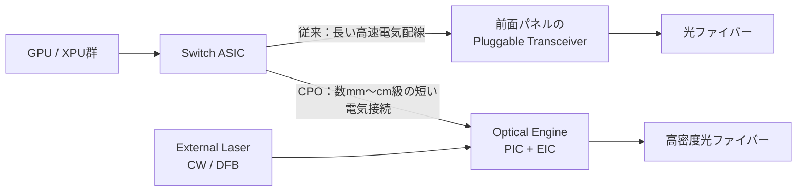
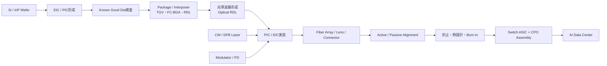

# 日本の光電融合・CPO市場――AI時代の次世代インターコネクトと日本企業の投資機会

## エグゼクティブサマリー

**結論から言えば、光電融合は「AIブームの次のテーマ」ではなく、AIインフラを今後も大型化するために必要になる基盤技術である。** GPUやASICの演算能力が増え続ける一方、そのチップ同士をつなぐ電気配線では、帯域、伝送損失、消費電力、発熱、フロントパネルのポート密度がボトルネックになり始めている。CPO（Co-Packaged Optics）は、従来フロントパネルに置いていた光トランシーバーをスイッチASICのすぐ近くまで移し、高速電気信号が走る距離を短くして早い段階で光に変換する技術である。Broadcomは51.2Tb/s級の「Bailly」で、光インターコネクト部分の電力をプラガブル方式より最大70%削減できると説明し、NVIDIAもSpectrum-X/Quantum-X Photonicsを製品ロードマップに載せている。CPOはすでに研究テーマから商用化フェーズへ入った、と見るべきである。 citeturn0search0turn0search1turn0search2

ただし、**「プラガブルトランシーバーがすぐ全部CPOに置き換わる」という理解は間違い**である。プラガブルには交換しやすさ、故障分離、歩留まり、熱設計の容易さという強みがある。CPOは高価なスイッチASICと光エンジンを近接実装するため、光学アライメント、熱、レーザー寿命、パッケージ歩留まり、修理性が難しくなる。したがって現実的な普及経路は、**DSPプラガブル → LPO/LRO → Near-Packaged → スイッチCPO → 将来のGPU/XPU光I/O**という段階的なものになる可能性が高い。NVIDIAの最新CPOでは光エンジンをASIC近傍に置きながら、レーザーは外部モジュール化して交換性と熱分離を確保する設計を採っている。 citeturn0search6turn0search8turn0search10

市場予測には大きな幅がある。Fortune Business Insightsは世界CPO市場を2025年2.562億ドル、2026年3.286億ドル、2034年33.741億ドル、CAGR 33.8%とする。一方IDTechExは2026～2036年を約37% CAGR、2036年に200億ドル超と予測する。Yoleについて複数の二次資料が引用する予測は2024年4,600万ドルから2030年81億ドルで、端点から計算するとCAGRは約136.7%になる。Cignal AIは2030年に年間3,000万超のCPOポート、外部レーザーELSFPだけでも15億ドル超を予測している。定義が「CPO光エンジン」「システム」「部品」「ポート」で異なるため、数字を単純比較してはいけない。 citeturn6search0turn6search2turn6search4turn7search0turn7search14

本レポートでは投資用に、**2030年を悲観約10.5億ドル、中立30億ドル以上、楽観81億ドル**と見る。このレンジは「予想を平均したコンセンサス」ではなく、市場定義の違う主要調査をシナリオ化したものである。Fortuneの33.8%成長を2026年から延長すると約10.5億ドル、IDTechExの2036年200億ドル超・37% CAGRを逆算すると2030年約30億ドル以上、Yole引用値では81億ドルとなる。 citeturn6search0turn6search2turn7search0

ユーザーが提示した**「2030年に69倍」説は、条件付きではほぼ成立するが、基準年を明記しない限り正確ではない。** 81億ドルが69倍になる基準市場は約1.174億ドルである。Yole引用値の2024年4,600万ドルを起点にすれば約176倍、端点CAGRで2025年を推計すると約1.09億ドルなので約74倍になる。つまり「2025年前後の約1.1～1.2億ドルを起点に2030年81億ドル」という意味なら69倍前後は妥当だが、「2024年比69倍」は誤りである。 citeturn7search0turn7search14

そして日本株を考える上で最も重要なポイントは、**日本の強みはIOWNだけではない**ことである。むしろ海外から見た日本の投資価値は、光電融合を量産するときに不可欠になる「ガラス・TGV・パッケージ基板・ポリマー/ガラス光導波路・高精度レンズ・ファイバーアレイ・コネクター・InPレーザー・高速変調器・接着/封止」といった**部材・実装層**にある。AGC、DNP、新光電気工業、住友電工、古河電工、三菱電機についてはCPOとの直接的な一次情報が確認できる。日産化学は光インターコネクト材料として有望である。一方、パナソニックとレゾナックは現時点では「AI向け高速基板・先端パッケージ材料」という隣接領域の色が強く、TDKについては「CPO向け高速光変調器の量産企業」とする一次根拠を今回確認できなかった。ここはテーマ株分析で特に重要な訂正点である。 citeturn2search7turn2search9turn2search10turn2search2turn3search3turn3search8turn4search0turn3search0

投資対象として私が「CPOへの直接性」と「現在の利益」を分けて評価すると、**古河電工と三菱電機が比較的わかりやすい実需型、住友電工が光接続のピック・アンド・ショベル型、AGCとDNPが将来のパッケージ/光RDL型、レゾナックと日産化学が材料オプション型**となる。新光電気工業は技術的には非常に面白いが非上場化済みのため、個人投資家が直接株式投資する対象ではない。PanasonicとTDKについては、CPO売上・量産顧客の開示を待つのが慎重である。 citeturn2search10turn15search12turn16search1turn19search0turn19search2turn19search3turn18search0

政策面でも仮説の修正が必要である。**日本＝NTT/IOWNは概ね正しいが、米国＝軍事中心は言い過ぎ**である。米国にはDARPAなど国防系フォトニクス研究が存在する一方、現実のCPO量産を先導しているのはBroadcom、NVIDIAなど民間AIインフラ企業である。EUはHorizon EuropeでADOPTION、COCOPOP、AMICAなどCPOを明示したプロジェクトへ資金を投入している。中国について「米国・日本より5年遅れ」という定量的根拠は確認できず、その表現は使わない方がよい。中国はプラガブル光トランシーバーでは既に強く、CPO/シリコンフォトニクス/高度パッケージで後発部分がある、という表現の方が実態に近い。日本の経済産業省自身も米中を中心に光電融合開発競争が激化していると認識している。 citeturn24search9turn24search5turn24search3turn24search14

また、Goldman Sachs、BlackRock、J.P. Morganについて調べた結果、**指定された日本の光電融合銘柄を三社が公に「推奨」していると断定できる公開一次資料は確認できなかった。** Goldman Sachsの2026年7月の公開報道では、日本の半導体関連でLasertec、東京エレクトロン、DISCOを高評価し、先端ノードやadvanced packaging投資をポジティブ要因としているが、これは古河電工・AGC・DNP等への直接推奨ではない。BlackRockの保有は資産運用上の保有であって推奨とは限らず、J.P. Morganの個別CPO関連日本株レポートは多くが機関投資家向け有料情報である。したがって、存在しない「海外機関投資家のお墨付き」を作ってはいけない。 citeturn25search2

本調査では、ユーザー提供の既存リサーチ資料についても論点と過去の取得データを照合したが、一次情報で確認できない断定は下記で「未確認」「未指定」と明示している。 fileciteturn0file0

## 光電融合とCPOを初心者向けに理解する

光電融合を一言で表現すると、**「計算は電気、データ輸送は光」という適材適所を、チップやパッケージの内部近くまで持ち込む技術**である。

CPU、GPU、スイッチASICはトランジスタによる電子回路なので、演算そのものは電気が得意である。一方、高速データを遠くまで運ぶと、高周波の電気信号は配線抵抗、誘電損失、反射、クロストークなどによって品質が低下し、速度を上げるほど強力なドライバ、イコライザー、リタイマー、DSPなどが必要になる。光ファイバーは長距離・高速伝送で損失が小さい。この両者をできるだけ近距離で切り替えるのが光電融合の基本思想である。NVIDIAもCPOを、スイッチASICと光エンジンを近接させることで電気SerDesの伝送距離と損失を減らすアーキテクチャとして説明している。 citeturn0search8turn0search10turn0search11

AI時代に重要なのは「GPUが速いか」だけではない。巨大AIモデルでは数千、数万のGPU/XPUが互いにデータを交換するため、ネットワークが遅ければ高価なGPUが通信待ちする。NVIDIAのQuantum-X Photonicsは144ポート×800Gb/s、Spectrum-X Photonicsではさらに大規模なスイッチ構成が示されており、1.6Tb/s/port方向への移行も打ち出されている。帯域が51.2Tb/s、102.4Tb/s、さらに数百Tb/sへ増えるほど、「ASICからフロントパネルまで高速電気信号を運んでから光にする」方式の負担が増える。 citeturn0search2turn0search6

初心者向けに例えるなら、**プラガブルは「工場で作った荷物をトラックで長距離運び、港で船に積み替える」方式、CPOは「工場のすぐ横に港を作る」方式**である。トラック輸送に相当する高速電気配線を短くできるため、電力と信号劣化を抑えられる。

Broadcomは51.2Tb/s「Bailly」で8個の6.4Tb/sシリコンフォトニクス光エンジンをTomahawk 5と統合し、プラガブル方式と比べて光インターコネクト部分の消費電力を最大70%低減できると説明している。これはBroadcomの特定製品におけるベンダー公称値であり、「全CPOが必ず70%削減」と一般化してはいけないが、電気経路短縮による省電力の方向性を具体化した事例である。 citeturn0search0

NVIDIAも同じ方向だが、興味深いのは**レーザーまでASICパッケージ内部に入れていない**点である。Spectrum-X Photonicsでは多数の光エンジンをスイッチ近傍へ統合する一方、光源はExternal Laser Sourceとして交換可能にする。レーザーは熱と寿命の影響を受けるため、外へ出して保守性を確保する設計には合理性がある。これこそ古河電工や海外のCoherent、Lumentumなど外部CWレーザー企業に市場機会が残る理由である。 citeturn0search8turn0search2

| 比較項目 | DSP付きプラガブル | LPO/LRO | CPO |
|---|---|---|---|
| 光変換場所 | フロントパネル | フロントパネル | ASIC直近 |
| ASICから光変換までの電気距離 | 長い | 長い | **非常に短い** |
| DSP | 通常あり | 削減・簡素化 | 構成による |
| 消費電力 | 高い | 低下 | **最も下げやすい** |
| ポート密度 | フロントパネル制約 | 同様 | **高密度化しやすい** |
| 交換・修理 | **非常に容易** | 容易 | 難しい |
| 光学アライメント | モジュール内 | モジュール内 | **パッケージ量産工程で必要** |
| 熱設計 | ASICから分離 | 分離 | ASIC熱との共存が課題 |
| 歩留まりリスク | モジュールだけ交換 | 比較的小さい | 高価なASICと光部品の組み合わせが問題 |
| 最初の有力市場 | 幅広いDC | 省電力DC | **AI/HPCスイッチ** |

このため「CPOはプラガブルを駆逐する」と考えるより、**CPOが最も経済合理性を持つ高帯域部分から侵食する**と考える方がよい。Cignal AIも初期段階ではプラガブル市場への影響は限定的で、2027年ごろからCPOの数量増加が始まり、2029～30年に加速するシナリオを示している。 citeturn6search4

もう一つ初心者が誤解しやすいのが「CPO＝超低遅延」という説明である。数十センチの銅配線を光に置き換えただけの**物理的な伝搬時間差自体はそれほど巨大ではない**。重要なのは、高損失電気リンクのために必要だったDSPやリタイマーを削減できる可能性、より高いradixのスイッチを作れること、ネットワーク段数を減らせること、電力制約の中でより多くの帯域を実装できることである。NVIDIAもCPOの価値として電力効率、レジリエンシー、信号品質、実装密度を前面に出している。 citeturn0search1turn0search6

将来的にはスイッチだけでなく、GPU/XPUのパッケージ自身へ光I/Oが入る可能性がある。ここまで進むとCPOより広い意味での「光電融合」が本格化し、パッケージ内光導波路、photonic chiplet、CWレーザー、光コネクター、ガラスインターポーザーなどのTAMがさらに拡大する。ただし、これはスイッチCPOより後のフェーズと考えるべきである。日本の経済産業省が紹介するNTTのロードマップも、2025年度以降のラック間・ボード間光化、2028年度以降のチップ間光化、2032年度以降のチップ内部光化という段階的な構成になっている。 citeturn24search9

## 市場規模と「二〇三〇年六十九倍」の検証

CPO市場の数字を見るときの最大の注意点は、**各調査会社が違うものを数えていること**である。

ある調査はCPO光エンジンだけを数え、別の調査はレーザー、コネクター、パッケージなどを含み、さらに別の調査はCPOスイッチ全体やポート数量を数える。この定義差を無視して「市場は○○億ドル」と言い切ると、投資判断を大きく誤る。

主要な公開予測を整理すると次のようになる。

| 調査 | 基準値 | 将来値 | 成長率 | コメント |
|---|---:|---:|---:|---|
| Fortune Business Insights | 2025年 **$256.2m**、2026年 **$328.6m** | 2034年 **$3.374bn** | 33.8% CAGR | 比較的保守的。部品・光エンジン等を定義に含む citeturn6search2 |
| IDTechEx | 2026年起点 | 2036年 **$20bn超** | 約37% CAGR | 長期CPOシステム市場。スイッチが主要収益源 citeturn6search0 |
| Yole引用値 | 2024年 **$46m** | 2030年 **$8.1bn** | 端点計算 **約136.7%** | 非常に強気。元資料の公開アクセスに制限があり二次情報で照合 citeturn7search0turn7search14 |
| Cignal AI | 金額より数量 | 2030年 **3,000万CPO port超/年** | ― | 2027年立ち上がり、29～30年加速を想定 citeturn6search4 |
| Cignal AI ELSFP | 2026年 $100m超 | 2030年 **$1.5bn超** | ― | 外部レーザーだけでも大型市場化を予想 citeturn6search4 |

Yoleの数字には注意点がある。一部二次媒体では「76% CAGR」と記載されている一方、2024年4,600万ドルから2030年81億ドルを6年間で計算すると、

\[
(8.1/0.046)^{1/6}-1 \approx 136.7\%
\]

となる。したがって本稿では**端点の4,600万ドルと81億ドルを採用し、CAGRについては算術計算値を使う**。公開二次情報間の不整合がある以上、「Yoleが公式に137%と断定」とまでは表現しない。 citeturn7search0turn7search14

投資家向けには、次の三シナリオが使いやすい。

| シナリオ | 2030年市場 | 根拠 | 何が起きるケースか |
|---|---:|---|---|
| 悲観 | **約$1.05bn** | Fortuneの2026年$328.6mに33.8% CAGRを4年間適用 | CPOはハイエンドのみ、LPO/プラガブルが長く残る |
| 中立 | **約$3.0bn以上** | IDTechExの2036年$20bn超、37% CAGRを逆算 | 51.2T/102.4T世代で徐々に標準採用 |
| 楽観 | **$8.1bn** | Yole引用の2030年予測 | NVIDIA/Broadcom等が急速量産、CPO portが爆発的増加 |

citeturn6search0turn6search2turn7search0

中立シナリオの約30億ドルは、IDTechExの「2036年200億ドル超、2026～36年37% CAGR」を200億ドルちょうどとして逆算した最低イメージである。2036年が「20bn超」なので、実際には2030年も30億ドルを上回る可能性がある。市場定義がFortuneと同じとは限らないため、この表はコンセンサス予想ではなく**感度分析**である。 citeturn6search0

**69倍説**を数字で分解するとさらに明快になる。

2030年81億ドルを69倍とするなら、

\[
8.1\text{bn}/69 = 0.1174\text{bn}
\]

つまり基準市場は**約1.174億ドル**でなければならない。

| 仮定する2025年市場 | 2030年$8.1bnまでの倍率 | 必要な5年CAGR |
|---:|---:|---:|
| $80m | 約101倍 | 約152% |
| $100m | 81倍 | 約141% |
| **$117m** | **69倍** | **約133%** |
| $150m | 54倍 | 約122% |
| Fortuneの$256.2m | 約31.6倍 | 約100% |

したがって、**「CPO市場は2030年に69倍」という表現は“Yole型の市場定義で2025年を約1.17億ドルと置いた場合”に限って成立する。** Fortuneの2025年値2.562億ドルを分母にするなら81億ドルでも約31.6倍にしかならない。Yole引用の2024年4,600万ドルからなら約176倍である。 citeturn6search2turn7search0

これは重要な投資教訓である。**CPO関連株を買う理由を「市場が69倍になるから」とだけ説明するのは危険**である。重要なのは、企業ごとの売上感応度である。たとえばCPO市場が80億ドルになっても、そのうち一企業の材料がBOMの0.5%しか取れず、かつその企業の連結売上が2兆円なら、EPSインパクトは小さい。逆にCPO市場が30億ドルでも、その企業の主力レーザーが供給制約となり高いシェアと利益率を取れば、業績効果は大きい。

したがって今後追うべき先行指標は市場調査会社の2030年予想そのものより、**CPO port数量、102.4Tスイッチ採用、ELSFP出荷、1.6T光リンク、顧客認定、材料メーカーの量産売上**である。Cignal AIの「2027年から増加、2029～30年に加速」という予測は、この観点で特に投資判断に使いやすい。 citeturn6search4

## バリューチェーンと日本企業の勝ち筋

CPOを理解するには、「完成品スイッチ」ではなく**製造工程を逆算する**と分かりやすい。

各部材を初心者向けに言い換えると、次のようになる。

| 部材 | 簡単な役割 | なぜCPOで重要になるか |
|---|---|---|
| **パッケージ基板・インターポーザー** | チップを載せる「土地と道路」 | ASIC、電源、EIC、PICを近距離で結び、高密度配線と低反りが必要 |
| **TGVガラス** | ガラスを上下に貫く「縦穴配線」 | 低誘電損失、平坦性、寸法安定性を利用して高密度パッケージ化 |
| **光導波路** | パッケージ上の「光の道路」 | PICからコネクターまで光を曲げて運ぶ |
| **レンズ・ファイバーアレイ** | 光を次の道路へ正確に渡す「料金所」 | 数μm以下の位置ずれでも損失が増える |
| **光コネクター** | 光ファイバーの着脱口 | 数百本級ファイバーを小面積で高密度接続する必要 |
| **CW/DFBレーザー** | 光信号の「電球」 | 外部レーザー方式では高出力・長寿命・高効率が重要 |
| **光変調器** | 電気データを光へ刻む「超高速シャッター」 | 数十～数百GHz級で光を変調し、Tb/s通信を作る |
| **Photodiode** | 光を電気へ戻す受信器 | 高速・低ノイズ受信に必要 |
| **EIC/Driver/TIA** | 光部品を電気的に駆動する回路 | PICとASICの橋渡し |
| **熱材料・封止・接着** | 壊れないよう固定・冷却 | ASICの高熱とμm級光学精度を同時に維持する必要 |

ここで日本に面白い構造がある。米国はBroadcomやNVIDIAのように**「ASIC＋シリコンフォトニクス＋システム設計」**で圧倒的に強い。一方、日本は「完成スイッチのブランド」では弱いが、量産時に歩留まりと寿命を決める**ガラス、精密光学、光ファイバー、接着、InP、基板**に企業が密集している。

指定銘柄を一次情報の強さまで含めて整理すると以下になる。

| 企業 | CPOでの役割 | 一次情報で確認できる強み | CPO直接度 |
|---|---|---|---|
| **AGC** | TGVガラス、光導波路、マイクロレンズ | CPO向けポリマー/ガラス導波路、TGVを展示。ガラスMLAはサブμm級形状精度、pitch control ±0.3μm以下を公表 citeturn2search1turn2search7turn2search8turn2search14 | **高** |
| **DNP** | ガラスコア、TGV、光RDL | TGVガラスコアのパイロットライン、2026年サンプル供給開始。オランダTNOとのCPO共同研究拠点も展開 citeturn2search9turn2search11 | **高** |
| **新光電気工業** | FC-BGA、CPO基板/実装 | 単一モードポリマー光導波路をFC-BGA上に直接形成する基板を公式に開発 citeturn2search10 | **非常に高いが非上場** |
| **住友電工** | Fiber array、光導波路/接続 | 40/80ch、200ch超級fiber array、CPO 3.2T超用途を明示。NVIDIAのphotonic ecosystemにも参加 citeturn2search0turn2search2turn2search5turn0search2 | **高** |
| **Panasonic** | 高速多層基板材料 | AIインフラ向け高速通信・多層基板材料を拡大。ただしCPO用光導波路の量産を直接示す一次資料は今回未確認 citeturn14search1turn14search3 | **中～低** |
| **レゾナック** | advanced packaging材料 | 100mm超パッケージ向け低熱膨張CCLを開発し2026年量産目標。CPO用光導波路量産の一次根拠は今回未確認 citeturn17search8 | **中** |
| **日産化学** | 光導波路/光接続材料 | SUNCONNECTは近赤外透明性、耐リフロー性、lithography/imprint加工に対応し光インターコネクト用途を想定 citeturn3search0 | **中～高** |
| **古河電工** | CW/DFBレーザー、光コネクター | InP CW-DFB、EMLを展開。CPO向け12-fiber小型コネクターはMPOの約1/6 footprint、260℃ reflow対応 citeturn3search3turn3search8 | **非常に高い** |
| **三菱電機** | InP、EML、CW光源、高速変調器 | 2026年4月に光電融合デバイスプロジェクトを設置。EMLとInP技術をCPOへ展開し2028～30年の技術確立を狙う citeturn4search0turn4search2 | **非常に高い** |
| **TDK** | AI向け受動部品・材料 | AIデータセンター需要による受動部品成長は確認。ただし「CPO用高速光変調器の量産企業」という一次情報は今回確認できず citeturn13search0 | **現時点で低～未確認** |

ここはかなり重要である。ユーザーの仮説にあった**「高速変調器は三菱電機やTDKが得意」**について、三菱電機はかなり強く支持できる。InP、EML、レーザーと変調器を一体化する技術資産があり、会社自身がCPOを明示している。対してTDKは、AIデータセンター関連部品需要は強いものの、今回確認した公開一次情報だけでは「CPO光変調器の有力量産メーカー」とは評価できない。投資レポートでは両社を同列に置かない方がよい。 citeturn4search0turn13search0

同様に、**レゾナック＝光導波路の直接本命**と断定するより、現在は「AI advanced packaging材料全般の本命」と位置付ける方が安全である。同社は大型パッケージの反りを抑える低熱膨張銅張積層板などを開発しており、AIチップ大型化そのものから恩恵を受ける。ただし本調査でCPO用光導波路の量産を直接示す公式資料は確認できなかった。 citeturn17search8

AGCは非常に興味深い。CPOではチップ性能だけでなく、**光をPICからファイバーへ低損失で結合できるか**が量産歩留まりを左右する。AGCはTGVガラス、ポリマー/ガラス導波路、精密ガラスマイクロレンズを同じ企業内で扱うため、「glass substrate + optical routing + optical coupling」という複数工程へ横断的に入れる可能性がある。同社はSEMICON Taiwan 2026でもこれらをCPO用途として展示している。 citeturn2search3turn2search14

DNPの強みは印刷会社というイメージとは逆に、**超微細パターニングを大面積パネルへ展開できること**にある。TGVガラスコアをadvanced packaging向けにサンプル供給し、欧州TNOとの共同研究でCPOを扱っているため、「電子RDL＋光RDL」の将来を狙っていることが読み取れる。 citeturn2search9turn2search11

住友電工はCPOで必要になる「光をたくさん外へ出す」部分が強い。CPOによってプラガブルモジュール数が減っても、AIスイッチ全体から出る総光ファイバー数はむしろ増える可能性があり、高密度fiber arrayや低損失PLCの重要性が増す。同社がNVIDIAのCPO supply ecosystemに含まれていることは、**日本の光部材優位を海外側から確認できる数少ない具体例**である。 citeturn2search0turn2search5turn0search2

古河電工はさらに直接的である。CPOのレーザーをASICから外へ出すELS方式が普及すれば、必要なのは「高出力・高効率・長寿命のCW-DFB」である。同社はInPレーザー、CW-DFB、EMLを持ち、さらにCPO用小型光コネクターまで開発しているため、光源と接続の二カ所から参入できる。 citeturn3search3turn3search8

米国側は逆に、Broadcomがswitch ASIC＋silicon photonicsを垂直統合し、NVIDIAもTSMC、Coherent、Corning、Lumentum、Foxconn、SENKO、住友電工などを束ねてCPOサプライチェーンを構築している。日本企業は「Broadcomのような完成CPOシステム企業」を作るより、**どのASICベンダーが勝っても必要になる部材を握る方が現実的な勝ち筋**と考えられる。 citeturn0search0turn0search2

工程で日米を比較すると次のイメージである。

| 製造工程 | 日本の代表候補 | 米国・海外代表 | 競争の焦点 |
|---|---|---|---|
| Switch ASIC/EIC | 日本は相対的に弱い | **Broadcom、NVIDIA、Marvell、Cisco** | SerDes、radix、電力 |
| Silicon Photonics PIC | 三菱電機等の研究・InP連携 | **Broadcom、NVIDIA、Cisco/Acacia、Coherent** | 低損失、量産歩留まり |
| CW/DFB Laser | **古河電工、三菱電機** | Coherent、Lumentum等 | WPE、出力、寿命 |
| 高速Modulator | **三菱電機** | Coherent、Lumentum、MACOM等 | 帯域、挿入損失、駆動電力 |
| Glass/TGV/FC-BGA | **AGC、DNP、新光電気** | Intel/OSAT等 | 反り、CTE、微細RDL |
| Optical RDL/Waveguide | **AGC、DNP、日産化学等** | imec/IBM系等 | 光損失、耐熱、加工 |
| Fiber array/connector | **住友電工、古河電工** | Corning、SENKO等 | μm精度、fiber density |
| CPO assembly/test | 新光電気等 | Fabrinet、Foxconn、OSAT | active alignment、burn-in |
| 完成CPO switch | 国内は弱い | **Broadcom、NVIDIA** | システム全体最適化 |

米国企業名の一部はNVIDIAの公式CPO ecosystemにも明記されている。 citeturn0search2

## 決算・株価と米国銘柄比較

投資テーマとして最も重要なのは「CPO技術を持っているか」より、**現在の損益計算書にAI/光通信需要がどの程度入っているか**である。

日本企業の直近決算を同じ観点で整理する。

| 企業 | 最新確認決算 | 業績要旨 | 投資上の意味 |
|---|---|---|---|
| **AGC** | 2026年上期 | 売上高1兆1,006億円、営業利益646.6億円、前年比売上+10.6%、営業利益+19.7% citeturn19search2turn20search12 | CPOはまだ全社利益の主役ではない。電子材の高付加価値化オプション |
| **DNP** | 2027/3期1Q | 売上3,729億円、営業利益278億円、前年比+1.9%、+21.3% citeturn19search3turn19search7 | CPO/TGVは成長投資段階。既存事業の収益基盤が厚い |
| **新光電気** | ― | 上場廃止後のため同一基準の市場向け四半期開示は未指定 | 技術価値は高いが個人投資家が直接買えない |
| **住友電工** | 2027/3期1Q | 売上1兆3,306億円、営業利益970.6億円、前年比+15.9%、+61.0% citeturn19search0turn19search4 | 情報通信とAIデータセンターを既存事業で取り込める |
| **Panasonic HD** | 2027/3期1Q | IndustryのAI関連売上は749億円、約1.4倍。通期AI関連売上見通しを2,700→3,100億円へ引き上げ citeturn14search0 | AI基板材料は業績化済み。ただしCPO純度は低い |
| **レゾナック** | 2026年上期 | 売上6,768.5億円+5.4%、core OP887.5億円+156.5%。半導体・電子材料売上2,989.6億円+29.6%、core OP814.9億円+91.8% citeturn18search0 | CPO単独よりAI advanced packaging全体への利益感応度が非常に高い |
| **日産化学** | 2027/3期1Q | 売上787.9億円+12.8%、営業利益219.1億円+21.1% citeturn19search1 | 光材料はまだ小さいが、高収益材料企業としてオプション価値 |
| **古河電工** | 2027/3期1Q | 売上3,652億円+24.3%、営業利益255億円+205.4%。通期OP予想1,230億円へ上方修正 citeturn15search12 | **既存AI光通信需要が利益へ直結しており最も検証しやすい** |
| **三菱電機** | 2027/3期1Q | 売上1兆4,971億円+14%、調整後OP1,443億円+54% citeturn16search1turn16search5 | 全社ではFA・防衛等も大きいが、CPO光デバイスは追加オプション |
| **TDK** | 2027/3期1Q | 売上7,410億円+38.3%、営業利益863億円+53%。AI DC向け需要が強い citeturn13search0 | AI恩恵は明瞭。ただしCPO光変調器銘柄とまでは確認できない |

特に注目したいのが古河電工である。前年度のCommunications Solutionsでもデータセンター向け光ファイバー、MT ferrule、DFB laser diode chipの需要増により売上と利益が改善し、2026年3月期には同事業が売上2,293億円、営業利益118億円へ黒字化している。つまり、**CPOが本格普及する前から800G/1.6T、光ファイバー、DFB需要で利益が出ている**。この「現在の利益＋将来CPO」という構造はテーマ株として重要である。 citeturn15search17

レゾナックも異なる意味で強い。同社の2026年上期では半導体・電子材料がグループ利益成長の中心で、AI向け先端半導体の後工程材料数量増が寄与している。CPOが遅れてもHBM、2.5D/3D、chiplet、大型パッケージが伸びれば恩恵を受けるため、「CPO一本足」ではないことが投資上の強みである。 citeturn18search0turn17search8

三菱電機は全社規模が大きいため、CPOだけでEPSが急増する銘柄ではない。しかし同社が2026年4月に光電融合デバイスの専任プロジェクトを立ち上げ、既存のEML/InP技術をCPOへ展開していることは、単なる研究テーマより一歩踏み込んでいる。 citeturn4search0turn4search2

**株価については2026年10月3日（土曜日）時点なので、実質的な最新市場日は10月2日（金曜日）である。** 以下は本調査で確認できた最新値で、銘柄により「10月2日終値」と「10月2日場中値」「10月1日取得値」が混在するため、完全同期比較ではない。YTDは可能なものについて2025年12月末価格との単純価格騰落率を計算し、配当を含まない。

| 日本株 | 最新確認株価 | 確認日時 | 概算YTD | コメント |
|---|---:|---|---:|---|
| **AGC 5201** | ¥5,744 | 10/1取得 | **約+10.6%** | 2025/12価格¥5,193との比較 citeturn20search0turn22search0 |
| **DNP 7912** | ¥2,952 | 10/2 11:38 | **約+9.6%** | 2025/12価格¥2,694との比較 citeturn20search9turn21search4 |
| **新光電気 6967旧** | 非上場 | ― | ― | 直接投資不可 |
| **住友電工 5802** | ¥2,452 | 10/2終値 | **約+55.1%** | 株式分割を調整して比較 citeturn21search2turn21search3turn21search6 |
| **Panasonic HD 6752** | ¥4,508 | 10/2 11:38 | **約+122.7%** | 2025/12価格¥2,024との単純比較 citeturn20search2turn21search1 |
| **レゾナック 4004** | ¥16,545 | 10/2 11:38 | **約+153.5%** | 2025/12価格¥6,526との比較 citeturn18search5turn22search2 |
| **日産化学 4021** | 約¥8,454 | 10月取得値 | **約+57.6%** | 2025/12価格¥5,363との比較 citeturn22search1 |
| **古河電工 5801** | **¥4,429** | 10/2終値 | 未指定 | 当日+7.68%、52週¥863.4～¥6,241 citeturn25search0turn25search1 |
| **三菱電機 6503** | **未指定** | ― | 未指定 | 本調査で10/2国内現物値を十分な確度で再取得できず |
| **TDK 6762** | **未指定** | ― | 未指定 | 同上 |

大きなYTD上昇が目立つため、ここから新規にテーマだけで買う場合には注意が必要である。特にレゾナック、Panasonic、住友電工などはCPOだけで上昇しているわけではなく、AI半導体、電力、データセンター、事業再編、為替など複数要因が株価へ入っている。**「CPO市場が伸びる」ことと「今の株価からさらに上がる」ことは全く別の問い**である。

米国では、完成システムと部品でリスク特性が違う。

| 米国企業 | CPOでの位置 | 投資家が見る指標 |
|---|---|---|
| **Broadcom** | Switch ASIC＋silicon photonics＋CPO | CPO商用化の最直接プレイヤー。51.2T→102.4T移行 |
| **NVIDIA** | AI networking＋CPO switch | Spectrum-X/Quantum-X採用数、networking売上 |
| **Marvell** | DSP、interconnect、custom silicon | CPOだけでなくAI connectivity全般 |
| **Cisco / Acacia** | optical networking、coherent | DC/telecom光ネットワーク |
| **Coherent** | InP laser、光部品 | レーザー供給能力、datacom数量 |
| **Lumentum** | laser、optical components | ELS/CW laser需要 |
| **Corning** | fiber/connectivity | AI DC内のfiber density |
| **Fabrinet** | optical manufacturing | 実際の光モジュール量産数量 |

BroadcomとNVIDIAについては両社自身がCPO商用製品を明示しているため「CPO銘柄」と呼びやすいが、企業価値の大部分がCPOだけで決まるわけではない。 citeturn0search0turn0search1turn0search2

ユーザー提供の既存調査ファイルに保存されている2026年10月1～2日前後のmarket-data snapshotでは、NVIDIA約$230.86、Broadcom約$343.64、Marvell約$268.08、Cisco約$108.76、Coherent約$319.19、Lumentum約$1,045.78、Corning約$160.42、Fabrinet約$451.44となっている。ただし今回の最終調査パスでは全銘柄を同一時刻の市場データで再検証できなかったため、**米国株価格については参考値**として扱う。 fileciteturn0file0

この観点で日本株を分類すると、個人的には次のようになる。

**「現在の利益にAI光通信が効いている」**のは古河電工、住友電工、レゾナック。**「CPO技術の直接性が高い」**のは古河電工、三菱電機、AGC、DNP、住友電工、新光電気。**「量産採用が確認できれば化けるオプション型」**は日産化学。PanasonicはAI基板材料として業績寄与があるがCPO純度は低く、TDKは現時点でCPO光変調器テーマを強く織り込む根拠が不足している、というのが本調査の結論である。 citeturn15search12turn19search0turn18search0turn2search7turn2search9turn4search0turn3search0

## 政策・地政学・海外資本の動き

日本の光電融合政策は確かに**NTT/IOWNが技術的な中心軸の一つ**であるが、現在はNTT単独プロジェクトではなくなっている。

経済産業省のエネルギー白書は、AI普及でデータセンター電力需要が増える中、光電融合をデジタル化と脱炭素を両立させる技術として位置付け、NTTのロードマップとして2025年度以降のラック間・ボード間光化、2028年度以降のチップ間光化、2032年度以降のチップ内光化、2029年度頃の光電融合デバイス量産開始目標を紹介している。IOWNの長期目標としては、ネットワーク全体で電力効率100倍、伝送容量125倍、遅延1/200という目標も掲げられている。これは製品単体の保証値ではなくIOWNの長期システム目標である。 citeturn24search9

2026年には経産省のグローバルサウス事業で、NTT DATAがインドにCPO光電融合スイッチ、光ネットワーク、GPUサーバーを組み合わせ、大容量・低遅延通信と省エネ性能を調査する案件も採択されている。日本政策は「国内研究」から海外データセンターでの実証・市場獲得へ進み始めている。 citeturn24search8

NTT自身も2026年6月に**IOWN AI Fund**を設立し、SK Group、Chunghwa Telecom、DBJ、Young Sohn氏らとグローバルスタートアップ投資の仕組みを構築した。GlobalFoundriesは同ファンドに対してadvanced packagingとsilicon photonicsの協力を明示し、古河電工もIOWNパートナーとして次世代AIインフラと光電融合技術への期待を表明している。つまり日本のIOWN戦略は「NTTのネットワーク規格」から、半導体・パッケージ・AI計算基盤を含むエコシステムへ広がっている。 citeturn23search2

**米国については「軍事中心」という仮説を修正した方がよい。** 国防・宇宙向けフォトニクスやheterogeneous integrationが国家安全保障上重要なのは事実だが、CPOの商用量産を動かしている直接的な需要はAIデータセンターである。BroadcomとNVIDIAの公表製品を見ても、主用途はAI/HPC Ethernet/InfiniBand infrastructureであり、軍事用途がCPO TAMの中心だとは読めない。 citeturn0search0turn0search2

したがって米国は、

**「国防・安全保障で先端フォトニクス/国内製造を支援し、民間では巨大AI capexがCPO量産を引っ張る」**

という二層構造で見るのが適切である。ユーザー提供の既存調査でもDARPA等の安全保障研究と民間AIの双方が確認されている。 fileciteturn0file0

EUについては、仮説はかなり正しい。European CommissionのCORDISで確認できる**ADOPTION**は、まさに「Advance co-packaged optics enabling high-efficiency cloud computing」と題したHorizon Europeプロジェクトで、2023～26年、総コスト約636万ユーロ、EU拠出約555万ユーロで実施されている。AI/HPCの帯域・電力問題と、従来faceplate pluggableの限界をCPOで解決することを目的としている。 citeturn24search5turn24search15

さらに**COCOPOP**ではCPO向けchip-scale optical frequency comb型External Laser Sourceを開発し、**AMICA**でもmicrocombを用いたWDM CPOを研究している。EUはCPO完成スイッチだけでなく、レーザー、frequency comb、silicon photonics、量産プラットフォームといった基盤IPを域内に残そうとしていると読める。 citeturn24search3turn24search14

中国については慎重な表現が必要である。**「日本や米国より5年遅れている」とする定量評価を裏付ける信頼できる一次資料は確認できなかった。** したがって投資資料で「中国は5年遅れ」と断定すべきではない。既存の調査では、中国は800G/1.6T等のプラガブル光トランシーバーの製造では既に非常に大きな存在感を持つ一方、最先端silicon photonics、CPO package、歩留まり、標準化、先端ファウンドリー/packaging ecosystemでは米国・台湾の先行勢を追う領域があることが確認されている。 fileciteturn0file0

経済産業省自身も「米国・中国を中心に光電融合技術の開発競争が激化」と表現している。つまり日本にとって中国は「5年間安全な後発国」ではなく、**既存光モジュール産業を使ってCPOへ急速に垂直展開できる競争相手**として考えた方がリスク管理上適切である。 citeturn24search9

海外資本についても、「海外ハイパースケーラーが日本の光部材会社へ直接出資している」のか、「日本国内のAIインフラに巨額投資している」のかを分ける必要がある。

| 海外企業・案件 | 金額・計画 | 日本側 | CPO銘柄への意味 |
|---|---|---|---|
| **Microsoft** | **$10bn、2026～29年**。2024年の$2.9bnに続く追加大型投資 | Sakura Internet、SoftBank等と国内GPU infrastructure連携 | 国内AI/DC需要を拡大。ただし指定光部材会社への直接出資ではない citeturn25search3 |
| **AWS** | **2兆2,600億円を2027年までに日本cloud infrastructureへ投資**。2011～27累計約3兆7,700億円 | Tokyo/Osaka、NTT DATA・Fujitsu等AWS partners | 国内DC光配線・networking需要の母数を増やす citeturn25search6 |
| **Dell＋RHAELM＋JERA** | 千葉で**$15bn、400MW** AI DC。2028年段階稼働、29年full capacity計画 | JERA、Apolloが金融面参加 | 2026年10月1日時点の大型AI infra案件。光接続需要へ間接波及 citeturn25news49 |
| **OpenAI＋SoftBank** | 旧Sharp工場活用、総投資最大約1兆円との報道 | SoftBank | 国内AI計算基盤拡張。光部材への直接出資ではない citeturn25news51 |
| **NVIDIA** | 指定日本光部材企業への出資額は未公表 | **住友電工をCPO ecosystem partnerとして明記** | 金銭出資以上に「顧客ecosystem入り」が重要 citeturn0search2 |

つまり、日本企業への直接的な「海外ハイパースケーラーによる株式出資」は、指定企業について公表ベースでは限定的である。一方、**日本国内に投入されるAIインフラCAPEXそのものが巨大化している**。AWSの2.26兆円、Microsoftの100億ドル、2026年10月に発表された千葉の150億ドルAI DCなどは、国内の電力、光ファイバー、コネクター、ネットワーク機器、先端パッケージ需要を中長期的に増やす方向に働く。 citeturn25search3turn25search6turn25news49

海外機関投資家については、調査上の重要な「否定結果」も明記しておく。

| 機関 | 公開情報で確認できたこと | 本稿の評価 |
|---|---|---|
| **Goldman Sachs** | 2026年7月、日本半導体装置でLasertec、東京エレクトロン、DISCOを高評価。Intelの先端ノード・advanced packaging投資を材料視 citeturn25search2 | **日本半導体/advanced packagingへの強気材料は確認。ただし指定CPO株の直接推奨ではない** |
| **BlackRock** | 指定CPO日本株への公開・明示的な投資推奨は今回未確認 | ファンド保有＝アナリスト推奨とは解釈しない |
| **J.P. Morgan** | 指定CPO日本株への公開一次レポートを今回確認できず | 有料機関投資家レポートを未確認のまま引用しない |
| 著名投資家 | 指定銘柄をCPOテーマとして公に推奨した十分な一次資料は未確認 | 「有名投資家が買っている」という物語は使わない |

これはむしろ投資家にとって大切である。光電融合テーマは強いが、**まだ「Goldman、BlackRock、JPMorganが日本の光電融合株を一斉に買っている」という段階を一次情報で証明できるテーマではない。** そのため、個人投資家はブランド名を借りた煽りより、各社の設備投資、顧客認定、セグメント利益を追うべきである。

## 投資判断・リスク・ポートフォリオ・プレゼン台本

光電融合を投資テーマとして見るとき、私は企業を「技術が面白い順」ではなく、**現在利益 × CPO直接度 × 量産障壁 × 株価織り込み度**の四軸で評価する。

現時点の相対的な見方は次の通りである。

| 投資類型 | 銘柄 | 私の見方 |
|---|---|---|
| **現在利益＋CPO直接型** | **古河電工** | 最も分かりやすい。DFB、光接続、既存DC需要が現在利益に入り、CPOは次の成長オプション |
| **技術直結・大型複合型** | **三菱電機** | InP/EML/CW/変調器が直接。ただし全社利益に対するCPO比率はまだ小さい |
| **光接続Pick & Shovel** | **住友電工** | fiber array/PLC、高密度接続。NVIDIA ecosystem入りは海外からの有力な検証材料 |
| **次世代package本命候補** | **AGC** | glass/TGV/waveguide/lensを横断。量産採用が見えれば評価が変わる |
| **光RDL/ガラスコア候補** | **DNP** | TGV＋微細加工＋欧州CPO共同研究。CPO売上の定量化が次の課題 |
| **AI後工程総合型** | **レゾナック** | CPOに依存しなくてもAI packagingで伸びる。テーマ純度より業績強度が魅力 |
| **材料オプション型** | **日産化学** | SUNCONNECTの採用拡大時に高い利益レバレッジの可能性。ただし現状CPO売上は不透明 |
| **AI隣接型** | Panasonic | AI多層基板材は強いが、CPO導波路の直接性は未確認 |
| **監視対象** | TDK | AI DC恩恵はあるが「CPO変調器本命」とする根拠が不足 |
| **技術的本命だが非上場** | 新光電気 | FC-BGA＋single-mode optical waveguideは非常に興味深いが直接投資不可 |

上位評価の根拠は各社のCPO技術一次情報と直近業績に基づく。 citeturn3search3turn3search8turn4search0turn2search2turn0search2turn2search7turn2search9turn18search0turn3search0

ただし「有望」と「今すぐ買い」は同義ではない。株価がすでに将来CPO利益を大きく織り込んでいれば、素晴らしい技術でも株式リターンは低くなる。

個人投資家が四半期ごとに見るべきKPIは、次の五つに絞れる。

第一に、**800G/1.6T optical、DFB/EML、fiber connectivityの現在売上**。ここが伸びていなければ、CPOだけが突然巨大利益になる可能性は低い。

第二に、**51.2Tから102.4T switchへの移行とCPO SKU数**。Broadcom/NVIDIAがCPOを一部ハイエンドだけでなく標準ラインへ広げるかが重要である。BroadcomとNVIDIAの商用化状況は市場の最重要先行指標である。 citeturn0search0turn0search1

第三に、**ELSFP/CW laserの受注**。Cignal AIが予測する2030年15億ドル超の外部レーザー市場が本当に立ち上がれば、古河電工のような企業のTAMが一段上がる。 citeturn6search4

第四に、**AGC、DNP、日産化学等が「研究開発」から「顧客認定」「量産」「売上」へ表現を変える瞬間**である。展示会出品と量産受注には大きな距離がある。

第五に、**CPOがGPU/XPU packageまで近づくか**。NTTのロードマップでいう2028年度以降のチップ間光化が現実化すれば、現在のスイッチCPOよりはるかに大きな市場へなる可能性がある。逆にここが2030年代半ばまで延期されれば、材料企業の利益化も遅れる。 citeturn24search9

主要な下振れリスクは以下の構造で理解するとよい。

| リスク | 何が起こるか | 影響が大きい企業 |
|---|---|---|
| **LPO延命** | DSPを減らしたプラガブルで電力問題が十分改善 | CPO専用部材 |
| **歩留まり問題** | ASIC＋PIC＋fiber attachの一体実装コストが高止まり | substrate/assembly |
| **レーザー信頼性** | 高温環境で故障率が高い | laser/CPO system |
| **保守性** | プラガブルの簡単交換が再評価 | CPO system |
| **AI CAPEX減速** | hyperscaler投資が落ちる | 全銘柄 |
| **標準化による価格低下** | 光部品がcommodity化 | laser/modulator |
| **顧客内製化** | NVIDIA/Broadcom等が機能統合 | 外付け部品企業 |
| **中国追い上げ** | 大量生産で価格競争 | module/material |
| **株価先行** | EPSよりvaluationが先に上昇 | テーマ純度の高い銘柄 |

一方で最大の上振れは、**102.4Tスイッチ世代でCPOが「オプション」ではなく標準になること**である。第二の上振れはGPU/XPU optical I/Oの前倒し、第三の上振れはデータセンター電力制約が深刻化し、$/GbpsよりpJ/bitを優先する設計思想へ変わることである。NVIDIA、Broadcom、EU ADOPTION、日本の政策ロードマップはいずれも電力効率を光化の重要な理由としている。 citeturn0search0turn0search1turn24search5turn24search9

個人投資家向けの**教育用モデルポートフォリオ**を作るなら、テーマ集中を避けるため私は次のように考える。これは特定個人のリスク許容度を前提とした投資助言ではなく、CPOテーマを分散して持つ場合の構造例である。

| 資産 | 比率例 | 意図 |
|---|---:|---|
| 世界半導体・AIインフラの広範ETF等 | **30%** | 個別CPO技術の勝敗リスクを軽減 |
| Broadcom＋NVIDIA | **15%** | 完成CPO/system側 |
| 古河電工＋三菱電機＋住友電工 | **20%** | 日本のlaser/modulator/connectivity |
| AGC＋DNP | **8%** | glass/TGV/optical package |
| レゾナック＋日産化学 | **7%** | advanced packaging/material option |
| 現金・短期債等 | **20%** | テーマ株急落時の再投資余力 |

重要なのは、CPOテーマだけで100%を構成しないことである。どの光アーキテクチャが最終勝者になるかはまだ確定していないため、完成システム、レーザー、接続、基板、材料へ分散し、さらにテーマ外の資産を持つ方が合理的である。

初心者が銘柄を選ぶときは、ニュースの「世界初」より、次の順序で確認した方がよい。

**技術発表 → 顧客評価 → 設備投資 → 量産開始 → セグメント売上増 → 営業利益増**

この最後の二段階まで到達して初めて、テーマがEPSへ変わる。

古河電工は既に「データセンター需要→光関連売上→利益増」の段階へ入っている。レゾナックもAI先端パッケージで同様である。AGC、DNP、日産化学のCPO関連は、現在は「技術発表～顧客評価」の比重がまだ大きい。ここを区別するだけで、初心者が「全部同じ光電融合株」として買ってしまうミスをかなり防げる。 citeturn15search12turn18search0turn2search7turn2search9turn3search0

最後に、プレゼンや動画の台本に落とすなら、以下の順番が最も伝わりやすい。

| スライド | 見出し | 話すべき一言 |
|---|---|---|
| 冒頭 | **AIの次の壁は「計算」ではなく「通信と電力」** | GPUを増やすほどGPU同士をつなぐ配線が問題になる |
| 技術 | **電気は計算、光は輸送** | 光電融合はこの2つをASIC近くで組み合わせる |
| CPO | **港を工場の隣に置く技術** | 前面トランシーバーまで電気で運ばず、ASIC直近で光へ変える |
| 市場 | **2030年は10億～81億ドルと予測差が巨大** | 定義差がある。69倍だけを独り歩きさせない |
| 日本 | **日本の本当の強みはIOWNだけではない** | glass、substrate、waveguide、connector、laser、InPという部材層 |
| 銘柄 | **古河・三菱・住友は直接、AGC/DNPは将来package** | CPOへの距離と現在利益を分けて考える |
| 海外 | **完成品は米国、量産を支える部材に日本** | Broadcom/NVIDIAに対し、日本はpick-and-shovel戦略 |
| 政策 | **日米欧中すべてが光化へ向かうが戦略が違う** | 日本＝IOWN/省電力、米国＝AI＋安全保障、EU＝技術主権、中国＝高速追撃 |
| 投資 | **市場69倍より「自社売上が何倍になるか」** | TAMではなく売上・粗利・EPSへの変換を見る |
| 結論 | **CPOの先に本命のOptical I/Oがある** | スイッチCPOは第一幕、XPU近傍光化が第二幕 |

最終的な投資テーゼを一文でまとめれば、**「AIの演算能力増大によって電気I/Oの電力・帯域限界が顕在化し、スイッチCPOから将来のXPU optical I/Oへ光電融合が進む。その過程で米国はASIC・システム、日本はガラス/TGV・光導波路・高密度接続・InPレーザー/変調器という量産ボトルネックを握れる可能性がある」**となる。Broadcom、NVIDIA、EU、NTT/経産省のロードマップは方向としてこの構造を支持している。 citeturn0search0turn0search2turn24search5turn24search9

そして個別株で最も大切なのは、**「CPO市場が伸びる企業」ではなく「CPOが伸びたときに一株利益が増える企業」を選ぶこと**である。現段階では、古河電工のように足元のAI光通信需要が既に利益に現れている企業、三菱電機のようにInP/EMLという既存技術からCPOへ連続的に展開できる企業、住友電工のようにNVIDIAを含む海外エコシステムで実際の光接続部材に入る企業が比較的検証しやすい。一方AGC、DNP、日産化学は、顧客認定と量産売上が確認できた瞬間に投資ストーリーが一段強くなる「次の確認待ち」の企業として見るのが、現時点では最も慎重かつ合理的である。 citeturn15search12turn4search0turn0search2turn2search7turn2search9turn3search0