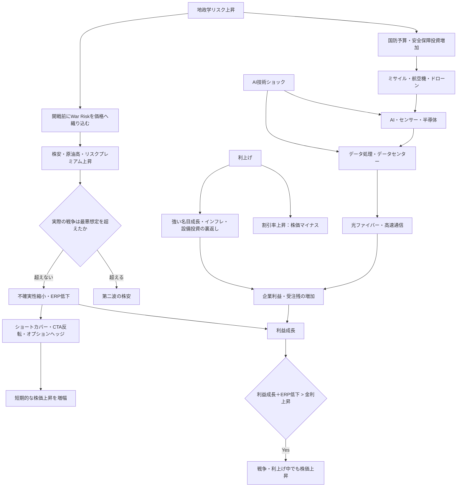
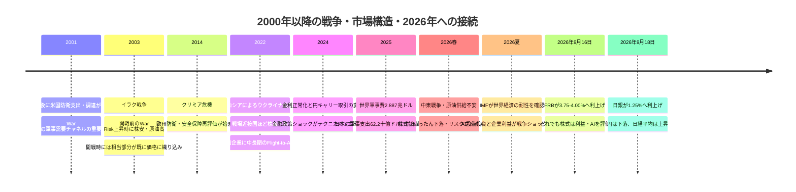
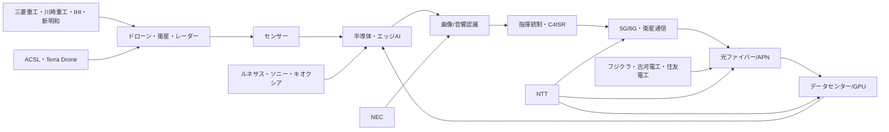

# 戦争・利上げ局面でも世界株・日本株が暴落せず上昇する理由  
## 機関投資家・経済アナリスト視点による実証研究、資金フロー、政策、企業業績の統合分析

## Executive summary

本報告の結論を先に述べる。

**「戦争が起きている」「中央銀行が利上げしている」という事実だけでは、株価下落を予測するには不十分である。** 株価を決めるのは、戦争や利上げの“絶対的な悪さ”ではなく、①それが事前にどこまで価格へ織り込まれていたか、②実現したシナリオが市場の最悪想定より良かったか、③企業利益が金利上昇によるバリュエーション低下を上回って伸びているか、④戦争・AI・財政支出によって新たな需要を得る企業が指数内でどれほど大きいか、⑤ショートカバー、システマティック運用、オプション・ディーラー、パッシブ資金が初動をどれだけ増幅するか、である。これは2003年イラク戦争、2022年ロシアによるウクライナ侵攻、過去101件の紛争を調べた査読研究、NBERの「War Puzzle」、そして2026年のIMF分析を横断すると一貫して見えてくる。 citeturn4search2turn4search1turn3search0turn2search2

特に重要なのが、**War Risk と War は同じではない**という点である。Rigobon & Sackの研究では、2003年イラク戦争前に「戦争になる確率」が高まる段階で株価が下がり、原油が上がり、ドルが下落した。一方、Guidolin & La Ferraraが1974～2004年の101件の紛争を調べると、紛争開始時の各国株式市場は平均的にはマイナスよりプラス反応を示すケースの方が多かった。つまり、**最大の株価下落が開戦前の不確実性上昇時に発生し、開戦そのものが新情報でなくなった瞬間にリスクプレミアムが縮小する**ことがある。 citeturn4search2turn4search1

この構造は2026年にも確認できる。IMFは6月、長引く中東戦争、ホルムズ海峡問題、原油上昇にもかかわらず、世界経済は予想以上に持ちこたえ、**強い企業利益を背景にリスク資産が上昇し、広範な「安全資産への逃避」はほとんど確認されなかった**と分析した。7月の世界経済見通しでは、2026年の世界成長率を3.0%、2027年を3.4%とし、中東戦争という負の供給ショックとAIという正の技術ショックが同時に世界経済を動かしていると整理している。S&P500企業についても2026年1～3月期には80%以上が利益予想を上回ったとしている。 citeturn2search2turn2search3turn2search7

さらに、2026年9月16日にFRBは政策金利を25bp引き上げ3.75～4.00%としたが、FRB自身が米国経済について「solid pace」での拡大、底堅い国内需要、強い生産性、堅調な設備投資を認識している。利上げは景気崩壊を意味するものではなく、むしろ**名目成長・需要・設備投資が中央銀行に引き締めを可能にするほど強い**という側面を持つ。 citeturn0search0

日本ではさらに示唆的である。9月18日に日銀は政策金利を1.00%から1.25%へ引き上げ、31年ぶりの高水準とした。それにもかかわらず日経平均は同日約1.7%上昇する局面があり、円はむしろ157円台まで下落した。したがって、**「最新局面では円高なのに株高」というより、「利上げをしても市場が想定したほどタカ派でなく、円安・AI株高が株価を支えた」というのが9月18日時点の正確な描写**である。円高局面は2026年中に存在したものの、足元では為替効果が再び日本株に追い風となった。 citeturn22search0turn22search7turn22search9

また、資金フローは「世界中の投資家が一斉に株を買っている」という単純な構図でもない。9月16日までの1週間には世界株ファンドから232.1億ドル、米国株ファンドから314.4億ドルが流出した一方、アジア株ファンドには62.6億ドルが流入し、セクターファンドではテクノロジー、金融、一般消費財を中心に44.9億ドルが流入した。つまり現在起きているのは、**全面的なリスクオンより「指数内・地域間・セクター間の巨大なローテーション」**に近い。 citeturn22news46

そして日本株で最も重要なのは、防衛大手だけではない。防衛省は2026年の科学技術戦略で**量子、AI、情報・通信、宇宙、半導体**を重点5分野に指定した。現代戦では「ミサイルと戦車」だけではなく、ドローン、エッジAI、イメージセンサー、半導体、衛星、データセンター、光ファイバー、高速通信が同じシステムの一部になる。 citeturn19search1

したがって日本株の構造的恩恵は、

**三菱重工・川崎重工・IHI・新明和**  
↓  
**NEC・ACSL・Terra Drone**  
↓  
**ルネサス・ソニー・キオクシア**  
↓  
**フジクラ・古河電工・住友電工**  
↓  
**NTT / 光通信・データセンター**

という、**「兵器 → 無人化 → AI → 半導体 → データ → 光通信」**のサプライチェーン全体で考えるべきである。もっとも、後半になるほど「戦争による直接収益」ではなく「AI・通信・デュアルユース需要」という間接チャネルになるため、銘柄ごとの因果関係を混同してはいけない。 citeturn19search1turn16search0turn16search3turn17search1turn18search7turn21search0turn20search6

## 方法論と評価フレーム

本報告では、**2000年以降の主要な戦争・地政学ショックと2026年9月19日時点の市場環境**を中心に、イベントスタディ、時系列研究、資産価格研究、政府資料、企業IRを統合した。学術エビデンスについては、NBER working paperだけでなく、*Journal of Banking & Finance*、*Journal of Peace Research*、*Journal of Money, Credit and Banking*、*International Review of Financial Analysis*、*Heliyon* 等の査読研究を優先した。2026年のマクロ環境についてはIMF、FRB、日銀・防衛省、SIPRIを一次資料として優先し、足元の市場反応・資金フローについてReutersを補完的に使用した。 citeturn4search14turn4search1turn4search8turn3search4turn6search0

株価は概念的には、

\[
P_t=\sum_{k=1}^{\infty}
\frac{E_t(CF_{t+k})}
{(1+r_f+ERP+GPRP)^k}
\]

と考えることができる。ここで \(r_f\) は無リスク金利、ERPは株式リスクプレミアム、GPRPは地政学リスクに伴う追加プレミアムである。利上げは \(r_f\) を引き上げるため本来は株価にマイナスだが、同時に企業利益 \(CF\) が上方修正され、さらに戦争のテールリスク後退によってERP/GPRPが低下すれば、**分母の金利上昇を分子の利益成長とリスクプレミアム縮小が上回る**ことがある。これは現在の「金利高なのに株高」を理解する基本式である。IMFが2026年に確認している「市場金利上昇と株価上昇の併存」は、この枠組みと整合的である。 citeturn2search2turn2search3

本報告では、株高の説明要因を以下のように分解する。ただし、これらは互いに相互作用するため、後述する「寄与度」は回帰分析で得た厳密な分散分解ではなく、**機関投資家向けのエビデンス加重スコア**である。

| 評価軸 | 観察するもの | 主要な伝播経路 |
|---|---|---|
| War Riskの織り込み | 戦争確率、原油、株、信用スプレッド | 開戦前に悪材料を価格化 |
| 実現シナリオ | 原油供給、戦争拡大、世界貿易 | 最悪回避ならリスクプレミアム低下 |
| 金融政策 | 政策金利、国債利回り、実質金利 | 割引率と景気シグナル |
| 財政・軍事支出 | 防衛予算、調達契約、産業政策 | 企業売上・受注残へ転換 |
| AI投資 | 半導体、GPU、メモリ、光通信 | 生産性・設備投資・利益成長 |
| 為替 | USD/JPY等 | 輸出利益・輸入コスト・外国人投資 |
| ポジショニング | 空売り、CTA、先物、オプション | 初動を増幅 |
| 市場構造 | パッシブ比率、指数集中、0DTE | 少数大型株の動きを指数全体へ拡大 |
| 流動性 | スプレッド、出来高、ファンドフロー | システミック危機かローテーションかを判別 |

今回の研究の出発点となったユーザー提供台本は、2026年春の反発を「ショートスクイーズ → CTA反転 → オプション・ディーラーのヘッジ」という連鎖で説明している。fileciteturn0file0 ただし、同台本に含まれるGoldman SachsのCTAポジション等はプロプライエタリなデータであり、公開資料だけでは完全な再検証ができない。そのため本報告では**市場構造チャネル自体は採用するが、具体的なCTA買い金額を現在の株高の主因とは断定しない**。

また、台本にある「0DTEがS&P取引の約63%」という表現には重要な修正が必要である。Cboeによると2026年7月には0DTEが**SPXオプション取引量の66.2%**を占め、2026年第2四半期には0DTEの平均日次想定元本が約2.3兆ドルに達したが、これは「S&P500株式取引全体の66%」ではなく**SPXオプション市場の比率**である。 citeturn11search8turn11search5

同様に「パッシブ運用が市場の64%」も定義が重要である。ICIの2026年7月データでは、米国国内株式のミューチュアルファンド＋ETF資産のうちインデックス運用は約15.1兆ドル、アクティブは約8.44兆ドルで、インデックス比率は約64.1%だった。これは**米国上場株式の時価総額全体の64%が機械的に保有されているという意味ではない**。ただし、指数連動資金が価格形成上極めて大きな存在になったこと自体は確かである。 citeturn11search11

主要な学術・公的ソースは以下である。

| 研究・資料 | 主な発見 | URL |
|---|---|---|
| Rigobon & Sack, *JBF* / NBER | 戦争「確率」上昇段階で株安・原油高・ドル安 | `https://www.nber.org/papers/w9609` citeturn4search2turn4search14 |
| Guidolin & La Ferrara, *JPR* | 101紛争で開戦時の株価反応は平均的にプラスがマイナスより多い | `https://journals.sagepub.com/doi/10.1177/0022343310381853` citeturn4search1 |
| Cortes, Vossmeyer & Weidenmier | War Puzzle、戦時の米国株ボラティリティが低い | `https://www.nber.org/papers/w29837` citeturn3search0 |
| Hirshleifer, Mai & Pukthuanthong | 約160年・700万件の記事からWar Return Premium | `https://www.nber.org/papers/w31204` citeturn3search1 |
| Federle et al. | 戦場から近い国ほど株価下落が大きい | `https://onlinelibrary.wiley.com/doi/10.1111/jmcb.13226` citeturn4search8 |
| Zhang et al., *IRFA* | 防衛株に中長期的な“Flight-to-Arms” | `https://doi.org/10.1016/j.irfa.2022.102327` citeturn3search4 |
| Bossman & Gubareva | 日本・米国・フランスの市場が弱気局面でもGPRに比較的耐性 | `https://doi.org/10.1016/j.heliyon.2023.e13626` citeturn6search0 |
| IMF 2026年6月 | 戦争中も世界経済・リスク資産が持ちこたえる | `https://www.imf.org/en/blogs/articles/2026/06/15/global-economy-endures-war-shock-so-far` citeturn2search2 |
| IMF 2026年7月 WEO | War shock と AI shock の同時進行 | `https://www.imf.org/en/Publications/WEO/Issues/2026/07/28/world-economic-outlook-update-july-2026` 相当のIMF WEOページ citeturn2search3 |
| SIPRI | 世界・日本の軍事支出拡大 | `https://www.sipri.org/media/press-release/2026/global-military-spending-rise-continues-european-and-asian-expenditures-surge` citeturn7search0 |
| 防衛省 DSTB | AI・通信・宇宙・半導体等を防衛重点技術化 | `https://www.mod.go.jp/j/policy/agenda/meeting/dstb/report.html` citeturn19search1 |

## 主要エビデンスの時系列分析

**イラク戦争は「War Risk vs War」の最も明快なケースである。** Rigobon & Sackは市場が推定する戦争確率の変化を利用し、戦争可能性が上昇すると米国株が下落し、低格付け債のスプレッドが拡大し、ドルが下落、原油が上昇することを示した。Leigh、Wolfers、Zitzewitzも予測市場を利用して、戦争確率が株価へ相当程度事前に織り込まれたことを示している。したがって、実際に開戦した時点で株価が上がるケースは「市場が戦争を好む」からではなく、**未知の確率分布が既知のシナリオへ変わるため**である。 citeturn4search2turn4search0

Guidolin & La Ferraraはさらに広いサンプルを使い、1974～2004年の101件の国内・国際紛争を検証した。その結果、紛争開始時の株式市場は平均的にプラス反応を示すケースがマイナスより多く、国際紛争やアジア・中東で効果が強いことを報告した。これは「戦争は株にプラス」という意味ではなく、**戦争開始の瞬間には大量のリスクが既に価格へ反映されている**可能性を示す。 citeturn4search1

「War Puzzle」はさらに直感に反する。Cortesらは米国の長期データを調べ、戦争・紛争期の株価ボラティリティが通常期より約25%低い現象を示し、その一因として**Military Demand Channel**を提示した。国防省など政府部門は巨大で比較的予測可能な顧客となるため、軍事調達への依存度が高い企業では売上・利益予想のばらつきが低下し得る。9.11やイラク戦争後にも、調達依存企業でアナリスト利益予想の分散が低下したことを報告している。 citeturn3search0

一方で、戦争の損失が消えるわけではない。Federleらのロシア・ウクライナ戦争研究では、ウクライナの直接隣接国は侵攻後第2週までに累積で約23.1%下落し、ウクライナから1,000km遠くなるごとに下落効果が約2.6ポイント弱まった。貿易関係でこの距離効果の約3分の2を説明でき、残りには軍事的テールリスクが関係する。**世界株高と戦争被害は矛盾しない。被害は地理的・産業的に極端に偏るからである。** citeturn4search8

この「地理的近接性」は日本を考える上で非常に重要である。ロシア・ウクライナ戦争をG7・E7市場で分析した研究では、地政学リスクの株価効果は市場環境によって非対称で、日本、米国、フランスは弱気局面でも相対的な耐性を示した。したがって「欧州で戦争→日本株も同率で下落」というモデルは実証研究と合わない。 citeturn6search0

同時に防衛株には時間差がある。世界の防衛企業を分析したIRFA研究では、地政学リスクと防衛企業リターンとの正の関係が中長期で現れる「Flight-to-Arms」が確認されている。より新しい研究でも、地政学ショック直後は防衛株ですら市場全体と一緒に売られる場合がある一方、中長期には国防予算・調達増加を通じて相対リターンが改善するという**短期Flight-to-Quality → 中長期Flight-to-Arms**の構造が示されている。 citeturn3search4turn3search6

2025年には世界の軍事支出が2兆8,870億ドルへ増加し、11年連続で増加した。日本の支出は622億ドル、前年比9.7%増で、GDP比1.4%と1958年以来の高水準になった。これは戦争を一時的なニュースではなく、**数年間の受注残を生みうる設備投資サイクル**へ変える。 citeturn7search0

2026年の日本政府の政策もこれを強化している。防衛省資料では2026年度の防衛関係費は防衛力整備計画ベースで約8.81兆円規模であり、無人アセット防衛能力だけでも約2,773億円を計上し、2027年度以降の「SHIELD」構想に向けて安価で多数運用できるUAV、USV、UUV等を整備する方向を示している。 citeturn7search4turn7search10

さらに2026年4月には防衛装備移転三原則等が改定され、防衛省は官民一体で装備移転を進める方針を示した。日米DICAS 2.0でも「より迅速かつ大量」に装備を生産するため、防衛産業基盤・サプライチェーン・維持整備能力を強化する方針で一致している。これにより日本の防衛企業は**国内需要だけでなく同盟国向け生産能力**というオプション価値を持ち始めている。 citeturn19search6turn17search14

2026年の最大の相殺要因はAIである。IMFは、中東戦争を負の供給ショック、AIを正の技術ショックとして捉え、AI・データセンター投資が米国だけでなく日本、韓国、台湾などテクノロジー輸出経済を支えていると指摘する。**世界株は「戦争指数」ではなく「上場企業利益の時価総額加重指数」である。AI大型株の利益が強ければ、戦争の被害を受ける企業が多数存在しても指数は上がり得る。** citeturn2search2turn2search3

## 政策・市場構造・資金フロー・企業業績の寄与度評価

現在の株高を一つの理由で説明するのは危険である。機関投資家としては、**ファンダメンタルズを一次要因、リスクプレミアムを二次要因、テクニカルフローを増幅要因**として分けるのが妥当である。

以下の「寄与度」は厳密な回帰係数ではなく、研究・マクロデータ・企業業績・市場反応を統合した**非加算型の分析スコア**である。

| 要因 | 世界株への寄与 | 日本株への寄与 | 確信度 | 判断 |
|---|---:|---:|---:|---|
| AI・企業利益 | ★★★★★ | ★★★★★ | 高 | 現在の最重要ドライバー |
| War Riskの事前織り込み・最悪回避 | ★★★★☆ | ★★★☆☆ | 高 | 戦争そのものより予想との差 |
| 金融政策が予想内 | ★★★☆☆ | ★★★★☆ | 高 | 利上げの“サプライズ”が小さい |
| 防衛・財政支出 | ★★★☆☆ | ★★★★☆ | 高 | 日本では構造変化が大きい |
| 為替 | ★★☆☆☆ | ★★★★☆ | 中～高 | 日本株では極めて重要、方向は変化 |
| 地理的近接性 | ★★★★☆ | ★★★☆☆ | 高 | 遠隔市場への直接損失を限定 |
| ショートカバー・CTA | ★★★☆☆ | ★★★☆☆ | 中以下 | 方向増幅は可能、公開データ制約 |
| オプション・ディーラー | ★★★☆☆ | ★★☆☆☆ | 中 | 米国中心に短期増幅 |
| パッシブ・指数集中 | ★★★★☆ | ★★★★☆ | 高 | AI大型株の指数寄与を増幅 |
| 市場流動性 | ★★★☆☆ | ★★★☆☆ | 中 | 現時点で金融危機型の枯渇は確認しにくい |

**最大の寄与は企業利益とAI投資**である。2026年7月のIMFは、企業利益の強さとAI投資を金融市場の強さの中心要因として挙げている。S&P500企業の80%以上が1～3月期に予想を上回ったという事実は、金利上昇によるPER圧縮をEPS上方修正が相殺している可能性を示す。 citeturn2search3

**金融政策について重要なのは「利上げか否か」ではなく「予想との差」である。** 9月16日のFRB利上げは市場で広く予想されていた。翌17日には原油低下も加わって日本株が上昇し、ReutersはFRBの決定を「largely expected」と評価している。日銀の9月18日の利上げも予想通りで、2人の反対票と強烈なタカ派ガイダンスの欠如から、市場はむしろ将来の利上げパスを下方修正し、円安・日本株高となった。 citeturn22search8turn22search1turn22search9

これは中央銀行の利上げを、

> 利上げ → 株安

ではなく、

> 利上げ予想形成 → 既に債券・為替・株価へ反映 → 実際の利上げ → 予想との差を再評価

というイベントとして扱う必要があることを示す。

**為替については、日本株を一括して評価してはいけない。** 円高は自動車・電機など海外利益比率の高い企業には円換算利益の逆風になるが、輸入コストの大きい内需企業にはプラスである。一方、最新の9月18日は円高ではなく円安となり、それが輸出株・日経平均を支援した。したがって現状の日本株上昇を「円高にもかかわらず」と表現する場合は、**2026年中の円高局面**と**9月18日以降の円安反応**を明確に分ける必要がある。 citeturn22search7turn22search9

資金フローも「株価上昇＝大量の新規資金流入」ではない。9月中旬には世界株ファンド全体から資金が流出しているのに、アジアとテクノロジーなど一部セクターには資金が入った。これは指数が上昇していても市場内部では**AI、防衛、金融、輸出株などへのローテーションが起き、一方で別セクターが売却されている**ことを示す。 citeturn22news46

9月1日の日本市場でも、AI関連・電線株が利益確定で下落する一方、自動車などへ資金が移り、TOPIXが上昇した。Reutersはこれを明確にsector rotationとして報じている。つまり「AI株が止まれば日本株も終わり」ではなく、**利益期待が他セクターへ拡散すれば指数全体が高値を維持できる**。逆に言えば、指数高だけを見て市場の広がりが強いと判断するのも危険である。 citeturn22search2

市場構造も無視できない。米国国内株式ファンドではインデックス比率が約64%まで上昇しており、SPXオプションでは0DTEが取引量の6割超を占める。時価総額加重指数では、既に上昇している大型AI銘柄ほど指数ウェイトが大きくなり、指数連動資金がそれを保有する。このため**少数の巨大企業の利益上方修正が「世界株全体が強い」という見た目を生みやすい**。 citeturn11search11turn11search8

ただし、ショートスクイーズ、CTA、ディーラー・ガンマについては慎重さが必要である。これらは**上昇を始める根本原因というより、価格が一定水準を超えた後に上昇速度を増幅するメカニズム**と考える方が妥当である。最新のCTAポジション、プライムブローカーのグロス/ネット・レバレッジ、ディーラーのネットガンマは完全な公開データではないため、本報告では現在の株高に対し高い確率で「増幅要因」と評価する一方、「主原因」とはしない。

現状の2026年市場を一枚で表すと以下になる。

| 観測値 | 現状 | 株式への含意 |
|---|---|---|
| FRB政策金利 | 9月16日に3.75～4.00%へ25bp利上げ | 割引率は逆風だが予想内 citeturn0search0 |
| 日銀政策金利 | 9月18日に1.25% | 利上げでも円安・株高 citeturn22search0turn22search9 |
| 世界成長率 | IMF 2026年3.0%、2027年3.4%予想 | 世界景気後退を基本シナリオとしていない citeturn2search3 |
| 企業利益 | S&P500 Q1の80%以上が予想超過 | 金利上昇をEPSが相殺 citeturn2search3 |
| 世界株ファンド | 週232.1億ドル流出 | 全面リスクオンではない citeturn22news46 |
| アジア株ファンド | 同週62.6億ドル流入 | 地域ローテーション citeturn22news46 |
| 世界軍事支出 | 2025年2.887兆ドル | 防衛企業の長期需要へ citeturn7search0 |
| 日本軍事支出 | 622億ドル、前年比+9.7% | 日本防衛企業に構造的追い風 citeturn7search0 |
| パッシブ化 | 米国内株式ファンドで指数運用約64.1% | 大型株集中を増幅 citeturn11search11 |
| 0DTE | SPXオプション量の66.2%まで上昇 | 短期ディーラー・ヘッジの重要性増大 citeturn11search8 |

## 日本株のセクター・銘柄別インパクト分析

日本株を見る上で最も大きな誤解は、**「戦争の恩恵＝防衛株」だけで終わること**である。

2026年4月の防衛科学技術委員会は、量子、AI、情報・通信、宇宙、半導体を重点技術に選定した。さらに防衛省は指揮統制・情報関連機能へ5,166億円規模を配分し、AI、大量データ処理、低遅延通信を含む次世代情報通信基盤を整備する方向である。現代戦は**センサー → AI推論 → 通信 → 指揮統制 → 無人機 → 効果器**というデジタルシステムになっている。 citeturn19search1turn8search11

その結果、戦争・安全保障投資とAI投資は次の場所で重なる。

以下は最低限指定された14銘柄を、**直接的防衛収益・AI収益・デュアルユース・現在確認できる受注/事業進展**で評価したものである。

| 銘柄 | 主なエクスポージャー | 直接度 | 現在確認できる材料 | 投資インパクト |
|---|---|---:|---|---|
| 三菱重工 7011 | ミサイル、艦艇、航空・宇宙、防衛 | ★★★★★ | 防衛・宇宙の大規模受注残が売上・利益成長ドライバー。豪州フリゲート関連でも政府支援 | **非常に高い** citeturn14search2turn19search3 |
| 川崎重工 7012 | 航空宇宙、哨戒機、潜水艦、無人機 | ★★★★★ | 2026Q1航空宇宙売上1,376億円。Airbusと無人機協業、9月にはEdgeCortixと防衛エッジAI協業 | **非常に高い** citeturn15search6turn15search4turn14search13 |
| IHI 7013 | 防衛航空エンジン、宇宙、衛星 | ★★★★★ | FY2026増益要因に防衛航空エンジン・装備品の売上拡大と採算改善。SAR衛星・AI衛星データも展開 | **非常に高い** citeturn15search0turn14search14turn14search11 |
| 新明和 7224 | US-2、航空機、防衛周辺 | ★★★★☆ | 2026年3月期航空機売上415.6億円、全社の約15% | **中～高** citeturn15search3 |
| NEC 6701 | C4ISR、ソーナー、通信、AI | ★★★★★ | MHIと指揮統制・無人アセット・AI sovereigntyで提携。ATLAから水中音響基盤モデル受注。豪州フリゲート向け9種装備契約 | **非常に高い** citeturn16search0turn16search1turn16search5 |
| ACSL 6232 | 国産ドローン | ★★★★★ | 防衛省から約10億円の小型空撮ドローン案件。2026年売上予想40億円に対し規模は大きい。ただし営業赤字予想 | **高いが高リスク** citeturn16search3turn16search14 |
| Terra Drone 278A | 偵察・迎撃・汎用ドローン | ★★★★★ | 防衛装備庁から300式・1.154億円。Terra B1が迎撃実証を通過、量産フェーズへ。国産フライトコントローラ量産体制 | **高オプショナリティ** citeturn17search1turn17search5turn16search17 |
| ルネサス 6723 | MCU/SoC・組込半導体 | ★★☆☆☆ | 防衛省が半導体を重点技術指定。ただし公開資料上、防衛売上の直接寄与は確認困難。2026Q2売上4,053億円 | **デュアルユース、直接War betaは低め** citeturn19search1turn18search15 |
| ソニーG 6758 | イメージセンサー | ★★☆☆☆ | センサーは自律機・画像認識の基盤だが、防衛売上の直接開示は限定的。半導体・センサーの国家戦略的重要性は上昇 | **AI/センサー主体、戦争は間接** citeturn19search1turn23search1 |
| キオクシア 285A | NAND、SSD、AI DC | ★★☆☆☆（防衛）/★★★★★（AI） | DC・エンタープライズ売上比率を中長期60%以上へ。今後3年、年4,700億円設備投資・2,300億円R&D | **AIインフラとして非常に高い** citeturn18search2turn18search7 |
| フジクラ 5803 | 光ファイバー、接続、DCI | ★★☆☆☆（防衛）/★★★★★（AI） | 生成AIでデータセンター超多心・高密度化。16心対応融着機、DC向け光配線を拡大 | **AI/DC主因で非常に高い** citeturn20search8turn23search16 |
| 古河電工 5801 | 光ファイバー、DC、通信 | ★★☆☆☆（防衛）/★★★★★（AI） | 13,824心ケーブル量産、能力はFY2023比2倍超。FY2025売上+8.8%、営業益+35.8%、DC関連が寄与 | **非常に高い実業績連動** citeturn21search0turn21search7 |
| 住友電工 5802 | 光通信、電線、マルチコアファイバー | ★★☆☆☆（防衛）/★★★★☆（AI） | AI DC向け4コア・マルチコアファイバー規格を業界各社と策定、9月に仕様1.0完成 | **中～高** citeturn20search9turn20search13 |
| NTT 9432 | IOWN/APN、6G、DC、分散GPU | ★★★☆☆ | APNで遠隔GPU、AI映像解析、ロボット遠隔制御を実証。AI DC向け光ネットワークへの投資も拡大 | **通信基盤として高い** citeturn20search3turn20search6turn20search7 |

**三菱重工・川崎重工・IHIは最も純粋な「軍事需要チャネル」の受益者である。** この3社は防衛政策・大型政府調達が売上・受注残に直接接続するため、NBERのWar Puzzle研究が指摘する「予測可能な政府需要」の日本版に最も近い。日本の国防支出拡大と装備移転制度変更が継続すれば、短期的な戦争ニュースよりも複数年の受注残が評価の中心になる。 citeturn3search0turn7search0turn19search6

川崎重工は特に興味深い。2026年6月にAirbus Defence & Spaceと滞空型無人機の協業検討を開始し、9月8日にはEdgeCortixと低消費電力エッジAIを利用する次世代防衛システムで協業を発表した。**「重工業」と「AI半導体」の境界が消え始めている**象徴的な例である。 citeturn15search4turn14search13

NECはさらに直接的な**AI×防衛**銘柄である。9月2日に三菱重工と戦略提携し、作戦計画、指揮統制、無人アセット、データ主権、AI主権を対象とした。8月には防衛装備庁から水中音響基盤モデルの研究を受注し、2027年度までの基盤モデル構築を目指している。さらに豪州フリゲート向けにソーナーや複合通信アンテナ等9種類の防衛装備品を供給する大型契約を締結している。 citeturn16search0turn16search1turn16search5

ACSLは大型重工と異なり、小型株ゆえに**1件の防衛案件が業績に与える相対インパクトが非常に大きい**。3月の防衛省案件は約10億円で、同社の2026年売上予想40億円の約4分の1に相当する。ただし同社は2026年も13.6億円の営業赤字予想で、8月には海外募集による新株発行も決議している。したがって「防衛需要の高成長」というテーマと「希薄化・資金調達・量産採算」という企業リスクを同時に見る必要がある。 citeturn16search3turn16search14turn16search11

Terra Droneも同じく高オプショナリティ型である。5月に防衛装備庁から汎用型ドローン300式、1億1,543万円を受注し、8月には38社の提案から選定された迎撃ドローンTerra B1が実証試験を単独通過した。9月にはドローンの「頭脳」に相当する国産フライトコントローラーTerra DFCの量産体制を発表した。現時点の売上規模より、**量産調達へ移行できるかどうか**が株価評価の中心である。 citeturn17search1turn17search5turn16search17

一方、ルネサス、ソニー、キオクシアを「戦争銘柄」と呼ぶのは適切ではない。防衛省が半導体を安全保障上の重点技術として扱っていることは明確だが、各社の公開IRから防衛向け売上が業績全体を動かすほど大きいとは確認できない。これらは**戦争→直接売上ではなく、AI・自律化・センシング・データ処理のデュアルユース化**を通じた二次受益者と位置づけるべきである。 citeturn19search1

その中でキオクシアはAI側の収益因果が最も明確である。会社はAI推論時代にSSDをGPUの拡張メモリとして活用する需要が拡大するとみて、データセンター・エンタープライズ向け売上比率を中長期60%以上へ引き上げる方針を示した。今後3年間で年約4,700億円の設備投資と2,300億円のR&D投資を予定している。2026年3月期売上は2兆3,376億円であり、これはもはやテーマだけでなく巨大な設備投資サイクルである。 citeturn18search7turn18search8

**光ファイバー3社は「戦争関連」というより「AIと現代戦に共通する帯域需要」の受益者**である。古河電工はAI・クラウド普及によるハイパースケールDC需要を受け、13,824心の超多心光ケーブルを量産開始し、光ケーブル生産能力をFY2023比2倍以上へ拡大した。2026年3月期にはデータセンター関連製品の増収などで全社売上が8.8%、営業利益が35.8%増加している。ここは「テーマ株」ではなくすでに損益計算書にAI需要が表れている。 citeturn21search0turn21search7

フジクラも生成AIによるデータセンター大型化、高密度化、超多心化を明示している。同社はデータセンター向け光配線、SWR/WTC、融着接続機を展開しており、2026年3月期の連結売上は1兆1,824億円まで拡大した。 citeturn20search8turn21search6

住友電工はFujikura系企業、Corning等とAIデータセンター用の4コア・マルチコアファイバー規格を策定し、2026年9月17日にVersion 1.0を公表した。従来の単心ファイバーが物理的密度の限界に近づく中、**GPUクラスタのscale-outが光ファイバーそのものの構造変化を起こしている**。 citeturn20search9turn20search13

NTTはこの「光→AI→遠隔制御」をネットワーク側から押さえる。2026年3月には5GとIOWN APNを使い、遠隔GPUで低遅延AI映像解析を実証した。4月にはAIOWNへの転換を打ち出し、AI推論処理が2025～2030年に4倍以上になるという前提で、GPU、ネットワーク、電力を統合するAIネイティブ・インフラを構想している。9月にはNVIDIAも参加する1.25億ドルの資金調達を通じ、AIデータセンター向けプログラマブル光ネットワーク企業iPronicsへの投資を発表した。 citeturn20search3turn20search6turn20search7

ここで、投資テーマを三層に分けると誤認が減る。

| 階層 | 銘柄例 | 主たる利益ドライバー | 戦争との因果 |
|---|---|---|---|
| **直接軍事需要** | 7011、7012、7013、7224、6701、6232、278A | 防衛予算・契約・受注残 | 強い |
| **デュアルユース** | 6723、6758、9432 | AI、自律制御、通信、センサー | 中程度・間接 |
| **AIインフラ** | 285A、5803、5801、5802 | GPUクラスタ、DC、推論、光通信 | 戦争よりAIが主因 |

これが非常に重要である。**フジクラやキオクシアが上がる理由を「戦争で光ファイバーや半導体が必要だから」だけで説明すると因果を誇張する。** 現在の利益ドライバーは圧倒的にAIデータセンター需要であり、安全保障・ドローン・宇宙通信はその同じ技術基盤を使う追加的なデュアルユース需要である。古河電工も自社のLighteraについて、データセンター、5G/6Gだけでなく航空宇宙・防衛・センシングを対象市場に挙げるが、現在確認できる利益成長は主にデータセンター需要から来ている。 citeturn21search0turn21search7

オンラインで図・製品画像を確認する際に有用な一次資料は以下である。

| 図表・画像 | 参照先 |
|---|---|
| IMF「戦争ショック下の世界経済」チャート | `https://www.imf.org/en/blogs/articles/2026/06/15/global-economy-endures-war-shock-so-far` citeturn2search2 |
| SIPRI 世界軍事支出 | `https://www.sipri.org/media/press-release/2026/global-military-spending-rise-continues-european-and-asian-expenditures-surge` citeturn7search0 |
| 防衛省 DSTB AI・通信・半導体等 | `https://www.mod.go.jp/j/policy/agenda/meeting/dstb/report.html` citeturn19search1 |
| 古河電工13,824心光ファイバー | `https://www.furukawaelectric.com/en/release/2026/comm_20260312.html` citeturn21search0 |
| フジクラDC光配線 | `https://www.fujikura.co.jp/en/news/pressrelease/20260323post_118.html` citeturn20search8 |
| Terra B1迎撃ドローン | `https://terra-drone.net/global/2026/08/25/28439/` citeturn16search7 |
| NEC×三菱重工 防衛AI構想 | `https://www.nec.com/en/press/202609/global_20260902_04.html` citeturn16search0 |
| NTT IOWN/APN・AIインフラ | `https://group.ntt/jp/ir/library/nttis/aiown.html` citeturn20search6 |

## リスクと不確実性

最大のリスクは、**現在の市場が織り込んでいる戦争被害の上限を現実が突破すること**である。

Rigobon & Sack型のモデルでは、戦争が想定内なら開始後にリスクプレミアムが低下し得る。しかし、ホルムズ海峡の長期完全封鎖、エネルギーインフラへの大規模攻撃、主要国の直接参戦などによって「戦争確率」ではなく「実体経済への損失額」そのものが上方修正されれば、再び株式の期待キャッシュフローが低下する。現在の株高は**戦争が無害という判断ではなく、テールシナリオが基本シナリオではないという価格付け**である。 citeturn4search2turn2search2

原油も重要である。2026年の中央銀行は戦争によるエネルギー価格上昇を無視しておらず、FRB・日銀・ECBがインフレ再加速を警戒している。戦争が長期化し原油高が二次的な賃金・サービスインフレに波及すれば、現在の「企業利益が金利上昇を上回る」という関係が崩れる可能性がある。 citeturn22search1turn0search0

第二のリスクは**金利の非線形性**である。株は3.75～4.00%の政策金利でも上昇できるが、長期金利が利益成長以上に急上昇すれば、長期デュレーションのAI・半導体株ほど大きなPER圧縮を受ける。2026年9月時点で米10年債利回りは5%近辺まで上昇する場面があり、今後さらに実質金利が上昇すれば「AIの利益成長 > 割引率上昇」という現在の条件が逆転する可能性がある。 citeturn0search5

第三のリスクは**AI投資の収益化**である。現在の世界株・日本株はAI設備投資を正の供給ショックとして高く評価している。そのため、GPU、メモリ、光ファイバー、データセンターへの投資が実際のAI収益に転換しなかった場合、戦争とは無関係に株価が調整する。特にキオクシア、フジクラ、古河電工、住友電工などは「戦争受益株」ではなくAI設備投資サイクルへの感応度が高いので、AI CAPEXピークアウトが最大リスクになり得る。 citeturn18search7turn21search0turn20search9

第四は**指数集中**である。日本でも日経平均は値がさ株の寄与が大きく、AI・半導体銘柄の上昇だけで指数が大きく動くことがある。9月の市場でもAI関連が日経を牽引する一方、市場全体の値上がり銘柄数が弱い日が確認されている。「日経平均が上がった＝日本企業全体のファンダメンタルズが改善した」と解釈するのは危険である。 citeturn22search2turn22search9

第五は**テクニカル相場をファンダメンタル相場と誤認すること**である。0DTE、ディーラーヘッジ、CTA、ショートカバーは値動きを加速できるが、数週間～数年の株価を支えるには最終的に利益が必要である。プロプライエタリなプライムブローカー・データなしに「現在の日本株高の○割はCTA」と断言するのは不適切である。公開データで確認できるのは、指数運用・0DTEの存在感が高まったという市場構造までである。 citeturn11search8turn11search11

第六は**防衛銘柄のバリュエーション先行**である。防衛予算拡大は事実でも、受注が売上・利益になるには生産能力、人員、サプライチェーン、原価管理が必要である。受注残が増えても固定価格契約や部品不足で採算が悪化すれば、売上増＝EPS増にはならない。特に小型ドローン企業では増産のための資本調達が株主希薄化を伴う場合がある。ACSLの2026年海外増資はこのリスクを具体的に示す。 citeturn16search11turn16search14

第七は**防衛・AI・半導体を一つのテーマとして束ねすぎること**である。三菱重工の防衛契約、NECの防衛AI契約、ACSLの防衛省ドローン受注は直接的である。しかしソニーのイメージセンサーやルネサスの組み込み半導体、フジクラの光ファイバーについては、安全保障用途との技術的親和性が高くても、公開資料で防衛収益が全社利益を大きく動かしていることまでは確認できない。投資判断では**「使われ得る」と「売上が増えている」を分離する必要がある。** citeturn16search1turn16search3turn19search1turn21search7

最後に、流動性にも留意が必要である。現状、IMFが指摘するような広範なflight-to-safetyは確認されておらず、ファンドフローも全面的な株式撤退ではなく地域・セクター間ローテーションに近い。しかし、最新の先物投資家別ポジション、個別オプションのディーラー・ガンマ、プライムブローカーのレバレッジ、リアルタイムのbid-ask spreadは完全には公開されていない。したがって現在の流動性評価には必然的に推定が含まれる。 citeturn2search2turn22news46

機関投資家が監視すべきリスク指標を整理すると以下になる。

| シグナル | 強気継続 | 警戒 | 危険 |
|---|---|---|---|
| 原油 | 戦争中でも安定/低下 | 高止まり | 再急騰・供給断 |
| 長期金利 | 利益成長に見合う上昇 | 5%超で定着 | 実質金利急騰 |
| EPS revision | 上方修正 | 横ばい | 下方修正 |
| AI CAPEX | 増額 | 成長鈍化 | キャンセル |
| 防衛受注 | 契約・受注残増 | 発表のみ | 納期遅延・採算悪化 |
| 円 | 緩やかな変動 | 急速な円高/円安 | 当局介入・キャリー解消 |
| 株価 breadth | TOPIX等も上昇 | 日経だけ上昇 | 少数銘柄のみ |
| 信用市場 | スプレッド安定 | 拡大開始 | 流動性枯渇 |
| ファンドフロー | セクターローテーション | 持続流出 | 株・債券同時売り |
| ポジショニング | 中立 | 高レバレッジ | 強制デレバレッジ |

## 結論と投資家向け示唆

最も重要な結論は、

**「戦争なのに株が上がっている」のではない。  
「戦争の悪影響を織り込みながら、それを上回る利益・技術・財政ショックが同時に存在しているから株が上がっている」**

ということである。

歴史研究では、戦争が始まる前の**War Risk**が株価へ強く影響する。開戦によって不確実性が減り、実現した事態が最悪想定を下回れば、戦争が継続中でもリスクプレミアムは低下し得る。101件の紛争研究、2003年イラク戦争の予測市場研究、War Puzzle、160年間のWar Return Premium研究はいずれも、「戦争＝その瞬間から機械的に株安」というモデルを否定している。 citeturn4search2turn4search1turn3search0turn3search1

同時に、戦争の経済的損失は地理的に均等ではない。ウクライナ戦争で最も大きな株価下落を経験したのは近隣国であり、距離と貿易依存度が重要だった。したがって世界株指数は戦争地域の実体経済が悪化していても上昇し得る。世界株は「世界の幸福度指数」ではなく、**世界の主要上場企業の将来キャッシュフローを時価総額加重した価格**だからである。 citeturn4search8

2026年にこの構造へ加わった最大の要素がAIである。IMFの表現を借りれば、世界経済は**戦争という負の供給ショックとAIという正の技術ショックの綱引き**にある。現在は強い企業利益、AI・データセンター設備投資、アジアのテクノロジー輸出が戦争・原油・金利の逆風を相殺している。 citeturn2search2turn2search3

利上げも同様である。**利上げそのものではなく、利上げが市場予想よりタカ派か、そして利益成長より速く割引率を押し上げるか**が重要である。FRBが9月16日に3.75～4.00%へ、日銀が9月18日に1.25%へ引き上げても株価が崩れなかったのは、双方が大部分予想されており、特に日銀については市場が決定を想定ほどタカ派ではないと解釈したためである。 citeturn0search0turn22search1turn22search9

日本株については、投資対象を三つに分けるのが最も実用的である。

第一群は、**防衛予算の増加が直接受注になる企業**である。三菱重工、川崎重工、IHI、NEC、ACSL、Terra Droneが中心になる。ここでは「ニュース」ではなく、防衛省の契約額、受注残、納期、生産能力、利益率を見るべきである。 citeturn19search3turn16search5turn16search3turn17search1

第二群は、**現代戦とAIの両方に必要なデュアルユース企業**である。NEC、ルネサス、ソニー、NTTなどが該当する。ただし売上の多くは民生用途であるため、戦争テーマだけでバリュエーションを説明してはいけない。防衛省がAI・通信・半導体を重点分野としていることは将来の需要オプションを高めるが、実際の契約へ変わるまで割り引いて考えるべきである。 citeturn19search1

第三群は、**AI設備投資そのものの受益者**である。キオクシア、フジクラ、古河電工、住友電工、NTTが中心となる。このグループの最大の株価ドライバーは戦争ではなく、GPUクラスタ、AI推論、データセンター、光通信の設備投資である。ただし、AI・ドローン・衛星・防衛通信が同じ半導体・通信インフラを利用するため、安全保障投資が追加需要を作る可能性がある。 citeturn18search7turn21search0turn20search9turn20search6

機関投資家としての最も有用なフレームは、

> **Headline → Positioning → Earnings → Policy → Capacity**

の順で見ることである。

「戦争が始まった」というHeadlineだけでは売買しない。  
市場が既にどれほどショートなのかというPositioningを見る。  
次にEPS、受注残、AI CAPEXというEarningsを見る。  
その後、防衛予算、金融政策、装備移転制度というPolicyを見る。  
最後に、その企業が実際に増産できるかというCapacityを見る。

この順番なら、**「戦争だから防衛株を買う」「利上げだから株を売る」「円高だから日本株を全部売る」**という単純なマクロ連想を避けられる。

2026年9月時点のベースケースは、**戦争・高金利が続いても、世界株・日本株が必ずしも暴落する環境ではない**。企業利益、AI設備投資、防衛財政、地理的な損失分散、既に高いWar Riskの織り込みが株価を支えている。IMFの最新分析と学術研究はこの見方を支持する。 citeturn2search2turn2search3turn4search1turn3search0

ただし、これは「戦争中だから株を買えばいい」という結論ではない。現在の強気構造を壊す条件は明確である。

**戦争のテールリスクが現実化する。  
原油高が持続的なインフレへ転化する。  
実質金利が利益成長を上回る。  
AI CAPEXがピークアウトする。  
防衛受注が利益へ転換できない。  
円キャリーや高レバレッジが強制的に解消される。**

このいずれかが起きれば、現在は株高を増幅している市場構造が逆回転する可能性がある。

したがって最終的な投資判断は、

**「戦争が続くか」ではなく、  
「市場の想定より戦争が悪化するか」**

**「利上げするか」ではなく、  
「市場が織り込んだ以上に実質金利が上がるか」**

**「AIが重要か」ではなく、  
「AI投資が実際の企業利益へ転換し続けるか」**

**「防衛費が増えるか」ではなく、  
「どの企業の受注・生産能力・利益率に落ちるか」**

を見るべきである。

これが、**戦争中かつ利上げ局面にもかかわらず世界株・日本株が暴落せず、むしろ上昇できる理由を説明する最も整合的なフレームワーク**である。