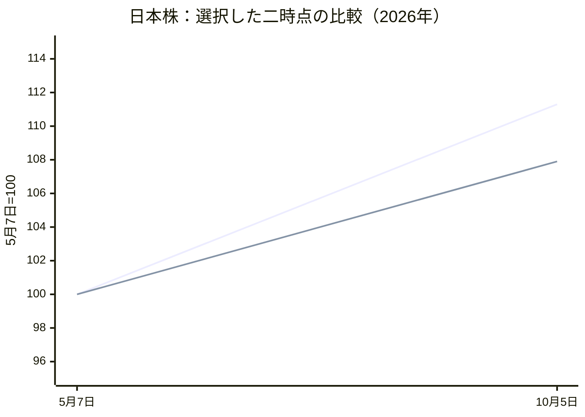
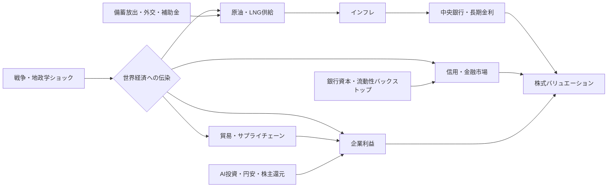
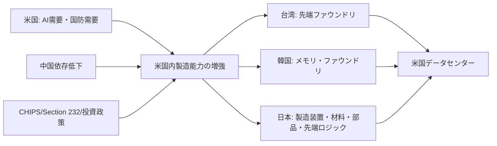
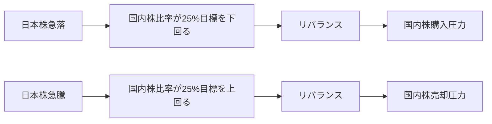
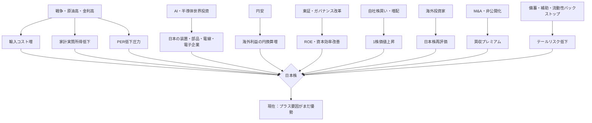

# 日本株が「戦争・金利高・原油高」でも暴落しない理由  
## 機関投資家・マクロ経済アナリスト視点の地政学／資金フロー／政策分析

**分析基準日：2026年10月5日**  
本稿では、10月5日時点で利用可能な情報を基本的なカットオフとし、米財務省、FRB、日銀、経産省、IMF、OECD、JPX、GPIF、Goldman Sachs、J.P. Morgan、UBS、Reuters、主要学術研究を優先した。元になった海外動画は、停戦後の上昇をショートカバー、CTA、オプション市場の増幅作用から説明していたが、fileciteturn0file0 本稿では初心者にも理解しやすいよう、**「戦争がどの経路で実体経済と企業価値に伝染するのか」**を中心に分析する。円防衛とFIMAを巡る別の海外動画の仮説も、FRB等の一次資料で再検証した。fileciteturn0file1

## Executive Summary

**第一の結論は、「戦争だから株が暴落する」という因果関係そのものが弱いことだ。** 学術研究では、戦争確率の上昇局面では株価が下がる一方、十分に予想された開戦では不確実性の解消によって株価が上がる「War Puzzle」が確認されている。440件の国際政治危機を調べたBerkman & Jacobsenは危機が平均的には株価とボラティリティに悪影響を与えることを確認しているが、その影響は暴力の規模、大国関与、経済への波及度によって大きく異なる。Caldara & Iacovielloも地政学リスク上昇が投資・雇用を抑えることを示す。したがって正しい理解は、**「戦争は悪材料だが、株価クラッシュを決めるのは戦争そのものではなく、エネルギー、金融、企業利益、信用市場への伝染度」**である。citeturn2search2turn2search6turn1search7

**第二に、現在の日本株には「戦争・原油高・金利高」を相殺する複数の構造的買い材料が同時に存在する。** AI・半導体需要と企業利益だけでなく、円安による海外利益の円換算増、東証・ガバナンス改革、過剰現金の圧縮、自社株買い・増配、M&A・非公開化、外国人投資家の日本再評価、GPIFなど長期資金のリバランス需要が重なっている。Goldman Sachs Asset Managementは2025年の自社株買いを約18兆円規模とし、J.P. Morganも日本株の株主還元、テック・ハードウェア、M&Aを重要な支援材料としている。citeturn20search3turn4search0

**第三に、原油100ドル超が即クラッシュにつながらない最大の理由は、政策当局が「供給途絶のテールリスク」を封じ込めているからだ。** IEA加盟国は2026年3月に4億バレル規模の協調放出を決め、米国はそのうち1.72億バレルを担う方針を示した。10月初めにはG7がさらに約1億バレルの原油・石油製品の緊急放出で協調し、中東からの輸出も9月末には一時、戦前水準を上回った。市場が見ているのは「戦争が続いているか」ではなく、**「世界経済が必要とする石油が実際に届くか」**である。citeturn11search10turn12news42

**第四に、2026年はリーマン・ショック型の危機ではない。** 2008年は銀行そのものの資本不足、住宅証券の信用損失、短期資金市場の凍結が同時発生し、信用創造機能が壊れた。2026年は主としてエネルギー・インフレ・国債金利・地政学のショックである。FRBの2026年ストレステストでは32行すべてが厳しい景気後退シナリオでも最低CET1要件を上回り、総損失7080億ドル超を吸収しても総合CET1比率の最大低下は1.6ポイントだった。ただしヘッジファンドのレバレッジは過去最高圏、生命保険のレバレッジも歴史的に高いため、**危機が消えたのではなく、脆弱性が銀行からノンバンク・国債市場へ移動した**と見るべきだ。citeturn15search1turn15search4turn15search9

**第五に、現在の株高は「安全宣言」ではない。** 10月5日の日経平均は69,946.86円、TOPIXは4,145.22、Brentは約101～102ドル、ドル円は約157.7円、米10年金利は5.3%前後という通常なら厳しい組み合わせだった。それでも株価が高いのは、現時点で「企業利益・AI投資・円安・株主還元・政策バックストップ」の合計が地政学ショックを上回っているからである。逆に、**ホルムズ海峡の再度の長期機能停止＋原油高の長期化＋米長期金利再上昇＋利益予想下方修正＋信用市場ストレス**が重なれば、現在の均衡は急速に崩れる。citeturn14search3turn14search0turn13news5

## 市場スナップショットと主要仮説の検証

### 最新市場データ

基準日の日本株を数字だけで見ると、「なぜ暴落しないのか」という問いが成立することが分かる。

| 指標 | 2026年10月5日前後 | 投資家としての読み方 |
|---|---:|---|
| 日経平均 | **69,946.86円**、日中高値70,072.13円 | 戦争・原油高・金利高でも約7万円。AI・半導体寄与が大きい。 citeturn14search3 |
| TOPIX | **4,145.22**、+1.33% | 日経平均の+2.40%より弱く、指数上昇の集中度を示す。 citeturn14search3 |
| S&P500 | **7,773.95**（米10月5日終値） | 史上最高値圏。企業利益・AI期待が高金利を相殺。 citeturn14news27 |
| Nasdaq | 10月5日に**最高値更新** | 世界株高の中心が依然AI・テクノロジーであることを示す。 citeturn14news27 |
| Brent原油 | 約**101～102ドル/バレル** | 日本には明確な逆風。ただし「不足」より「価格」で済んでいる段階。 citeturn14search0turn14news31 |
| WTI原油 | 約**90ドル** | Brentほど中東リスクが直接反映されない。 citeturn14search0 |
| 米10年国債 | 約**5.25～5.31%** | 株価バリュエーションへの強い逆風だが、利益成長期待が勝っている。 citeturn13news5 |
| 日本10年国債 | 約**3.06%** | 日本でも「ゼロ金利前提」は終了。銀行には追い風、長期成長株には逆風。 citeturn14search3 |
| USD/JPY | 約**157.7円** | 輸出・海外売上企業には利益押上げ、家計・輸入企業には逆風。 citeturn14search0 |
| 外国法人等の日本株保有比率 | **34.7%**（FY2025時価ベース） | 外国人は日本株の最大級の価格決定主体。過去最高水準。 citeturn8search0turn7view0 |
| GPIF国内株式基本配分 | **25%** | 暴落時のリバランス買いになり得るが、上昇時には売りにもなるため「常時買い支え」ではない。 citeturn23search6 |

ここで重要なのは、**日経平均が+2.40%なのにTOPIXは+1.33%だった**点である。10月5日の大幅高は、アドバンテスト、東京エレクトロン等のAI・半導体関連が中心だった。したがって「日本株全体が地政学を無視している」というより、**世界的AI投資の受益企業が指数を上へ引っ張っている**側面も大きい。citeturn14search2turn14search3

**選択した二時点での指数変化**

5月7日は中東情勢の緩和期待後、日経平均62,833.84、TOPIX3,840.49だった。10月5日にはそれぞれ69,946.86、4,145.22まで上昇している。日経平均は約11%、TOPIXは約8%高い計算になる。この期間には原油高・長期金利上昇があったため、単純な「地政学改善ラリー」では説明できない。citeturn13news9turn14search3

### 主要仮説と検証結果

- **「戦争が起きれば株は暴落する」→ 棄却。** 戦争の予想可能性、経済規模、エネルギー供給への影響、大国関与によって市場反応は大きく異なる。citeturn2search2turn2search6
- **「原油100ドルなら日本株は必ず下がる」→ 部分的に棄却。** 日本経済には確実に逆風だが、政府補助、備蓄、供給回復、AI需要、円安による企業利益が現時点では相殺している。OECDも2026年について、エネルギー価格上昇を逆風としつつ、賃金、政府補助、高い企業利益が国内需要・設備投資を支えるとみている。citeturn15search12
- **「円安だから日本株が上がっている」→ 一部支持。** グローバル企業にはプラスだが、中小企業・家計には輸入物価を通じマイナス。日銀自身も両面を認めている。citeturn21search7
- **「海外投資家とガバナンス改革が構造的な買い需要を作っている」→ 強く支持。** 外国人保有、英語開示、資本効率、自社株買い・M&Aの改善が同時進行している。citeturn21search2turn20news50
- **「GPIFや生保が無条件で株価を買い支えている」→ 誇張。** 長期安定資金ではあるが、GPIFは25%という基本配分を守るため、株高局面では逆にリバランス売りも発生する。citeturn23search6
- **「現在は第二のリーマン」→ 現時点では棄却。** 銀行資本・流動性は2008年よりはるかに強い。一方、ヘッジファンド・保険・国債市場には別種の脆弱性がある。citeturn15search1turn15search4
- **「米議会がねじれれば株安」→ 棄却。** 過去のリターンに一貫した関係はなく、金融政策・景気・利益サイクルの方が支配的である。学術研究にも、ねじれが短期的に政策不確実性を高める結果と、政治体制だけでリターンを予測するのは難しいという結果が併存する。citeturn16search8turn16search2

## 地政学・原油・政策バックストップ

### 市場は「戦争の数」ではなく「伝染経路」を値付けする

UBSのGlobal Investment Returns Yearbook 2026は、1900年以降126年に及ぶ長期市場史から地政学ショックを検討している。長期的な投資成果を破壊してきたのは、単発の政治危機そのものよりも、戦争が**インフレ、経済活動、金融危機、資産価格バブル崩壊**へつながったケースだった。citeturn1search0turn1search14

Bruneらの「The War Puzzle」では、戦争発生確率が高まる間に株価は下がるが、すでに十分予想されていた戦争が実際に始まると株が反発することがある。一方、予想外の開戦では負の反応が大きい。つまり市場は「戦争か平和か」という二択ではなく、**昨日の価格に対して新情報がどれだけ悪かったか**を値付けする。citeturn2search2

Berkman & Jacobsenの1918～2002年、440件の国際危機の研究では、危機は平均的に株式リターンを押し下げ、発生直後のボラティリティも高める。しかし大国が関与し、暴力の規模が大きいほど影響は強い。これは「戦争は無関係」という主張を否定すると同時に、**すべての戦争を同じリスクとして扱うのも誤り**であることを示す。citeturn2search6

Caldara & Iacovielloの地政学リスク指数研究でも、GPR上昇はその後の投資・雇用低下と下方リスク増加を予測する。Rigobon & Sackがイラク戦争前を分析した研究では、war risk上昇が株安、原油高、ドル安、低格付け社債スプレッド拡大と結びついた。つまりクラッシュに近づくのは、**地政学が金融条件を同時に締め上げる時**である。citeturn1search7turn2search1

現在の因果関係を単純化するとこうなる。

現在の日本株が崩れていないということは、**BからC～Fへの伝染がまだ「金融システムを壊すほど」進んでいない**という意味であって、Aが消えたという意味ではない。

### 原油高に対する米国・G7の防波堤

現在の政策対応はかなり大規模である。

| 時期 | 対応 | 市場に効く経路 | 限界 |
|---|---|---|---|
| 2026年3月 | IEA加盟国が**4億バレル**規模の協調放出を決定。米国は約**1.72億バレル**を担う方針 | 「物理的に油が足りなくなる」テールリスクを低下 | 一回限りの在庫であり恒久供給ではない。 citeturn11search10 |
| 3～4月 | DOEがSPRから段階的に緊急交換・放出 | 米国内供給と製油所への原料確保 | 精製能力や輸送制約は解消しない。 citeturn11search2turn11search20 |
| 9月下旬 | 中東原油輸出が一時**戦前水準を上回る** | 「ホルムズ問題＝即世界的供給不足」という最悪シナリオが後退 | タンカー攻撃、保険料、運賃、精製品不足は残る。 citeturn12news42 |
| 10月初め | G7が約**1億バレル**の原油・石油製品緊急放出で協調 | Brent・ディーゼルのリスクプレミアムを抑える | 原油があっても製油所・輸送が詰まれば軽油価格は下がりにくい。 citeturn12news42 |
| 9月米中首脳協議 | イラン情勢・国際水路について協議 | 米中双方が海上物流の完全寸断を望まないとの期待を形成 | **直接的な原油増産合意ではない。** 市場心理上のテールリスク低下というのは本稿の推論。 citeturn12search4turn12search13 |

ここは動画にすると非常に分かりやすい。

> 戦争は続いている。  
> しかし「石油が世界に届かない」という最悪シナリオは、政府・G7・産油国・備蓄によって封じ込められている。  
> だから戦争が続いていても株式市場は「世界恐慌」を値付けしない。

という説明である。

日本にとってこの点は特に重要で、日銀は日本の原油調達の**9割超を中東に依存**していることを指摘している。原油高は交易条件を悪化させ、企業利益と実質所得を圧迫するため、米国以上に日本の実体経済へ効く。citeturn0search10

それでもOECDは2026年の日本について、エネルギー価格上昇による逆風を認めながら、賃金上昇、エネルギー補助、高い企業利益、政府補助による設備投資が国内需要を支えると予測している。IMFも中東紛争を理由に成長見通しを抑えているが、民間投資と消費の底堅さを見込んでいる。これは、**原油ショックが「不況」ではなく現段階では「成長率を削るショック」として処理されている**ことを意味する。citeturn15search12turn15search8

### FIMAは「原油対策」ではなく金融市場の防波堤

FIMA Repo Facilityはここで混同しない方がいい。

FIMAは石油価格を下げる仕組みではない。外国中央銀行・通貨当局が米国債を市場で投げ売りせず、それをFRBに差し入れてドルを調達できる仕組みである。目的の一つは、ドル不足の際に外国当局が米国債を強制売却し、米国債市場を不安定化させることを避ける点にある。citeturn11search6

この点で、先ほどの海外動画の「日本が円防衛のため米国債を売れば米金利まで上がるため、FIMAが安全弁になる」というロジックには経済的合理性がある。fileciteturn0file1 2026年夏には日本の大規模円買い介入と外貨準備減少が実際に起き、ReutersはFIMAを使えば米国債の outright sale を避けてドルを調達できると報じた。citeturn20search5

しかし、ここは重要なファクトチェックがある。

**2026年9月30日時点でFRBの「Foreign official」レポ残高は0ドルだった。**

つまり、FIMAは現時点では「巨大な資金注入を実行中」なのではなく、**存在そのものが市場の強制売却リスクを小さくするバックストップ**と考える方が正確である。citeturn21search0

### 地政学イベントのタイムライン

| 時期 | イベント | 市場にとって重要な意味 |
|---|---|---|
| 2026年春 | 中東戦争激化・ホルムズ物流混乱 | 「原油供給ショック→世界不況」が最大のテールリスクになる。 |
| 3月 | IEA・米国が史上級の備蓄対応 | 物理的な原油不足シナリオを後退させる。 citeturn11search10 |
| 4月 | 停戦期待・原油急落・株反発 | ファンダメンタルズ改善にポジショニング解消が重なった。元動画は後者を主役にしている。 fileciteturn0file0 |
| 5月 | OECDが日本の成長をエネルギー高で下方圧迫と評価 | 原油高の負の効果は実体経済には存在。 citeturn15search6 |
| 夏 | 円安・日本の大規模為替介入 | 円安が日本の金融・財政問題にも接続。 citeturn20search5 |
| 9月 | 米中首脳協議、海上物流・イラン問題を協議 | 大国間で物流完全遮断を避けるインセンティブ。 citeturn12search13 |
| 9月末 | 中東原油輸出が大幅回復 | 戦争継続と原油供給回復が同時に起きる。 citeturn12news42 |
| 10月初め | G7追加備蓄対応 | 原油100ドル超でも「供給不能」ではないとの安心材料。 citeturn12news42 |
| 10月5日 | 日経平均一時7万円 | 地政学よりAI・利益・資金フローが優位な現状を象徴。 citeturn14search3 |

## 米政治・ねじれ国会・金融危機との比較

### 共和党が下院を含め勝利した場合

2026年10月5日時点では、トランプ政権下で共和党が上院を53議席で支配し、下院も非常に僅差ながら共和党多数である。11月3日の中間選挙で問題になるのは「共和党政権誕生」ではなく、**共和党が上下両院の支配を維持できるか**である。citeturn17search10turn16news48

市場では三つに分けるのが合理的だ。

| 中間選挙後 | 政策 | 米国市場 | 日本株への主な波及 |
|---|---|---|---|
| **共和党が上下両院維持** | 減税・設備投資優遇、規制緩和、エネルギー増産、国防・AI・製造業政策を進めやすい | EPSにはプラス。ただし財政赤字・インフレ期待→長期金利上昇が逆風 | 円安、銀行、防衛、機械、半導体製造装置に追い風。一方、米金利上昇が過度ならグロース株には逆風 |
| **民主党下院＋共和党上院** | 新たな大規模財政法案は通しにくい。行政権で関税・輸出規制・外交は継続可能 | 財政拡張抑制なら債券にはプラス。政策不確実性・shutdown riskは上昇 | 米金利低下なら日本グロースにはプラス、円高なら輸出株にはマイナス |
| **民主党が両院奪取** | 税制・歳出の追加変更を強く制約。監督強化 | 財政プレミアム低下の可能性。ただし行政・議会対立増加 | 日本株への影響は党派よりドル円・米金利経由の方が大きい |

注意すべきなのは、**2025年にすでに大規模な税制変更が成立している**ことである。国内R&D費の即時控除など企業向け優遇措置はすでに法律化されているので、「共和党勝利＝初めて減税が始まる」ではない。共和党勝利の追加効果は、既存政策の維持、追加規制緩和、エネルギー、国防、AI・製造業への政策実行力が上がる点にある。citeturn10search0

同時にCBOは現行税財政措置が中期的に巨額の追加赤字をもたらすと試算している。したがって「共和党勝利＝株高」という単線的な見方も危険で、**減税によるEPS押上げと、財政赤字による10年・30年金利上昇が綱引きする**。citeturn10search7

ここは日本株にも重要である。

**米財政拡張**
→ 米長期金利↑  
→ ドル高・円安  
→ 日本の輸出企業利益↑  
→ ただし輸入インフレ↑  
→ 日銀利上げ↑  
→ 日本の長期金利↑

となるからだ。

したがって共和党勝利は、**TOPIX全体に一方向ではなく、「輸出・銀行・防衛・資本財」と「高PER成長株・内需消費」の相対価格を動かすイベント**になる。

### 「ねじれ国会だから株は下がる」は歴史的に弱い

過去を比べると分かりやすい。

下表のS&P500は配当込み年次リターンから計算した期間リターンであり、「議会構成が原因」という意味ではない。むしろ、**議会構成だけでは説明できない**ことを示すための比較である。citeturn22search0

| 大統領・期間 | 政治構造 | S&P500累積リターン概算 | 読み方 |
|---|---|---:|---|
| クリントン 1995–2000 | 民主党大統領＋共和党議会 | **約+219%** | ねじれでもIT・生産性・低インフレ・利益成長が勝った |
| ブッシュ 2007–08 | 共和党大統領＋民主党議会 | **約-34%** | 暴落したが原因は銀行・住宅信用危機で、ねじれそのものではない |
| オバマ 2011–16 | 主としてねじれ | **約+102%** | 欧州危機等があってもQE、利益回復、景気拡大が優位 |
| トランプ 2019–20 | 民主党下院＋共和党上院 | **約+56%** | 貿易戦争・COVIDがあったが政策対応と利益期待で最終的に上昇 |
| オバマ 2009–10 | 民主党統一 | **約+46%** | 統一政府でも大幅上昇 |
| トランプ 2017–18 | 共和党統一 | **約+17%** | 統一政府でも2018年はマイナス |

学術研究でも結論は単純ではない。選挙開票時の高頻度データを使った研究では、ねじれ政府の確率上昇がS&P500先物を約1.4%押し下げる結果があり、**短期的には政策不確実性が嫌われる**ことは確認されている。citeturn16search8

しかし別の研究では、党派を使った株式リターン予測の差は長続きせず、統計的に頑健とは言いにくい。大統領サイクルについても、任期後半のリターンが高いという「puzzle」は存在するが、通常の景気・リスク変数で説明しきれない。citeturn16search2turn16search1

したがって機関投資家は、

> 「共和党だから買う」  
> 「ねじれだから売る」

ではなく、

> **税率は何％変わるか  
> 財政赤字はいくら増えるか  
> 10年債は何bp動くか  
> 半導体・エネルギー・防衛のCAPEXがどれだけ変わるか**

に翻訳してポートフォリオを動かす。

### リーマンとの違い

これが「なぜまだ暴落しないか」を考えるうえで非常に重要である。

| 項目 | 2007～09年 | 2026年 | 評価 |
|---|---|---|---|
| ショックの中心 | 住宅信用・銀行 | 原油・地政学・インフレ・国債金利 | **種類が違う** |
| 銀行資本 | 不十分、損失把握困難 | 規制資本は大幅強化 | 現在の方が頑健 |
| 資産の不透明性 | MBS/CDO等、価格発見不能 | 国債・原油など価格は可視的 | 現在の方がマシ |
| 短期資金 | インターバンク・レポ市場が凍結 | ストレスはあるが全面凍結ではない | 決定的な差 |
| 家計 | 住宅レバレッジ大 | 米家計の住宅エクイティは比較的厚い | 現在の方が強い citeturn15search9 |
| 銀行ストレステスト | 現行制度前 | 32行すべて最低CET1以上 | 大きな防波堤 citeturn15search1 |
| ヘッジファンド | 問題はあった | **レバレッジ過去最高圏** | 現在の弱点 citeturn15search4 |
| 生保 | 通常 | 最大手のレバレッジは歴史的上位四分位 | 注意点 citeturn15search4 |
| 国債市場 | 安全資産への逃避 | 財政懸念で国債自体の金利上昇 | **現在特有のリスク** |

2026年FRBストレステストでは、商業用不動産価格-39%、住宅価格-30%、失業率10%という厳しい仮定の下でも全32行が最低CET1要件を上回った。総損失は7080億ドル超だが、総合CET1の最大低下は1.6ポイントである。citeturn15search1turn15search3

だから現在、

**原油↑  
金利↑  
戦争↑**

でも、

**銀行破綻↑  
信用供給停止↑  
企業の運転資金調達不能↑**

には直結していない。

これが株価にとって巨大な違いである。

ただし安心しすぎてもいけない。Fed自身がヘッジファンドのレバレッジを「記録的高水準」と評価し、生命保険会社のレバレッジも歴史的に高いと警告している。次の金融事故が起きるなら、2008年の銀行住宅ローンと同じ場所ではなく、**レバレッジドファンド、国債basis trade、保険、プライベートクレジット、ソブリン債市場**から始まる可能性を監視すべきである。citeturn15search4turn15search9

## 円・製造業・サプライチェーンの再編

### 円安は日本株にとって「良い」ではなく「分配効果が大きい」

日銀の氷見野副総裁は、円安はグローバル企業の利益やインバウンド支出を押し上げる一方、中小企業の輸入コストを引き上げ、家計の実質所得を削ると整理している。これが最も正確な見方である。citeturn21search7

日本株だけを見れば、

**適度な円安**
→ 海外売上の円換算増  
→ 輸出企業の利益率改善  
→ EPS上方修正  
→ 株価上昇

というルートがある。

日銀の高田委員も、米関税の影響がある中で輸出企業が想定以上に悪化しなかった一因として円安を挙げ、日本企業が長期の事業再編で損益分岐点を引き下げ、外部ショックに対する耐性を高めてきたと指摘している。citeturn21search3turn21search5

一方、

**過度な円安**
→ 原油・LNG・食料輸入価格↑  
→ CPI↑  
→ 実質賃金↓  
→ 消費↓  
→ 日銀追加利上げ  
→ JGB金利↑  
→ 内需企業・高PER株↓

となる。

したがって「円安は日本株にプラス」というより、

> **円安は日本株指数の中で勝者と敗者を強烈に分ける**

と考えるべきだ。

以下の為替水準は予測ではなく、政策伝播を考えるための分析用レンジである。

| 円相場イメージ | 株式への主作用 |
|---|---|
| 円高方向へ急変 | 輸出株の円換算利益に逆風。ただし輸入物価低下・家計にはプラス |
| 緩やかな円安 | 海外売上企業の利益に追い風。日本株には最も扱いやすい |
| 150円台後半の長期化 | 輸出メリットと輸入インフレの綱引き。現在この領域 |
| さらに急激な円安 | 政策介入、日銀利上げ、家計圧迫が強まり、株式には逆に不安定化要因 |

1985年のプラザ合意のような「為替レジーム転換」を現在へそのまま当てはめるのも危険である。当時より日本企業は海外生産、多通貨売上、コスト削減を進めており、日銀も企業の損益分岐点低下と外部ショック耐性向上を指摘している。citeturn21search5

### 米国の製造業政策が日本株を押し上げる逆説

「America First＝日本企業に悪い」と考えると、現在の半導体市場を読み違える。

2026年1月、米政府はSection 232に基づく半導体政策で、米国が世界の半導体需要の約4分の1を消費する一方、国内で完全製造できる比率が約10%にとどまることを国家安全保障上の弱点として明示した。AI、軍事、通信、エネルギー等のすべてが半導体依存を深めているという認識である。citeturn18search0

だから米国政策は単純な「外国製品排除」ではない。

**国内生産を増やす**
+
**同盟国企業に米国内投資させる**
+
**中国への先端技術依存を下げる**

という三段構造になっている。

2026年の米国半導体政策では、特定の先端コンピューティング半導体に25%関税を設定する一方、**米国のデータセンター、R&D、国内技術サプライチェーン強化に使う輸入には例外**を設けている。これは「必要なAIチップは輸入しながら、生産能力を米国内へ誘導する」設計である。citeturn18search3turn18search4

台湾との2026年合意では、台湾半導体・テクノロジー企業が少なくとも2500億ドルを米国で投資する枠組みが発表された。米商務省は日本・韓国・台湾企業の米国進出を支える人材政策も展開している。citeturn18search5turn18search6

日本もこの再編から外れていない。経産省は2026年に「地政学リスクを踏まえた製造基盤強化」を正式な政策テーマとし、半導体、重要鉱物、AI・デジタルを中長期の産業競争力・経済安全保障政策へ組み込んでいる。citeturn19search1turn19search3

さらに日米の戦略的投資イニシアティブでは、半導体等の部素材に関係する製造プロジェクトを米国内で共同推進している。citeturn19search0

したがって今後のサプライチェーンは、

この構造は、**日本国内だけのGDP成長率が低くても、日本の装置・材料・電線・電力設備・精密部品企業が世界AI投資から利益を取れる**理由になる。

ここが、現在の日本株を「日本経済の弱さ」だけから判断してはいけない最大の理由の一つである。

## 海外機関投資家が日本株を買う理由

### 業績以外の株高メカニズム

現在の日本株を支える要因を、業績以外まで広げるとこうなる。

| メカニズム | 株価への作用 | 現在の強さ | 注意点 |
|---|---|---|---|
| **海外投資家の日本再評価** | 世界ポートフォリオ内のJapan underweight縮小 | 強い | 円高急変・米景気後退では巻き戻る |
| **東証・ガバナンス改革** | ROE、PBR、資本コスト意識向上→valuation rerating | 非常に強い | 改革が形式化すると失速 |
| **自社株買い** | 発行株減少→EPS・1株価値上昇 | 非常に強い | 高値での買い戻しは資本効率を悪化させる場合も |
| **増配** | total shareholder yield上昇 | 強い | 景気悪化時には減速 |
| **M&A・非公開化** | 含み価値・過剰現金に買収プレミアム | 強い | 金利上昇でLBOコスト増 |
| **円安** | 海外売上の円換算利益増 | 強い | 家計・輸入企業には逆風 |
| **GPIF等の長期資金** | 暴落時のリバランス需要 | 中程度 | 株高局面では売り手にもなる |
| **生命保険・長期機関投資家** | スチュワードシップ、長期保有、資本効率圧力 | 中程度 | JGB利回り上昇で債券の魅力も高まる |
| **財政・エネルギー補助** | 原油高が家計と企業へ伝染する速度を抑える | 中程度 | 恒久策ではなく財政負担 |
| **政策バックストップ** | 「最悪時に流動性が消える」テールリスク低下 | 強い心理効果 | 株価を直接保証する制度ではない |

### 外国人にとって日本企業は「変わり始めた市場」

東証Prime企業では2025年4月から決算情報・適時開示の英語同時開示が原則義務化され、2025年末にはIR資料の英語化率87.1%、株主総会関連資料94.9%まで上昇した。海外投資家調査でも88%が日本企業の英語開示は改善したと評価している。citeturn21search2turn21search6

これは小さく見えて、海外運用会社には重要である。

以前は、

**「日本企業は安いが、情報取得が難しい」**

だったものが、

**「安い＋英語で情報が取れる＋経営者がROEを意識する＋現金を株主へ返し始めた」**

へ変化している。

Reutersによれば、日本企業には約1.8兆ドル相当の現金があり、2026年のガバナンス改革では「その現金をなぜ保有するのか」「成長投資・M&A・株主還元のどこへ振り向けるのか」という資本配分の説明が一段強く求められている。citeturn20news50

ここが海外機関投資家にとって非常に大きい。

なぜなら、

> **業績が同じでも、余剰現金100を現金のまま寝かせる企業より、ROICの高い投資・自社株買い・増配・M&Aへ動かす企業の方が株主価値は高くなる**

からである。

### 自社株買いと「株数の減少」は利益成長とは別のエンジン

Goldman Sachs Asset Managementは2025年の日本企業の自社株買いを約18兆円規模とし、パンデミック前の2倍超と説明している。加えて、デフレ期の2008～19年に年平均約2%だった日本企業のEPS成長率が、その後は名目成長回復によって約8%へ加速したと分析している。citeturn20search3

この二つは別の話である。

**利益そのものが増える**
+
**発行株数が減る**

ため、1株当たり利益が二重に改善しやすい。

これが「GDP成長率0～1%程度なのに株価が高い」という一見した矛盾の一部を説明する。

J.P. Morganも2026年の日本株について、テクノロジー・ハードウェア需要、増配、自社株買い、PEによる買収、M&Aを中東リスクに対抗する構造的な支えとしている。citeturn4search0

### M&A・非公開化はまだ初期段階

Goldman Sachs Asset ManagementのStephanie Huiは2026年7月、日本の企業買収・非公開化はまだ**“early innings”**にあると述べた。日本には米国に近い数の上場会社がある一方、経済規模ははるかに小さく、企業再編の余地が大きいという見方である。citeturn20search9

これは日本株のvaluationに「オプション価値」を加える。

低PBR企業が、

**放置**
ではなく、

**自社株買い**
または
**資産売却**
または
**親子上場解消**
または
**MBO**
または
**PEによる買収**

へ進む可能性が以前より高まっているからだ。

### GPIF・生保は「買い支え」ではなく安定化装置

GPIFの2025年度以降の基本ポートフォリオは、

- 国内債券 25%
- 外国債券 25%
- 国内株式 25%
- 外国株式 25%

である。citeturn23search6

これを「国が日本株を25%買ってくれる」と理解するのは間違いである。

重要なのは**リバランス**だ。

つまりGPIFは一方向の買い手ではなく、**ボラティリティを弱める逆張り型の巨大資金**になりやすい。

生命保険会社についても、生命保険協会が機関投資家として企業価値向上や株式市場活性化を明示的なテーマにしている一方、現在のJGB利回り上昇は債券の相対魅力も高めている。したがって「生保が永遠に株を買う」という仮説は支持できない。citeturn23search0turn23search5

### 海外投資家から見た現在の日本株

機関投資家のinvestment caseを簡略化するとこうなる。

**以前の日本**

低成長  
＋デフレ  
＋過剰現金  
＋低ROE  
＋政策保有株  
＋英語開示不足

↓

**現在の日本**

名目成長  
＋賃金上昇  
＋インフレ  
＋資本コスト意識  
＋自社株買い  
＋政策保有株削減  
＋M&A  
＋AI・半導体  
＋円安  
＋英語開示改善

という変化である。

Goldman Sachs Researchは8月時点でTOPIXの12カ月目標を4,500とし、中長期の日本株見通しを前向きに評価していた。10月5日のTOPIX4,145.22に対して単純計算すると約8.6%上の水準である。ただしGoldman自身も、急激な円高が2024年のような日本株調整を起こすリスクを明示している。citeturn20search10turn14search3

したがって海外勢の見方は、

> 「日本は安全だから買う」

ではない。

より正確には、

> **「日本企業の資本効率が改善しており、AI・サプライチェーン再編の受益企業も多く、まだ企業再編・資本還元の余地が残っている。その期待リターンが原油・円・金利リスクを補償するなら買う」**

である。

### 本当に暴落する条件

機関投資家の立場では「何が株を支えているか」以上に、**そのロジックがどこで壊れるか**を見る。

現在の均衡を崩しやすい順に並べると、

| リスク | なぜ危険か | 観察指標 |
|---|---|---|
| **中東原油供給の再急減** | 日本の交易条件・企業マージン・家計所得を同時攻撃 | Hormuz通航、Brent、タンカー運賃 |
| **原油高＋米金利上昇の同時進行** | インフレでFedが緩和できずPERが圧縮 | Brent、米10年、実質金利 |
| **AI利益期待の下方修正** | 日米の指数上昇を支える最大テーマが逆転 | 半導体受注、データセンターCAPEX、EPS revisions |
| **急激な円高** | 輸出・海外売上企業のEPS下方修正 | USD/JPY、為替ヘッジ比率 |
| **信用市場ストレス** | 「原油問題」が「金融危機」へ昇格する瞬間 | HY spread、bank CDS、repo市場 |
| **日本国債の無秩序な金利上昇** | 財政、銀行、保険、株式valuationを同時に攻撃 | 10年・30年JGB |
| **外国人フロー反転** | 34%超を保有する海外勢のre-ratingが逆回転 | JPX投資部門別売買 |
| **自社株買い・M&A減速** | 「ガバナンス改革プレミアム」が剥落 | buyback announcements、TOB件数 |

したがって、

> **戦争ニュースが増えたかどうか**

より、

> **原油・金利・利益予想・信用スプレッドの4つが同時に悪化したか**

を見る方が、株価クラッシュを予測するうえでははるかに重要である。

## 動画企画への落とし込みと主要資料

### このテーマは伸びる可能性が高い

企画としての最大の強みは、**視聴者が感じている直感と市場現実が完全に逆だから**である。

2026年10月5日時点で、

> 戦争が続いている  
> 原油100ドル超  
> 米10年金利5%超  
> 日本の10年金利3%超  
> 円は157円台
>
> **なのに日経平均は一時7万円。**

という絵ができている。citeturn14search3turn14search0turn13news5

しかも日本は原油の9割超を中東に依存するため、「戦争と関係が薄い国」ではない。むしろ地政学上は米国よりエネルギーショックに弱い。それでも株価が高いという逆説が、海外版より日本版を面白くする。citeturn0search10

本命タイトルは、

> **世界中で戦争、原油100ドル、金利5%超。それでも日本株が暴落しない理由**

が最も内容とクリック率を両立しやすい。

より初心者向けなら、

> **「戦争＝株価暴落」は間違い？ 日経7万円を支える本当の理由**

でもよい。

サムネは金融専門用語を一切入れず、

**戦争中**  
**原油100ドル**  
**日経7万円**

の三つで十分である。

### 十五分動画の台本骨子

**導入｜0:00–1:30**

> 世界中で戦争。  
> 中東情勢は緊迫。  
> 原油は100ドルを超えています。
>
> しかもアメリカの10年金利は5%台。
>
> 普通に考えれば株価は暴落していてもおかしくありません。
>
> ところが10月5日、日経平均は一時7万円。
> アメリカのNASDAQも最高値。
>
> 一体なぜなのか？
>
> 実は125年以上の株価データを見ると、  
> **「戦争が起きる＝株が暴落する」という常識そのものが間違っている可能性があります。**

日経平均69,946.86、Brent約101～102ドル、米10年約5.3%を同じ画面に出す。citeturn14search3turn14search0turn13news5

**論点｜1:30–4:00　戦争そのものでは株は死なない**

War Puzzle、UBS、Berkman & Jacobsenを使用する。

> 市場が見ているのは「戦争があるか」ではありません。
>
> **その戦争が世界経済を壊すかどうかです。**

citeturn2search2turn2search6turn1search0

ここで、

**戦争**
→ **原油**
→ **インフレ**
→ **金利**
→ **企業利益**
→ **株価**

の図を出す。

**論点｜4:00–6:30　今回、最悪シナリオが起きていない理由**

> 今回最大のリスクはホルムズ海峡でした。
>
> 日本は原油の9割以上を中東に依存。
> 本当に長期間止まれば、日本経済への打撃は極めて大きい。
>
> ところが世界は何もしなかったわけではありません。

IEA4億バレル、米国1.72億バレル、G7約1億バレル、中東輸出回復を紹介する。citeturn11search10turn12news42

> **戦争は終わっていない。**
>
> でも、
>
> **「石油が来ない」という最悪シナリオが起きていない。**
>
> これが株価には非常に大きい。

**論点｜6:30–9:00　日本株には戦争以上の買い材料がある**

ここで、

AI・半導体  
円安  
自社株買い  
増配  
東証改革  
外国人投資家

を一気に紹介。

> 海外投資家から見ると、日本は30年間何も変わらなかった市場ではありません。
>
> 企業が現金を溜め込む時代から、
> 「その現金をどう使って株主価値を上げるのか」を問われる市場に変わっています。

Reutersの1.8兆ドル企業現金、GSの自社株買い、JPX英語開示を出す。citeturn20news50turn20search3turn21search2

**論点｜9:00–11:00　金利が上がっても日本株が死なない理由**

> 金利上昇は全部の株に悪いわけではありません。
>
> 銀行にとっては利ざや正常化。
> 輸出企業には円安。
> AI関連には世界の設備投資。
>
> だから市場全体が一斉に下がるのではなく、
> **勝ち組が指数を押し上げています。**

10月5日の日経+2.40%に対してTOPIX+1.33%という差を見せる。citeturn14search3

**論点｜11:00–12:30　なぜリーマンとは違うのか**

> リーマン・ショックでは、悪いニュースが出たのではありません。
>
> **銀行そのものが壊れました。**
>
> 今はそこが違います。

FRBストレステストの「7080億ドル損失でも全32行が最低資本要件以上」を出す。citeturn15search1

ただし、

> 一方でヘッジファンドのレバレッジは史上最高圏。
> 次の危機が同じ場所から来るとは限らない。

とリスクを残す。citeturn15search4

**結論｜12:30–14:00　本当に見るべきもの**

> これから戦争のニュースを見ても、
> 「戦争が起きた、株を売ろう」
> と考える必要はありません。
>
> 見るべきものは4つです。
>
> **原油**
>
> **長期金利**
>
> **企業利益**
>
> **信用市場**
>
> この4つが同時に壊れ始めた時、
> 地政学リスクは初めて「金融危機」へ変わります。

**視聴者への示唆｜14:00–15:00**

> 今の株価が高いから、戦争は無視していい。
> そういう話ではありません。
>
> むしろ逆です。
>
> **市場は戦争そのものではなく、その先にある経済的な被害を見ています。**
>
> 今はAI、企業利益、円安、株主還元、政策対応が、その被害を上回っている。
>
> しかし原油・金利・利益・信用市場が同時に悪化した瞬間、その均衡は変わります。
>
> **戦争が株を殺すのではない。  
> 経済と企業利益を壊す戦争が、株を殺す。**
>
> これが今、日経平均が7万円近辺でも暴落していない最大の理由です。

### 資金フローを一枚で見せる図

### 主要一次資料・機関レポート

**Bank of Japan — Outlook / speeches, 2026**  
日銀自身が「中東原油高＝成長下押し」と「AI需要＝成長押上げ」を同時に認識している。今回の動画の「AI対地政学」という構図に最も使いやすい一次資料。citeturn0search0turn21search7  
URL: https://www.boj.or.jp/

**Federal Reserve — Financial Stability Report, May 2026**  
銀行は健全・流動性も高い一方、ヘッジファンドのレバレッジは記録的高水準、生命保険も高レバレッジという「2008年との差と現在の新しいリスク」を同時に示す。citeturn15search4turn15search9  
URL: https://www.federalreserve.gov/publications/financial-stability-report.htm

**Federal Reserve — 2026 Stress Test**  
32行すべてが厳しい景気後退下でも最低CET1を維持。現在が銀行システム起点の危機ではないことを説明する最重要資料。citeturn15search1  
URL: https://www.federalreserve.gov/publications/2026-june-dodd-frank-act-stress-test-results.htm

**Federal Reserve — FIMA Repo Facility / H.4.1**  
FIMAは外国中銀による米国債の強制売却を避けるドル流動性バックストップ。2026年9月30日時点でforeign official repoは0であり、「実際に大量使用中」ではないことが重要。citeturn11search6turn21search0  
URL: https://www.federalreserve.gov/monetarypolicy/fima-repo-facility.htm  
URL: https://www.federalreserve.gov/releases/H41/

**U.S. Department of Energy — Emergency SPR release, 2026**  
IEA加盟国4億バレル、米国約1.72億バレルという巨大な供給バックストップ。citeturn11search10  
URL: https://www.energy.gov/

**IMF — Japan Article IV Consultation 2026**  
中東情勢による外部需要・エネルギーへの逆風を認めながら、日本の内需、投資、雇用の強さを評価。citeturn15search8  
URL: https://www.imf.org/en/News/Articles/2026/04/02/pr-26105-japan-imf-executive-board-concludes-2026-article-iv-consult

**OECD — Economic Survey / Outlook Japan 2026**  
中東原油高が成長を下押しする一方、賃金、エネルギー補助、高企業利益、設備投資が景気を支えるという、現在の「なぜクラッシュしないか」に直接つながる。citeturn15search2turn15search12  
URL: https://www.oecd.org/en/topics/sub-issues/economic-surveys/japan-economic-snapshot.html

**JPX / Tokyo Stock Exchange**  
Prime企業の英語開示義務化と開示率改善は、外国人投資家から見た「日本株ディスカウント」を縮める地味だが重要な改革。citeturn21search2  
URL: https://www.jpx.co.jp/

**GPIF — Basic Portfolio**  
国内株25%という長期配分が市場のリバランス構造を形成している。citeturn23search6  
URL: https://www.gpif.go.jp/gpif/portfolio.html

**Goldman Sachs Asset Management — Japanese Equities 2026**  
自社株買い、配当、名目成長、EPS、ガバナンス改革を日本株の構造変化として評価。citeturn20search3  
URL: https://am.gs.com/

**Goldman Sachs Research — Japanese equities and yen risk**  
日本株の中長期見通しを前向きに評価する一方、急激な円高による外国人ポジション巻き戻しを明確なリスクとする。citeturn20search10  
URL: https://www.goldmansachs.com/insights/articles/are-japanese-stocks-at-risk-of-falling-as-the-yen-surges

**J.P. Morgan Asset Management — Managing Japanese Equities Through Geopolitical Change**  
中東原油高という逆風と、日本企業の強い利益、テック、増配、自社株買い、M&Aを同じフレームで分析しており、今回の動画企画に最も直結する機関投資家資料の一つ。citeturn4search0  
URL: https://am.jpmorgan.com/

**UBS — Global Investment Returns Yearbook 2026**  
1900年以来の長期データから、地政学リスクを投資リターンの文脈で検証。短期政治ニュースと長期株式リターンを分けて考える根拠になる。citeturn1search0turn1search14  
URL: https://www.ubs.com/global/en/wealthmanagement/insights/2026/global-investment-returns-yearbook.html

**Brune et al. — The War Puzzle**  
「開戦＝必ず株安」ではなく、戦争確率が事前にどう変化したかが重要という研究。citeturn2search2  
URL: https://papers.ssrn.com/sol3/papers.cfm?abstract_id=1855895

**Berkman & Jacobsen — War, Peace and Stock Markets**  
440件の国際危機を調査。政治危機は平均的には株式に悪影響だが、規模・暴力・大国関与で結果が大きく異なる。citeturn2search6  
URL: https://papers.ssrn.com/sol3/papers.cfm?abstract_id=885980

**Caldara & Iacoviello — Measuring Geopolitical Risk**  
現在もっとも広く参照されるGPR指標の基礎研究。地政学リスク上昇が投資・雇用低下と下方リスクを予測することを示す。citeturn1search7  
URL: https://www.aeaweb.org/articles?id=10.1257/aer.20191823

### 最終判断

現在の日本株は、

**戦争を無視しているのではない。**

市場はすでに、

**原油100ドル超**
**日本の高い中東依存**
**米10年金利5%超**
**日本の金利正常化**
**円安**
**中東戦争**

を知っている。

そのうえで、

**AI・半導体需要**
+
**企業の外部ショック耐性**
+
**円安によるグローバル企業利益**
+
**自社株買い・増配**
+
**東証・ガバナンス改革**
+
**M&A・非公開化**
+
**海外投資家の日本再評価**
+
**備蓄放出・補助金・流動性バックストップ**

の価値をより大きく評価している。日銀、OECD、IMFも、原油高による成長下押しを認めつつ、日本の企業利益・設備投資・賃金・国内需要に一定の耐久力があるという見方で一致している。citeturn21search14turn15search8turn15search12

したがって機関投資家目線の結論は、

> **「戦争だから株が下がらないのはおかしい」のではない。**
>
> **株価を決めるのは戦争そのものではなく、その戦争が将来キャッシュフローと割引率をどこまで破壊するかである。**
>
> 現在は原油供給の完全崩壊が政策で抑え込まれ、金融システムも2008年ほど脆弱ではなく、日本企業側にはAI・円安・資本改革・株主還元という複数のバッファーがある。
>
> だから日経平均は約7万円でも成立している。
>
> ただし、**原油・金利・企業利益・信用市場の四つが同時に悪化した時、この説明は一気に崩れる。**

動画として最も強い結論も同じである。

**「戦争が株を暴落させるのではない。  
経済と企業利益を壊す戦争だけが、株を暴落させる。」**