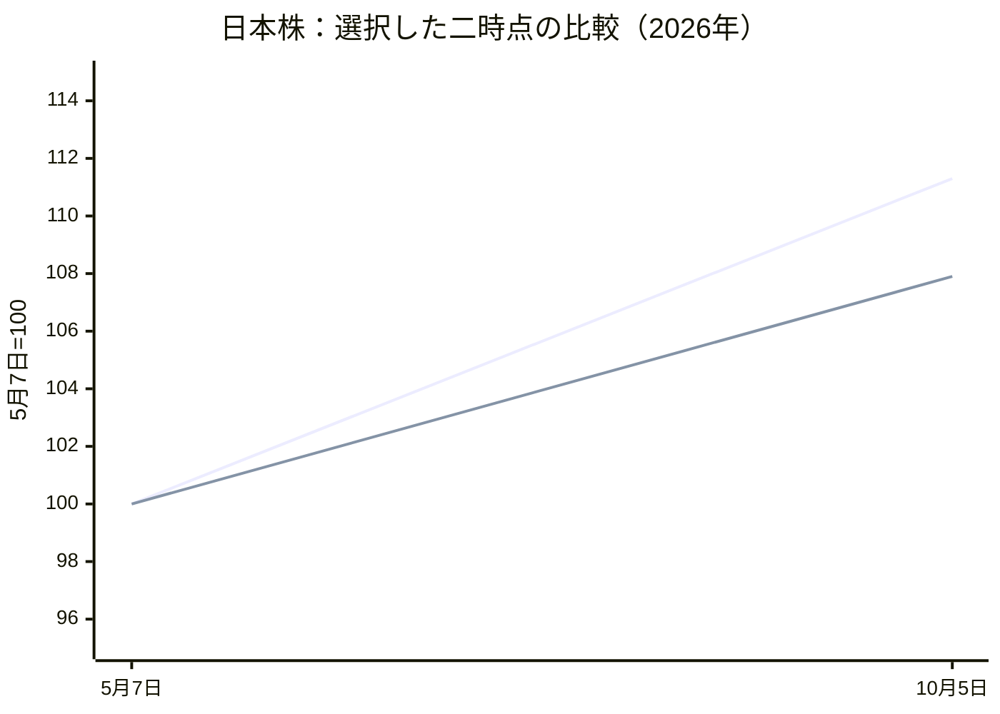
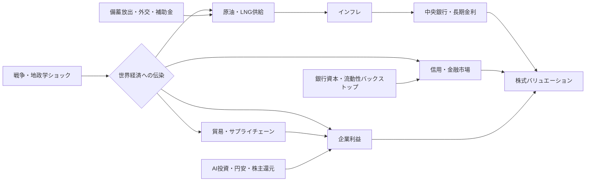
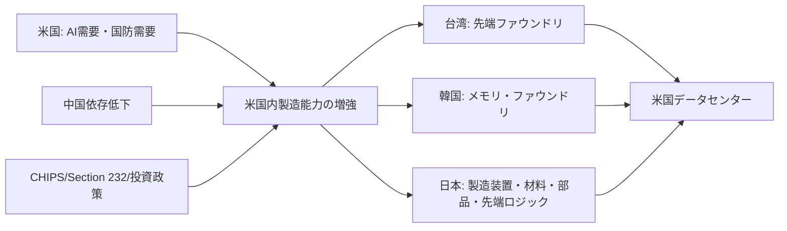
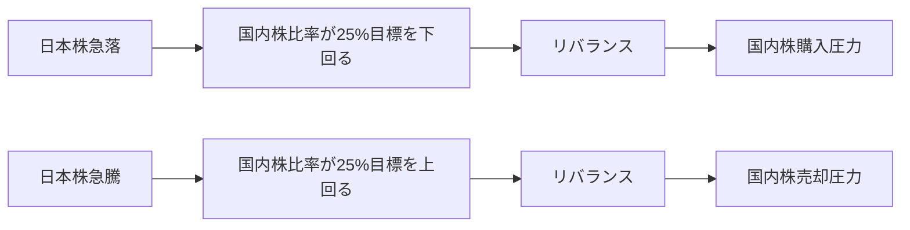
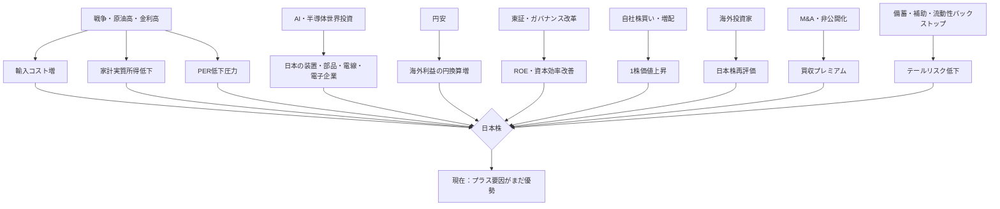

# 戦争・原油高・高金利でも日米株が暴落しない理由――金融危機・バブル・回復速度・非AI産業・日本株への波及を統合した完全研究版

**統合更新日：2026年10月13日**  
**原研究の分析基準日：2026年10月5日**  
**位置づけ：元の869行の研究レポートと、この会話で追加検討した経済学・金融市場・日米株に関する研究を統合した資料。初心者向け用語解説・原典リンク付き。**

> **中心的な研究命題**：戦争・原油高・高金利・株価の割高感は重要なリスクだが、「リーマン級の金融危機が近日中に必ず起きる」とは同義ではない。何が金融危機を引き起こすのか、なぜ2026年時点で株価が支えられているのか、どうなれば強気シナリオが崩れるのかを検証する。

### この統合版の読み方と検証上の注意

- **原資料に書かれていた説明・統計・主張は原則として保持**した。新しい研究は同じ内容を繰り返すのではなく、歴史比較・暴落指標・金融当局の制度進化・AI以外の収益源・米国株から日本株への伝播の章として補った。原資料の15分動画構成・原資料の出典一覧も末尾に収録。
- **「確認できた事実」「学術研究の一般的な発見」「2026年への適用に伴う分析者の推論」「未実施の定量検証」を区別**する。ストレステストは特定シナリオでの耐性確認であり、危機が絶対に起こらない保証ではない。
- **経済指標や市場価格は日付を明示**し、10月13日現在の数字と10月5日当時の元資料の数字を混同しない。異なる基準日・集計方法の数値を単純比較しない。
- 原資料中の `cite...` は**元の研究時の参照識別子**であり、Markdown単体ではクリックできない。原資料のURL一覧および本統合版末尾の追加原典URLを参照すること。これらのIDを外部検証済みのURLと同一視しない。
- 一部の後続会話に現れた推計・比率は、元データの算式、指数の基準、決算の特殊要因が揃わない場合、**目安または未確認値**として扱う。特に株価回復の期間は「高値→底値」「底値→旧高値」「高値→旧高値」で違う。
- このファイルは**強気シナリオを検証する研究資料**であって、日米株の安全性を保証する売買推奨文書ではない。

### 目次（構成の概要）

1. **基礎**：原研究の市場環境・戦争と株価の主要仮説
2. **歴史・地政学**：金融危機の制度史、戦争が経済へ伝わる仕組み、原油供給の政策対応
3. **バブルと信用市場**：ITバブル・リーマン比較、CAPE、信用スプレッド、OAS、金融ストレス指標
4. **危機後の回復**：日米株の高値回復期間と、中央銀行・政府の学習
5. **利益の広がり**：米国の非AIセクター、日本の金利・価格転嫁・国内旅行・人口動態
6. **世界情勢と政治**：エネルギー、再軍備、貿易、米国議会、為替、サプライチェーン
7. **日本株の構造**：東証改革、株主還元、外国人資金、GPIFと長期資産配分
8. **市場間の伝播と総合判定**：米国株から日本株への連れ安、3シナリオ、弱気論への反証
9. **動画化・専門用語・出典**：元の15分動画構成、用語集、元資料と追加研究の一次資料一覧

### 全体の読み進め方

1. 元レポートの市場状況・戦争の経済的伝播を把握する。
2. 1987年・ITバブル・2008年・2020年・2022年など、**危機の種類と回復期間**を理解する。
3. CAPE・信用スプレッド・OAS・金融ストレス指数・民間債務などの**危機予兆指標**を学ぶ。
4. 中央銀行・政府の対応力と、非AI産業の利益源泉を検討する。
5. 米国市場から日本市場への伝播と、**日本株の強気論が成立する条件／崩れる条件**を整理する。

---

## 【原研究】2026年10月5日時点の市場環境と基本仮説

### 原レポート：日本株が「戦争・金利高・原油高」でも暴落しない理由  
*機関投資家・マクロ経済アナリスト視点の地政学／資金フロー／政策分析*

**分析基準日：2026年10月5日**  
本稿では、10月5日時点で利用可能な情報を基本的なカットオフとし、米財務省、FRB、日銀、経産省、IMF、OECD、JPX、GPIF、Goldman Sachs、J.P. Morgan、UBS、Reuters、主要学術研究を優先した。元になった海外動画は、停戦後の上昇をショートカバー、CTA、オプション市場の増幅作用から説明していたが、fileciteturn0file0 本稿では初心者にも理解しやすいよう、**「戦争がどの経路で実体経済と企業価値に伝染するのか」**を中心に分析する。円防衛とFIMAを巡る別の海外動画の仮説も、FRB等の一次資料で再検証した。fileciteturn0file1

### 原レポートのExecutive Summary

**第一の結論は、「戦争だから株が暴落する」という因果関係そのものが弱いことだ。** 学術研究では、戦争確率の上昇局面では株価が下がる一方、十分に予想された開戦では不確実性の解消によって株価が上がる「War Puzzle」が確認されている。440件の国際政治危機を調べたBerkman & Jacobsenは危機が平均的には株価とボラティリティに悪影響を与えることを確認しているが、その影響は暴力の規模、大国関与、経済への波及度によって大きく異なる。Caldara & Iacovielloも地政学リスク上昇が投資・雇用を抑えることを示す。したがって正しい理解は、**「戦争は悪材料だが、株価クラッシュを決めるのは戦争そのものではなく、エネルギー、金融、企業利益、信用市場への伝染度」**である。citeturn2search2turn2search6turn1search7

**第二に、現在の日本株には「戦争・原油高・金利高」を相殺する複数の構造的買い材料が同時に存在する。** AI・半導体需要と企業利益だけでなく、円安による海外利益の円換算増、東証・ガバナンス改革、過剰現金の圧縮、自社株買い・増配、M&A・非公開化、外国人投資家の日本再評価、GPIFなど長期資金のリバランス需要が重なっている。Goldman Sachs Asset Managementは2025年の自社株買いを約18兆円規模とし、J.P. Morganも日本株の株主還元、テック・ハードウェア、M&Aを重要な支援材料としている。citeturn20search3turn4search0

**第三に、原油100ドル超が即クラッシュにつながらない最大の理由は、政策当局が「供給途絶のテールリスク」を封じ込めているからだ。** IEA加盟国は2026年3月に4億バレル規模の協調放出を決め、米国はそのうち1.72億バレルを担う方針を示した。10月初めにはG7がさらに約1億バレルの原油・石油製品の緊急放出で協調し、中東からの輸出も9月末には一時、戦前水準を上回った。市場が見ているのは「戦争が続いているか」ではなく、**「世界経済が必要とする石油が実際に届くか」**である。citeturn11search10turn12news42

**第四に、2026年はリーマン・ショック型の危機ではない。** 2008年は銀行そのものの資本不足、住宅証券の信用損失、短期資金市場の凍結が同時発生し、信用創造機能が壊れた。2026年は主としてエネルギー・インフレ・国債金利・地政学のショックである。FRBの2026年ストレステストでは32行すべてが厳しい景気後退シナリオでも最低CET1要件を上回り、総損失7080億ドル超を吸収しても総合CET1比率の最大低下は1.6ポイントだった。ただしヘッジファンドのレバレッジは過去最高圏、生命保険のレバレッジも歴史的に高いため、**危機が消えたのではなく、脆弱性が銀行からノンバンク・国債市場へ移動した**と見るべきだ。citeturn15search1turn15search4turn15search9

**第五に、現在の株高は「安全宣言」ではない。** 10月5日の日経平均は69,946.86円、TOPIXは4,145.22、Brentは約101～102ドル、ドル円は約157.7円、米10年金利は5.3%前後という通常なら厳しい組み合わせだった。それでも株価が高いのは、現時点で「企業利益・AI投資・円安・株主還元・政策バックストップ」の合計が地政学ショックを上回っているからである。逆に、**ホルムズ海峡の再度の長期機能停止＋原油高の長期化＋米長期金利再上昇＋利益予想下方修正＋信用市場ストレス**が重なれば、現在の均衡は急速に崩れる。citeturn14search3turn14search0turn13news5

### 市場スナップショットと主要仮説の検証

#### 最新市場データ

基準日の日本株を数字だけで見ると、「なぜ暴落しないのか」という問いが成立することが分かる。

| 指標 | 2026年10月5日前後 | 投資家としての読み方 |
|---|---:|---|
| 日経平均 | **69,946.86円**、日中高値70,072.13円 | 戦争・原油高・金利高でも約7万円。AI・半導体寄与が大きい。 citeturn14search3 |
| TOPIX | **4,145.22**、+1.33% | 日経平均の+2.40%より弱く、指数上昇の集中度を示す。 citeturn14search3 |
| S&P500 | **7,773.95**（米10月5日終値） | 史上最高値圏。企業利益・AI期待が高金利を相殺。 citeturn14news27 |
| Nasdaq | 10月5日に**最高値更新** | 世界株高の中心が依然AI・テクノロジーであることを示す。 citeturn14news27 |
| Brent原油 | 約**101～102ドル/バレル** | 日本には明確な逆風。ただし「不足」より「価格」で済んでいる段階。 citeturn14search0turn14news31 |
| WTI原油 | 約**90ドル** | Brentほど中東リスクが直接反映されない。 citeturn14search0 |
| 米10年国債 | 約**5.25～5.31%** | 株価バリュエーションへの強い逆風だが、利益成長期待が勝っている。 citeturn13news5 |
| 日本10年国債 | 約**3.06%** | 日本でも「ゼロ金利前提」は終了。銀行には追い風、長期成長株には逆風。 citeturn14search3 |
| USD/JPY | 約**157.7円** | 輸出・海外売上企業には利益押上げ、家計・輸入企業には逆風。 citeturn14search0 |
| 外国法人等の日本株保有比率 | **34.7%**（FY2025時価ベース） | 外国人は日本株の最大級の価格決定主体。過去最高水準。 citeturn8search0turn7view0 |
| GPIF国内株式基本配分 | **25%** | 暴落時のリバランス買いになり得るが、上昇時には売りにもなるため「常時買い支え」ではない。 citeturn23search6 |

ここで重要なのは、**日経平均が+2.40%なのにTOPIXは+1.33%だった**点である。10月5日の大幅高は、アドバンテスト、東京エレクトロン等のAI・半導体関連が中心だった。したがって「日本株全体が地政学を無視している」というより、**世界的AI投資の受益企業が指数を上へ引っ張っている**側面も大きい。citeturn14search2turn14search3

**選択した二時点での指数変化**

5月7日は中東情勢の緩和期待後、日経平均62,833.84、TOPIX3,840.49だった。10月5日にはそれぞれ69,946.86、4,145.22まで上昇している。日経平均は約11%、TOPIXは約8%高い計算になる。この期間には原油高・長期金利上昇があったため、単純な「地政学改善ラリー」では説明できない。citeturn13news9turn14search3

#### 主要仮説と検証結果

- **「戦争が起きれば株は暴落する」→ 棄却。** 戦争の予想可能性、経済規模、エネルギー供給への影響、大国関与によって市場反応は大きく異なる。citeturn2search2turn2search6
- **「原油100ドルなら日本株は必ず下がる」→ 部分的に棄却。** 日本経済には確実に逆風だが、政府補助、備蓄、供給回復、AI需要、円安による企業利益が現時点では相殺している。OECDも2026年について、エネルギー価格上昇を逆風としつつ、賃金、政府補助、高い企業利益が国内需要・設備投資を支えるとみている。citeturn15search12
- **「円安だから日本株が上がっている」→ 一部支持。** グローバル企業にはプラスだが、中小企業・家計には輸入物価を通じマイナス。日銀自身も両面を認めている。citeturn21search7
- **「海外投資家とガバナンス改革が構造的な買い需要を作っている」→ 強く支持。** 外国人保有、英語開示、資本効率、自社株買い・M&Aの改善が同時進行している。citeturn21search2turn20news50
- **「GPIFや生保が無条件で株価を買い支えている」→ 誇張。** 長期安定資金ではあるが、GPIFは25%という基本配分を守るため、株高局面では逆にリバランス売りも発生する。citeturn23search6
- **「現在は第二のリーマン」→ 現時点では棄却。** 銀行資本・流動性は2008年よりはるかに強い。一方、ヘッジファンド・保険・国債市場には別種の脆弱性がある。citeturn15search1turn15search4
- **「米議会がねじれれば株安」→ 棄却。** 過去のリターンに一貫した関係はなく、金融政策・景気・利益サイクルの方が支配的である。学術研究にも、ねじれが短期的に政策不確実性を高める結果と、政治体制だけでリターンを予測するのは難しいという結果が併存する。citeturn16search8turn16search2

## 歴史編｜金融市場は危機のたびに何を学び、何を修正したか

以下は元資料の2026年地政学タイムラインとは異なり、**現在の危機対応能力がどの歴史の上に成立しているか**を時系列で整理したものである。金融当局の「学習」は、株価水準を直接守ることではなく、**決済・預金・企業金融・国債市場の連鎖的機能停止を止める制度を増やしたこと**を指す。

| 時期・危機 | 壊れた、または危険になった経路 | 対応・制度上の学習 | 株価への重要な含意 |
|---|---|---|---|
| 1973～74年 オイルショック | 原油供給・インフレ・景気・金利が同時悪化 | エネルギー安全保障、備蓄政策、政策協調の必要性 | 供給ショックが長期化すると株式の回復にも時間がかかる |
| 1987年 ブラックマンデー | コンピューター売買・保険的売買戦略・流動性不足 | 取引停止措置、清算・決済・市場間連携の重要性 | 1日での暴落と長期的な企業利益の崩壊は異なる |
| 1990年代 日本のバブル・金融危機 | 不動産担保価値、銀行不良債権、資産デフレ | 損失認識、公的資本注入、銀行破綻処理 | 問題処理が長期化すると株価回復も遅い |
| 1997～98年 アジア通貨危機 | 外貨建て短期債務・通貨防衛・資本流出 | 外貨流動性、通貨スワップ、健全性監督の強化 | 為替・外貨債務と株式が連鎖し得る |
| 2000～02年 ITバブル崩壊 | 実現利益の乏しい将来期待への過大評価 | 会計・企業統治・利益とキャッシュフローの再評価 | 信用危機でなくてもPERの縮小だけで深い下落が起きる |
| 2007～09年 世界金融危機 | 住宅融資・証券化・銀行資本・短期市場・金融機関の連鎖破綻 | TARP、緊急流動性、預金保護、バーゼルIII、ストレステスト | 信用創造機能の破壊は長い景気後退・株価回復遅延につながる |
| 2020年 コロナショック | 実体経済の急停止、社債・短期金融・国債市場の機能低下 | 家計・雇用・企業支援と中央銀行の信用市場バックストップ | 企業金融の連鎖崩壊を抑えれば株価が早く反発する事例がある |
| 2022年 インフレ・急速利上げ | インフレ、実質金利上昇、高PER資産の割引率 | 物価安定と金融安定の政策トレードオフを再認識 | 中央銀行が緩和できないと株価回復に時間がかかり得る |
| 2023年 米地方銀行危機 | 債券含み損、預金流出速度、銀行の資金繰り | BTFP、破綻銀行処理、預金保護の例外的措置 | 資産の含み損と即時の資金流出は区別して見る必要 |
| 2024年8月 円キャリー巻き戻し | 円高、レバレッジ縮小、証拠金の引き上げ、クロスアセット連鎖 | 政策コミュニケーション、証拠金・市場流動性管理への注意 | 金融機関が破綻しなくても株価は短期に二桁下落する |
| 2025年 関税・政策不確実性 | 貿易政策や成長予想の急変 | 政策期待の再評価と企業の調達調整 | 急落後の反発は起こり得るが原因は単一ではない |
| 2026年 中東戦争・高金利・割高懸念 | 原油、国債金利、円、ノンバンク、AI期待 | 石油備蓄・金融安定制度・企業の事業分散 | **株価ショックが金融危機に変わるか**が焦点 |

**重要な区別**：短期金融市場を安定化させる中央銀行の措置は、株式の適正価値まで保証するわけではない。過大な成長期待が剥落すれば、銀行システムが健全なままでも数十％の株価調整は起こり得る。

### 危機対応の制度史：2008年→2020年→2023年

**2008年：金融仲介機能そのものが傷んだ。** 住宅ローン損失が証券化商品・銀行資本・短期資金調達市場へ波及し、銀行・証券会社が資金を出せなくなった。TARP（不良資産救済プログラム）は当初の不良資産買い取り構想から銀行への資本注入などへ発展した。その後バーゼルIIIの自己資本・流動性規制、ストレステスト、銀行の破綻処理制度が整備された。これらは**ショック後の自己資本不足を減らす**ための措置である。

**2020年：危機の原因は感染症による経済停止で、金融市場の流動性問題が増幅した。** 米国のCARES法は2兆ドル超の経済支援規模を持ち、FRBは国債・MBS購入に加え、社債市場の信用供給制度（PMCCF/SMCCF）を導入した。日本でも家計・企業への支援と日銀のCP・社債購入、企業金融支援が進んだ。**金融機関の救済に加え、雇用と企業の継続そのものを守る**対策が同時に行われた。米2兆ドル超や日本の経済対策事業規模を、全額が純粋な財政支出・現金給付と誤解してはいけない。

**2023年：高金利と預金流出の組み合わせに対応した。** 米国では銀行が保有する債券の含み損と、SNSやオンライン銀行を通じた預金流出が問題となった。FRBのBTFP（Bank Term Funding Program）は、条件を満たす証券を担保に銀行が資金を調達できる制度として設計された。全銀行や全株価に恒久的な保証を与えた制度ではない。

**2024年：銀行破綻がなくても「強制売り」は発生した。** BIS Bulletin 90は、2024年8月5日のTOPIX約12%急落を、米国景気指標への反応と円キャリー取引の巻き戻し、マージン引き上げによる売りの増幅として分析した。円キャリー取引規模は概算40兆円。ただし統計上の把握が難しい概数である。市場はその後比較的早く落ち着いたが、日経平均が直前の史上高値を再更新したのは翌2025年であり、「週初の下落分の反発」と「高値への完全回復」は区別する。

### 2020年の実証：中央銀行は実際に大量購入する前から市場心理を変えた

ニューヨーク連銀のDaleep Singh氏の2020年10月20日の講演では、FRB社債信用制度の発表後3か月で信用スプレッドがコロナ前の水準に向けて約90%戻り、改善の約3分の2は**実際の社債買入れ開始前を含む政策発表日**に起きたと説明された。NY Fed Staff Report 935も、制度公表が発行市場に作用し、直接の社債購入にも市場改善効果があったと分析している。

- 仕組み：市場機能の停止懸念 → 緊急融資・社債買い入れ制度の発表 → 企業の借換え懸念が低下 → 引受・売買が再開 → 信用スプレッドが改善。
- **解釈**：資金供給額だけでなく、当局の約束への信頼が市場機能を支え得る。
- **限界**：この効果は制度対象・設計・政策の信認によって変化する。社債市場で観察された結果を、そのまま株価回復の因果効果に置き換えてはいけない。

原典：NY Fed [2020年講演](https://www.newyorkfed.org/newsevents/speeches/2020/sin201020)、[Staff Report 935](https://www.newyorkfed.org/research/staff_reports/sr935)、[2020年5月12日の社債ETF購入開始](https://www.newyorkfed.org/newsevents/news/markets/2020/20200511)。

### 長期の景気後退研究：信用崩壊がある不況は回復が遅い

Òscar Jordà、Moritz Schularick、Alan M. Taylorの「When Credit Bites Back」は、1870～2008年の先進14か国・200件以上の景気後退の歴史データを扱い、**景気後退前の信用膨張が大きいほど景気後退が深く、その後の回復が弱くなる傾向**を示した。金融危機を伴う不況は、通常の不況より景気の損失が大きい。

これは「今回、銀行に問題がないから株価は下がらない」という意味ではない。むしろ**同じ下落率でも、信用供給そのものが壊れたか**で回復の難しさが変わる、という歴史的根拠である。株価の回復時間を説明する際には、危機の深さ、原因、金融政策制約を分けて扱う必要がある。

原典：[NBER（When Credit Bites Back）](https://www.nber.org/papers/w17621)。

---

## 地政学・原油・政策バックストップ

### 市場は「戦争の数」ではなく「伝染経路」を値付けする

UBSのGlobal Investment Returns Yearbook 2026は、1900年以降126年に及ぶ長期市場史から地政学ショックを検討している。長期的な投資成果を破壊してきたのは、単発の政治危機そのものよりも、戦争が**インフレ、経済活動、金融危機、資産価格バブル崩壊**へつながったケースだった。citeturn1search0turn1search14

Bruneらの「The War Puzzle」では、戦争発生確率が高まる間に株価は下がるが、すでに十分予想されていた戦争が実際に始まると株が反発することがある。一方、予想外の開戦では負の反応が大きい。つまり市場は「戦争か平和か」という二択ではなく、**昨日の価格に対して新情報がどれだけ悪かったか**を値付けする。citeturn2search2

Berkman & Jacobsenの1918～2002年、440件の国際危機の研究では、危機は平均的に株式リターンを押し下げ、発生直後のボラティリティも高める。しかし大国が関与し、暴力の規模が大きいほど影響は強い。これは「戦争は無関係」という主張を否定すると同時に、**すべての戦争を同じリスクとして扱うのも誤り**であることを示す。citeturn2search6

Caldara & Iacovielloの地政学リスク指数研究でも、GPR上昇はその後の投資・雇用低下と下方リスク増加を予測する。Rigobon & Sackがイラク戦争前を分析した研究では、war risk上昇が株安、原油高、ドル安、低格付け社債スプレッド拡大と結びついた。つまりクラッシュに近づくのは、**地政学が金融条件を同時に締め上げる時**である。citeturn1search7turn2search1

現在の因果関係を単純化するとこうなる。

現在の日本株が崩れていないということは、**BからC～Fへの伝染がまだ「金融システムを壊すほど」進んでいない**という意味であって、Aが消えたという意味ではない。

### 原油高に対する米国・G7の防波堤

現在の政策対応はかなり大規模である。

| 時期 | 対応 | 市場に効く経路 | 限界 |
|---|---|---|---|
| 2026年3月 | IEA加盟国が**4億バレル**規模の協調放出を決定。米国は約**1.72億バレル**を担う方針 | 「物理的に油が足りなくなる」テールリスクを低下 | 一回限りの在庫であり恒久供給ではない。 citeturn11search10 |
| 3～4月 | DOEがSPRから段階的に緊急交換・放出 | 米国内供給と製油所への原料確保 | 精製能力や輸送制約は解消しない。 citeturn11search2turn11search20 |
| 9月下旬 | 中東原油輸出が一時**戦前水準を上回る** | 「ホルムズ問題＝即世界的供給不足」という最悪シナリオが後退 | タンカー攻撃、保険料、運賃、精製品不足は残る。 citeturn12news42 |
| 10月初め | G7が約**1億バレル**の原油・石油製品緊急放出で協調 | Brent・ディーゼルのリスクプレミアムを抑える | 原油があっても製油所・輸送が詰まれば軽油価格は下がりにくい。 citeturn12news42 |
| 9月米中首脳協議 | イラン情勢・国際水路について協議 | 米中双方が海上物流の完全寸断を望まないとの期待を形成 | **直接的な原油増産合意ではない。** 市場心理上のテールリスク低下というのは本稿の推論。 citeturn12search4turn12search13 |

ここは動画にすると非常に分かりやすい。

> 戦争は続いている。  
> しかし「石油が世界に届かない」という最悪シナリオは、政府・G7・産油国・備蓄によって封じ込められている。  
> だから戦争が続いていても株式市場は「世界恐慌」を値付けしない。

という説明である。

日本にとってこの点は特に重要で、日銀は日本の原油調達の**9割超を中東に依存**していることを指摘している。原油高は交易条件を悪化させ、企業利益と実質所得を圧迫するため、米国以上に日本の実体経済へ効く。citeturn0search10

それでもOECDは2026年の日本について、エネルギー価格上昇による逆風を認めながら、賃金上昇、エネルギー補助、高い企業利益、政府補助による設備投資が国内需要を支えると予測している。IMFも中東紛争を理由に成長見通しを抑えているが、民間投資と消費の底堅さを見込んでいる。これは、**原油ショックが「不況」ではなく現段階では「成長率を削るショック」として処理されている**ことを意味する。citeturn15search12turn15search8

### FIMAは「原油対策」ではなく金融市場の防波堤

FIMA Repo Facilityはここで混同しない方がいい。

FIMAは石油価格を下げる仕組みではない。外国中央銀行・通貨当局が米国債を市場で投げ売りせず、それをFRBに差し入れてドルを調達できる仕組みである。目的の一つは、ドル不足の際に外国当局が米国債を強制売却し、米国債市場を不安定化させることを避ける点にある。citeturn11search6

この点で、先ほどの海外動画の「日本が円防衛のため米国債を売れば米金利まで上がるため、FIMAが安全弁になる」というロジックには経済的合理性がある。fileciteturn0file1 2026年夏には日本の大規模円買い介入と外貨準備減少が実際に起き、ReutersはFIMAを使えば米国債の outright sale を避けてドルを調達できると報じた。citeturn20search5

しかし、ここは重要なファクトチェックがある。

**2026年9月30日時点でFRBの「Foreign official」レポ残高は0ドルだった。**

つまり、FIMAは現時点では「巨大な資金注入を実行中」なのではなく、**存在そのものが市場の強制売却リスクを小さくするバックストップ**と考える方が正確である。citeturn21search0

### 地政学イベントのタイムライン

| 時期 | イベント | 市場にとって重要な意味 |
|---|---|---|
| 2026年春 | 中東戦争激化・ホルムズ物流混乱 | 「原油供給ショック→世界不況」が最大のテールリスクになる。 |
| 3月 | IEA・米国が史上級の備蓄対応 | 物理的な原油不足シナリオを後退させる。 citeturn11search10 |
| 4月 | 停戦期待・原油急落・株反発 | ファンダメンタルズ改善にポジショニング解消が重なった。元動画は後者を主役にしている。 fileciteturn0file0 |
| 5月 | OECDが日本の成長をエネルギー高で下方圧迫と評価 | 原油高の負の効果は実体経済には存在。 citeturn15search6 |
| 夏 | 円安・日本の大規模為替介入 | 円安が日本の金融・財政問題にも接続。 citeturn20search5 |
| 9月 | 米中首脳協議、海上物流・イラン問題を協議 | 大国間で物流完全遮断を避けるインセンティブ。 citeturn12search13 |
| 9月末 | 中東原油輸出が大幅回復 | 戦争継続と原油供給回復が同時に起きる。 citeturn12news42 |
| 10月初め | G7追加備蓄対応 | 原油100ドル超でも「供給不能」ではないとの安心材料。 citeturn12news42 |
| 10月5日 | 日経平均一時7万円 | 地政学よりAI・利益・資金フローが優位な現状を象徴。 citeturn14search3 |

## バブル検証編｜「株価が高い」ことと「まもなく暴落する」ことは別である

### CAPE（ケープ、シラーPER）とは何か

**CAPE＝景気循環調整後PER**。株価を、過去10年間のインフレ調整後の平均利益で割って算出する。通常のPERが直近1年や予想1年の利益を用いるのに対し、CAPEは景気循環による一時的な増減を平準化する。

例：株価4,000円／直近利益200円ならPER20倍。過去10年のインフレ調整後平均利益が100円ならCAPE40倍。この40倍は「過去10年平均の利益40年分相当の株価」という意味であり、**40年で投資を回収できると確定した意味ではない**。

- 高CAPE：株式の長期的な実質期待リターンが低くなりやすいという研究上の背景を持つ。
- 限界：会計、産業構造、利益率、金利、インフレ、株式の構成比が変わる。**高CAPEだけで1か月後・1年後の暴落時期は決められない。**
- 2026年10月初旬の米CAPEについて、前の会話では約41倍というデータが紹介された。系列・観測日によって値が異なるため、動画に掲載する前に原データを再照合する。

Robert Shillerのデータ：[Yaleの公開データ](https://shillerdata.com/)。

### 経済学者の反証：Greenwood・Shleifer・You『Bubbles for Fama』（2019年）

この論文は、米国の産業別株式リターン（1926～2014年）および海外の産業別リターン（1985～2014年）を分析し、次の4点を示した。

1. 産業株の急騰は、その後の**平均的なリターンが必ず低下する**という予測にはつながらない。
2. ただし、**大幅な暴落の確率は高まる**。
3. 上昇局面の変動率、売買回転率、株式発行、株価の上昇経路などに、暴落を予測する情報が含まれる。
4. 一部の特徴は市場タイミングにも情報を与える。

これは「バブルなど存在しない」ではなく、**『株価が高いからすぐ暴落する』の論理飛躍を戒めると同時に、急騰が危険であることも認める**研究である。結論を強気側に都合良く半分だけ引用してはならない。

原典：[Harvard著者ページ](https://shleifer.scholars.harvard.edu/publications/bubbles-fama)、[Journal of Financial Economics](https://www.sciencedirect.com/science/article/pii/S0304405X1830254X)。

### 2000年・2008年・2026年を同じ「バブル」と呼ぶ危険

| 論点 | 2000年前後 ITバブル | 2007～09年 世界金融危機 | 2026年の点検対象 |
|---|---|---|---|
| 主因 | テック成長期待・PERの膨張 | 住宅信用・証券化商品・銀行の資本損失 | 高い株価評価、AI集中、原油・金利、ノンバンク |
| 株価が大きく下落する経路 | 期待成長率の下方修正、割引率上昇 | 融資停止・資産売却・倒産の悪循環 | いずれも起こり得るが、危機の経路は一様ではない |
| 企業収益 | 利益が確立していない企業も多かった | 家計・金融のレバレッジ増大 | 利益・キャッシュフローの裏付けがある企業も多いが利益集中に注意 |
| 家計・企業の債務 | IT株高の中心テーマではない | 住宅関連の過剰信用が中核 | FRBは民間債務/GDPが2000年代初頭以来の低水準と報告 |
| 銀行の耐性 | 現代の規制整備前 | 自己資本不足が顕在化 | FRB・日銀ストレステストでは基礎的耐性を確認 |
| 見落とせないリスク | 実際の技術革新でも株価は過熱し得る | 銀行以外にも損失が波及した | ヘッジファンド、私募信用、国債市場、指数集中 |

Goldman Sachs Researchの2026年7月10日付分析は、現代の米国大型株が1990年代末より強い利益・バランスシートを持つ点を指摘する一方、AI関連銘柄の巨大な時価総額を正当化するためには将来利益に楽観的な仮定が必要と論じる。これを**「バブル否定の証明」ではなく「同じ価格水準でも構造が違う証拠」**として用いる。

原典：[Goldman Sachs Research 2026年7月10日](https://www.goldmansachs.com/insights/articles/are-us-stock-market-valuations-outpacing-fundamentals)。

### 株式投資家が実際に答えるべき5つの質問

1. バリュエーションが高いのは全市場か、一部の巨大企業か。
2. 利益・フリーキャッシュフローの改善は、景気循環・資産評価益・会計上の特殊利益を除いても続くか。
3. 債務・流動性・借換え能力が悪化していないか。
4. 市場内部（等ウェイト株価、騰落銘柄、200日移動平均線上の銘柄割合）が悪化していないか。
5. 原油と国債金利が上がっても企業の利益予想は持ちこたえられるか。

**2026年10月12日のReuters報道**では、S&P500が年初来約14%上昇していた一方、構成銘柄の4割超は年初来で下落し、構成銘柄の中央値上昇率は約4%だった。これは**指数最高値と市場全体の健全性が一致しない**ことを示す。高値更新だけで強気・弱気の結論を出してはならない。

原典：[Reuters 2026年10月12日](https://www.reuters.com/business/wall-streets-big-narrow-rally-4-10-sp-stocks-are-down-this-year-2026-10-12/)。

---

### リーマンとの違い

これが「なぜまだ暴落しないか」を考えるうえで非常に重要である。

| 項目 | 2007～09年 | 2026年 | 評価 |
|---|---|---|---|
| ショックの中心 | 住宅信用・銀行 | 原油・地政学・インフレ・国債金利 | **種類が違う** |
| 銀行資本 | 不十分、損失把握困難 | 規制資本は大幅強化 | 現在の方が頑健 |
| 資産の不透明性 | MBS/CDO等、価格発見不能 | 国債・原油など価格は可視的 | 現在の方がマシ |
| 短期資金 | インターバンク・レポ市場が凍結 | ストレスはあるが全面凍結ではない | 決定的な差 |
| 家計 | 住宅レバレッジ大 | 米家計の住宅エクイティは比較的厚い | 現在の方が強い citeturn15search9 |
| 銀行ストレステスト | 現行制度前 | 32行すべて最低CET1以上 | 大きな防波堤 citeturn15search1 |
| ヘッジファンド | 問題はあった | **レバレッジ過去最高圏** | 現在の弱点 citeturn15search4 |
| 生保 | 通常 | 最大手のレバレッジは歴史的上位四分位 | 注意点 citeturn15search4 |
| 国債市場 | 安全資産への逃避 | 財政懸念で国債自体の金利上昇 | **現在特有のリスク** |

2026年FRBストレステストでは、商業用不動産価格-39%、住宅価格-30%、失業率10%という厳しい仮定の下でも全32行が最低CET1要件を上回った。総損失は7080億ドル超だが、総合CET1の最大低下は1.6ポイントである。citeturn15search1turn15search3

だから現在、

**原油↑  
金利↑  
戦争↑**

でも、

**銀行破綻↑  
信用供給停止↑  
企業の運転資金調達不能↑**

には直結していない。

これが株価にとって巨大な違いである。

ただし安心しすぎてもいけない。Fed自身がヘッジファンドのレバレッジを「記録的高水準」と評価し、生命保険会社のレバレッジも歴史的に高いと警告している。次の金融事故が起きるなら、2008年の銀行住宅ローンと同じ場所ではなく、**レバレッジドファンド、国債basis trade、保険、プライベートクレジット、ソブリン債市場**から始まる可能性を監視すべきである。citeturn15search4turn15search9

## 信用市場・早期警戒編｜『本当の金融危機』を何で見抜くか

### まず信用スプレッドを理解する

**信用スプレッド**＝企業の借入に対して投資家が国債などの安全性の高い金利より余分に要求する利回り。たとえば同程度の年限で米国債4%、社債7%なら、単純な差は**3パーセントポイント＝300ベーシスポイント（bp）**。1bpは0.01パーセントポイント。

- 企業の倒産確率・倒産時損失・社債市場の売買しにくさ（流動性）・投資家のリスク回避などを反映する。
- **広く急速に拡大**すると、企業が資金を借り換える条件が厳しくなっている可能性がある。
- ただしスプレッドの縮小は「危機なし」の保証ではなく、リスクの過小評価でも起こる。

### 米国ハイイールド社債のOASとは

**ハイイールド（High Yield）社債**は、投資適格を下回る格付けの企業債券を中心とした市場。景気と信用環境の悪化に敏感である。**OAS（Option-Adjusted Spread：オプション調整後スプレッド）**は、社債に付いた期限前償還などのオプションの価値を調整して求めた上乗せ利回りである。

「信用力が低めの企業に、金融市場が何%の追加利回りを求めているか」を示す実務的な警戒計器である。例えばOASが3.15%なら約315bpの追加利回りを示すが、**3.15%の倒産確率という意味ではない**。

前の会話で引用したICE BofA US High Yield Index OASは、2026年9月18日の2.68%から10月8日の3.15%へ約47bp拡大したとされる。**市場ストレスが増えた兆候だが、その値だけでリーマン級の信用市場崩壊と断定できない。**

日付ごとの再確認・更新：[FRED：BAMLH0A0HYM2](https://fred.stlouisfed.org/series/BAMLH0A0HYM2)。

### 米国金融ストレス指数 STLFSI4

セントルイス連銀のSTLFSI4は、金利、利回り格差など**18の週次金融指標**を組み合わせた指数。**ゼロが長期平均程度、プラスになるほど通常より金融市場のストレスが高い**。単純に「0以下なら安全」ではない。

FRED公表の観測値：

| 週末の観測日 | STLFSI4 | 読み方 |
|---|---:|---|
| 2026年9月18日 | -0.7029 | 長期平均より低い |
| 2026年9月25日 | -0.8091 | 前週より緊張緩和 |
| 2026年10月2日 | -0.4681 | 長期平均以下だが前週より緊張増加 |

2010年代・2020年代の危機時ピークはこれらとは大きく異なる。ただし**指数の改定系列の違い、ピーク日、数値の比較方法**に注意し、旧版指数の値をそのまま同一の履歴として引用しない。

原典：[FRED：STLFSI4](https://fred.stlouisfed.org/series/STLFSI4/)。

### 2026年の金融システムをFRBと日銀はどう評価したか

**FRB『Financial Stability Report』（2026年5月）**：

- 株式の予想PERは歴史的な高水準圏。社債の信用スプレッドは比較的低い。
- 米家計と企業の債務合計の対GDP比は2000年代初頭以来の低水準に低下。
- 大手銀行は歴史的に高い自己資本比率を持ち、国内銀行の流動性資産も概ね潤沢。
- 高リスク企業やプライベートクレジット利用企業には返済負担問題がある。
- ヘッジファンドのレバレッジは高く、最大手生命保険会社のレバレッジも歴史的な高水準帯。
- カード・自動車ローンの延滞には懸念があり、家計全体が均等に健全なわけではない。

**日銀『金融システムレポート』（2026年4月21日）**：

- 日本の金融システムは全体として安定し、金融仲介機能も維持。
- 世界金融危機に匹敵するストレスのほか、**原油高、AI期待の急減、金利大幅上昇の複合シナリオ**でも、銀行の基礎的な資本・資金調達の耐性を確認。
- ただし不動産関連融資、海外ファンド向け融資、海外ノンバンクから日本への波及を重点監視。

原典：[FRB Financial Stability Report 2026](https://www.federalreserve.gov/publications/financial-stability-report.htm)、[日銀2026年4月版](https://www.boj.or.jp/en/research/brp/fsr/fsr260421.htm)。

**重要な評価**：2008年より銀行の損失吸収能力が改善したことと、2026年の株式評価が割高であることは両立する。金融危機は今や**銀行の外側**（国債市場、ファンド、レポ取引、保険、私募信用）から広がる可能性がある。

### 早期警戒の監視表（予測モデルではなく観察枠組み）

| 指標 | なぜ重要か | 危険になる変化 |
|---|---|---|
| CAPE／予想PER | 株価と利益の乖離 | 利益下方修正と高い倍率の同時発生 |
| HY OAS／投資適格社債スプレッド | 企業の借換え・倒産懸念 | 短期間の急拡大、発行市場の停止 |
| STLFSI4／VIX | 金融全体・株式のストレス | 継続的な上昇と同時市場機能低下 |
| 信用/GDPギャップ（BIS） | 民間信用の異常拡大 | 長期トレンドを大きく上回る信用増大 |
| 債務返済比率 DSR（BIS） | 家計・企業の所得に占める返済負担 | 利払いと元本返済が所得成長を上回る |
| 銀行CET1・預金流出 | 損失吸収能力と資金繰り | 資本低下・預金の連続流出 |
| 米国債・日本国債の板／レポ市場 | 最も流動性が高い市場の機能 | 応札不振、価格の飛び、強制売り |
| 円相場とキャリーポジション | 国際金融から日本株への波及 | 急激な円高と証拠金引き上げ |
| 利益予想の修正幅・市場の広がり | 株式市場内部の弱さ | 全業種に利益下方修正が拡大 |
| ホルムズ通航・原油・運賃 | 実体経済への供給ショック | 現物供給不足の長期化と物流停止 |

**BISの危機早期警戒研究**は、株価指数の高水準単独よりも、信用/GDPギャップや債務返済比率の上昇が金融危機予測に有用な情報を含むと示す。ただし万能の単一指標はない。

---

## 回復速度編｜『暴落が起きても回復が早くなった』はどこまで事実か

### まず3種類の期間を区別する

1. **高値→底値**：どれほど速く暴落したか（下落にかかった期間）。
2. **底値→以前の高値**：安値から完全回復するまでの期間。
3. **以前の高値→高値回復**：投資家が旧高値まで戻るのを待つ総期間。**本章の比較表は原則として③**。

さらに、価格指数と配当再投資込み指数、名目指数とインフレ調整後指数、営業日の数え方でも結果が違う。異なる定義を混ぜて「史上最速」などと述べない。

### 米国S&P500：主要下落局面の比較

| 危機の原因 | 最大下落率・概算 | 下落前の高値を回復するまで・概算 | 金融システムへの影響 |
|---|---:|---:|---|
| 1973～74年 オイルショック | -48% | 約7年7か月 | インフレと供給ショックが長期化 |
| 1987年 ブラックマンデー | -34% | 約1年11か月 | 短期の市場機能・売買構造の問題 |
| 1990年 景気後退 | -20% | 約7か月 | 不況を伴うが比較的短期 |
| 2000～02年 ITバブル | -49% | 約7年3か月 | 技術株の期待・PER修正が中心 |
| 2007～09年 リーマンショック | -57% | 約5年5か月 | 銀行信用・家計債務のシステミックな崩壊 |
| 2020年 コロナ | -34% | 約6か月 | 市場ストレスは深刻でも金融システム崩壊を回避 |
| 2022年 インフレ・利上げ | -25% | 約2年 | 金利上昇で市場評価が収縮 |
| 2025年 関税・政策ショック | 約-19% | 約4か月 | 20%未満の調整局面、金融危機とは異なる |

**注記**：日次の価格指数の正確な高値・再突破日を統一して再抽出した回帰分析ではなく、これまでのチャットで確認した代表ケースを同じ「高値から高値」の概念で再整理した概算。20%未満の2025年を「弱気相場」の標本に含めると統計を歪めるので別扱いとする。

**データから言えること**：2020年・2025年など、近年の短期回復事例は明確にある。しかし、1987年・1990年にも短期間の回復があった。したがって**回復が時代とともに単調に短くなっているとは言えず、「2008年以降の政策学習がすべての回復を早めた」という因果関係は未証明**である。

### 日本の日経平均：同じ尺度で見る

| 起点の危機 | 高値からの代表的な下落 | 元の高値回復まで | 注意点 |
|---|---|---|---|
| 2007～09年 世界金融危機 | 2007年高値約1万8,261円→2009年3月安値7,054.98円 | 2015年ごろ、約7年7か月 | 世界信用危機と国内経済停滞が重なる |
| 2020年 コロナ | 2020年3月に約1万6,553円へ | 2020年11月ごろ、約9か月 | 政策発表と企業金融の安定化 |
| 2024年7～8月 円キャリー巻き戻し | 8月5日に日経平均・TOPIX大幅下落 | 2025年8月、約13か月 | 数日での急反発と旧高値更新までの期間は別 |

**日本特有の注意**：1989年のバブル高値から2024年まで約34年を要した事例がある。これは「すべての暴落はすぐ戻る」という一般論への最も強力な反証である。

### 回復期間が速くなったように見える理由を5つに分解

- **危機の質が違う**：2008年型の銀行信用収縮と、2020年型の一時的活動停止は比較できない。上記Jordàらの研究と整合的。
- **政策反応速度が上がった**：当局が社債・金融市場の機能不全に早期介入できる枠組みを整えた。制度の**存在と発表**にも効果がある。
- **銀行の損失吸収能力が改善**：大規模な損失が発生しても貸出機能が維持される可能性が高まった。
- **投資家が「政策反応関数」を予測する**：危機時の利下げや流動性供給を織り込む。ただし高インフレでは反応できない場合がある。
- **ポジション調整型の危機は巻き戻しも速い**：為替・先物・オプション・CTAなどの短期売買が価格変化を増幅させ、その後逆向きの売買が起き得る。ただし自己修復を保証しない。

**未実施の厳密検証**：1980年以降のすべての10%、20%、30%下落局面を日次データで抽出し、下落率・景気後退の有無・信用危機の有無・インフレ・金利水準を統制し、回復日数の中央値・分布を比較する必要がある。今回の表を統計的検定の結果として扱わない。

---

## 米国経済編｜AI・半導体だけではない利益と経済のエンジン

### 2026年第2四半期：State Streetのセクター別利益データ

State Streetの2026年10月12日付『Strong earnings raise the bar for S&P 500』は、FactSetの2026年10月2日時点データでS&P500の第2四半期の**集計利益成長率52.4%**、業種別の寄与を示した。

| S&P500業種 | 2026年Q2の前年比利益成長率 | S&P500全体利益成長への寄与 |
|---|---:|---:|
| 情報技術 | +76.2% | +17.8ポイント |
| 通信サービス | +116.9% | +13.7ポイント |
| 一般消費財 | +92.6% | +8.1ポイント |
| エネルギー | +146.3% | +5.9ポイント |
| 金融 | +22.0% | +4.2ポイント |
| 資本財・産業 | +16.6% | +1.3ポイント |
| 素材 | +45.9% | +0.9ポイント |
| 生活必需品 | +13.6% | +0.8ポイント |
| 公益 | +13.7% | +0.3ポイント |
| 不動産 | +7.9% | +0.2ポイント |
| ヘルスケア | -6.4% | -0.8ポイント |
| **全体** | **+52.4%** | **+52.4ポイント** |

**読み方**：情報技術・通信サービス・一般消費財の合計は39.6ポイント、残り8業種の純寄与は**52.4－39.6＝12.8ポイント**。およそ75.6%が上記3業種に集中している。つまり**AI・大型テック以外にも利益成長はあるが、指数全体の成長の中心は大型株に偏っている**。

**特に重要な会計上の留保**：米第2四半期の利益急伸は、Amazon・Alphabetなど一部大型企業の投資関連の大きな利益計上にも影響されたと報じられている。そのため、**52.4%を全額「本業の持続的キャッシュフロー成長」と言い換えるのは誤り**。正確な分析には一過性の評価益等を除いた調整後利益・FCFの確認が必要。S&P500の成長率について外部報道で35.1%など異なる数字が現れるのは、利益定義・サンプル時点・特殊利益の扱い等が違う可能性があるため、数字の出所を統一する。

原典：[State Street 2026-10-12](https://www.ssga.com/us/en/intermediary/insights/mind-on-the-market-12-october-2026)。

### 半導体が調整したら他業種も必ず下がるのか：J.P. Morganの検証

J.P. Morganの2026年7月24日付『Is It All One Big AI Trade?』は、半導体の**1か月リターンが-5%未満**のリスクオフ局面で、他業種が同時にリスクオフだった割合を提示した。

| 米国業種 | 半導体リスクオフ局面で同時にリスクオフだった割合 |
|---|---:|
| 一般消費財 | 86% |
| 資本財・産業 | 59% |
| 金融 | 55% |
| 生活必需品 | 45% |
| 医療 | 45% |
| 公益 | 41% |
| エネルギー | 18% |

読み方：平常の半導体安であれば、エネルギーなどが異なる値動きをすることがある。一方で**金融危機レベルの強制売却時にエネルギーだけが必ず上がるという統計ではない**。業種分散の機会は、完全なクラッシュ防御を意味しない。

原典：[J.P. Morgan 2026-07-24](https://www.jpmorgan.com/insights/markets-and-economy/top-market-takeaways/tmt-is-it-all-one-big-ai-trade)。

### 米国エネルギー産業の地政学的位置付け

米EIAによれば、2025年の米原油生産量は日量平均**約1,360万バレル**で、2018年以来、世界最大の生産国だった。また2025年はエネルギーの輸出31クアッド、輸入21クアッド、約**11クアッドの純輸出**を記録した（エネルギー全体の概念であり、**原油単体が純輸出という意味ではない**）。

これは、米国で原油高が**供給する企業の利益増と、利用する企業・家計の負担増を同時に生む**ことを示す。石油・天然ガスの生産、LNG輸出、油田サービス等に恩恵が及ぶ可能性がある一方、航空・物流・化学・消費には逆風となる。米国全体に「原油高がプラス」だとは断定できない。

原典：[EIA原油2025](https://www.eia.gov/todayinenergy/detail.php?id=67844)、[EIAエネルギー貿易2025](https://www.eia.gov/todayinenergy/detail.php?id=67724)。

### 金融・保険業はAI設備投資とは別の収益源を持つ

FDICによれば、米預金保険対象金融機関の2026年Q1純利益は**805億ドル**（前四半期比+3.6%）、貸出残高の前年同期比増加率は7.1%だった。自己資本と流動性は概ね強固と評価される。一方、純利ざやは前四半期比8bp低下し、消費者向け融資や商業用不動産の一部には延滞リスクがある。

銀行が高金利で必ず儲かるわけではない。重要なのは、貸出・預金・決済・資産運用・保険などが**半導体出荷とは異なる経済的基礎**を持つことだ。

原典：[FDIC Quarterly Banking Profile Q1 2026](https://www.fdic.gov/quarterly-banking-profile/quarterly-banking-profile-q1-2026)。

### 消費・サービス・医療・公益：米国経済の実需は広い

BEAの2026年9月30日公表のQ2実質GDP第三次推計は、**前期比年率+2.2%**。民間サービス生産業の実質付加価値は年率+2.5%、財生産業は+2.3%だった。医療、生活必需品、決済、旅行、住宅関連サービスなどの実需はAI設備投資だけに依存しない。

一方、医療セクターの2026年Q2集計利益成長率はマイナスであり、**需要が底堅い業界＝その年の株価が強い業界**とは限らない。薬価・保険給付・労働費・規制などが業績に影響する。

原典：[BEA Q2 2026](https://bea.gov/news/2026/gdp-third-estimate-industries-corporate-profits-state-gdp-and-state-personal-income-2nd)。

### 金利・戦争の影響は業種ごとに異なる

| 外部環境の変化 | 相対的に恩恵を受け得る米国産業 | 打撃を受け得る米国産業 |
|---|---|---|
| 原油高 | 原油生産・一部エネルギー関連 | 航空、物流、化学、可処分所得に依存する消費 |
| 金利高 | 一部の銀行・保険（利ざや等が改善する場合） | 高レバレッジ不動産、高PER成長株 |
| 国防・安全保障需要 | 航空宇宙、防衛、整備、電子機器 | 財政負担増やコスト上昇の悪影響を受ける領域 |
| 供給網再編 | 産業機械、物流、品質検査、インフラ | 新設・移転コストが増える企業 |
| 高齢化 | 医療、介護、設備保守 | 医療報酬規制・人件費の負担が大きい企業 |

**米国株の構造に対する結論**：エネルギー、金融、資本財、素材、サービスなどの独立した利益源がある。一方で**指数の大型テック集中と、利益計上に含まれる特殊要因は無視できない**。非AI企業が存在することと、AI企業の株価急落を指数全体が相殺できることは別問題である。

---

## 日本経済編｜『海外マネー・財政・AI』以外の株価下支え要因

この章は、後掲の元レポートに収録済みの「円安・東証改革・外国人保有・自社株買い・M&A・GPIF」を繰り返すのではなく、**国内の価格形成・金融業の収益構造・人口動態・観光・産業再編**に焦点を当てる。

### 金利正常化が金融機関の収益構造を変える

長期にわたり極端に低い金利では、金融機関が貸出と預金の利ざやを得にくかった。適度な金利正常化によって、**貸出金利上昇が預金金利上昇や信用コストの増加を上回る銀行**では利益成長につながる。

日銀の2026年4月金融システムレポートでは、円金利の上昇や経費率改善を受け、コア業務純益が改善している金融機関が見られる。**ただし銀行の収益が改善することと、金利高が日本経済全体にプラスであることは違う**。保有債券の評価損、借り手の倒産リスク、住宅・不動産需要の減退などは逆風となる。

### 日本企業の価格設定行動の変化

デフレが長期化した時代には、「値上げをすれば顧客を失う」という慣行が広く存在した。しかし、材料費・人件費の上昇、供給者の減少、サービス品質・安定供給への評価が変わると、**価格転嫁が許容される企業の範囲**が変化する。

重要なのは売上高だけではなく、**値上げ後も数量・顧客維持率が保たれ、費用上昇を上回って利益率が改善しているか**。物流、保守、専門サービス、外食などは銘柄ごとの差が大きい。「インフレ＝日本株上昇」という一般論にはしない。

### 2026年9月短観：強さと弱さの両面

日銀の2026年9月調査では、大企業非製造業の業況判断DIは**+35**（前回+37）で、好調と答える企業が不調と答える企業を大きく上回った。ただし前回からは悪化した。景況感と実際の利益予想は同一ではない。

一方、家計消費と消費者サービスには弱さもあり、**「日本のすべての内需企業が拡大している」とは言えない**。国内の価格転嫁力、数量、賃金、原材料費を業界別に検討する必要がある。

原典：[日銀2026年短観一覧](https://www.boj.or.jp/en/statistics/tk/gaiyo/2026/)。

### 国内旅行は訪日客以外にも需要がある

観光庁の2026年4～6月期1次速報では、日本人の国内旅行消費額は**7兆5,361億円（前年同期比+11.7%）**、国内延べ旅行者数は**1億4,958万人（+3.3%）**、旅行単価は**5万381円（+8.2%）**だった。国内のホテル・旅館、交通、外食、レジャーなどにはインバウンド以外の収益源がある。

ただし旅行消費増加には客単価上昇＝物価上昇の影響も含まれる。**消費額の名目増加と、利益率・実質需要の増加を区別**することが必要だ。訪日客の国別構成と為替・地政学への感応度も地域ごとに異なる。

原典：[観光庁2026年4～6月期 国内旅行消費](https://www.mlit.go.jp/kankocho/news02_00096.html)。

### 人口減少・高齢化は総需要の制約と、企業収益の再配分を同時にもたらす

日本の高齢化は全体の労働供給・消費者数に制約を与える。他方、医療、介護、保守、省人化、事業承継など特定事業への需要を高める。例えば高齢者に向けた医療・在宅サービス、技能労働者を補う省人化設備、労働不足に対応する物流、施設・インフラの継続的な保守が挙げられる。

この議論は「人口減少だから日本企業が儲かる」と同義ではない。**負担と機会が企業間で再配分される**という主張にとどまる。制度価格、労働集約度、供給能力、企業の競争力が実際の利益率を決める。

### 金融・旅行・価格転嫁・事業承継を合わせた分析

| 収益機会 | 利益源 | 逆風・監視点 |
|---|---|---|
| 銀行・一部保険 | 金利正常化、商品構成と運用収益 | 債券含み損・貸倒れ・調達コスト |
| 国内旅行・地域サービス | 客数・単価・稼働率 | 家計実質所得、原油高、労働コスト |
| 専門サービス・物流・保守 | 顧客が必要とする継続的サービス、価格転嫁 | 値上げ後の数量、供給能力 |
| 医療・介護周辺 | 高齢化に伴う実需 | 診療・介護報酬と賃上げ |
| 省人化・省力化機械 | 労働力不足に対応した実物需要 | 投資回収期間、企業の設備投資余力 |
| 事業承継・業界統合 | 経営効率・競争環境の変化 | 買収価格の高さ、統合失敗 |

**強気論として言えること**：AIや海外投資家の買いに依存しない、国内の実需と価格形成の変化が存在する。**まだ証明されていないこと**：その寄与が日本株指数全体のPER低下を十分に相殺できる大きさであるかどうか。

---

## 世界情勢編｜戦争・地政学は需要を消すだけでなく、産業間で移動させる

### 世界の再軍備と日本企業への波及

NATOの2026年7月資料によれば、欧州加盟国とカナダの2025年の中核防衛支出は、前年に対し**実質で約20%増加**した。2025年ハーグ首脳会議では、2035年までにGDP比5%を防衛・安全保障関連支出とする目標が採択された（うち中核防衛3.5%、関連分野1.5%）。**目標であって将来の予算実行・企業契約を保証するものではない**。

半導体・AI以外にも、航空機、艦艇、推進機器、通信機器、特殊鋼、光学、整備、補給、港湾・物流などへ長期的な需要が発生し得る。日本の造船・機械・精密部品・素材会社に受注機会が生まれる余地はあるが、契約獲得には輸出規制、認証、調達国の政策、価格競争力が重要。

防衛需要の増加は企業利益に寄与し得る一方、軍事支出が自動的に国全体の厚生を高めるわけではない。財政負担、資源配分の変化、インフレ効果を併記する。

原典：[NATO 2026年7月投資発表](https://www.nato.int/en/news-and-events/articles/news/2026/07/07/defence-investment-update-record-spending-in-europe-and-canada)、[NATO 5%枠組み](https://www.nato.int/en/what-we-do/introduction-to-nato/defence-expenditures-and-natos-5-commitment)。

### WTOの2026年世界貿易見通し：供給網の適応

WTOの2026年10月8日公表では、2026年の世界の商品貿易量の伸び率予測が**+1.9%から+3.9%へ上方修正**された。中東情勢によるエネルギー・肥料物流の混乱に対し、供給網が適応したことが背景の一つである。

ただし**AI関連インフラ財の貿易拡大も上方修正の重要な要因**であり、+3.9%を「AI以外の貿易成長率」と言うことはできない。サービス貿易や地域によっては影響が厳しく、回復は均一ではない。

原典：[WTO 2026年10月8日](https://www.wto.org/english/news_e/news26_e/stat_08oct26_510_e.htm)。

### 原油供給ショックを巡る「米国」と「日本」の非対称性

原油価格が上昇した場合、米国には生産・輸出により売上や利益が改善する企業群がある。一方で日本は中東依存の高いエネルギー輸入国であり、輸入物価・物流・家計の実質所得が大きな制約を受ける。

したがって、戦争・原油高が発生したからといって「日米株が完全に同じ方向・同じ程度に動く」とは限らない。米国内でもエネルギーと航空・消費で利益移転が発生する。**エネルギー価格の上昇が高止まりし、金融政策の引締めを必要とする場合は、受益企業の増益よりも他部門の需要収縮が大きくなる可能性**がある。

### 米中対立・サプライチェーン再編に共通する経済原理

国家安全保障を背景とした調達先の分散、同盟国への供給依存、原産地・品質の認証、重要素材・装置の確保は、供給網に追加費用をもたらす半面、選ばれる供給者には継続需要を生む。米国内製造拡充策は同盟国企業の米国内投資や装置・材料需要を伴うケースがある。

これを**政府が投資するから株価は上がる**という単純な財政論ではなく、**市場が求める製品・サービスの付加価値の変化**として分析する。契約が確定しているか、粗利益率が改善するか、現金回収が確実かまで確認する必要がある。

### 地政学ショックの受益・被害の対照表

| 外部ショック | 利益を増やし得る企業 | 利益を減らし得る企業 | 株価指数への影響を決めるもの |
|---|---|---|---|
| 原油供給不安 | エネルギー生産・一部資源物流 | 燃料消費、輸入依存の企業 | 資源高の期間、物価、金利、指数ウェイト |
| 国際安全保障の不安定化 | 防衛装備、修理・補給、特殊部材 | 輸送・観光、供給網が途絶した産業 | 政府契約の実現時期、製造能力、資金調達 |
| 世界貿易の経路変更 | 商社、港湾、品質検査、代替供給者 | 従来物流に過度依存した企業 | 移行コストと最終需要 |
| 金利の正常化 | 一部銀行・保険 | 高借入・高PER・長期金利固定資産 | 利ざや改善と信用コストの差 |
| 人口構造の変化 | 医療、保守、省人化、事業承継支援 | 労働供給制約を吸収できない企業 | 価格転嫁・生産性・市場規模 |

---

## 米政治・ねじれ国会・金融危機との比較

### 共和党が下院を含め勝利した場合

2026年10月5日時点では、トランプ政権下で共和党が上院を53議席で支配し、下院も非常に僅差ながら共和党多数である。11月3日の中間選挙で問題になるのは「共和党政権誕生」ではなく、**共和党が上下両院の支配を維持できるか**である。citeturn17search10turn16news48

市場では三つに分けるのが合理的だ。

| 中間選挙後 | 政策 | 米国市場 | 日本株への主な波及 |
|---|---|---|---|
| **共和党が上下両院維持** | 減税・設備投資優遇、規制緩和、エネルギー増産、国防・AI・製造業政策を進めやすい | EPSにはプラス。ただし財政赤字・インフレ期待→長期金利上昇が逆風 | 円安、銀行、防衛、機械、半導体製造装置に追い風。一方、米金利上昇が過度ならグロース株には逆風 |
| **民主党下院＋共和党上院** | 新たな大規模財政法案は通しにくい。行政権で関税・輸出規制・外交は継続可能 | 財政拡張抑制なら債券にはプラス。政策不確実性・shutdown riskは上昇 | 米金利低下なら日本グロースにはプラス、円高なら輸出株にはマイナス |
| **民主党が両院奪取** | 税制・歳出の追加変更を強く制約。監督強化 | 財政プレミアム低下の可能性。ただし行政・議会対立増加 | 日本株への影響は党派よりドル円・米金利経由の方が大きい |

注意すべきなのは、**2025年にすでに大規模な税制変更が成立している**ことである。国内R&D費の即時控除など企業向け優遇措置はすでに法律化されているので、「共和党勝利＝初めて減税が始まる」ではない。共和党勝利の追加効果は、既存政策の維持、追加規制緩和、エネルギー、国防、AI・製造業への政策実行力が上がる点にある。citeturn10search0

同時にCBOは現行税財政措置が中期的に巨額の追加赤字をもたらすと試算している。したがって「共和党勝利＝株高」という単線的な見方も危険で、**減税によるEPS押上げと、財政赤字による10年・30年金利上昇が綱引きする**。citeturn10search7

ここは日本株にも重要である。

**米財政拡張**
→ 米長期金利↑  
→ ドル高・円安  
→ 日本の輸出企業利益↑  
→ ただし輸入インフレ↑  
→ 日銀利上げ↑  
→ 日本の長期金利↑

となるからだ。

したがって共和党勝利は、**TOPIX全体に一方向ではなく、「輸出・銀行・防衛・資本財」と「高PER成長株・内需消費」の相対価格を動かすイベント**になる。

### 「ねじれ国会だから株は下がる」は歴史的に弱い

過去を比べると分かりやすい。

下表のS&P500は配当込み年次リターンから計算した期間リターンであり、「議会構成が原因」という意味ではない。むしろ、**議会構成だけでは説明できない**ことを示すための比較である。citeturn22search0

| 大統領・期間 | 政治構造 | S&P500累積リターン概算 | 読み方 |
|---|---|---:|---|
| クリントン 1995–2000 | 民主党大統領＋共和党議会 | **約+219%** | ねじれでもIT・生産性・低インフレ・利益成長が勝った |
| ブッシュ 2007–08 | 共和党大統領＋民主党議会 | **約-34%** | 暴落したが原因は銀行・住宅信用危機で、ねじれそのものではない |
| オバマ 2011–16 | 主としてねじれ | **約+102%** | 欧州危機等があってもQE、利益回復、景気拡大が優位 |
| トランプ 2019–20 | 民主党下院＋共和党上院 | **約+56%** | 貿易戦争・COVIDがあったが政策対応と利益期待で最終的に上昇 |
| オバマ 2009–10 | 民主党統一 | **約+46%** | 統一政府でも大幅上昇 |
| トランプ 2017–18 | 共和党統一 | **約+17%** | 統一政府でも2018年はマイナス |

学術研究でも結論は単純ではない。選挙開票時の高頻度データを使った研究では、ねじれ政府の確率上昇がS&P500先物を約1.4%押し下げる結果があり、**短期的には政策不確実性が嫌われる**ことは確認されている。citeturn16search8

しかし別の研究では、党派を使った株式リターン予測の差は長続きせず、統計的に頑健とは言いにくい。大統領サイクルについても、任期後半のリターンが高いという「puzzle」は存在するが、通常の景気・リスク変数で説明しきれない。citeturn16search2turn16search1

したがって機関投資家は、

> 「共和党だから買う」  
> 「ねじれだから売る」

ではなく、

> **税率は何％変わるか  
> 財政赤字はいくら増えるか  
> 10年債は何bp動くか  
> 半導体・エネルギー・防衛のCAPEXがどれだけ変わるか**

に翻訳してポートフォリオを動かす。

## 円・製造業・サプライチェーンの再編

### 円安は日本株にとって「良い」ではなく「分配効果が大きい」

日銀の氷見野副総裁は、円安はグローバル企業の利益やインバウンド支出を押し上げる一方、中小企業の輸入コストを引き上げ、家計の実質所得を削ると整理している。これが最も正確な見方である。citeturn21search7

日本株だけを見れば、

**適度な円安**
→ 海外売上の円換算増  
→ 輸出企業の利益率改善  
→ EPS上方修正  
→ 株価上昇

というルートがある。

日銀の高田委員も、米関税の影響がある中で輸出企業が想定以上に悪化しなかった一因として円安を挙げ、日本企業が長期の事業再編で損益分岐点を引き下げ、外部ショックに対する耐性を高めてきたと指摘している。citeturn21search3turn21search5

一方、

**過度な円安**
→ 原油・LNG・食料輸入価格↑  
→ CPI↑  
→ 実質賃金↓  
→ 消費↓  
→ 日銀追加利上げ  
→ JGB金利↑  
→ 内需企業・高PER株↓

となる。

したがって「円安は日本株にプラス」というより、

> **円安は日本株指数の中で勝者と敗者を強烈に分ける**

と考えるべきだ。

以下の為替水準は予測ではなく、政策伝播を考えるための分析用レンジである。

| 円相場イメージ | 株式への主作用 |
|---|---|
| 円高方向へ急変 | 輸出株の円換算利益に逆風。ただし輸入物価低下・家計にはプラス |
| 緩やかな円安 | 海外売上企業の利益に追い風。日本株には最も扱いやすい |
| 150円台後半の長期化 | 輸出メリットと輸入インフレの綱引き。現在この領域 |
| さらに急激な円安 | 政策介入、日銀利上げ、家計圧迫が強まり、株式には逆に不安定化要因 |

1985年のプラザ合意のような「為替レジーム転換」を現在へそのまま当てはめるのも危険である。当時より日本企業は海外生産、多通貨売上、コスト削減を進めており、日銀も企業の損益分岐点低下と外部ショック耐性向上を指摘している。citeturn21search5

### 米国の製造業政策が日本株を押し上げる逆説

「America First＝日本企業に悪い」と考えると、現在の半導体市場を読み違える。

2026年1月、米政府はSection 232に基づく半導体政策で、米国が世界の半導体需要の約4分の1を消費する一方、国内で完全製造できる比率が約10%にとどまることを国家安全保障上の弱点として明示した。AI、軍事、通信、エネルギー等のすべてが半導体依存を深めているという認識である。citeturn18search0

だから米国政策は単純な「外国製品排除」ではない。

**国内生産を増やす**
+
**同盟国企業に米国内投資させる**
+
**中国への先端技術依存を下げる**

という三段構造になっている。

2026年の米国半導体政策では、特定の先端コンピューティング半導体に25%関税を設定する一方、**米国のデータセンター、R&D、国内技術サプライチェーン強化に使う輸入には例外**を設けている。これは「必要なAIチップは輸入しながら、生産能力を米国内へ誘導する」設計である。citeturn18search3turn18search4

台湾との2026年合意では、台湾半導体・テクノロジー企業が少なくとも2500億ドルを米国で投資する枠組みが発表された。米商務省は日本・韓国・台湾企業の米国進出を支える人材政策も展開している。citeturn18search5turn18search6

日本もこの再編から外れていない。経産省は2026年に「地政学リスクを踏まえた製造基盤強化」を正式な政策テーマとし、半導体、重要鉱物、AI・デジタルを中長期の産業競争力・経済安全保障政策へ組み込んでいる。citeturn19search1turn19search3

さらに日米の戦略的投資イニシアティブでは、半導体等の部素材に関係する製造プロジェクトを米国内で共同推進している。citeturn19search0

したがって今後のサプライチェーンは、

この構造は、**日本国内だけのGDP成長率が低くても、日本の装置・材料・電線・電力設備・精密部品企業が世界AI投資から利益を取れる**理由になる。

ここが、現在の日本株を「日本経済の弱さ」だけから判断してはいけない最大の理由の一つである。

## 海外機関投資家が日本株を買う理由

### 業績以外の株高メカニズム

現在の日本株を支える要因を、業績以外まで広げるとこうなる。

| メカニズム | 株価への作用 | 現在の強さ | 注意点 |
|---|---|---|---|
| **海外投資家の日本再評価** | 世界ポートフォリオ内のJapan underweight縮小 | 強い | 円高急変・米景気後退では巻き戻る |
| **東証・ガバナンス改革** | ROE、PBR、資本コスト意識向上→valuation rerating | 非常に強い | 改革が形式化すると失速 |
| **自社株買い** | 発行株減少→EPS・1株価値上昇 | 非常に強い | 高値での買い戻しは資本効率を悪化させる場合も |
| **増配** | total shareholder yield上昇 | 強い | 景気悪化時には減速 |
| **M&A・非公開化** | 含み価値・過剰現金に買収プレミアム | 強い | 金利上昇でLBOコスト増 |
| **円安** | 海外売上の円換算利益増 | 強い | 家計・輸入企業には逆風 |
| **GPIF等の長期資金** | 暴落時のリバランス需要 | 中程度 | 株高局面では売り手にもなる |
| **生命保険・長期機関投資家** | スチュワードシップ、長期保有、資本効率圧力 | 中程度 | JGB利回り上昇で債券の魅力も高まる |
| **財政・エネルギー補助** | 原油高が家計と企業へ伝染する速度を抑える | 中程度 | 恒久策ではなく財政負担 |
| **政策バックストップ** | 「最悪時に流動性が消える」テールリスク低下 | 強い心理効果 | 株価を直接保証する制度ではない |

### 外国人にとって日本企業は「変わり始めた市場」

東証Prime企業では2025年4月から決算情報・適時開示の英語同時開示が原則義務化され、2025年末にはIR資料の英語化率87.1%、株主総会関連資料94.9%まで上昇した。海外投資家調査でも88%が日本企業の英語開示は改善したと評価している。citeturn21search2turn21search6

これは小さく見えて、海外運用会社には重要である。

以前は、

**「日本企業は安いが、情報取得が難しい」**

だったものが、

**「安い＋英語で情報が取れる＋経営者がROEを意識する＋現金を株主へ返し始めた」**

へ変化している。

Reutersによれば、日本企業には約1.8兆ドル相当の現金があり、2026年のガバナンス改革では「その現金をなぜ保有するのか」「成長投資・M&A・株主還元のどこへ振り向けるのか」という資本配分の説明が一段強く求められている。citeturn20news50

ここが海外機関投資家にとって非常に大きい。

なぜなら、

> **業績が同じでも、余剰現金100を現金のまま寝かせる企業より、ROICの高い投資・自社株買い・増配・M&Aへ動かす企業の方が株主価値は高くなる**

からである。

### 自社株買いと「株数の減少」は利益成長とは別のエンジン

Goldman Sachs Asset Managementは2025年の日本企業の自社株買いを約18兆円規模とし、パンデミック前の2倍超と説明している。加えて、デフレ期の2008～19年に年平均約2%だった日本企業のEPS成長率が、その後は名目成長回復によって約8%へ加速したと分析している。citeturn20search3

この二つは別の話である。

**利益そのものが増える**
+
**発行株数が減る**

ため、1株当たり利益が二重に改善しやすい。

これが「GDP成長率0～1%程度なのに株価が高い」という一見した矛盾の一部を説明する。

J.P. Morganも2026年の日本株について、テクノロジー・ハードウェア需要、増配、自社株買い、PEによる買収、M&Aを中東リスクに対抗する構造的な支えとしている。citeturn4search0

### M&A・非公開化はまだ初期段階

Goldman Sachs Asset ManagementのStephanie Huiは2026年7月、日本の企業買収・非公開化はまだ**“early innings”**にあると述べた。日本には米国に近い数の上場会社がある一方、経済規模ははるかに小さく、企業再編の余地が大きいという見方である。citeturn20search9

これは日本株のvaluationに「オプション価値」を加える。

低PBR企業が、

**放置**
ではなく、

**自社株買い**
または
**資産売却**
または
**親子上場解消**
または
**MBO**
または
**PEによる買収**

へ進む可能性が以前より高まっているからだ。

### GPIF・生保は「買い支え」ではなく安定化装置

GPIFの2025年度以降の基本ポートフォリオは、

- 国内債券 25%
- 外国債券 25%
- 国内株式 25%
- 外国株式 25%

である。citeturn23search6

これを「国が日本株を25%買ってくれる」と理解するのは間違いである。

重要なのは**リバランス**だ。

つまりGPIFは一方向の買い手ではなく、**ボラティリティを弱める逆張り型の巨大資金**になりやすい。

生命保険会社についても、生命保険協会が機関投資家として企業価値向上や株式市場活性化を明示的なテーマにしている一方、現在のJGB利回り上昇は債券の相対魅力も高めている。したがって「生保が永遠に株を買う」という仮説は支持できない。citeturn23search0turn23search5

### 海外投資家から見た現在の日本株

機関投資家のinvestment caseを簡略化するとこうなる。

**以前の日本**

低成長  
＋デフレ  
＋過剰現金  
＋低ROE  
＋政策保有株  
＋英語開示不足

↓

**現在の日本**

名目成長  
＋賃金上昇  
＋インフレ  
＋資本コスト意識  
＋自社株買い  
＋政策保有株削減  
＋M&A  
＋AI・半導体  
＋円安  
＋英語開示改善

という変化である。

Goldman Sachs Researchは8月時点でTOPIXの12カ月目標を4,500とし、中長期の日本株見通しを前向きに評価していた。10月5日のTOPIX4,145.22に対して単純計算すると約8.6%上の水準である。ただしGoldman自身も、急激な円高が2024年のような日本株調整を起こすリスクを明示している。citeturn20search10turn14search3

したがって海外勢の見方は、

> 「日本は安全だから買う」

ではない。

より正確には、

> **「日本企業の資本効率が改善しており、AI・サプライチェーン再編の受益企業も多く、まだ企業再編・資本還元の余地が残っている。その期待リターンが原油・円・金利リスクを補償するなら買う」**

である。

### 本当に暴落する条件

機関投資家の立場では「何が株を支えているか」以上に、**そのロジックがどこで壊れるか**を見る。

現在の均衡を崩しやすい順に並べると、

| リスク | なぜ危険か | 観察指標 |
|---|---|---|
| **中東原油供給の再急減** | 日本の交易条件・企業マージン・家計所得を同時攻撃 | Hormuz通航、Brent、タンカー運賃 |
| **原油高＋米金利上昇の同時進行** | インフレでFedが緩和できずPERが圧縮 | Brent、米10年、実質金利 |
| **AI利益期待の下方修正** | 日米の指数上昇を支える最大テーマが逆転 | 半導体受注、データセンターCAPEX、EPS revisions |
| **急激な円高** | 輸出・海外売上企業のEPS下方修正 | USD/JPY、為替ヘッジ比率 |
| **信用市場ストレス** | 「原油問題」が「金融危機」へ昇格する瞬間 | HY spread、bank CDS、repo市場 |
| **日本国債の無秩序な金利上昇** | 財政、銀行、保険、株式valuationを同時に攻撃 | 10年・30年JGB |
| **外国人フロー反転** | 34%超を保有する海外勢のre-ratingが逆回転 | JPX投資部門別売買 |
| **自社株買い・M&A減速** | 「ガバナンス改革プレミアム」が剥落 | buyback announcements、TOB件数 |

したがって、

> **戦争ニュースが増えたかどうか**

より、

> **原油・金利・利益予想・信用スプレッドの4つが同時に悪化したか**

を見る方が、株価クラッシュを予測するうえでははるかに重要である。

## 米国市場から日本株への伝染編｜『連れ安』と『長期的な利益悪化』を分ける

### 日本株はなぜ米国株の下落で売られるのか

1. **世界的なリスクオフ**：株式ファンドやETFが換金され、米国以外の株も売られる。
2. **為替の変動**：ドル高・円安だけではなく、円キャリー取引の急な巻き戻しによる円高が日本株の輸出企業に打撃を与える。
3. **マージンコール（追加証拠金請求）**：別の資産の損失を埋めるため、利益の出ている日本株まで売られることがある。
4. **米国実需の減速**：米国向けの輸出・サービスや世界の設備投資が本当に落ちれば、日本企業のEPSも下方修正される。
5. **ドル調達・国債市場の不安定化**：企業・銀行の調達条件が悪化し、単なる株安を金融危機へ変える可能性がある。

この5つは伝播の強さも期間も異なる。**米国の短期ポジション整理**なら日本株に一時的な連れ安があっても戻る余地はあるが、**米国実需と信用供給が長期低迷**すれば日本企業の利益にも影響が残る。

### BISが示した2024年8月の実証例

BIS Bulletin No.90（2024年8月27日）は、米景気指標への反応を出発点に、円高、キャリー取引縮小、レバレッジ取引の解消、証拠金の上昇が相互に増幅したと分析した。2024年8月5日にTOPIXは約12%下落。為替キャリー取引の規模は概ね40兆円と推計したが、正確な計測は困難だと明記している。

同レポートは、**銀行が破綻していなくても、国をまたぐ投資家の取引解消で日本株が極端に振れる**ことを示す。反面、数日単位でリスク回避が緩和したことも記録されており、資金市場全体の長期停止に移行しなかった点が重要である。

原典：[BIS Bulletin 90](https://www.bis.org/publications/bulletin-90-market-turbulence-and-carry-trade-unwind-august-2024)。

### 米国株下落の4つの仮想ケース

| 米国市場で起こること | 日本株の短期反応 | 日本企業の中長期への影響 | 強気論の存続条件 |
|---|---|---|---|
| AI・半導体大型株のPER調整 | 日経平均の値がさ株に連れ安、TOPIXへの波及は相対的に小さい場合も | 装置・素材・AI関連需要が本当に減るなら減益 | 非AI企業の利益と米信用市場が維持される |
| 国債金利急上昇 | 高PER株・為替・銀行債券評価に影響 | 調達金利・家計消費・設備投資に波及 | 金利が安定し、信用スプレッド拡大が限定的 |
| 米景気の軽度後退 | 輸出・資本財が一時売られる | 米国向け需要減少 | 信用システムが維持され、需要回復が可能 |
| 米国で世界金融危機 | 日本も全面安、円・国債・資金調達に波及 | 倒産・貸倒れ・利益低迷の長期化 | この場合は強気論の前提そのものを再検討 |

### 連動性を数字で検証するための設計

単にS&P500と日経平均の相関係数を求めるだけでなく、以下を比較する。

- S&P500が当日-2%、-5%、月間-10%、高値から-20%下落した局面を区別。
- TOPIX・日経平均の平均下落率、中央値、分散、翌月・翌3か月のリターンを計算。
- 円高（ドル円下落）幅、米実質長期金利、HY OASの拡大幅を併記。
- 日経平均とTOPIXの違い、業種別の利益修正、為替感応度を比較。
- **大幅下落後の戻り**と、下落前高値への完全回復を分けて評価。

**注意**：これは今後再現可能な研究設計であり、現時点で1980～2026年の全日次データを取得し回帰・イベントスタディを完了したと主張するものではない。

---

## 統合判断編｜『バブル崩壊前夜』論にどこまで反証できるか

### よくある暴落論と、経済学的に正しく言い直した結論

| 主張 | 研究で確認できること | 誤解を避けるための留保 |
|---|---|---|
| CAPEが高いから来月暴落する | 高CAPEは割高感や長期期待リターンの警告になる | **短期の暴落時期を決定できない** |
| ITバブルと同じだから崩壊する | 現代の一部企業は実際の利益・FCF・資本基盤が異なる | 企業価値の過大評価は依然としてあり得る |
| リーマンショックの再来は目前 | FRB・日銀は銀行の資本・流動性に一定の耐性を確認 | ノンバンク・国債・私募信用からの危機は残る |
| 戦争があれば必ず株価暴落 | 戦争の経済伝播経路・予想可能性によって反応が異なる | 供給遮断と高インフレの持続は重大リスク |
| 金利が高いから全面安 | 一部銀行・エネルギー・企業には別の収益源 | 実質金利高はPERを圧縮し得る |
| AIが下がれば全業種が同時暴落 | 半導体リスクオフ時にエネルギー等は異なる値動きも | 世界的な強制売却では相関が高まる |
| 2008年以降は暴落しても必ず半年で戻る | 2020年・2025年には短期回復の事例がある | 2022年は約2年、2024年日本株は旧高値回復に約13か月 |
| 米国株が下落したら日本は長期不況 | つれ安は起きても業績・信用市場が持続すれば回復余地 | 米国信用危機・需要崩壊なら日本株も打撃が長期化 |
| 日本株はAIと外国人買いだけ | 銀行金利正常化、国内サービス、価格転嫁、再軍備、供給網など別の需要源がある | その効果が指数を支える十分な規模かは追加検証 |

### 日本株の強気論を数式で整理する

> **株価指数 ≒ 指数EPS × PER**  
> ※実務上は指数の除数・算出方法、先行EPS系列の定義にも留意。

株価がさらに上昇するには、利益成長と評価倍率の変化の積がプラスになればよい。現在のPERを1としたとき、3年間のEPS成長率が毎年8%、PERが15%下落するとすると、

`(1.08)^3 × 0.85 − 1 ≒ +7.1%`

となる。これは**あくまで仮定の試算**であり、2026年のEPS成長が確定している意味ではない。逆にEPSが横ばいでPERが20%下がれば株価は約20%下がる。**PERの収縮に勝てる利益成長が必要**ということである。

### 今後の3シナリオ

**シナリオA：株価調整を吸収し、中期上昇が継続する**。原油供給の完全停止が回避され、米信用市場が機能し、主要銀行が損失を吸収し、日米の非AIセクターとAI関連産業の利益成長が一定程度続く。日本では金融・サービス・装置・資本財等のEPS成長が継続。高PERの部分的収縮があっても指数の利益成長で相殺され得る。

**シナリオB：10～20%程度の調整・持ち合い**。AI関連の利益期待低下、長期金利高止まり、円高によって指数のPERが収縮するが、信用市場全体の停止には至らない。金融・エネルギー・生活必需品・公益などへ資金ローテーションが起きても、指数全体では弱含む期間があり得る。

**シナリオC：30%以上の大幅調整・長期低迷**。中東原油供給が長期間止まり、米・日本の長期金利が無秩序に急騰し、企業利益予想が下方修正され、HY OAS急拡大・国債市場流動性低下・ファンドの強制売りが同時進行する。**この場合は2026年の金融安定性評価が将来も維持されるという前提は使えない**。

**発生確率は付与しない。** 2026年10月13日時点で、予測確率を推定するための統一モデル・十分なデータを本レポートで構築していないためである。

### 週次で見ておくと有用なモニター

1. Brent/WTIと現物供給、タンカー通航・保険料・運賃。
2. 米10年・30年国債金利、日本10年・30年国債金利、入札の状態。
3. 米HY OAS、投資適格スプレッド、銀行CDS、STLFSI4。
4. S&P500等ウェイト指数、上昇銘柄数、200日平均線超え銘柄の割合。
5. S&P500・TOPIXのEPS予想修正と、**AI以外の業種別寄与**。
6. ドル円、円キャリー・海外ファンドのポジション解消兆候。
7. 企業倒産、貸出延滞、銀行の資本・預金流出。
8. 米国の経済指標・日本短観・観光等の実需。

### 最終的な研究命題

- **戦争があるから株が必ず暴落するのではない**。市場は戦争が将来利益、供給、インフレ、金利、信用システムに与える損失を織り込む。
- **割高だからリーマン級の崩壊が近いとは言えない**。ただし、割高と集中があるほど、利益期待の崩落時の下落余地は大きい。
- **金融市場は2008年以降に制度を整備した**。銀行の損失吸収能力・中央銀行の緊急市場支援・政府の実体経済支援が連鎖破綻を防ぐ可能性がある。しかし現代のノンバンクと国債市場には別の脆弱性がある。
- **AI以外にも利益源はある**。米国ではエネルギー・金融・資本財等、日本では金融の金利正常化・価格転嫁・国内観光・省人化・保守・防衛関連需要が候補。ただし株価指数への寄与を数量化しないと「全面的な下支え」とまでは言えない。
- **米国株から日本株への連れ安は現実的**。しかしポジション解消による短期ショックと、金融・実需の恒久的破壊は同じではない。

**動画に耐える結論**：『いまの株価には過熱がある。だからといって、ITバブルやリーマンショックと同じ形で近日中に崩壊すると断定することはできない。世界の供給網、金融システム、企業の収益源を分解すれば、日本株が中長期で持ちこたえるための条件は複数ある。ただし原油・金利・利益・信用市場の同時悪化を見落とせば、この強気論は崩れる。』

---

### 最終判断

現在の日本株は、

**戦争を無視しているのではない。**

市場はすでに、

**原油100ドル超**
**日本の高い中東依存**
**米10年金利5%超**
**日本の金利正常化**
**円安**
**中東戦争**

を知っている。

そのうえで、

**AI・半導体需要**
+
**企業の外部ショック耐性**
+
**円安によるグローバル企業利益**
+
**自社株買い・増配**
+
**東証・ガバナンス改革**
+
**M&A・非公開化**
+
**海外投資家の日本再評価**
+
**備蓄放出・補助金・流動性バックストップ**

の価値をより大きく評価している。日銀、OECD、IMFも、原油高による成長下押しを認めつつ、日本の企業利益・設備投資・賃金・国内需要に一定の耐久力があるという見方で一致している。citeturn21search14turn15search8turn15search12

したがって機関投資家目線の結論は、

> **「戦争だから株が下がらないのはおかしい」のではない。**
>
> **株価を決めるのは戦争そのものではなく、その戦争が将来キャッシュフローと割引率をどこまで破壊するかである。**
>
> 現在は原油供給の完全崩壊が政策で抑え込まれ、金融システムも2008年ほど脆弱ではなく、日本企業側にはAI・円安・資本改革・株主還元という複数のバッファーがある。
>
> だから日経平均は約7万円でも成立している。
>
> ただし、**原油・金利・企業利益・信用市場の四つが同時に悪化した時、この説明は一気に崩れる。**

動画として最も強い結論も同じである。

**「戦争が株を暴落させるのではない。  
経済と企業利益を壊す戦争だけが、株を暴落させる。」**

## 動画企画への落とし込みと主要資料

### このテーマは伸びる可能性が高い

企画としての最大の強みは、**視聴者が感じている直感と市場現実が完全に逆だから**である。

2026年10月5日時点で、

> 戦争が続いている  
> 原油100ドル超  
> 米10年金利5%超  
> 日本の10年金利3%超  
> 円は157円台
>
> **なのに日経平均は一時7万円。**

という絵ができている。citeturn14search3turn14search0turn13news5

しかも日本は原油の9割超を中東に依存するため、「戦争と関係が薄い国」ではない。むしろ地政学上は米国よりエネルギーショックに弱い。それでも株価が高いという逆説が、海外版より日本版を面白くする。citeturn0search10

本命タイトルは、

> **世界中で戦争、原油100ドル、金利5%超。それでも日本株が暴落しない理由**

が最も内容とクリック率を両立しやすい。

より初心者向けなら、

> **「戦争＝株価暴落」は間違い？ 日経7万円を支える本当の理由**

でもよい。

サムネは金融専門用語を一切入れず、

**戦争中**  
**原油100ドル**  
**日経7万円**

の三つで十分である。

### 十五分動画の台本骨子

**導入｜0:00–1:30**

> 世界中で戦争。  
> 中東情勢は緊迫。  
> 原油は100ドルを超えています。
>
> しかもアメリカの10年金利は5%台。
>
> 普通に考えれば株価は暴落していてもおかしくありません。
>
> ところが10月5日、日経平均は一時7万円。
> アメリカのNASDAQも最高値。
>
> 一体なぜなのか？
>
> 実は125年以上の株価データを見ると、  
> **「戦争が起きる＝株が暴落する」という常識そのものが間違っている可能性があります。**

日経平均69,946.86、Brent約101～102ドル、米10年約5.3%を同じ画面に出す。citeturn14search3turn14search0turn13news5

**論点｜1:30–4:00　戦争そのものでは株は死なない**

War Puzzle、UBS、Berkman & Jacobsenを使用する。

> 市場が見ているのは「戦争があるか」ではありません。
>
> **その戦争が世界経済を壊すかどうかです。**

citeturn2search2turn2search6turn1search0

ここで、

**戦争**
→ **原油**
→ **インフレ**
→ **金利**
→ **企業利益**
→ **株価**

の図を出す。

**論点｜4:00–6:30　今回、最悪シナリオが起きていない理由**

> 今回最大のリスクはホルムズ海峡でした。
>
> 日本は原油の9割以上を中東に依存。
> 本当に長期間止まれば、日本経済への打撃は極めて大きい。
>
> ところが世界は何もしなかったわけではありません。

IEA4億バレル、米国1.72億バレル、G7約1億バレル、中東輸出回復を紹介する。citeturn11search10turn12news42

> **戦争は終わっていない。**
>
> でも、
>
> **「石油が来ない」という最悪シナリオが起きていない。**
>
> これが株価には非常に大きい。

**論点｜6:30–9:00　日本株には戦争以上の買い材料がある**

ここで、

AI・半導体  
円安  
自社株買い  
増配  
東証改革  
外国人投資家

を一気に紹介。

> 海外投資家から見ると、日本は30年間何も変わらなかった市場ではありません。
>
> 企業が現金を溜め込む時代から、
> 「その現金をどう使って株主価値を上げるのか」を問われる市場に変わっています。

Reutersの1.8兆ドル企業現金、GSの自社株買い、JPX英語開示を出す。citeturn20news50turn20search3turn21search2

**論点｜9:00–11:00　金利が上がっても日本株が死なない理由**

> 金利上昇は全部の株に悪いわけではありません。
>
> 銀行にとっては利ざや正常化。
> 輸出企業には円安。
> AI関連には世界の設備投資。
>
> だから市場全体が一斉に下がるのではなく、
> **勝ち組が指数を押し上げています。**

10月5日の日経+2.40%に対してTOPIX+1.33%という差を見せる。citeturn14search3

**論点｜11:00–12:30　なぜリーマンとは違うのか**

> リーマン・ショックでは、悪いニュースが出たのではありません。
>
> **銀行そのものが壊れました。**
>
> 今はそこが違います。

FRBストレステストの「7080億ドル損失でも全32行が最低資本要件以上」を出す。citeturn15search1

ただし、

> 一方でヘッジファンドのレバレッジは史上最高圏。
> 次の危機が同じ場所から来るとは限らない。

とリスクを残す。citeturn15search4

**結論｜12:30–14:00　本当に見るべきもの**

> これから戦争のニュースを見ても、
> 「戦争が起きた、株を売ろう」
> と考える必要はありません。
>
> 見るべきものは4つです。
>
> **原油**
>
> **長期金利**
>
> **企業利益**
>
> **信用市場**
>
> この4つが同時に壊れ始めた時、
> 地政学リスクは初めて「金融危機」へ変わります。

**視聴者への示唆｜14:00–15:00**

> 今の株価が高いから、戦争は無視していい。
> そういう話ではありません。
>
> むしろ逆です。
>
> **市場は戦争そのものではなく、その先にある経済的な被害を見ています。**
>
> 今はAI、企業利益、円安、株主還元、政策対応が、その被害を上回っている。
>
> しかし原油・金利・利益・信用市場が同時に悪化した瞬間、その均衡は変わります。
>
> **戦争が株を殺すのではない。  
> 経済と企業利益を壊す戦争が、株を殺す。**
>
> これが今、日経平均が7万円近辺でも暴落していない最大の理由です。

### 資金フローを一枚で見せる図

## 初心者にも分かる用語集｜台本にそのまま使える説明

| 用語 | 初心者向けの言い換え | 株価・暴落との関係 |
|---|---|---|
| **CAPE（ケープ／シラーPER）** | 過去10年の景気調整後平均利益に対して株価が何倍か | 高すぎると割高感。短期の暴落時期は予告できない |
| **PER（株価収益率）** | 株価が利益の何倍で買われているか | 利益が一定でもPERが下がると株価は下がる |
| **EPS（1株当たり利益）** | 企業の利益を株数で割ったもの | 株価＝EPS×PERの理解が基本 |
| **信用スプレッド** | 国債より企業に貸すときに必要な上乗せ金利 | 急拡大は倒産や資金調達の不安の兆候 |
| **ハイイールド社債** | 格付けが低めの企業が発行する利回りの高い社債 | 景気後退や借換えの悪化に敏感 |
| **OAS** | 社債の期限前償還などの影響を調整した追加利回り | HY OASの急拡大は信用市場の警戒度が高まるサイン |
| **bp（ベーシスポイント）** | 金利の差を細かく示す単位。100bp＝1パーセントポイント | 金利やスプレッドの変化の表現 |
| **CET1自己資本比率** | 銀行が持つ質の高い資本の厚みを示す比率 | 金融危機時の損失吸収能力を見る |
| **金融ストレス指数（STLFSI4）** | 金利・信用市場などの緊張度をまとめた温度計 | 上昇すると市場全体の資金繰り不安が強い可能性 |
| **DSR（債務返済比率）** | 所得に対して元本と利息の返済負担がどれほど重いか | 返済負担が膨らむと信用危機につながり得る |
| **信用/GDPギャップ** | 借金の規模が経済に対して長期傾向からどれだけ膨張したか | BISが危機予測で重視する一指標 |
| **リスクプレミアム** | 安全性の高い資産よりリスク資産に投資するために求める追加収益 | 大きくなると株価の評価倍率が下がり得る |
| **レバレッジ** | 借金や派生商品を利用して自己資金より大きく投資すること | 損失が出ると強制売却が起きやすい |
| **マージンコール** | 取引継続のため追加の担保や証拠金を求められること | 他の資産まで売って現金化する連鎖につながる |
| **円キャリートレード** | 金利の低い円で資金を調達し、外貨資産に投資する取引 | 急な円高時に巻き戻しが日本株を揺らす |
| **CTA** | トレンドなどのルールに沿って先物を売買する運用者 | 上下のトレンドを増幅する場合がある |
| **FIMAレポ制度** | 外国の中央銀行が米国債を担保にFRBからドル資金を得られる制度 | 米国債の強制売却を回避する安全弁。石油価格対策ではない |
| **GPIFのリバランス** | 年金が資産配分を目標比率に戻すための売買 | 下落時の買いになり得るが、上昇時は売りにもなる |
| **タームプレミアム** | 長期債を持つリスクに対して必要な上乗せ利回り | 財政不安や金利リスク上昇で株のPERを圧迫 |
| **イールドカーブ** | 残存期間ごとの国債利回りを結んだ曲線 | 景気見通し、銀行利ざや、資金調達の環境を示す |
| **War Puzzle** | 戦争確率が高まると下がっても、予想済み開戦で反発する現象 | 市場は「戦争の有無」よりニュースと予想の差を値付けする |
| **政策バックストップ** | 危機のときに政府・中央銀行が資金市場を支える仕組み | 危機の連鎖を減らし得るが株価水準は保証しない |
| **株価の市場内部（market breadth）** | 何社の株価が上がっているか、等ウェイト指数が強いか | 数社だけの高値更新なら指数全体の強さとは限らない |
| **リレーティング** | 利益が同じでも市場が評価するPER等が変わること | ガバナンス改善・金利・成長期待によって株価が動く |
| **テールリスク** | 発生確率が低めでも起きると損失が非常に大きい事態 | ホルムズ長期封鎖、国債市場の混乱など |

### 用語説明を動画に入れる場合の3つの短文例

**CAPE**：「CAPEはケープと読みます。過去10年間の企業利益を平均して、今の株価が何倍まで買われているかを見る指標です。高ければ割高感は分かりますが、暴落する日付までは分かりません。」

**信用スプレッド**：「国債が4%の金利なのに、企業の社債は7%の金利が必要なら、その差の3%ポイントが信用スプレッド。企業の借金に対して市場がどれだけ警戒しているかが見えます。」

**ハイイールド社債OAS**：「倒産リスクが比較的高い企業の社債に、投資家が追加でどれだけ金利を求めるかを見るものです。数字が急に大きくなると、会社がお金を借りにくくなる恐れが強まります。」

---

## 元の研究レポートで引用された主要一次資料・機関レポート

**Bank of Japan — Outlook / speeches, 2026**  
日銀自身が「中東原油高＝成長下押し」と「AI需要＝成長押上げ」を同時に認識している。今回の動画の「AI対地政学」という構図に最も使いやすい一次資料。citeturn0search0turn21search7  
URL: https://www.boj.or.jp/

**Federal Reserve — Financial Stability Report, May 2026**  
銀行は健全・流動性も高い一方、ヘッジファンドのレバレッジは記録的高水準、生命保険も高レバレッジという「2008年との差と現在の新しいリスク」を同時に示す。citeturn15search4turn15search9  
URL: https://www.federalreserve.gov/publications/financial-stability-report.htm

**Federal Reserve — 2026 Stress Test**  
32行すべてが厳しい景気後退下でも最低CET1を維持。現在が銀行システム起点の危機ではないことを説明する最重要資料。citeturn15search1  
URL: https://www.federalreserve.gov/publications/2026-june-dodd-frank-act-stress-test-results.htm

**Federal Reserve — FIMA Repo Facility / H.4.1**  
FIMAは外国中銀による米国債の強制売却を避けるドル流動性バックストップ。2026年9月30日時点でforeign official repoは0であり、「実際に大量使用中」ではないことが重要。citeturn11search6turn21search0  
URL: https://www.federalreserve.gov/monetarypolicy/fima-repo-facility.htm  
URL: https://www.federalreserve.gov/releases/H41/

**U.S. Department of Energy — Emergency SPR release, 2026**  
IEA加盟国4億バレル、米国約1.72億バレルという巨大な供給バックストップ。citeturn11search10  
URL: https://www.energy.gov/

**IMF — Japan Article IV Consultation 2026**  
中東情勢による外部需要・エネルギーへの逆風を認めながら、日本の内需、投資、雇用の強さを評価。citeturn15search8  
URL: https://www.imf.org/en/News/Articles/2026/04/02/pr-26105-japan-imf-executive-board-concludes-2026-article-iv-consult

**OECD — Economic Survey / Outlook Japan 2026**  
中東原油高が成長を下押しする一方、賃金、エネルギー補助、高企業利益、設備投資が景気を支えるという、現在の「なぜクラッシュしないか」に直接つながる。citeturn15search2turn15search12  
URL: https://www.oecd.org/en/topics/sub-issues/economic-surveys/japan-economic-snapshot.html

**JPX / Tokyo Stock Exchange**  
Prime企業の英語開示義務化と開示率改善は、外国人投資家から見た「日本株ディスカウント」を縮める地味だが重要な改革。citeturn21search2  
URL: https://www.jpx.co.jp/

**GPIF — Basic Portfolio**  
国内株25%という長期配分が市場のリバランス構造を形成している。citeturn23search6  
URL: https://www.gpif.go.jp/gpif/portfolio.html

**Goldman Sachs Asset Management — Japanese Equities 2026**  
自社株買い、配当、名目成長、EPS、ガバナンス改革を日本株の構造変化として評価。citeturn20search3  
URL: https://am.gs.com/

**Goldman Sachs Research — Japanese equities and yen risk**  
日本株の中長期見通しを前向きに評価する一方、急激な円高による外国人ポジション巻き戻しを明確なリスクとする。citeturn20search10  
URL: https://www.goldmansachs.com/insights/articles/are-japanese-stocks-at-risk-of-falling-as-the-yen-surges

**J.P. Morgan Asset Management — Managing Japanese Equities Through Geopolitical Change**  
中東原油高という逆風と、日本企業の強い利益、テック、増配、自社株買い、M&Aを同じフレームで分析しており、今回の動画企画に最も直結する機関投資家資料の一つ。citeturn4search0  
URL: https://am.jpmorgan.com/

**UBS — Global Investment Returns Yearbook 2026**  
1900年以来の長期データから、地政学リスクを投資リターンの文脈で検証。短期政治ニュースと長期株式リターンを分けて考える根拠になる。citeturn1search0turn1search14  
URL: https://www.ubs.com/global/en/wealthmanagement/insights/2026/global-investment-returns-yearbook.html

**Brune et al. — The War Puzzle**  
「開戦＝必ず株安」ではなく、戦争確率が事前にどう変化したかが重要という研究。citeturn2search2  
URL: https://papers.ssrn.com/sol3/papers.cfm?abstract_id=1855895

**Berkman & Jacobsen — War, Peace and Stock Markets**  
440件の国際危機を調査。政治危機は平均的には株式に悪影響だが、規模・暴力・大国関与で結果が大きく異なる。citeturn2search6  
URL: https://papers.ssrn.com/sol3/papers.cfm?abstract_id=885980

**Caldara & Iacoviello — Measuring Geopolitical Risk**  
現在もっとも広く参照されるGPR指標の基礎研究。地政学リスク上昇が投資・雇用低下と下方リスクを予測することを示す。citeturn1search7  
URL: https://www.aeaweb.org/articles?id=10.1257/aer.20191823

## 追加した学術研究・公的資料・金融機関レポート（統合版の追補）

以下は、この会話で元資料に追加した論点を支える主要な一次資料・研究の一覧。元レポートが挙げたUBS・Brune・Berkman・Caldara・FRB・日銀・JPX・GPIF等の文献は直前の**「主要一次資料・機関レポート」**に収録してあるため、ここでは重複を避ける。

### 暴落予測・バブル・金融危機の歴史

- **Greenwood, Robin / Shleifer, Andrei / You, Yang (2019), “Bubbles for Fama”, Journal of Financial Economics, 131(1), 20–43**：急騰は平均リターン低下を必ずしも予告せず、暴落確率の上昇は予告する。[Harvardの著者ページ](https://shleifer.scholars.harvard.edu/publications/bubbles-fama)
- **Jordà, Òscar / Schularick, Moritz / Taylor, Alan M., “When Credit Bites Back”**：信用膨張を伴う金融危機の不況は深く、回復が弱い。[NBER Working Paper](https://www.nber.org/papers/w17621)
- **Goldman Sachs Research (2026-07-10), “Are US Stock Market Valuations Outpacing Fundamentals?”**：現在と1990年代末の相違と割高感の両面。[原文](https://www.goldmansachs.com/insights/articles/are-us-stock-market-valuations-outpacing-fundamentals)
- **Robert ShillerのCAPE系列**：価格と過去10年間のインフレ調整後利益。[データ](https://shillerdata.com/)

### 金融市場の損失吸収力・政策対応

- **FRB, Financial Stability Report (May 2026)**：銀行の健全性、民間債務、レバレッジとノンバンクの懸念。[FRB公式](https://www.federalreserve.gov/publications/financial-stability-report.htm)
- **日銀、金融システムレポート（2026年4月21日）**：原油高・AI期待後退・金利上昇の複合ストレスと海外ノンバンク。[日銀公式](https://www.boj.or.jp/en/research/brp/fsr/fsr260421.htm)
- **NY Fed, Daleep Singh (2020-10-20), “The Federal Reserve’s Corporate Credit Facilities”**：信用市場支援の発表効果。[原文](https://www.newyorkfed.org/newsevents/speeches/2020/sin201020)
- **Boyarchenko, Nina / Kovner, Anna / Shachar, Or, NY Fed Staff Report 935**：FRB信用市場支援の分析。[NY Fed](https://www.newyorkfed.org/research/staff_reports/sr935)
- **BIS Bulletin No.90 (2024-08-27), “The market turbulence and carry trade unwind of August 2024”**：円キャリー取引縮小と株式の急落。[BIS](https://www.bis.org/publications/bulletin-90-market-turbulence-and-carry-trade-unwind-august-2024)
- **BIS, Quarterly Review (September 2024)**：市場急落・ポジション解消・テック株のバリュエーション比較。[BIS](https://www.bis.org/publications/qr-202409/carry-off-carry-on)
- **セントルイス連銀STLFSI4**：市場ストレス指数。[FRED](https://fred.stlouisfed.org/series/STLFSI4/)
- **ICE BofA US High Yield Index OAS**：米ハイイールド社債OAS。[FRED](https://fred.stlouisfed.org/series/BAMLH0A0HYM2)
- **FDIC Quarterly Banking Profile, Q1 2026**：米銀行の業績・貸出・自己資本。[FDIC](https://www.fdic.gov/quarterly-banking-profile/quarterly-banking-profile-q1-2026)

### 米国AI以外の利益成長・市場集中

- **State Street (2026-10-12), “Strong earnings raise the bar for S&P 500”**：2026年Q2のセクター別EPS成長と寄与度。[State Street](https://www.ssga.com/us/en/intermediary/insights/mind-on-the-market-12-october-2026)
- **J.P. Morgan (2026-07-24), “Is It All One Big AI Trade?”**：半導体リスクオフと他業種の同時下落割合。[JPMorgan](https://www.jpmorgan.com/insights/markets-and-economy/top-market-takeaways/tmt-is-it-all-one-big-ai-trade)
- **Reuters (2026-10-12), “Wall Street’s big but narrow rally”**：S&P500の上昇と構成銘柄4割超の下落。[Reuters](https://www.reuters.com/business/wall-streets-big-narrow-rally-4-10-sp-stocks-are-down-this-year-2026-10-12/)
- **BEA, 2026年Q2実質GDP第三次推計**：実質GDPと産業別付加価値。[BEA](https://bea.gov/news/2026/gdp-third-estimate-industries-corporate-profits-state-gdp-and-state-personal-income-2nd)
- **EIA (2026), 米原油生産2025年の統計**：日量約1,360万バレル。[EIA](https://www.eia.gov/todayinenergy/detail.php?id=67844)
- **EIA (2026), 米国のエネルギー貿易2025年**：総エネルギー純輸出11クアッド。[EIA](https://www.eia.gov/todayinenergy/detail.php?id=67724)

### 日本の非AI収益・世界情勢

- **日銀、2026年9月短観（2026-10-01公表）**：大企業非製造業DIなど。[日銀一覧](https://www.boj.or.jp/en/statistics/tk/gaiyo/2026/)
- **観光庁、2026年4～6月旅行・観光消費動向調査（1次速報）**：国内旅行消費7兆5,361億円。[観光庁](https://www.mlit.go.jp/kankocho/news02_00096.html)
- **NATO (2026-07-07), Defence Investment Update**：欧州加盟国とカナダの防衛支出。[NATO](https://www.nato.int/en/news-and-events/articles/news/2026/07/07/defence-investment-update-record-spending-in-europe-and-canada)
- **WTO (2026-10-08), Global Trade Outlook**：商品貿易量の伸び率+3.9%、供給網の適応とAI財需要の双方。[WTO](https://www.wto.org/english/news_e/news26_e/stat_08oct26_510_e.htm)
- **Reuters (2026-10-07), Japan company survey on oil volatility**：日本企業が原油変動・為替・金利をリスク視。[Reuters](https://www.reuters.com/business/energy/oil-price-volatility-tops-list-earnings-risks-japan-firms-reuters-survey-2026-10-07/)

### 出典を使う際の再確認事項

1. **株価・原油・金利・為替は観測日を明示**し、当該日の終値か場中高値かを分ける。
2. **S&P500 Q2の利益成長**はState Streetの定義で+52.4%だが、別資料には異なる値もある。一過性利益や会計処理の影響を除く場合、対象範囲と算式を明示する。
3. **CAPE・STLFSI4・OAS**は公表日と観測日が異なり得る。FRED系列は後から改定される可能性もある。
4. **原料供給・防衛支出・貿易量**の伸びがそのまま日経平均の利益や株価の伸びになるとは限らない。
5. 元レポートの過去の検索参照IDには、**本Markdownだけでは機械的に復元できない出典**がある。動画のテロップ・資料映像・公開台本で具体的な数値を使う前に一次資料の該当箇所を再点検する。
6. 前の会話にある**「株価はもう暴落しない」「回復期間は必ず短くなる」**といった断定は、学術研究の結論ではない。検証可能な条件付きの主張として提示する。

---

