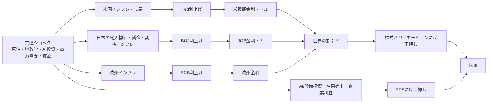
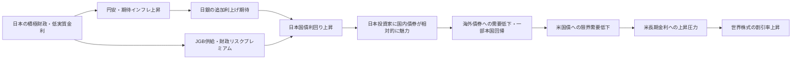
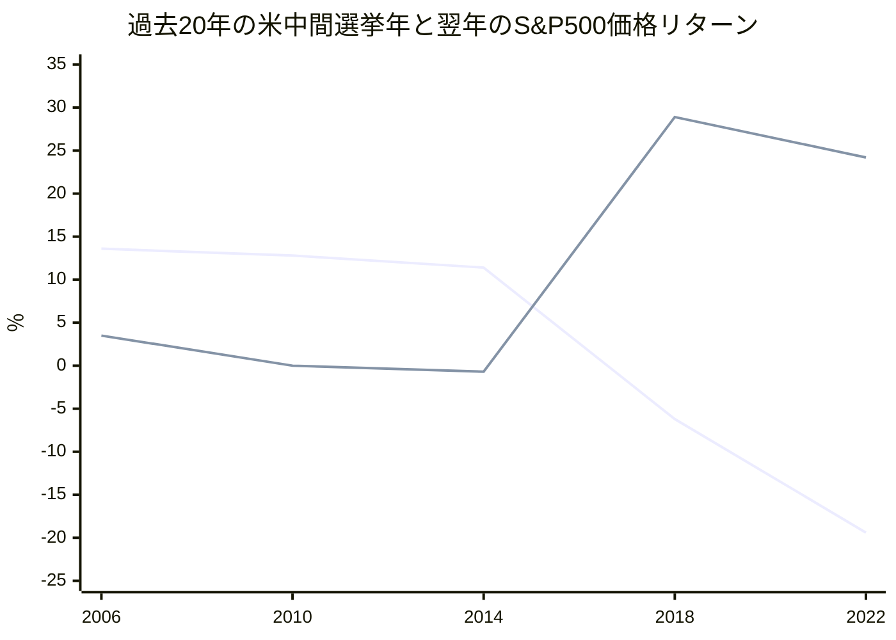
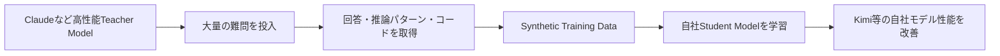

# 日米同時利上げ・株高・円安、米国中間選挙、AI競争、中国Kimi、日銀政策と日本人の資産配分に関する統合投資レポート

## エグゼクティブサマリー

**調査基準日：2026年9月18日。** 本稿では「日米同時利上げ」を、厳密な同日利上げではなく、**日銀とFRBが概ね6か月以内にともに政策金利を引き上げる局面**と定義する。これは1970年代のFedが現在のような明示的な政策金利ターゲットを運用していなかった時期を含め、約50年を一貫した基準で比較するためである。株価リターンは原則として指数の価格リターン、米中間選挙については指定された過去20年、すなわち2006、2010、2014、2018、2022年を中心に分析する。

**結論を先に言えば、現在の「利上げなのに株高」「日米双方が利上げしたのに円安」は矛盾ではない。** 株価は政策金利そのものではなく、最終的には「将来キャッシュフロー÷割引率」で決まる。現在は金利上昇という割引率悪化を、①AI関連を中心とする利益成長、②設備投資、③日本企業の資本効率改善、④円安による日本企業の海外利益押し上げ、⑤金融株など金利上昇の恩恵を受けるセクター、⑥依然として緩和的な日本の実質金利、が上回っている。J.P. Morganは2026年見通しでS&P500利益の今後2年間の伸びを年13～15%程度と想定し、日本についても企業改革、余剰キャッシュの設備投資・賃金・株主還元への転換を株価支持要因としている。BISもAI投資が景気、株価、金融環境を支えている一方、バリュエーション上昇と信用スプレッド縮小をリスクとして指摘している。citeturn5search22turn0search3turn2view2

したがって、**「金利上昇＝即株価クラッシュ」という理解の方がむしろ不正確**である。Goldman Sachsの過去の利上げ局面分析でも、初回利上げ後2～3か月はS&P500が平均・中央値で約4%下落する傾向がある一方、6か月程度で回復し、1年後の中央値は約+9%だったと報じられている。重要なのは「利上げをしたか」ではなく、**利上げによって景気・利益成長を壊すほど実質金融条件が引き締まったか**である。citeturn26news32

2026年9月16日、Fedは政策金利を25bp引き上げ3.75～4.00%としたが、同時に「経済活動は堅調」「国内支出は底堅い」「生産性上昇は力強い」「設備投資は堅調」と評価した。9月18日には日銀も7対2で0.25%ポイント引き上げ、無担保コール翌日物を1.25%程度としたが、それでも日銀自身が**実質金利は低く、金融環境は緩和的**と評価している。つまり、今回の利上げは「景気を叩き壊すための緊縮」というより、**強い名目需要・AI投資・輸入物価・賃金価格転嫁に対する正常化・予防的引き締め**の性格が強い。citeturn3view0turn3view1

さらに重要なのは、**「日米とも利上げなら円高」という機械的な為替モデルは成立しない**ことである。9月18日の日銀利上げ後、円はむしろ約1.2%下落して1ドル=157.84円付近まで売られた。理由は絶対的な金利差が依然大きいこと、Fed側にも追加引き締め観測があること、日銀の2名の反対票と緩やかな将来パスが「想定よりハト派的」と受け取られたことにある。citeturn15news41turn17news34

したがってユーザーの「**日銀は為替を目的に利上げしているのではない**」という仮説は、**概ね正しい**。日銀の公式反応関数は基調的物価・賃金・需給・期待インフレであり、為替目標ではない。ただし、「為替は関係ない」まで言うと誤りで、日銀自身が最近の円安を生産者物価、輸入物価、企業の価格設定を通じて将来CPIを押し上げる要因として明示している。つまり、**円相場は目的変数ではないが、インフレ予測を通じた重要な説明変数**である。citeturn3view1

ユーザーの「**CPIが低下している、設備投資も弱いから本来は利上げ局面ではない**」という見方については、私は**半分賛成、半分反対**である。日銀自身も足元のコアCPIを概ね1.5～2%とし、反対した委員は「コアCPIが2%を下回る」「経済・物価の加速は十分でない」と主張しているため、利上げ反対論には合理性がある。一方、日銀は設備投資を「緩やかな増加基調」、企業収益を高水準、労働需給を引き締まった状態と評価し、2026年度後半には賃金転嫁、原油、半導体・AI需要、円安によりCPIが明確に2%を超えると予測している。したがって、今回の日銀は**現在のCPIではなく6～18か月後のインフレを見て先回りしている**と考えるのが自然である。citeturn3view1turn0search2

AIについてもユーザーの仮説はかなり核心を突いている。ただし「CEO全員がAI開発そのものを止めようとしている」と理解するのは強すぎる。AnthropicのDario AmodeiはフロンティアAIの進歩速度を調整する協調を提案し、OpenAIも2026年8月に**“Pacing model development in an era of cyber-critical capabilities”**を公式発表している。Sam AltmanやElon Muskも安全面でペース調整・外部評価の必要性に賛同したと報じられた。これは「研究停止」より、**危険能力が閾値を超える際のペーシング、評価、ガードレール**に近い。citeturn7search4turn20search8turn10news39

一方で競争は全く止まっていない。OpenAIとNVIDIAは少なくとも10GW規模のAIインフラを計画し、NVIDIAは段階的に最大1000億ドルのOpenAI投資意向を公表している。OpenAI自身も2026年に1100億ドルの新規資金調達を7300億ドルのプレマネー評価額で発表した。AnthropicはAWSに今後10年間で1000億ドル超をコミットし最大5GWを確保し、Google/Broadcomとも複数GWの次世代TPU契約を結んでいる。xAI/SpaceXAIもGrokのAPI、エージェント製品を積極的に展開している。**「安全を訴えながら裏では競争を続けている」という仮説は、かなり強くデータに支持される。** ただし「裏」というより、多くは公式に公表されている巨大投資である。citeturn21search4turn21search20turn21search1turn21search5turn20search10

Kimiについてはもっと慎重であるべきだ。AnthropicはMoonshot AIを含む中国企業がClaudeを大量に利用して**distillation（蒸留）**を行ったと主張している。しかしこれは「Kimiの通常サービスが実はClaudeのAPIを裏で呼んでいる」という意味ではない。より正確には、**Claudeへの大量クエリから高品質な出力・推論パターンを取得し、自社モデルの学習に利用した疑い**である。したがって「Kimi＝Claudeのラッパー」は現在得られる証拠からは立証できない。citeturn12search4

さらに、そこから「中国AIは脅威ではない」と結論づけるのも危険である。2026年の独立研究では、Kimi K2.5はコーディング、マルチモーダル、エージェント能力で閉鎖型フロンティアモデルに匹敵し、GPT-5.2やClaude Opus 4.5と類似したデュアルユース能力を示したと評価されている。仮に蒸留が事実なら、それは中国の独自基礎研究能力の弱さを示す面と同時に、**米国モデルの能力を低コストで急速に吸収して技術差を圧縮できる能力**を示す。投資家の視点では、むしろ後者を軽視すべきではない。citeturn22academia47turn22search23

私の12～18か月の主観確率は、**基本シナリオ55%、強気25%、弱気20%**とする。基本シナリオでは日米株は高値圏で大きく揺れながらも利益成長に沿って上方向、強気ではAI投資の収益化と生産性上昇が金利悪影響を完全に上回る。弱気シナリオでは「AI投資額＞AIから得られるキャッシュフロー」という疑念、長期金利の追加上昇、エネルギー・地政学インフレが同時に顕在化する。BIS自身も現在の株式バリュエーションの高さと圧縮された信用スプレッドを警戒しており、**「今までクラッシュしなかった」ことと「ここから安全」は同義ではない。** citeturn2view2turn0search9

## 前提と現状認識

本稿で特に重要なのは、**政策金利、長期金利、株価、為替は同じ方向に動く必要がない**という点である。それぞれ市場が見ているものが異なる。

株式市場は主として将来EPS、長期割引率、リスクプレミアムを見る。為替市場は政策金利の「変化幅」以上に、日米の金利**水準差・実質金利差・将来のターミナルレート差**を見る。長期債市場は短期政策金利に加えて期待インフレ、財政、国債供給、タームプレミアムを見る。したがって「日銀が0.25%上げた→円高」「Fedが0.25%上げた→株安」と一本線で考えると、現在の市場をほぼ確実に読み違える。BISは2026年の観察期間中、米10年金利が約31bp、日本の長期金利も約27bp上昇した一方、株式のリスク選好は比較的強く、米国では小型株が一時テクノロジーを上回り、米国外株も相対的に堅調だったと報告している。citeturn2view2

2026年9月時点の政策環境を単純化するとこうなる。

| 項目 | 米国 | 日本 | 投資上の意味 |
|---|---:|---:|---|
| 政策金利 | 3.75～4.00% | 約1.25% | **名目差はまだ約2.5～2.75%** |
| 中央銀行の判断 | 成長・国内需要・設備投資は堅調、インフレ高止まり | 緩やかな回復、賃金・価格転嫁、AI・原油・円安を警戒 | 両国とも「不況対応型利下げ」ではない |
| 日本の実質短期金利 | ― | なお低いと日銀が判断 | 日銀利上げ後も金融環境は完全な緊縮ではない |
| 株式 | AI・設備投資・利益成長が中心 | AI/半導体、輸出、銀行、資本効率改革 | 金利上昇の影響がセクターで非対称 |
| 為替 | ドルのキャリー優位 | 円の実質金利は低い | 日銀利上げだけでは円高にならない |

政策金利と日銀の実質金利評価はFed・日銀の直近声明に基づく。citeturn3view0turn3view1

現在のS&P500は9月17日時点で7,637.76付近にあり、高金利環境でも株式市場が高値圏を維持していること自体が、単純な「金利↑＝株価↓」モデルの限界を示している。citeturn25finance0

financeturn25finance0

もう一つ重要な前提は、**2026年の日米欧の利上げを「中央銀行同士が相談して同時に利上げした」と考えないこと**である。より適切なのは、同じ世界経済が①原油・地政学、②AIデータセンター・半導体・電力への巨大需要、③財政刺激、④供給制約、⑤賃金上昇といった共通ショックを受け、それぞれ独立したマンデートのもとで似た反応をしている、という理解である。BISも2026年の世界経済についてAI投資と金融環境が活動を支える一方、インフレ再加速、資産価格、財政リスクを重要な不確実性としている。citeturn0search3turn0search24

その意味で「世界同時利上げ」は**協調政策というより相関した反応関数**である。

この図のポイントは、**同じインフレ要因が「金利を上げる力」と「企業利益を増やす力」の両方になり得る**ことである。株価は両者のネットで決まる。BIS、Fed、BOJ、J.P. Morganの現状認識はこの構造と整合的である。citeturn2view2turn3view0turn3view1turn5search22

## 金利上昇でも株価が上がる理由と日米同時利上げ・円安

**まずマクロ面から見る。**

株価を最も単純化すると、

\[
P \approx \frac{将来キャッシュフロー}{実質金利＋株式リスクプレミアム－利益成長率}
\]

である。

金利が0.25%上がっても、企業利益の期待成長率が例えば10%から15%へ上方修正されれば、金利上昇によるマイナスを上回ることは十分ある。J.P. Morganは2026年見通しでS&P500の利益成長を今後2年間13～15%程度とみており、AIスーパーサイクルによる記録的設備投資と企業収益を重要な背景としている。citeturn5search22

さらに現在の米国では、金利敏感な低収益企業ではなく、巨額の内部資金を持つ大型テクノロジー・半導体・クラウド企業が設備投資を主導している。この種の企業は、高レバレッジの不動産・小型企業より政策金利上昇への耐性が高い。BISもAI関連投資が実体経済と市場センチメントを押し上げたと評価している。citeturn0search9turn2view2

その一方、金利上昇は全セクターに悪いわけではない。銀行は貸出金利上昇や長期的な利ざや正常化から恩恵を受ける余地があり、日本では銀行・保険を含む金融セクターが「脱デフレ・金利正常化」の受益者になる。J.P. Morganも日本について銀行、工業、テクノロジーを選別的に評価している。citeturn5search15

日本株にはさらに**円安という利益バッファー**がある。海外売上・海外利益の大きい輸出企業の場合、現地通貨利益が同じでも円換算EPSが増える。J.P. Morgan Asset Managementは2026年の日本株について、円安、AI関連需要、企業統治改革、堅調な設備投資を株価支持要因として挙げている。citeturn5search29

加えて、日本企業では過去10年以上にわたる資本効率改革により、余剰現金を「ただ持つ」ことから、設備投資、賃上げ、配当、自社株買いへ振り向ける圧力が高まった。このため、現在の日本株上昇を1989年の資産バブルと完全に同一視するのは適切ではない。2024年に日経平均が1989年高値を突破した際も、海外資金、企業利益、AI関連株、円安、企業統治改革が背景として指摘された。citeturn26news51turn5search22

ただし、**バリュエーション面の安全余裕は以前より小さい。** J.P. Morgan Private BankはTOPIXの予想PERを約17倍と歴史的に高い水準と評価しており、BISも世界株の高バリュエーションと圧縮された信用スプレッドを指摘している。したがってここからの上昇には、単なるPER拡大ではなく**EPSの実現**がより重要になる。citeturn5search15turn2view2

**では、なぜ日米同時利上げで円安になったのか。**

第一に、為替が見るのは「双方が利上げした」という符号ではなく、**利上げ後の金利水準差**である。Fedが3.75～4.00%、日銀が1.25%なら、名目短期金利差はなお約2.5～2.75ポイントある。しかも日銀自身が日本の実質金利を低いと評価している。J.P. Morganも2026年の円安の根本要因として、日米実質短期金利差、財政懸念、ポジショニング、海外資産の限定的な本国還流などを挙げている。citeturn3view0turn3view1turn5search15turn5search29

第二に、為替は**将来の政策パス**を取引する。日銀が+25bpでも「これでしばらく止まる」と市場が考え、Fedが+25bpした上でさらに引き締め余地を残したなら、相対的にはドル買い材料となる。9月18日の円安はまさにこの「材料出尽くし＋日銀の将来パスへの失望」で説明でき、2人の反対票も利上げ継続への確信を弱めた。citeturn15news41turn17news34

第三に、日本の経常黒字は必ずしも即時の円買いを意味しない。海外投資から得る所得が海外で再投資されれば、経常黒字が大きくても円への資金還流は限定される。日本の機関投資家にとって米ドル資産の絶対利回りが高ければ、完全に国内へ戻るインセンティブも弱い。この点もJ.P. Morganが円安継続要因として指摘する「限定的なrepatriation」と整合的である。citeturn5search29

第四に、為替介入はトレンド転換ではなく、基本的には**速度調整・投機抑制**の政策である。金利差、実質金利、財政、期待政策パスが変わらなければ、介入だけで数年単位の円相場を固定するのは難しい。J.P. Morganも介入だけで根本トレンドを変えることには限界があると評価している。citeturn5search15

そしてユーザーの「BOJの利上げはFX目的ではない」という命題について、私は次のように評価する。

| 命題 | 判定 | 理由 |
|---|---|---|
| 日銀は円を一定水準に戻すために政策金利を上げている | **概ね否定** | 日銀の公式目的は物価安定 |
| 円安は日銀の意思決定に関係しない | **否定** | 輸入物価・PPI・CPI・期待インフレを通じて影響 |
| 足元CPIだけなら利上げの緊急性は低い | **一定の合理性あり** | 現在のコアCPIは1.5～2%程度、反対票も存在 |
| 設備投資が弱いので利上げできない | **現在の公式データとは不整合** | 日銀は設備投資を「緩やかな増加基調」と評価 |
| 日銀は将来インフレを先回りしている | **支持** | FY2026後半以降の2%超を重視 |

日銀資料では、企業利益は高水準、設備投資は緩やかな増加基調、個人消費は底堅く、労働需給は引き締まっている一方、現在のCPIだけを見れば必ずしも強い過熱とはいえない。この二面性が7対2という決定にも表れている。citeturn3view1

ここでScott Bessentについても訂正しておく。ユーザーの依頼文では「commentatorかもしれない」とされているが、**Scott Bessentは2026年9月現在も米国財務長官である。** 米財務省公式サイトもSecretary Bessentとして掲載している。citeturn23search0

Bessentが日本に対して過度なリフレ的財政・金融政策を修正し、財政規律と金融正常化を促した背景には円安だけでなく、**世界の長期金利への波及**もある。報道によればBessentは日本側に財政支出抑制と金融正常化を促していた。citeturn15news43

メカニズムは次の通りである。

ただしこれは**米長期金利の主因が日本だという意味ではない**。BISは2026年の米長期金利上昇について、期待政策金利だけでなく、タームプレミアムや財政要因を重要な背景としている。日本のJGB利回り上昇・本国回帰は追加的な限界要因と見るべきである。citeturn2view2

## 過去50年の同時引き締めと米国中間選挙

過去約50年で日米が同じ半年程度の範囲で引き締めに向かった主要局面を整理すると、**1979～80年、1989年前後、2006～07年、2026年**が比較しやすい。ただし政策制度が異なるため、完全な同質比較ではない。特に1979～80年のFedはVolcker体制下で準備量を重視する運営へ移行しており、現在の25bp刻みのFFレート目標と単純比較できない。

| 局面 | BOJ | Fed | マクロ背景 | 株式 | USD/JPY・FX | CPI/GDP | 政策ラグ・結果 |
|---|---|---|---|---|---|---|---|
| 1979～80 | 1979/4の4.25%から1980/3の9.00%まで**+475bp**。1978/3の3.50%からなら+550bp | Volcker期、FF金利が急騰 | 第2次石油危機、高インフレ | 米株は途中調整を挟みながらも1979、80年とも年間では上昇 | 円は一方向ではなく大幅変動 | 米インフレ二桁、1980年に米景気後退。日本も輸入インフレ | 実体経済悪化は即時ではなく数四半期遅行 |
| 1989～90 | 2.50%→最終的に6.00%、5回利上げ | 1988～89に引き締め、その後米国は先に緩和へ | 日本の資産価格・信用膨張、米国インフレ警戒 | 日経平均は1989年高値後、1990年に約39%下落。S&P500も1990年は下落 | 円相場より日本国内バブル抑制が中心 | 日本CPIは現在ほど高くないが資産価格が極端 | **株式への破壊力最大の歴史例** |
| 2006～07 | 2006/7にゼロ金利解除し0.25%、2007/2に0.50% | 2006/6まで5.25%へ | 世界景気拡大、信用ブーム、住宅過熱 | S&P500 2006 +13.6%、07 +3.5%。日経 06 +6.9%、07 -11.1% | 円キャリーが続き、即円高にはならず | 日本インフレは非常に低い | 本格的ショックは08年金融危機で顕在化 |
| 2026 | 9月1.25%、7対2 | 9月3.75～4.00% | AI・電力・原油・地政学、賃金、財政 | 日銀利上げ当日に日経平均は約+1.4% | **日銀利上げ後も円は約1.2%下落** | 日銀コア1.5～2%程度だが先行き上振れ予想。米国もインフレ高止まり | 現段階ではまだ観察中 |

BOJの1979～80年の公定歩合は、1979年4月17日4.25%、7月5.25%、11月6.25%、1980年2月7.25%、3月9.00%と引き上げられている。citeturn17search3 1989年には日銀が5月から引き締めを開始し、その後5回の利上げを行ったことを日銀自身が回顧している。citeturn17search10 2006年には量的緩和解除後、7月にゼロ金利政策を解除した。citeturn17search1turn17search13 2026年についてはFed・BOJ双方の公式声明を使用している。citeturn3view0turn3view1

ここから得られる最も重要な教訓は、**利上げ直後の株価と、最終的な景気への影響を混同してはいけない**ことである。

1979～80年では高金利でも株式市場は名目利益成長と高インフレによって耐えた局面があった。一方、1989～90年の日本では、利上げそのものよりも「極端な株価・土地価格＋信用膨張＋レバレッジ」に引き締めがぶつかったため、その後の崩壊が深刻になった。日銀自身も1989年から1990年まで5回引き締め、その後株価が大きく下落した歴史を認識している。citeturn17search10turn17search2

つまり、クラッシュを予測するうえで見るべき順序は、

**政策金利 < 実質金利 < 信用条件 < レバレッジ < 利益成長 < バリュエーション**

である。

現在の最大の1989年との差は、「日本企業全体の土地・株式バブル」というより、**AI・半導体・データセンター周辺に評価と設備投資が集中していること**である。一方で、もしAI投資の経済収益率が予想を大幅に下回れば、その集中自体が現代版の弱点となる。BISは世界の大手テクノロジー企業によるAI設備投資が巨額になっている一方、持続性を重要な金融市場リスクと見ている。citeturn0search6turn0search9

**米国中間選挙については、過去20年の中間選挙年と翌年をまず機械的に比較する。** ここでは日付選択による恣意性を避けるため、中間選挙年の暦年価格リターンと翌暦年価格リターンを比較する。

| 中間選挙 | S&P500・選挙年 | S&P500・翌年 | 日経225・選挙年 | 日経225・翌年 |
|---|---:|---:|---:|---:|
| 2006 | +13.6% | +3.5% | +6.9% | -11.1% |
| 2010 | +12.8% | 0.0% | -3.0% | -17.2% |
| 2014 | +11.4% | -0.7% | +7.1% | +9.1% |
| 2018 | -6.2% | +28.9% | -12.1% | +18.2% |
| 2022 | -19.4% | +24.2% | -9.4% | +28.2% |
| **平均** | **+2.4%** | **+11.2%** | **-2.1%** | **+5.4%** |

S&P500および日経225の年次指数履歴を基に計算。citeturn27search40turn26search42

上図は**第1系列が中間選挙年、第2系列が翌暦年**である。より長い1950年以降の米国データでも、中間選挙後1年間のS&P500平均リターンは約15.4%とされ、選挙前の不確実性が解消すると株価が回復しやすいというパターンが報告されている。ただしこれは因果法則ではなく、金融政策・景気循環と重なっていることに注意が必要である。citeturn26news49

日本株に同じ「中間選挙効果」が存在すると考えるべきではない。日本株は米国株、米金利、ドル円、世界製造業サイクルの影響を強く受けるため、**米中間選挙→米政策・金利→ドル円・世界景気→日本株**という間接経路で考える方が妥当である。

2026年現在、共和党は下院でごく僅かな多数、上院でも多数を持つが、11月の中間選挙では議会支配が変わる余地が大きい。直近の公開情報では下院は共和党218、民主党212に空席等を含む非常に僅差の構図、上院は共和党53議席と報じられている。citeturn26news31

ユーザーが想定する「共和党が負けてねじれ国会」には二種類ある。

**民主党が下院を取り、共和党が上院を維持するケース**では、議会内部そのものがねじれる。大型減税、歳出改革、AI・金融・エネルギー関連の大型法案は通しにくくなる一方、政府閉鎖・予算交渉・債務上限を巡るイベントリスクは増える可能性がある。

**民主党が上下両院を取るケース**でも、共和党の大統領と民主党議会という「divided government」になるため、大型立法はやはり難しくなる。一方、委員会調査や行政監視は強まる可能性が高い。

投資家にとって重要なのは、**ねじれ＝自動的な株安ではない**ことである。立法による大規模な政策変更確率が低くなることを市場が好感することもある。逆に、債務上限・政府閉鎖・財政合意の失敗がテールリスクとなる。長期的には「どの党が勝ったか」より、EPS、景気後退、Fed、実質金利の影響の方が大きいというのが過去データの読み方である。中間選挙後の米株高傾向もこの「不確実性解消」と金融・景気サイクルを切り分けなければならない。citeturn26news31turn26news49

## AIガバナンスと開発競争

まずユーザーの前提を少し修正する。

**「Anthropic、OpenAI、xAIのCEOが全員、AI開発そのものを停止すべきだと言っている」わけではない。**

現在起きているのは、

**開発全面停止**ではなく、

**危険能力が急上昇する局面で、競争各社がある程度歩調を合わせて開発・配備速度を調整し、外部評価を入れるべきだ**

という議論に近い。

AnthropicのDario Amodeiは進歩速度の調整を公に提唱し、Sam Altman、Elon Muskらも安全性の観点から一定のペーシング案に賛意を示したと報じられた。OpenAI自身も2026年8月18日、サイバー領域で重大能力に達するモデル開発をどう「pace」するかについて公式文書を公表している。citeturn7search4turn7search7turn20search8

なぜ競争している企業が同時に「少し遅くしよう」と言うのか。

最大の理由は**競争ゲームの構造**である。

1社だけが安全評価のため6か月止まれば、競合がその6か月で市場、研究者、顧客、計算資源を取る。したがって安全対策が社会全体では合理的でも、各企業には単独で実施するインセンティブが弱い。いわゆる囚人のジレンマに近い。

このためAmodeiが求めるのは、競争法上問題にならない形で安全面について業界が調整できる枠組みである。米司法当局もAI安全についての一定の企業間協議が直ちに反競争的になるわけではないという議論を行っている。citeturn10news39

第二の理由は、**モデルがAI研究そのものを加速し始めたこと**である。Anthropicは2026年8月時点でClaudeが次世代モデルR&D業務の約26%を主導し、人間との協働を含めると約90%のR&Dタスクに関与すると開示したと報じられている。これは完全自律型の「AIが自分自身を勝手に改良」ではないが、AI研究の速度そのものがAIによって上がるフィードバックループが現実化し始めている。citeturn21news45turn22news36

第三に、サイバー攻撃など一部能力は、単なるチャット性能と違って**閾値を超えると社会的外部性が急増する**。2026年9月には米上院情報委員会のMark Warnerも、AIエージェントによる重要インフラ侵害等を懸念し、AI安全ガードレールを急ぐべきだと主張した。citeturn19news40

ここで非常に重要なのがユーザーの観察である。

> 「そこまで危険なら、なぜ設備投資も開発も止めないのか」

答えは、**危険だから止めるインセンティブと、負けたら事業・国家安全保障上不利になるインセンティブが同時に存在するから**である。

実際の投資額を見ると、「AI開発停止」の証拠はほぼ見当たらない。

| 企業 | 公開されている競争継続の証拠 | 投資家としての読み方 |
|---|---|---|
| OpenAI | NVIDIAと少なくとも10GWのAIインフラ構想。NVIDIAは展開に応じ最大1000億ドル投資意向 | 次世代モデルの計算需要を大幅に拡大 |
| OpenAI | 2026年に1100億ドルの新規資金、7300億ドルのプレマネー評価額を発表 | 安全論と同時に超大型資本調達 |
| Anthropic | AWSへ10年間で1000億ドル超、最大5GWの計算容量 | Claudeの学習・推論能力を大幅拡張 |
| Anthropic | Google/Broadcomと複数GWの次世代TPU容量 | Amazon一社依存ではなく計算資源を多元化 |
| xAI/SpaceXAI | Grok API、Grok Bot等を積極的に商用展開 | 製品・エージェント競争を継続 |

OpenAI/NVIDIAについては両社公式発表、AnthropicについてはAnthropic自身の発表に基づく。citeturn21search4turn21search20turn21search1turn21search5turn20search10

つまり、ユーザーの

> 「表では安全を訴えているが、実際には競争を続けているのでは」

という仮説は**支持**する。

ただし「裏で秘密にやっている」というより、**何千億ドル規模で堂々と公開してやっている**と表現する方が正確である。

そしてこれを単なる経営者の偽善と考えるのも単純すぎる。

安全リスクが本物であることと、競争を続けることは両立する。

自動車会社が交通事故を本当に恐れながら自動車開発を続けるのと似ており、AI企業は「危険性がゼロになるまで停止」ではなく、**能力を上げながら安全性を追い付かせる**戦略を採っている。

研究者・安全担当者の退職も軽視はできないが、退職者がいることだけで「破滅確率が高い」と統計的に結論づけることはできない。より重要なのは、AIが実際に研究開発の大きな割合を担い始め、サイバー等のデュアルユース能力が上昇しているという観測データである。citeturn21news45turn19news40

IPOについても修正が必要である。**3社すべてが同じ段階でIPO準備中という証拠はない。** AnthropicについてはIPO準備が進んでいるとの報道がある。一方OpenAIは大型資本調達や将来的な上場議論はあるものの、上場時期については流動的であり、「すでに確定したIPO」と見るべきではない。xAIについても企業再編後の構造を考えると、独立したxAI IPOを前提に投資判断するのは早い。citeturn21news44turn21search20

株式市場への意味としては、私は**「AI安全論が出たから半導体株を売る」という判断には反対**である。

安全論だけでは、NVIDIA、Broadcom、クラウド、電力設備、ネットワーク、半導体製造装置への実需が減った証拠にはならない。むしろ現時点では計算資源契約が増えている。citeturn21search4turn21search1turn21search5

ただし、

**「だからAI関連株の下落は全部無視してよい」**

とも言えない。

最大の投資リスクは安全論そのものではなく、

\[
AI設備投資額 > AIから最終的に生まれるフリーキャッシュフロー
\]

となることである。

Bainの2026年調査では、AIコスト削減を測定した企業の相当数が期待した効果を下回る一方、90%がAI予算をさらに増やすと回答している。これは**設備投資ブームは続くが、ROI検証はこれから**という非常に重要なシグナルである。citeturn26search7

したがってAI株の本当のチェックポイントは、「CEOが危険と言ったか」ではなく、

**GPU利用率、推論単価、企業AI支出、売上成長、AIによる実質コスト削減、データセンター電力制約、減価償却負担、クラウド企業のFCF**

である。

## Kimi・Claude疑惑と中国AI競争力

「中国のKimiが裏でClaudeを使っていた」という話は、表現を正確に分解しなければならない。

確認できる強い一次情報は、**AnthropicがMoonshot AIを含む複数の中国AI企業によるClaudeへの大規模なdistillation attackを公表した**ことである。AnthropicはDeepSeek、Moonshot、MiniMaxなどが多数の不正アカウントなどを用い、Claudeの能力を抽出しようとしたと主張している。citeturn12search4

「蒸留」は概念的には、

という構造である。

これは、

**ユーザー → Kimi → 裏でClaude API → Claudeの回答をそのまま返す**

という「単純なClaudeラッパー」とは別物である。

したがって、現時点の証拠からは、

**「Kimiの通常推論は実はClaudeだった」**

とは断定できない。

言えるのは、

**「MoonshotがClaudeの出力を大量に取得し、自社モデル改善のために利用したとのAnthropicの具体的な告発が存在する」**

までである。citeturn12search4

これは中国AIにとって二つの相反する意味を持つ。

一つ目はユーザーが指摘する通り、**独自のフロンティア技術力について割り引くべき材料**である。

もしモデル性能の一部が米国モデルからの蒸留に強く依存しているなら、「中国企業が同じ研究コストで完全に独自の技術ブレークスルーを達成した」と評価することはできない。

しかし二つ目の方が投資家には重要である。

**蒸留できること自体が、技術差を非常に低コストで縮める手段になる。**

自動車で言えば、エンジンをゼロから発明できないことと、他社の技術を解析・改良して大量生産できないことは全く違う。

独立した2026年のKimi K2.5安全評価では、Kimi K2.5はコーディング、マルチモーダル、エージェント系ベンチマークで閉鎖型モデルに匹敵し、GPT-5.2やClaude Opus 4.5と類似したデュアルユース能力を示したと報告されている。しかも一部危険領域では拒否率が低いという安全上の懸念も指摘された。citeturn22academia47

したがって、

> 「Claudeから蒸留していた → 中国AIは大したことがない」

は論理的には成立しない。

むしろ、

> 「中国側は現時点で米国の最先端研究に依存する部分が存在する可能性がある。しかし模倣・蒸留・低コストモデル・オープンウェイト展開を組み合わせることで、米国の技術的先行を素早く商品化できる」

という方が私のベースケースである。

特に**国家間競争では「世界一のモデルを最初に発明した国」だけが勝つとは限らない。** 製造、電力、データセンター、オープンモデル、アプリケーション、導入コスト、国内市場規模まで含めた総合力で決まる。

これが、OpenAI、Anthropic、xAIが安全上の懸念を本気で持っていても一方的な開発停止を選びにくい最大の理由の一つでもある。

米国側からすれば、

\[
自社だけ停止
\rightarrow
競合が進歩
\rightarrow
中国側が合法・非合法を問わずその能力を吸収
\rightarrow
米国側の技術優位低下
\]

という戦略リスクがある。

したがって今後現実的なのは**全面停止より、「一定能力以上のモデルの外部評価・サイバー/バイオ能力管理・計算資源管理・モデルウェイト保護」を強化しながら研究自体は続行する政策**だと私はみる。OpenAI自身の“pacing”提案も全面停止よりこの考え方に近い。citeturn20search8turn10news39

## 日本の40〜60代以上にバランス型ファンドが合理的な理由

ここは「40歳になったらバランスファンド」という年齢だけの処方箋にしてはいけない。

投資配分を決める変数は年齢より、

**運用期間、退職予定、年金額、住宅ローン、現金保有、取り崩し開始時期、最大許容ドローダウン**

である。

しかし、40代後半～60代の投資初心者については、若年投資家に比べて**大きな株価下落から回復を待てる期間が短くなる**ため、株式100%よりバランス型ファンドが合理的になるケースは確実に増える。

金融庁も資産形成の基本として「長期・積立・分散」の考え方を重視している。citeturn23search1

最大の理由は**シーケンス・オブ・リターンズ・リスク**である。

例えば60歳で退職し、直後に株式市場が-40%になった場合、まだ積立中の30歳とは全く違う。

30歳なら安値で追加購入できる。

60歳で生活費を取り崩している場合、

\[
資産価格下落 + 安値での取り崩し
\]

が同時に起こり、その後市場が回復しても元本回復が難しくなる。

したがって「平均リターンを最大化する」より、

**必要な時期に資産を売らなくても済む確率を上げる**

ことが重要になる。

バランス型ファンドにはもう一つ初心者に大きな利点がある。

**自動リバランス**である。

株式が急騰すれば株を一部売り、債券等を買う。株が急落すれば相対的に増えた債券等を売り、株を買う。この「高いものを売り、安いものを買う」を個人の感情を介さず実行できる。

投資初心者にとって最大の損失原因は必ずしもファンド選びではなく、

**上昇後に買い、暴落後に怖くなって売る**

という行動である。

モデル配分を年齢別に示すなら、私はおおむね次をスタート地点とする。ただしこれは個別助言ではなく教育用モデルである。

| 投資家像 | 株式 | 債券 | REIT等 | 別枠現金 | 狙い |
|---|---:|---:|---:|---:|---|
| 40代・退職まで15年以上 | 60～70% | 20～30% | 5～10% | 生活防衛資金 | 成長重視 |
| 50代・10年前後 | 45～60% | 30～45% | 5～10% | 1～2年分の必要資金 | 成長と防御 |
| 60代・退職直前/直後 | 30～50% | 40～60% | 0～10% | **2～3年程度の取り崩し資金** | シーケンスリスク抑制 |
| 60代でも十分な年金・資産あり | 50%以上も可能 | 個別判断 | 個別判断 | 十分確保 | 長期成長も維持 |

ただし、「債券なら安全」も誤りである。金利上昇時には長期債価格は下落する。現在のような金利正常化局面では、長期債だけに偏らず、短中期債、為替ヘッジ付き外国債券等を組み合わせる方が合理的な場合がある。

初心者が一本で持つ商品例として最も分かりやすいものの一つが**eMAXIS Slim バランス（8資産均等型）**である。国内株、先進国株、新興国株、国内債券、先進国債券、新興国債券、国内REIT、先進国REITを概ね均等配分する構造で、2026年7月31日時点の信託報酬率は年0.143%以内と公表されている。citeturn23search2turn23search5

初心者が比較すべき商品群を整理すると以下のようになる。

| タイプ・商品例 | 配分の特徴 | 向いている層 | 注意点 |
|---|---|---|---|
| **eMAXIS Slim バランス（8資産均等型）** | 8資産を広範囲に分散 | 40～60代で一本化したい初心者 | REIT・新興国も12.5%前後ずつ持つため、思ったより値動きは大きい |
| 4資産均等型インデックスファンド群 | 国内外の株・債券 | REIT不要、より単純にしたい人 | 日本資産比率が高くなりやすい |
| 世界株式＋世界債券50/50型のバランスファンド | 世界全体を50/50程度 | 50～60代で中程度のリスク | 為替ヘッジ有無の確認必須 |
| 債券重視型バランスファンド | 株式20～40%、債券中心 | 退職直前・取り崩し期 | 長期成長率は株式中心より低い |
| 自分で全世界株＋債券ファンドを組む | 配分を自由に変更 | 中級者 | 自分でリバランスが必要 |

具体的なファンドを選ぶ際には、**表面の信託報酬だけでなく、実質コスト、売買手数料、ファンド・オブ・ファンズなら投資先ETF費用、為替ヘッジ、純資産残高、トラッキングエラー、リバランス方式、NISA対象区分**を見るべきである。金融庁も商品販売におけるコストと顧客本位の運営を継続的に重視している。citeturn23search1

特に60歳以上の場合、私は「バランスファンド一本に全財産」より、

\[
生活費2～3年分の現預金
+
低～中リスク資産
+
長期成長用株式
\]

という**バケット型**の考え方をより推奨する。

理由は、暴落時に株式ファンドを売らなくて済むからである。

## 結論・確率シナリオと主要ソース

2026年9月18日時点で、日米株について私が最も重視するのは「中央銀行が何bp動かすか」そのものではなく、

**名目成長率 − 実質金利 − 企業利益成長 − AI投資ROI − リスクプレミアム**

の組み合わせである。

現在は依然として**利益成長が割引率上昇を上回っている**ため株価が崩れていない。しかしBISが指摘する高バリュエーション、圧縮された信用スプレッド、AI設備投資の巨大化を考えると、2024～26年に有効だった「何でもAIなら買われる」局面から、2027年に向けては**誰が本当にFCFを生むか**の選別へ移行する可能性が高い。citeturn2view2turn0search6

私の主観的な12～18か月シナリオは次の通りである。

| シナリオ | 確率 | 金融・景気 | 米国株 | 日本株 | USD/JPY | 主なトリガー |
|---|---:|---|---|---|---|---|
| **基本** | **55%** | 利上げ後も景気後退回避、インフレ徐々に安定 | +5～15%程度の利益主導型上昇余地 | +5～15%、ただし選別色強化 | 150～162中心の高ボラティリティ | AI利益成長、BOJ緩慢正常化 |
| **強気** | **25%** | AI生産性が顕在化、インフレ低下 | +15～25% | +15～25% | 145～155方向も | EPS上方修正、実質金利安定 |
| **弱気** | **20%** | 原油・財政・AI需要でインフレ再燃、長期金利急騰 | -20～30%級も | -15～25%級 | リスクオフなら円高、財政不安なら逆に円安 | AI ROI失望、信用スプレッド拡大、地政学 |

これは統計モデルの機械的予測ではなく、Fed、BOJ、BIS、IMF、J.P. Morganの現状認識を基礎にした投資シナリオである。IMFは日本についてインフレが中期的に目標へ収束する一方、労働市場の引き締まりと賃金、民間投資・消費が景気を支えるとみている。citeturn0search2turn0search11

したがって、最終的な投資判断を一文ずつに圧縮すると以下になる。

**日米株：** 金利上昇だけを理由に全面弱気になる局面ではない。特に利益成長が維持される限り株高継続仮説は合理的。ただしPER拡大ではなくEPS実現が必要で、AI投資ROIが最大のチェックポイント。citeturn5search22turn2view2

**日本株：** 円安、企業改革、AI・半導体、銀行・工業セクターが支援材料。一方、日銀追加利上げとJGB長期金利上昇で今後は銘柄間格差が拡大しやすい。citeturn5search29turn3view1

**円：** 「日銀利上げ＝円高」は危険なモデル。絶対金利差、実質金利差、Fedの将来パス、日本財政、資本還流を見るべき。短期的には150円台が十分維持可能だが、BOJが市場予想以上に連続利上げすればキャリー巻き戻しによる急速な円高もテールではない。citeturn5search15turn15news41

**日銀：** 「FX防衛目的」というユーザー仮説は否定される。むしろユーザーの「FXは主目的ではない」が支持される。ただし円安→輸入物価→CPIという間接経路は重要。現在の利上げは足元CPIより将来の基調インフレに対する予防的政策と理解するのが妥当。citeturn3view1

**米中間選挙：** 共和党敗北・ねじれ議会そのものは株価クラッシュ要因ではない。過去20年の米株ではむしろ選挙翌年の平均リターンが強い。真のリスクは債務上限、政府閉鎖、予算交渉、通商政策などを通じた金利・EPSへの波及である。citeturn26news49turn26news31

**AI：** CEOの安全警告を「AIブーム終了」と読むのは現時点では誤り。巨額のGPU、TPU、データセンター契約は競争継続をはっきり示す。ただし安全リスクも演技とは言い切れず、モデルがモデル開発に利用され始めたこと、サイバー能力が上昇していることからテールリスクは実在する。citeturn21search4turn21search1turn21news45

**中国AI：** KimiがClaudeの単純なラッパーだったという証拠は不足。Claudeを利用した大規模蒸留疑惑は強いが、それを根拠に「中国AIは脅威でない」と判断するのは逆。蒸留によって最先端能力を低コストでコピーできるなら、米国側の技術的リードが短命になるリスクがある。citeturn12search4turn22academia47

**40～60代以上の初心者：** 期待リターン最大化より「暴落時に売らされない」ポートフォリオの方が重要になる。低コスト・分散・自動リバランス型バランスファンドはその意味で合理的だが、年齢だけで一律に選ぶのではなく、退職までの年数と生活費を基準に株式比率を調整すべきである。citeturn23search1turn23search5

主要な一次・準一次資料は以下の通りである。引用欄自体が原資料へのリンクになっている。

| 機関・資料 | 本稿での用途 | 原資料 |
|---|---|---|
| **Bank of Japan** 2026年9月金融政策決定 | 1.25%への利上げ、CPI、設備投資、円安、反対票、実質金利 | citeturn3view1 |
| **Federal Reserve** 2026年9月FOMC | 3.75～4.00%、米景気・設備投資・インフレ判断 | citeturn3view0 |
| **BOJ Historical Rates** | 1979～80年の公定歩合 | citeturn17search3 |
| **BOJ・植田審議委員の歴史回顧** | 1989～90年の5回利上げとバブル | citeturn17search10 |
| **IMF Japan Article IV 2026** | 日本の成長、インフレ、賃金、投資 | citeturn0search2turn0search11 |
| **BIS Annual Economic Report 2026** | AI投資、金融環境、資産価格リスク | citeturn0search3turn0search9 |
| **BIS Quarterly Review 2026/9** | 米日長期金利、株式、信用スプレッド | citeturn2view2 |
| **J.P. Morgan Global Research 2026 Outlook** | 米EPS、AI設備投資、日本企業改革 | citeturn5search22 |
| **J.P. Morgan Private Bank** | 円安、実質金利差、TOPIX評価 | citeturn5search15 |
| **J.P. Morgan Asset Management Japan** | 円安、AI、設備投資、日本株 | citeturn5search29 |
| **Goldman Sachs過去利上げ分析（報道引用）** | 利上げ後のS&P500歴史パターン | citeturn26news32 |
| **U.S. Treasury** | Scott Bessentが現職財務長官であること | citeturn23search0 |
| **OpenAI** | モデル開発ペーシング、安全政策 | citeturn20search8 |
| **OpenAI/NVIDIA** | 10GW AIインフラ・最大1000億ドル投資意向 | citeturn21search4 |
| **OpenAI** | 2026年大型資金調達 | citeturn21search20 |
| **Anthropic/Amazon** | 最大5GW、1000億ドル超AWSコミット | citeturn21search1 |
| **Anthropic/Google/Broadcom** | 次世代TPU複数GW | citeturn21search5 |
| **Anthropic Threat Intelligence** | Moonshot/Kimi等の蒸留疑惑 | citeturn12search4 |
| **独立Kimi K2.5安全評価** | 中国AIの実際の能力比較 | citeturn22academia47 |
| **金融庁** | 長期・積立・分散、顧客本位 | citeturn23search1 |
| **三菱UFJアセットマネジメント** | eMAXIS Slim 8資産均等型・費用 | citeturn23search2turn23search5 |

総合すると、現在のマーケットを理解する最重要ポイントは、**「金利が上がったか」から「なぜ金利が上がったか」へ分析軸を移すこと**である。景気崩壊を止めるためではなく、AI投資・賃金・名目需要・供給制約が強いから利上げしている局面では、利益成長が続く限り株式は上昇できる。しかし利益成長が止まった瞬間、現在の高いバリュエーションと長期金利は一転して大きな下落増幅装置になる。そのため、**2026～27年の最大の分岐点は中央銀行会合そのものではなく、AI設備投資が実際の生産性・売上・FCFに変換されるかどうか**だと判断する。citeturn5search22turn2view2turn26search7